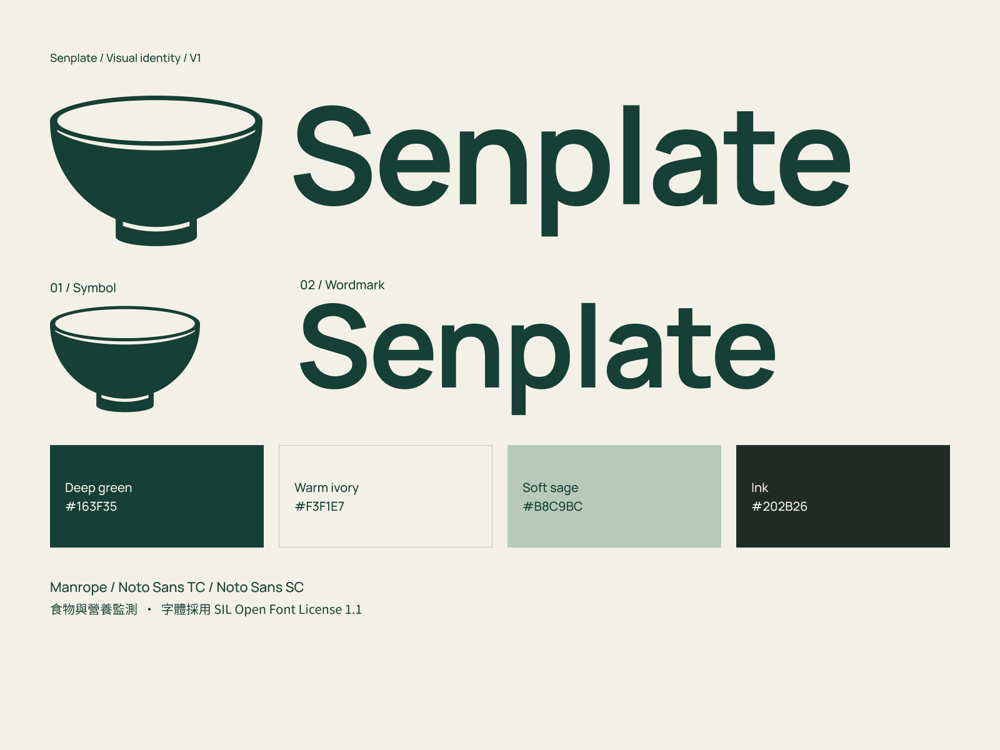

# Senplate 品牌规范 · VI V1 / 纯碗V7

**HISTORICAL — 2026-09-25：**用户已推翻食物监测 FYP。此 VI 是旧 Senplate 方案的保留资产，不是新桌面助理的品牌、Logo 或配色规范；新题目尚未命名。[当前项目规范](../../product.md)。

更新：2026-09-19。状态：**V7_PLAIN_BOWL_SELECTED — VI_V1_DELIVERED — SIMILAR_FIGURES_FOUND**。

主标志仍为用户已选[V7纯碗](planning/2026-09-18/senplate-plain-bowl-v7.md)。用户现要求独立图形、独立字标、整套VI与字体商用核查，并澄清不是原生.ai文件。本次[VI V1](planning/2026-09-18/senplate-vi-v1.md)已交付；旧源稿和导出保留，全部刻度探索停用。

## 当前商标初筛

已完成[2026-09-18纯碗与名称初筛](research/2026-09-18-senplate-trademark/trademark-review.md)。香港官方图像结果中，BASAO的碗口／实心碗身／底脚值得重点比较；OpenRice图形另覆盖点餐与餐厅管理App。新发现历史同名Senplate iOS原型，未核为有效注册；美国本次三个拼写查询均无结果。图形相似、业务相关与法律冲突分别记录，全球清查和香港文字刷新仍未完成。

[原始图样对照](research/2026-09-18-senplate-trademark/comparison.html)已保存。用户选择仍为V7，本次没有授权新设计，也未自动撤销选稿；现有VI与字体许可保持。商业使用前需进一步评估辨识与目标地区权利，黄金比例不能代替商标差异。

## 当前形态与字标

完整椭圆碗口、实体碗身和底脚；保留碗口及底脚分界留白。没有内外刻度、划痕或阶梯量位缺口。符号直接复用无刻度纯碗路径，边缘为矢量曲线。

品牌、字标及iOS显示名均写**Senplate**。字标沿用Manrope Bold，原字距、轮廓和图文间距保持；Figma保留原可编辑文字，交付Logo SVG的字标转轮廓。配色沿用深绿#163F35与米白#F3F1E7，中文名与口号仍未确定。

## 比例依据

V7沿用V6的主要构造尺寸：口宽320，碗身高197.770876（不含底脚），脚宽122.229124，口沿椭圆高75.541753，图文间距46.687371，脚伸出28.854382。这组构造相邻尺寸约为黄金比例φ；完整符号高度226.625，不能误作不含底脚的碗身高。

[V6历史构造与测量](planning/2026-09-17/senplate-bowl-golden-v6.md)是尺寸依据。本轮验证纯碗路径、字标和组合参数复用，不把旧稿的全部曲线测量报告当作V7新测结果，也不以黄金比例代替审美。

## VI V1 当前交付

- [完整素材包](output/brand/Senplate_VI_Kit_v1.zip)／[11页规范](output/pdf/Senplate_VI_Guidelines_v1.pdf)／[4页矢量总表](output/pdf/Senplate_Vector_Assets_Master_v1.pdf)。
- [独立图形SVG](output/brand/2026-09-18-senplate-vi-v1/01_Logos/SVG/symbol-green.svg)／[独立字标SVG](output/brand/2026-09-18-senplate-vi-v1/01_Logos/SVG/wordmark-green.svg)。每种形式另有黑色、反白及透明PNG。
- 横向组合保持原路径／间距；新增上下组合使用同一矢量，图形宽320、字标宽640、间距40源单位。
- App图标主／浅色版与未裁切前景／背景、演示封面、菜单立牌、设备标贴；菜单QR是占位，图标不是已经接入的App工程。
- [Figma VI源稿](https://www.figma.com/design/UyYjnTFGWO0r1lj4uvghGp?node-id=110-2)，页110:2，总览114:2，可编辑字标111:18。

## 字体、配色与使用规则

Manrope Bold700保持为字标；VI英文使用Manrope，繁／简中文分别用Noto Sans TC／SC。三种当前字体及历史标注字体Inter均已确认OFL1.1，可免费商用，原件和许可附包。[字体核查](research/2026-09-18-font-licences/font-licence-audit.md)。生产SVG转轮廓，可编辑文字SVG另存。

深绿#163F35与米白#F3F1E7保持；新增辅助浅绿#B8C9BC、墨色#202B26用于VI排版。组合／图形留白至少为图形宽度1/8；纯字标为可见字高1/4。尺寸和字体层级为VI建议，实际介质按手册核对，CMYK只是无ICC换算参考。详细规则以规范PDF和[设计令牌](output/brand/2026-09-18-senplate-vi-v1/03_Tokens/senplate-tokens.json)为准。

## V7原始核心文件（保留）

- [核心素材包](output/brand/Senplate_Plain_Bowl_v7.zip)
- [完整Logo SVG](output/brand/2026-09-18-senplate-plain-bowl-v7/senplate-logo.svg)／[透明PNG](output/brand/2026-09-18-senplate-plain-bowl-v7/senplate-logo.png)
- [纯碗SVG](output/brand/2026-09-18-senplate-plain-bowl-v7/senplate-symbol.svg)／[透明PNG](output/brand/2026-09-18-senplate-plain-bowl-v7/senplate-symbol.png)
- [预览](output/brand/2026-09-18-senplate-plain-bowl-v7/senplate-preview.png)／[64px样本](output/brand/2026-09-18-senplate-plain-bowl-v7/senplate-symbol-64.png)
- [素材说明](output/brand/2026-09-18-senplate-plain-bowl-v7/README.md)／[清单](output/brand/2026-09-18-senplate-plain-bowl-v7/manifest.json)／[既有字体许可副本](output/brand/2026-09-18-senplate-plain-bowl-v7/Manrope-OFL.txt)
- [Figma当前Logo](https://www.figma.com/design/UyYjnTFGWO0r1lj4uvghGp?node-id=106-13)：页面76:2；源106:2／布尔106:3，符号106:8，组合106:9，预览106:13。

已查看完整预览及64px；[本轮QA](output/qa/senplate-plain-bowl-v7-2026-09-18/closeout-validation.json)包含旧版保护、纯碗路径、字标与组合核对。PNG超出原生尺寸仍有像素，放大和加工使用SVG。

## 历史关系与后续

- [V6阶梯口沿](planning/2026-09-17/senplate-bowl-golden-v6.md)：由原保留基准转为历史构造来源。
- [V6.1碗壁刻线](planning/2026-09-17/senplate-v6-tick-study.md)、[V6.2微刻度](planning/2026-09-18/senplate-v6-rim-tick-study.md)、[V6.3清晰量位线](planning/2026-09-18/senplate-v6-visible-ticks.md)、[V6.4弧线](planning/2026-09-18/senplate-v6-curved-ticks.md)、[V6.5内壁刻度](planning/2026-09-18/senplate-v6-inner-scale.md)：全部停止作为当前候选，原文件及原QA保留其当时记录。
- 更早A／环形路线仍停用。

V7主标和VI V1已交付，VI制作阶段53个旧Figma节点及原文件保持；两份PDF共15页已查看。[VI QA](output/qa/senplate-vi-v1-2026-09-18/closeout-validation.json)。新增商标初筛见上文，未修改Figma或素材。用户已授权开始应用开发，P0沿用V7与VI；不恢复刻度探索、不自动重画。所有应用默认英文，支持简体中文；中文使用包内Noto Sans SC，TC仍保留在原VI历史资产中。当前实现与截图见[P0记录](planning/2026-09-18/development-p0.md)。
