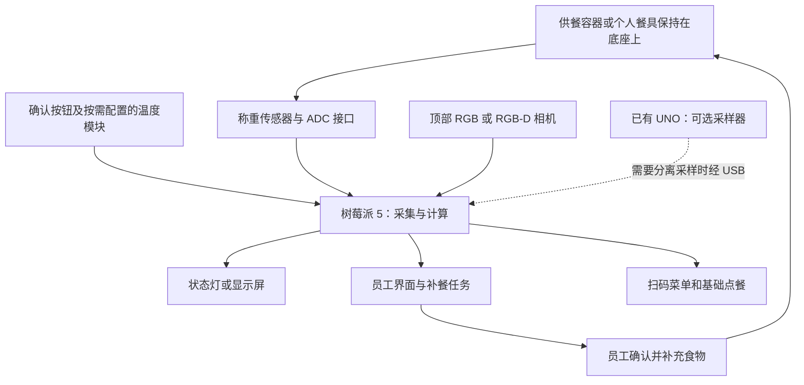

# Group 2 持续监测架构与计算硬件选择

**2026-09-21相机建议更新：**按Marco反馈，先验证普通RGB＋称重＋固定照明；Gemini2／RGB-D只作为有明确任务增益的可选增强。下文较早的Gemini2首购及对应供电是历史候选，待选型后同步配线与负载。持续原位监测、一个独立盘位及Pi单机优先不变。[混合菜营养与选型复核](../2026-09-21/marco-camera-and-nutrition-review.md)。

当前共用硬件要求是食物在监测期间留在底座上，连续记录有效数量和状态。首版工程基线为一套设备、一个独立称重盘位，轮流演示供餐、学校和个人配置；多个称重元件可以组成同一个平台，但不会自动给出各食物的独立重量。供餐盘、学校示范餐和个人餐具在共同载荷、尺寸及精度范围内共用采集核心，按容器校准；各场景反馈及营养数据规则见[多场景 V2](multi-scenario-suggestion-v2.md)和[单盘位与识别可靠性](single-station-recognition-reliability.md)。Metafoodx 的底座、立柱、感测头和屏幕继续作为外形参考，共享扫描站不是主架构。

现有硬件为一块 Arduino UNO R4 WiFi，但它不是必要组件。当前建议优先验证 Raspberry Pi 5 单机：通过称重 ADC 和兼容数字接口连接传感器、相机与提示设备，并运行采集、视觉、预测和后台。已有电脑用于开发和训练，UNO 可在调试或确需分离采样时使用；更重的视觉任务再评估加速器或其他主机。

2026-09-15采购细化：训练机为现有M2 Pro／16GB MacBook，部署主机按Pi 5 8GB规划；相机首购候选Gemini2，称重为NAU7802＋10kg四线全桥直梁，工作毛重先限制在5kg以内。官方7英寸Touch Display2、线材、结构及工具详见[采购说明](../2026-09-15/procurement-guide.md)。所有选型尚未在本项目实测，V1/V2文档原样保留。

同日扩展澄清：十盘位场景可研究独立称重路径、分区共用相机和共享主机／屏幕，无需默认十套完整装置；不增加首版设备数量。原采购表的Pi与灯分别使用适配器，单根低压线入机需新的供电转换与分配设计。具体候选、视野计算和成本假设见[相机、统一供电与扩展](../2026-09-15/camera-power-and-scaling.md)，尚非可直接上电的接线单或十盘位采购定稿。

当前单机供电候选已细化：12V5A外置适配器分为亚博Pi5 PD板和ORICO独立供电USB3 Hub两支路；Pi侧保留屏幕／ADC／风扇，相机和两条小灯改接Hub。USB数据仍经Hub进入同一Pi，采集／持续监测语义不变。具体器件、低压线径和待核接口见[供电专项](../2026-09-15/power-supply-detail.md)。多个器件仍组成一台demo，不增加盘位；尚未上电验证。

2026-09-16软件先行：用户确认只做iPhone，App内个人／顾客及授权工作角色，厨房／管理保留Web，设备屏单独运行；见[App与共享后台讨论稿](../2026-09-16/software-scope-and-architecture.md)。采集核心不因App原生化而搬到手机，Pi持续测量，App读取并执行授权操作。模拟器／回放／真实适配器共用格式，先在Mac模拟后台接iPhone界面，具体Pi驱动与性能到货后验证。

## 1. 硬件类别怎样理解

| 硬件 | 本质 | 擅长的工作 | 本项目中的位置 |
|---|---|---|---|
| 已有 UNO R4 WiFi | 微控制器开发板，运行控制程序 | 读传感器、校准、滤波、判断稳定、计时、按钮和灯、发送小数据包 | 可选采样／调试备选 |
| Raspberry Pi 5 | 可运行 Linux 的单板电脑 | Python、相机 SDK、OpenCV、轻量模型推理、数据库和网页服务 | 优先验证的单机采集与计算方案 |
| 已有笔记本／台式机 | 完整电脑 | 相同后台与视觉程序、训练和调试；具体能力依配置 | 初期最合适的开发主机，节省新增支出 |
| x86 小型电脑 | 紧凑型完整电脑 | Windows／Linux 软件、USB 相机、存储和后台 | 若相机 SDK 或整体成本更适合，可替代树莓派 |
| ESP32-S3 独立开发板 | 带无线功能的微控制器 | 分布式采集与控制，部分小模型 | 后续多个餐位的候选节点；已有 UNO 的首版无需因此换板 |
| Jetson Orin Nano Super | 带 NVIDIA GPU 的嵌入式计算机 | 适配 CUDA／TensorRT 的较重视觉和 AI 推理 | 多路或更重视觉的升级候选，初版不预设必须购买 |

这里比较的是具体的 UNO R4 与 Raspberry Pi 5。Arduino 是一个平台／品牌，并非其所有产品都是同一类别；Raspberry Pi Pico 也属于微控制器，不能把便宜的 Pico 当成 Pi 5 的替代电脑。

UNO R4 WiFi 的主 MCU 是 Renesas RA4M1，48 MHz、32 kB SRAM、256 kB Flash；板上的 ESP32-S3 承担无线连接等职责，也有单独编程方式。它们不是一块可随意合并内存、直接运行桌面视觉程序的电脑。[Arduino 官方规格](https://docs.arduino.cc/hardware/uno-r4-wifi/)

一幅 640×480 的原始 RGB 图像需要 640×480×3＝921,600 字节，约 0.92 MB，已明显大于主 MCU 的 32 kB SRAM。微控制器可以采用流式、压缩或小模型做有限任务，但 UNO R4 不适合承担本项目常规 RGB-D 图像、菜品识别和网页后台的主要计算。

Pi 5 使用四核 2.4 GHz Cortex-A76，提供 GB 级内存、USB 3、相机接口和存储，适合尝试一台相机、有限菜品、低频轻量推理的原型。是否能满足最终时延，需要在选定相机和模型上实测；8GB 相比 4GB 主要增加内存容量，不会自动使同一个模型推理速度翻倍。[Raspberry Pi 5 官方规格](https://www.raspberrypi.com/products/raspberry-pi-5/)

## 2. 一个持续监测餐位的结构

在供餐模式中，厨师将餐盘放入监测位置后即保持原位供餐。底座测量重量，上方摄像头观察同一个餐位，温度功能若启用则按选定传感器记录相应区域的温度。计算主机可以藏在台侧或独立机盒内；整机外观看起来仍然可以是一台设备。初版不默认增加温度探针、第二视角或独立分格秤。

树莓派可以直接处理完整流程：称重模块输出数字读数，相机直连，温度通过兼容 I2C／其他数字接口接入；Pi 保存历史、执行视觉和预测、对账厨房任务并控制提示。原始称重传感器仍需要 ADC／放大转换模块，不能直接接普通 GPIO 当模拟输入。

NAU7802 是可研究的 I2C 称重 ADC，厂商教程给出 Raspberry Pi＋Python 的接线与示例。多个模块地址相同，需要合适的总线或复用安排；HX711 也是候选，但具体 Pi 5 驱动和读取时序要在视觉负载下验证。[NAU7802 的 Pi/Python 接入](https://learn.adafruit.com/adafruit-nau7802-24-bit-adc-stemma-qt-qwiic/python-circuitpython)、[模块接口说明](https://learn.adafruit.com/adafruit-nau7802-24-bit-adc-stemma-qt-qwiic?view=all)

如果使用 MLX90640 这类温度阵列，优先在 Pi 端处理热图。可选 UNO 若启用，需要另外核算库和缓冲对 32 kB 内存的需求，视频仍直接接主机。

Pi 接线使用匹配的 3.3 V 逻辑。可选 UNO 若启用，优先通过 USB 串口连接；UNO 主 GPIO 为 5 V，不能将其 5 V 信号直接接到 Pi 输入。UNO 的 Qwiic 是独立的 3.3 V I2C 接口，使用 Wire1，需与普通 Wire 总线区分。[Arduino 规格](https://docs.arduino.cc/hardware/uno-r4-wifi/)、[UNO 官方数据表](https://docs.arduino.cc/resources/datasheets/ABX00087-datasheet.pdf)、[Pi GPIO 文档](https://www.raspberrypi.com/documentation/computers/raspberry-pi.html#gpio-and-the-40-pin-header)

## 3. 持续监测需要持续维护状态

放盘后先等待稳定，再建立餐位、菜品和批次关联；菜品由登记菜单或批次记录确认，视觉给出候选及疑似变化提示。之后长期跟踪同一餐位，不需要工作人员反复把菜搬去另一处扫描。不能把俯视覆盖整盘等同于识别隐藏配料；RGB-D 也不能直接测得成分或核心温度。

| 现场情况 | 需要识别的状态 | 系统反馈 |
|---|---|---|
| 顾客正常取餐 | 稳定重量下降 | 更新有效余量和取用趋势 |
| 手按住餐盘、夹取时晃动 | 短时读数不稳定或遮挡 | 保留上一有效值并标注正在更新，避免生成错误补餐建议 |
| 同盘加菜 | 增加了食物 | 记录补充量并更新供应；有保鲜计时功能时不能把旧食物年龄全部清零 |
| 整盘拿走 | 餐盘离位 | 标记离位，不当作顾客瞬间吃光 |
| 换成另一盘／另一种菜 | 批次或菜品变化 | 重新建立关联和去皮依据 |
| 网络或相机中断 | 数据失效或部分来源缺失 | 显示更新时间／不确定状态；Pi 故障或掉电时不能声称监测仍正常 |

重量下降是餐盘内容变化，不天然等于实际入口食量。勺子被拿走、食物转移和水分变化都可能影响读数。余量模型应排除明显异常，避免把每一个负变化都当作新的顾客需求。

机械设计要保证餐盘载荷经过称重结构。若餐盘边沿被保温台或支架托住，部分重量会绕过传感器；即使代码正确，读数也会错。长期热负载、偏载、蒸汽、液滴、清洁和镜头遮挡也都需要台架验证。计算板应与高温、潮湿的食品区域隔开，并保留散热空间。

## 4. 实时性与计算负载

持续监测的含义是：设备在整个供餐过程保持工作，并及时更新有效状态。采样、图像采集、运行模型和显示更新可以使用不同频率。下面只是初版实验设置，不是已经测得的性能承诺：

| 任务 | 初版可测试的设置 | 目的 |
|---|---|---|
| 原始重量采集 | 约 10 次／秒 | 判断放盘、取餐、波动和稳定读数 |
| 有效余量和界面更新 | 约 1 秒一次，有变化时更新 | 保持人员可见状态及时且稳定 |
| 视觉推理 | 从每秒约 1–2 次开始；换盘等事件可触发额外分析 | 辅助菜品、遮挡和内容变化判断 |
| 补餐预测 | 约每 10–30 秒及关键事件时重算 | 匹配分钟级制作提前量，避免重复任务 |

HX711 常见开发板支持 10 或 80 SPS，但有效稳定读数还受结构、滤波和干扰影响。[HX711 产品规格](https://www.sparkfun.com/sparkfun-load-cell-amplifier-hx711.html)

模型线程不能阻塞称重采集和设备心跳。主机处理不过来时应丢弃过旧图像，处理最新帧，不能让模型排队几十秒后还把输出显示为实时。原型要记录从物理变化、确认有效数据到界面更新的端到端延迟。

菜品模型优先在现有Mac进行迁移学习，Pi加载导出模型完成推理；当前主候选为PyTorch＋MobileNetV3-Large IMAGENET1K_V2＋ONNX Runtime CPU，Small作对照。训练、导出、推理和数据回流尚未执行。普通RGB模型不会因接入RGB-D相机就自动利用深度，需显式加入几何处理或对应输入。详见[AI训练与Pi部署](ai-training-and-pi-deployment.md)。

RGB-D 初版优先把深度用于经标定的盘位／高度／表观体积及有效性处理，再与 RGB 特征通过小分类层融合；RGB-D 直接输入另作必要时的实验。成对数据需时间对应、空间对齐、单位一致并处理缺失深度。相机 SDK 与几何处理也消耗主机资源，不能只测神经网络一次推理就确认整机容量。

重量与温度的数字处理通常很轻，单路相机的有限菜品识别和点云处理更容易成为主机负载。先测试 RGB 基线和选定深度功能，避免将每秒录像帧数直接等同于需要每秒运行复杂模型的次数。

## 5. 推荐的选型顺序

**当前开发准备阶段：复用Mac，先定义接口并用模拟／回放贯通软件流程。** 一个持续监测餐位的有效状态、界面、建议和任务可以先开发；Pi到位后再接真实采集，模型训练依照有标签数据和验证条件开展。已有UNO可按需作为临时采样器，但不是软件启动或最终装置的必需组件。

在完成全部菜品训练前，用候选相机和借用／可用的 Pi 尽早核对 SDK、采集、预训练模型推理及持续称重的共存情况，再用最终模型复验。占位输出只能检查接口，不能证明模型性能；台式机速度也不能充当 Pi 实测。若遇瓶颈，按采集、对齐、几何、推理或服务分段定位后决定优化／加速／换主机。

**独立展示阶段：按Pi 5 8GB验证单机。**这是本轮采购目标，不表示已购或已通过整机性能测试。单相机、轻量模型和适度更新频率先跑通；内存留给相机／后台缓冲，不把8GB当成CPU自动提速。小型电脑仍可作为实际瓶颈出现后的比较对象，不由外观直接决定。

**需要更高视觉吞吐时：再比较 AI HAT 或 Jetson。** Pi AI HAT 提供 Hailo 推理加速，但只能加速适配的模型，不会自动加速称重、数据库、所有深度算法和任意 Python 程序。Jetson 提供 NVIDIA GPU 和相应软件生态，适合更重的视觉推理；额外功耗、散热和部署复杂度要与需求匹配。[Pi AI HAT 文档](https://www.raspberrypi.com/documentation/accessories/ai-hat-plus.html)、[Jetson Orin Nano Super 官方规格](https://www.nvidia.com/en-us/autonomous-machines/embedded-systems/jetson-orin/nano-super-developer-kit/)

单机方案让采样、视觉和后台分别运行，避免互相阻塞。若实测采样时序、驱动或多餐位负载不满足要求，再增加已有 UNO／数字采样接口或更换计算主机；不能在尚未测试时预设双板是必需的。

首版只要求一个完整餐位；扩展到 2–3 个不再作为默认交付。未来若同时跟踪多盘各自余量，才需独立称重通道；相邻通道可研究共用 Pi，分布采集可研究独立节点。共用一个总重平台不能唯一还原各盘重量。通道扩展须核对受力结构、数字接口、相机视野和实测负载，不预设每盘一台树莓派。

十路称重不等于十路图像负载。按区域共用RGB-D时，要分别核算USB实际采集带宽、解码／对齐、推理、服务和供电；降低推理频率不会自动降低采集帧率。不能承诺Pi5能跑4–5路完整RGB-D；可按瓶颈比较分区Pi和USB接口合适的小主机。米级餐线用本地ADC／采集后传数字状态，不能直接把十块同地址NAU7802挂到长I2C线上。

## 6. 当前价格与待定项

2026-09-14 核对的 Raspberry Pi 5 官方产品简报（2026 年 4 月版，第 3 页）列 4GB 为 US$110、8GB 为 US$175，按预算假设 7.8 粗算约 HK$858／HK$1,365，均为裸板参考价。还要计电源、散热、存储和外壳，不能直接沿用旧上市价格作完整预算。[官方产品简报](https://pip-assets.raspberrypi.com/categories/892-raspberry-pi-5/documents/RP-008348-DS-4-raspberry-pi-5-product-brief.pdf)

此前按“一台共享扫描站＋两个节点”估算的整套预算不再是当前方案预算。仍可复用其元件价格研究，但应按持续监测餐位数、已有 UNO、主机是否复用以及镜头安排重新核算。现阶段未采购、未运行硬件实验、未确定最终主机；Pi 5 的建议是候选工程路线，不是已验证性能。

40／30／30 主责比例继续保留。硬件成员主责为单盘位持续称重结构、Pi 采集服务、校准和事件识别，可选固件仅在实际需要时实现；组长负责主机上的数据、视觉／预测、营养估算与业务一致性；前端成员负责员工与顾客界面。现有 V2 suggestion 已完成并保留，但多盘位文字尚未同步本轮澄清；当前工程说明以 product.md 及单盘位可靠性说明为准。已与 Marco 讨论原方向，修订范围仍供审阅，硬件验证待后续工作。
