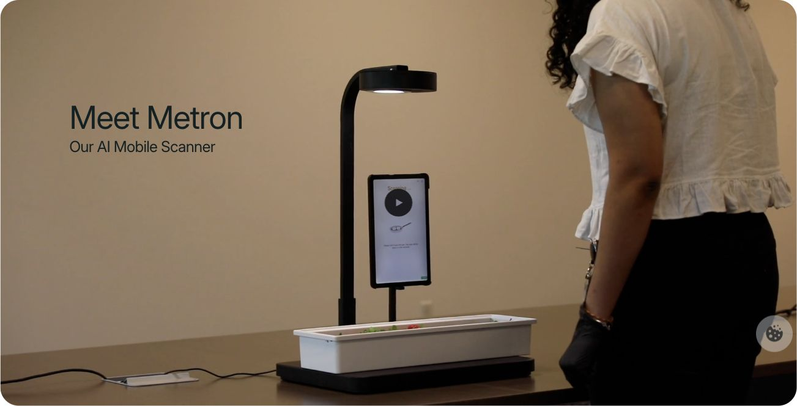

# 食物持续监测设备硬件制作询价

Group 2　简化版 V3　2026年9月16日　数量 1 台

## 1 项目与制作范围

我们正在开发一台用于学生项目演示的桌面食物监测设备。以自助餐为主要场景：工作人员把餐盆放上设备，餐盆保持原位供餐；底座持续称重，顶部相机观察食物变化，后续由我方软件显示余量并提供补餐建议。同一台设备也会用于学校配餐和个人餐食记录演示。

**本次希望贵司交付一台外形完整、部件已安装、内部接线已集成的硬件样机。**整个项目只做一个独立称重位置，食物在设备上持续被监测，无需每次取餐后搬去另一个位置扫描。

**贵司负责：**电子部件配套、底座／立柱／外壳等结构制作、部件固定、内部配电及全部接线装配。

**我方负责：**系统安装、驱动与采集程序、称重校准、AI模型、后台及网页、软件调试和性能测试；这些工作无需贵司开发或提供报告。

## 2 希望做成的样子

整体参考Metafoodx：**低矮底座＋后侧立柱或弧形臂＋朝下的相机头＋侧面竖向触摸屏**。外部走线整洁，看起来是一台完整设备。

图1　外观参考，来源：[Metafoodx产品页](https://www.metafoodx.com/product)，截图日期2026年9月15日。只参考整机布局，不要求复制其软件。

**尺寸参考：**底座约450×400mm，称重承载面约350×250mm；可放325×176×65mm餐盆或约24cm餐盘。相机距承载面约450–600mm，可调整并锁紧。请根据实际部件安排紧凑、稳固的结构，制作前确认外形和尺寸即可。

<!-- pagebreak -->

## 3 主要硬件配置

优先采用现成模块集成。下列为报价参考配置；若有更合适或更容易配套的型号，请说明替代方案后再确定。

| 部件 | 配置与装配要求 |
|---|---|
| 主机 | Raspberry Pi 5 8GB ×1，配主动散热器和128GB microSD卡，安装在机内可维护的位置。 |
| 顶部相机 | Orbbec Gemini 2完整RGB-D相机 ×1；镜头朝下对准餐盆，使用原厂固定孔安装，保留RGB和深度数据接口。 |
| 称重组件 | 适配上述承载面尺寸的10kg单点式全桥传感器＋NAU7802称重ADC，各1套；计划工作毛重≤5kg，包含托板、容器和食物；Pi侧数字接口兼容3.3V。 |
| 触摸屏 | 约7寸电容触摸屏 ×1，竖向安装。参考官方Touch Display2；也可建议亚博7寸IPS屏，并配齐相应显示、触摸和供电线。 |
| 照明与操作件 | 相机附近设置固定白光补光，总功率参考≤5W；保留确认／去皮按钮各1只、红黄绿小型状态灯各1路及所需接线。 |
| 统一供电 | 一只外置成品适配器、一根低压线入机。参考12V 5A，内部配Pi5专用5V／5A供电板及独立供电USB3 Hub，为主机、相机、屏幕和灯配电。 |
| 线材与连接 | 配齐并接好全部线材：相机USB-A至C的USB3数据线；Pi短C-C 5A供电线；屏幕所需DSI或HDMI／USB线；称重、按钮和灯接线。接口、电压与极性须匹配。 |
| 整机结构 | 底座、浮动称重托板、防滑垫、立柱／弧形臂、相机罩、屏幕支架、电子件外壳，以及全部固定件和线束收纳。 |

## 4 必要的集成要求

- **称重受力分开：**相机、屏幕和立柱固定在静止机架；餐盆重量经过称重传感器。浮动托板不碰外壳，线束不牵拉托板。
- **单线供电：**外置适配器使用香港适用的英规电源插头；机内有低压总开关、保护及可靠固定。USB Hub不能向Pi反向供电。
- **可维护、便于清洁：**外壳圆角、内部留散热空间，餐盆可取走清洗；相机镜头／红外窗口不被罩壳遮挡，电子件避免接触食物和清洁用水。
- **方便我们后续开发：**保留模块原厂接口，提供实际部件型号和简明接线对应即可；系统、程序和校准由我方自行处理。

## 5 请回复的内容

1. 能否按上述方向制作并集成**1台整机**。
2. **整机报价和预计制作周期**；价格简单区分“电子部件”和“结构制作／装配”即可。
3. 如需调整相机、屏幕、称重或供电型号，请一并说明建议与原因。
