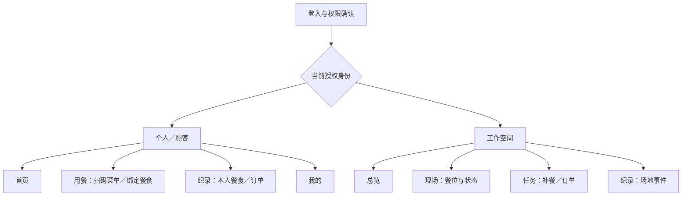

# Group 2 iPhone页面、操作流程与权限规格 V1

更新：2026-09-19。状态：M1_2_LOCAL_PROTOTYPE_VERIFIED。P0补餐、M1.1菜单／订单与M1.2个人餐食／学校匿名样本已在本地实现并分阶段验证；默认英文，可切简体中文且保存选择。当前交付见[餐食样本契约](../2026-09-19/meals-samples-contract.md)与[本批QA](../../output/qa/development-m1-2-meals-2026-09-19/verification.md)，原[菜单订单契约](../2026-09-19/menu-orders-contract.md)继续适用。本文中的完整管理、配方、审核计划和实物模型规格仍有后续工作，不能据表格推断全部交付。

配套：[状态与接口](software-workflows-and-api.md)、[开发批次与验收](software-mvp-and-acceptance.md)。P0为第一条可运行补餐链，P1补齐首版顾客／个人／学校功能，P2为本期暂不实现的扩展；不是把P0等同于完整FYP。

## 1 导航、登录和身份

实际界面采用默认英文／可切换简体中文。M1.1个人模式已采用四底栏：**首页 Home、用餐 Dining、记录 Records、我的 Profile**；工作模式：**Overview 总览、Live 实时、Tasks 任务、Records 记录**。工作模式右上角提供账户／身份入口，不额外增加第五个底栏。

启动恢复登录→取得本人及获授权身份→进入当前有效身份。普通用户默认个人；员工可以切回个人，私人记录不自动共享给餐厅。P0开发账号首次默认工作身份，账户页可显式切换；一般注册与首次身份选择在P1完成。权限失效后回到仍有权限的身份或登录页。

每个底栏维护独立导航栈，切换底栏不丢失本栏当前位置；切换账号／个人与工作身份／工作场地时清理旧导航与无权缓存，重新取状态并建立对应订阅。扫描是用餐页上的动作，不是一个会立即打开相机的底栏。二维码、照片或报表链接都要先核对权限和对象归属。

SwiftUI实现按轻量路由ID管理页面，账户／API／实时连接为共享服务，表单草稿为页面局部状态。模态窗口用于扫码、数量调整和确认原因；详情页用正常返回栈。不得让网络请求直接由页面绘制反复触发。最低iOS版本在首个工程建立时按实际演示手机确认，不默认要求最新系统。

这些导航选择参考[Apple底栏指引](https://developer.apple.com/design/human-interface-guidelines/tab-bars)和[导航栈说明](https://developer.apple.com/documentation/swiftui/understanding-the-navigation-stack)，并采用已读取的SwiftUI UI Patterns技能；当前已有SwiftUI实现、构建和模拟器交互验证；最低目标17.0，已测26.5，真机尚未验证。

## 2 页面清单

以下是页面或可复用面板编号，不代表每项都要单独做一个独立模块。

### 共用入口

| ID | 页面／面板 | 核心内容与主要动作 | 批次 |
|---|---|---|---|
| S01 | 启动／登入 | 恢复会话、账号密码登录、清楚的连接失败提示；成功后取本人权限 | P0 |
| S02 | 身份与工作空间 | 个人身份及已获授权场地；明确当前身份，不能自行选择经理权限 | P0 |
| S03 | 扫码／输入代码 | 区分餐厅菜单码和餐食配对码；相机不可用时手动输入；不打开未知外链 | P1 |
| S04 | 帐户与设定 | 账号、语言、当前身份、退出；工作权限只读显示，分配权限在管理Web | P0基础／P1完整 |

P0使用本地开发环境的预设演示账号，凭据不写入正式App包或文档，不接邮件找回、SSO或开放注册。P1可由管理Web建立测试用户及场地成员；生产用户自助注册另行定义，不影响FYP的本人数据隔离。

### 个人／顾客模式

| ID | 位置／页面 | 展示内容 | 主要动作与落点 |
|---|---|---|---|
| P01 | 首页 | 今日餐食摘要、进行中订单、未结束餐食；没有记录时显示引导，不显示虚构营养值 | 继续订单→P05；继续餐食→P06；开始用餐→P02 |
| P02 | 用餐 | 两个明确动作：进入餐厅、连接当前餐食设备；最近进入的餐厅 | 扫码→S03，再到P03或P06 |
| P03 | 餐厅菜单／菜品详情 | 菜名、图、价格、说明、供应来源、更新时间；热度窗口；菜品详情用共用面板 | 可下单菜品加入购物车→P04；普通自助菜只查看 |
| P04 | 购物车与确认 | 当前餐厅、菜品份数、后台核算金额与供应变化；本期现场结算 | 明确提交一次→P05；供应或价格变化时保留草稿并重新确认 |
| P05 | 订单详情 | 订单编号、当前阶段、菜品和可执行的取消／取餐操作；预计时间标为估计 | 未接单可取消；已接单未开始配餐可申请取消；结果以后台为准 |
| P06 | 餐食配对／逐项装盘 | 当前设备与餐盘、配对结果、已确认食物项、稳定的新增重量 | 选食物→加料→等待稳定→确认新增项；结束装盘→P07 |
| P07 | 餐食详情 | 已提供份量、可计算的参考营养、缺失项及来源；已知的总剩余单列 | 纠正食物／人工补充须留来源；结束记录，不能推算未知分项摄入 |
| P08 | 纪录 | 本人餐食／订单两个列表，日期筛选与来源标识 | 餐食→P07；订单→P05；看不到他人或运营日志 |

P01空状态与身份骨架属于P0验证；M1.1现已交付P01订单摘要、P02菜单入口、P03–P05和P08本人订单列表；M1.2已实现P06／P07、P08餐食及来源筛选；个人日期筛选仍待后续。营养缺值显示“未有合适资料”，不能补为0；部分食物有资料时标“部分参考营养”，不能冒充整餐完整营养。

### 工作模式

| ID | 位置／页面 | 展示内容 | 主要动作与落点 |
|---|---|---|---|
| W01 | 总览 | 当前餐期、待处理数量、需要注意的餐位、近期有效记录 | 点异常→W03；点建议→W05；点任务→W06 |
| W02 | 现场 | 本场地餐位列表，数据状态、当前菜品、余量及更新时间 | 进入W03；实物只显示一个监测位，模拟位明确标示范 |
| W03 | 餐位详情 | 净重、最近趋势、有效性、当前批次、在制任务和建议理由 | 查看建议→W05；任务→W06；暂停供应需权限与原因 |
| W04 | 任务 | 补餐／订单分类；待处理、进行中、待核对和已结束；可筛本人任务 | 建议→W05；补餐→W06；订单→W08 |
| W05 | 补餐建议详情 | 数据时间、剩余覆盖时间、制作提前量、已有在制量、建议克数与理由 | 接受、调整克数、拒绝；过期或已处理时显示最新结果 |
| W06 | 补餐任务详情 | 计划量、负责人、状态时间线、预计完成、实际补入证据 | 开始、制作完成、开始补入、确认对应加料事件；不直接改秤重 |
| W07 | 工作纪录／事件详情 | 本场地餐期事件、必要照片、来源和人工处理；较完整筛选／导出走Web | 查看关联任务／事件；不混入本人私人餐食 |
| W08 | 订单处理详情 | 获授权餐厅的订单与待配餐量；取消申请、配出关联和取餐状态 | 接受／拒绝、开始配餐、完成配出核对、确认取餐；P1 |

W01–W07围绕补餐的最小内容纳入P0，M1.1已追加W04订单分栏与W08接单、取消申请、配出核对和取餐。任务未被领取时，开始操作原子地认领；已由别人负责时显示负责人，转交由经理处理并留原因。手机和厨房Web不会各生成一份任务。

## 3 关键页面内容顺序

### W03 餐位详情

1. 场地／餐期、餐位与已确认菜品。
2. 数据状态与更新时间；示范数据在此处常驻标识。
3. 当前有效净重和可解释的变化；失效时显示最后有效值及时间，不显示成当前值。
4. 近期趋势与在制任务；数据不足时不生成确定的可供分钟数。
5. 当前建议：原因、建议量及“查看建议”动作；已有人处理则显示进度。

### W05 建议详情

顶部是“现在要处理什么”，下方列支撑它的数据和现有任务。主要动作是接受；调整数量打开面板，按菜品批量设置校验；拒绝需要选择原因。建议来自旧批次、读数失效或已经被别人处理时，动作入口改为查看最新状态，保留用户尚未提交的调整草稿。

### P06 装盘记录

顶部显示所连接的设备及餐食；中间显示当前新增食物候选和稳定重量；主要动作是“确认这一项”。已记录项目在下方列表，不用每加一次料重新进扫码页。重量抖动、菜名未确认或盘被拿走时不能确认新项；误加、移除或同时加入混合食物进入明确纠正流程，不静默改写原测量。

颜色辅助表达状态，同时有文字；字号放大后仍能读完关键数值和按钮。网络与数据库内部错误码只进日志，用户看到可理解的原因及下一步。

## 4 四条主要操作流程

### F01 登录和身份切换

S01→取得本人及权限→S02（需要选择时）→P01或W01。切换身份时取消旧订阅与无关读取，重置导航，再获取新身份快照。已提交但结果未明的请求仍保留在原身份的操作记录中，不以新身份重复执行。

### F02 补餐

W01／W03→W05→接受／调整→W06待开始→制作中→待补入→等待重量核对→已补入。模拟器或设备产生重量变化，员工确认关联后完成。点击制作完成不增加物理余量；实际量与计划量不同要显示差异。未能关联的记录进入待人工核对。

### F03 顾客点餐

P02→S03菜单码→P03→P04→后台提交→P05已提交→厨房接受→配餐→待取餐→已取餐。提交只表达需求，接受时才创建供应预留。普通自助菜不要求每取一勺下单；同一被监测菜品在一个会话内选择自取或员工配餐，避免自动猜测每次减重属于哪张订单。

### F04 个人餐食记录

设备进入个人模式并准备空盘→显示短时配对码→S03→P06申请配对→设备确认当前申请→手机获得本人餐食→逐项记录→P07→结束后进入P08。菜单二维码与餐食配对码不能互换，餐厅员工不能通过静态设备ID领取私人餐食。

学校模式复用设备配餐记录与工作报告：使用匿名样本编号、适用配餐模板和汇总数据；不把样本餐绑定为某名儿童的个人营养档案。

## 5 厨房／管理Web和设备屏

| ID | 页面 | 必须承担的操作 | 主要批次 |
|---|---|---|---|
| B01 | 厨房补餐看板 | 与W06共用任务，领取、开始、待补入及核对；大屏持续显示队列 | P0最小版 |
| B02 | 订单工作台 | 接单／拒绝、取消申请、配餐和取餐；与W08共用状态 | P1 |
| B03 | 食物、配方与菜单 | 名称、图片、标准份量、配方／营养来源版本、价格、供应方式和发布 | P1；P0用演示种子数据 |
| B04 | 餐期与补餐规则 | 开闭餐、提前量、批量、阈值和规则版本；按场地限制 | P1 |
| B05 | 设备、容器与人员 | 登记设备／容器、查看校准版本、授予工作权限；不远程直接去皮 | P1；P0预置 |
| B06 | 报告 | 餐期和来源筛选、剩余去向、任务／异常与学校匿名样本报告 | P1 |
| D01 | 开始／绑定 | 选择可用模式、容器、登记菜品／批次、开始会话 | P0模拟／实物到货后接入 |
| D02 | 即时量测 | 当前重量与有效性、菜品确认、加料／换盘提示和餐期收尾 | P0模拟 |
| D03 | 个人逐项装盘 | 配对申请确认、当前食物项、稳定新增量，与P06同步 | P1 |
| D04 | 校准与维护 | 授权人员在设备旁执行校准、去皮与诊断，保留版本 | P1及实物阶段 |

## 6 权限矩阵

权限始终同时检查身份、场地／本人归属、数据模式和操作状态。经理不是可读取所有私人信息的全局管理员；角色可组合，但“技术员”不会自然获得厨房或私人数据权限。

| 操作 | 个人／顾客 | 员工 | 经理 | 设备操作员 | 技术员 | 只读观察员 |
|---|---|---|---|---|---|---|
| 浏览已发布菜单 | 可 | 可 | 可 | 按需 | 按需 | 可 |
| 提交／查看个人订单 | 仅本人 | 个人身份仅本人 | 个人身份仅本人 | 个人身份仅本人 | 个人身份仅本人 | 个人身份仅本人 |
| 查看个人餐食／营养 | 仅本人 | 不获额外权限 | 不获额外权限 | 不获额外权限 | 不获额外权限 | 不获额外权限 |
| 查看运营状态／事件 | 不可 | 本场地 | 本场地 | 指定设备当前会话 | 维护诊断范围 | 本场地汇总 |
| 接受／调整补餐建议 | 不可 | 本场地 | 本场地 | 不默认 | 不可 | 不可 |
| 更新制作任务 | 不可 | 未领取任务可领取，或本人负责 | 本场地，可转交 | 仅授权的现场确认 | 不可 | 不可 |
| 接单／配餐／取餐 | 不可 | 本场地 | 本场地 | 不默认 | 不可 | 不可 |
| 暂停当前菜品供应 | 不可 | 本场地，留原因 | 本场地 | 指定设备，留原因 | 不可 | 不可 |
| 修改配方／价格／规则 | 不可 | 不可 | 本场地 | 不可 | 不可 | 不可 |
| 授予工作权限 | 不可 | 不可 | 本场地批准角色 | 不可 | 不可 | 不可 |
| 绑定菜品／开始运营会话 | 不可 | 需另授设备操作权限 | 需在设备本地 | 本地指定设备 | 维护模式 | 不可 |
| 去皮／改校准 | 个人会话按本地引导 | 不可远程操作 | 需另授维护权限及本地操作 | 仅允许状态下本地去皮 | 本地校准／维护 | 不可 |
| 处理数量矛盾并人工结案 | 仅纠正本人餐食，标人工 | 提交原因／请求 | 本场地留原因结案 | 提供现场依据 | 提供诊断 | 不可 |
| 导出运营／学校汇总 | 不可 | 只查看需要的任务 | 本场地 | 不默认 | 不默认 | 仅被授权汇总 |

设备服务凭据和模拟器凭据另算机器身份：只能提交其登记设备／运行的数据；不能登录管理端、改变用户权限或读取私人历史。技术员维护时不能借此浏览个人会话照片。工作权限在App／Web操作时均由后台检查，不能信任请求里自填的角色。

## 7 必须设计的异常与文案

| 情况 | 展示与动作 | 禁止出现的结果 |
|---|---|---|
| 首次没有餐食 | “尚未有餐食纪录”，进入用餐 | 自动生成热量或虚假示例记录 |
| 菜单没有可下单项目 | 可浏览已发布内容，解释自助／暂未开放点餐 | 无响应的购物车按钮 |
| 相机权限未开 | 解释扫码用途，允许手动输入代码和返回 | 把权限拒绝当扫码成功 |
| 配对过期或已被使用 | “配对码已失效，请在设备重新产生”，不显示原主人的内容 | 只凭设备ID抢绑 |
| 读数抖动／盘离位 | “请放稳餐盘”／“餐盘已移开”，保留最后有效时间 | 把离位直接算成食物吃光 |
| 后台断线／数据陈旧 | “暂时未能更新”，标最后更新时间，允许重试读取 | 继续显示精确当前余量或离线接单成功 |
| 写请求超时 | “正在确认操作结果”，用同一操作ID查询／重试 | 新建第二张订单／补餐任务 |
| 任务被他人更新 | 展示新状态和负责人，保留未提交草稿供再判断 | 用旧状态覆盖他人操作 |
| 身份权限被撤回 | 停止相关订阅，回到允许的身份 | 留在无权详情继续操作 |
| 模拟或回放 | “示范资料”／“回放资料”常驻且导出保留来源 | 让老师误认为已接真实传感器 |

购物车只属于一个餐厅。进入另一餐厅时保留原购物车或明确选择清空；不静默挪动商品。普通返回和切换底栏不反复询问确认，只有会丢失尚未提交内容时提供清楚选择。退出账号后清理私人缓存，不能让下一个账号看到前一个人的数据。

## 8 当前实现边界

P0已实现登录、个人／工作切换、语言偏好、工作四底栏、单餐位、建议接受／调整／拒绝、任务与核对、记录筛选；Web有厨房看板、记录、管理员CSV与设备显示。M1.1已追加个人四入口、菜单码／扫码回退、菜品／购物车／改价复核、本人订单／取餐码、工作订单链和最低B03管理表单。M1.2追加P06／P07餐食、P08餐食历史、独立D03控制台和学校样本／CSV；未知营养不造数。下一批为M1.3配置与复盘。

旧供餐显示仍在工作权限下；新增/device使用独立设备身份，个人配对与学校记录已经接通。真实去皮、校准、维护、Pi开机自启尚未接入。iOS最低目标17.0，已测26.5模拟器，未测17系统或真机。

S03同时支持严格的senplate://menu菜单与senplate://pair餐食链接；配对码短时单次，实际owner绑定仍需设备确认。B03只编辑本餐期三项种子菜单，已有餐食参考快照与纠正历史，不能据完整表格认定配方编辑、图像上传或完整食物目录增删已经完成。取餐码只向本人在ready状态显示，员工输入核验；经理切个人身份也看不到别人的订单。
