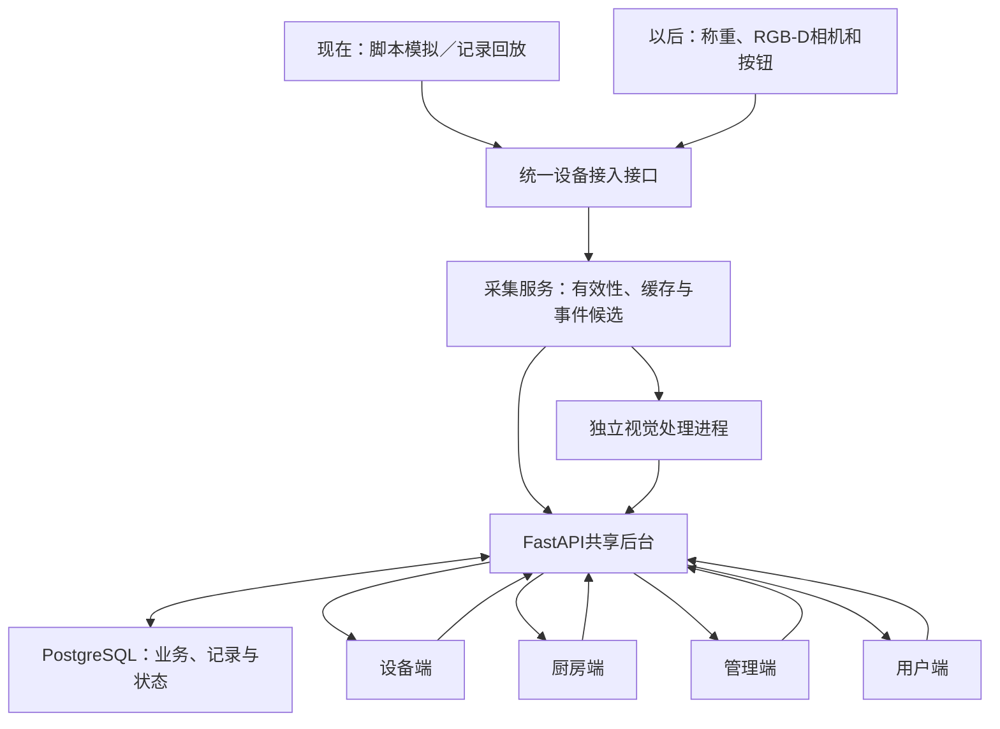

# Group 2 软件范围与系统架构讨论稿

日期：2026-09-16。状态：PROPOSED — PLANNING ONLY。用户要求硬件暂未完成时先梳理软件的端、功能和架构；本文为工程建议，未开始应用开发、模型训练或部署。当前实体范围仍为一台设备、一个独立称重位置，供应商仅完成硬件制作与集成。

## 1 推荐组织：四个使用端，一套软件核心

建议按使用任务划分**设备端、厨房端、管理端、用户端**，另设组内模拟／调试工具。四个端是同一套响应式网页的四个入口，共享组件、账号与后台，不需要开发四套独立App。

供餐、学校、个人是业务模式，不是额外三个软件产品。用场景配置决定启用哪些页面和规则；同一设备一次只服务一个活动餐期／餐食会话，结束当前会话后再切换。保留英文与繁体中文，规划文档可以使用简体中文。

| 端 | 主要使用者与设备 | 首版功能 | 为什么需要独立视图 |
|---|---|---|---|
| 设备端 | 现场操作员；设备7寸竖屏，开发时用浏览器模拟 | 选择场景；绑定容器、菜品与批次；实时有效重量；确认识别候选；去皮／加料／移盘提示；结束记录；个人逐项装盘 | 现场以少量大按钮完成物理操作，不在小屏上维护整套菜单 |
| 厨房端 | 厨师／配餐员；平板、电脑或手机 | 当前供应状态；补餐建议及理由；接受／调整／拒绝；制作任务；订单配餐与取餐队列；实际补入和剩余去向确认 | 把建议变成实际工作，并把执行情况返回系统 |
| 管理端 | 管理员；学校模式下的供餐负责人／教师 | 菜品与配方资料、参考营养来源、菜单发布；标准份量、制作时间和餐期；设备／容器资料；账号权限；报告与CSV导出 | 管配置、资料质量和复盘，不挤占厨师操作界面 |
| 用户端 | 顾客、成年个人用户；手机网页 | 扫码菜单、供应状态和更新时间；适用模式下下单／查单；个人餐食记录、份量与参考营养；学校菜单／样本餐展示 | 用户只看到与自己相关的结果和操作，不接触原始设备或后台数据 |
| 组内模拟工具 | 三位组员；开发电脑 | 场景脚本、暂停／倍速／重放、故障注入、事件日志、基线对比 | 无硬件时推进完整流程；不计作第五个正式用户端 |

建议页面入口为 `/station`、`/kitchen`、`/manage` 和用户区域；具体路由在页面清单阶段确定。模拟工具使用独立开发入口，发布给顾客的版本不可操作它。

## 2 各端的页面与操作

### 设备端

首版按三个页面／面板组织：**开始会话与绑定、实时监测、校准与设备设置**。设置只给授权操作员。主屏显示菜名、净重、更新时间和有效状态；识别不确定时可人工确认，重量波动时显示等待稳定，不把上一条读数冒充当前实测。

供餐模式在放盘后绑定登记菜品和容器，持续记录；同盘补充和整盘换走分别处理。个人模式在同一个秤上逐项加料，每次稳定后确认食物和新增克数，再汇总一餐。学校模式记录匿名样本餐或配餐批次。去皮必须是明确操作；有食物、读数不稳定或会话状态不适用时不直接清零。

### 厨房端

主要页面为**供餐看板、补餐任务、订单队列**。一个补餐建议应说明“剩多少、预计能供应多久、制作需多久、已有多少在做、建议补多少”，并允许员工接受、调整或拒绝。已经在做的任务要被后续建议考虑。

制作完成只代表待出餐；食物实际补入监测餐盆后，才更新当前物理供应。厨房点击完成与传感器重量变化分别留证据，差异进入待确认；没有对应重量证据时可保留人工报告，不能标为自动验证。

餐期结束时记录剩余去向，例如保留、转移或废弃。剩余总重不能直接全部计为浪费。设备端可发起餐期结束，厨房端处理去向与未完成任务，管理端查看汇总。

### 管理端

主要页面为**概览、食物与配方、菜单与餐期、设备与账号、报表**。食物／配方资料至少包括名称、图片、生熟状态、食物组、标准份量、参考营养记录与版本；菜单再关联价格、说明和可见状态。已有记录保存当时的配方／营养版本，修改目录不重写过去的餐食。

初版报告关注空盘时间、有效监测比例、补餐建议与人工处理、上台提供量及期末剩余去向。单位、时间窗口和数据来源应清楚；模拟／回放／硬件数据分别筛选。没有完整生产记录时显示“上台提供量”，不冒称厨房全部生产量。

### 用户端

顾客主要页面为**扫码菜单、菜品详情、购物车／下单、订单状态**。菜单提供菜名、图片、价格／套餐说明、供应状态、更新时间及有依据的预计等待。描述、食材和过敏原信息只使用人工维护的资料，不让模型凭外观推断。

“热销”按明确餐期内已完成订单统计，取消与重复订单不计入。自助菜的取用趋势单独命名，不把不同菜的克数直接排名为人气；只有一个被监测盘位时，不虚构全菜单的实时称重排行。其他菜可由员工手动维护供应状态，并标明更新时间和来源。

个人模式复用用户端的**餐食详情、历史记录与参考营养摘要**。个人记录与设备会话通过短时配对码／二维码明确关联；只扫码查看菜单不能取得别人的餐食。学校首版使用匿名示范餐与汇总，不另建儿童／家长账户系统。

## 3 模式与端的对应

| 模式 | 设备端 | 厨房端 | 管理端 | 用户端 |
|---|---|---|---|---|
| 自助餐 | 一盘登记菜持续监测 | 补餐建议和在制任务 | 菜单、餐期、补量规则、剩余报告 | 看菜单和供应；普通自取菜不用每次下单，现制／加点可下单 |
| 自选快餐 | 监测批量备好的菜 | 接单、配餐、取餐及补餐 | 菜单、标准份量、履约与剩余报告 | 扫码选菜下单，查看接受／备餐／取餐状态 |
| 学校配餐 | 匿名样本餐或分餐记录 | 有供餐流程时复用操作页 | 维护适用配餐计划，查看样本／汇总报告 | 展示菜单、样本份量和教育性营养信息 |
| 成年个人 | 逐项装盘或确认已知餐食 | 不启用 | 本人简化设置，基础食物资料复用 | 本人的餐食、份量、参考营养与历史 |

自助餐和自选快餐是供餐模式内的两种履约方式。后两种场景不要求增加一套后台或一台硬件，也不默认沿用厨房订单页面。个人模式不会因为总重下降就自动输出精确的分项营养摄入；未知配方或分项剩余不清时保留不确定。

## 4 共享后台做什么

采用一个后端程序，内部按业务分模块。前端负责显示和发起操作，最终状态与计算由后端统一决定。

| 模块 | 输入 | 负责的结果 |
|---|---|---|
| 设备接入与有效状态 | 带时间、来源、序号的读数／图像结果及设备心跳 | 最新有效值、离位／不稳定／陈旧状态、已确认物理事件 |
| 菜品、容器与会话 | 登记资料、皮重、批次、模式及人工确认 | 当前读数属于哪只容器、哪道菜、哪个餐期／个人餐食 |
| 识别结果管理 | 模型候选、版本、分数和质量标记 | 候选或待确认；人工纠正留痕，不直接覆盖测量事实 |
| 预测与补餐 | 有效余量、消耗历史、制作提前量、在制任务、收餐时间 | 何时补、补多少、依据是什么；数据不足时采用明确基线 |
| 订单与厨房任务 | 顾客提交、员工接受、配餐、完成和取消 | 待履约预留、制作／配餐状态、去重和对账 |
| 参考营养与场景反馈 | 已确认食物、分别测得份量、版本化参考／配方 | 份量换算和教育性提示；不从图片直接测化学成分 |
| 身份、记录与报表 | 权限、操作、事件和状态变化 | 各角色可访问的数据、可追溯历史、统计和导出 |

视觉识别、需求预测和建议生成是不同任务。首版不需要一个通用聊天模型包办它们：识别保留MobileNetV3候选，预测先做固定阈值／消耗速度基线，建议用明确约束与规则，营养用可核对数据换算，文字解释先用模板。

## 5 必须统一的数据规则

### 物理余量、订单预留、未来供应分开

物理余量来自最新有效测量。已接受、尚未配出的订单占用可承诺供应；仍在制作的食物是未来供应，不能当作当前盘中已有食物。标准份量只是克数到份数的估算依据，首版界面不保证任意取餐方式都得到精确份数。

例子：实际在盘20份，已接受待配餐8份，可再承诺12份。配出其中3份并完成对账后，实际17份、待配餐5份，仍可再承诺12份。不能下单扣一次，再按重量下降扣一次。

配出操作和物理变化不是天然同时发生。首版通过员工操作关联对应测量窗口；释放预留与更新可承诺量在同一确认步骤完成。异步或矛盾时保留待对账状态，暂不恢复相应可售额度，不猜测重量变化对应哪位顾客。订单接受和预留在数据库事务内校验并更新，重复请求只生成同一订单；对并发竞争采用行锁或等效条件更新策略。[PostgreSQL行锁依据](https://www.postgresql.org/docs/17/explicit-locking.html)

### 一次建议只形成一次任务

建议采用“待处理→接受／调整／拒绝／失效”；接受后关联唯一任务。制作任务采用“待开始→制作中→待补入→已补入”，另有取消与待核对。重新计算、刷新页面或网络重发不重复建任务。

订单另有“已提交→已接受→配餐中→待取餐→已取餐”，拒绝／取消为独立分支；按阶段限制取消，并释放尚未履约的预留。首版不接在线支付，保留现场付款方式，不把订单完成等同于已经结算。

### 读数与事件分开，陈旧不等于零

重量下降只是观测变化，不能一律解释为顾客吃下了食物。移盘、触碰、加料、餐具变化、断线和未知菜分别处理。上一次有效值可显示，但必须标记时间和状态；不足以支持新建议时暂停相应建议。菜品绑定仍可靠且秤有效时，相机故障可以降级为重量提示；不继续宣称视觉确认正常。

记录至少区分观测时间、服务接收时间、单位、设备／会话、序号、数据来源、有效性、校准和模型版本。迟到事件可进入历史，但不能倒退覆盖最新状态；重发通过唯一标识去重。

### 一个盘位只测一个位置

食物目录可以有4–6类，设备按批次轮换识别；不表示同时实测4–6道菜。未被设备监测的菜单项使用人工状态或明确标注的模拟数据。公开菜单不暴露原始摄像头画面、后台设备密钥或个人餐食记录。

## 6 推荐技术结构

| 层 | 建议 | 选择原因及边界 |
|---|---|---|
| 网页 | React＋TypeScript＋Vite，响应式布局、共享组件，按角色分入口 | 一套页面可在电脑、手机和设备浏览器运行；首版作为网页交付，不分别开发原生iOS／Android应用 |
| 后台 | Python＋FastAPI，按接入、菜单、订单、厨房、建议、营养、报表分模块 | 与后续图像／模型处理语言一致，首版一个业务服务进程 |
| 数据 | PostgreSQL作为唯一业务数据源；图片／深度文件独立存放，以索引关联 | 订单、预留、任务和记录可事务处理；不把持续录像塞入每条业务记录 |
| 接入与实时更新 | 采集服务用HTTP批量提交事件并接收确认；界面用HTTP操作＋WebSocket更新 | 单设备无需先增加MQTT broker；断线后重新取状态快照，推送只是更新通知，不是唯一记录 |
| 设备侧 | Python采集适配器；传感采样与视觉分进程／独立队列，保留最新图像 | 视觉慢时不能阻塞重量采集；真实相机SDK和GPIO驱动以后加入 |
| AI | 电脑训练；独立视觉进程按统一结果格式调用ONNX模型，先支持人工／占位结果 | 占位结果标明来源，仅用于流程开发，不作为AI准确率证据 |
| 离线缓存 | 设备服务可使用SQLite／本地日志缓存未确认事件，恢复后按ID补送 | 它是传输缓存，不再建立第二套业务主数据库 |

React官方提供使用Vite等工具从零构建的路线；这里已有独立Python后台，采用客户端网页是本项目的工程建议，并非官方规定本项目必须如此。[React文档](https://react.dev/learn/creating-a-react-app)

FastAPI支持WebSocket。首版限定一个业务服务进程，并把业务状态持久化；其示例的内存连接列表不能直接跨多个服务进程共享，后续确需横向扩展才加入共享消息机制。[WebSocket文档](https://fastapi.tiangolo.com/advanced/websockets/)

重视觉计算放到独立进程，不能仅把一个耗时推理函数塞进请求后的任务就认为已经完成可靠调度。首版也不需要因而立即搭建Celery、Redis和多服务集群；先保持清晰的采集／推理／业务边界。[FastAPI后台任务说明](https://fastapi.tiangolo.com/tutorial/background-tasks/)

PWA安装到主屏可作为后续体验增强。普通局域网网页能打开，不代表已满足各浏览器的安装与离线条件；可安装PWA有HTTPS或localhost等要求，缓存页面也不代表断线后还能正确接单。[MDN安装条件](https://developer.mozilla.org/en-US/docs/Web/Progressive_web_apps/Guides/Making_PWAs_installable)

## 7 运行在哪里

**现在：**在现有Mac上运行后台、数据库、模拟器和网页开发环境；浏览器分别打开四端，手机通过同一可互访局域网访问用户端。二维码包含可从手机访问的地址，不能填只指向手机自身的localhost。当前只是方案，未安装依赖或验证本机服务。

**硬件到位：**把实际采集和视觉程序接到Pi；优先验证Pi 5 8GB同时运行采集、业务服务、数据库和设备浏览器的独立演示。网页先在电脑构建，Pi使用构建产物；不在Pi上训练。若实测资源不足，可先让Pi采集、Mac承担后台，不为维持“全部上Pi”的说法牺牲可靠性。

外网／云端查看不作为首个演示前置条件。局域网断开时，远端手机不能继续获取最新状态；设备与本地后台仍运行的条件下，现场功能才可能继续。Pi掉电或后台停止时，不声称监测与接单仍正常。

## 8 无硬件开发的具体方式

建议先开发统一输入约定和可重复模拟场景，再做真实适配器。接口可以接模拟读数、历史回放或实物；相同业务层处理三种来源。

模拟工具至少提供：正常取餐、同盘加料、整盘移走／换盘、按压抖动、视觉遮挡／未知类别、断线／重连／重发、临近收餐、订单取消与并发提交。每个场景保存脚本、随机种子或固定序列、时间和预期结果，可暂停、倍速和重放。

模拟分两层：最初注入明确标识的事件／识别占位结果，用于网页与业务流程；随后产生重量序列验证事件判断。后一层的答案标签单独保存作评价，不直接作为算法输入，否则不能检验判断逻辑。

数据源统一标为 `simulated`、`replay` 或 `hardware`；识别来源再区分 `stub`、`model` 和 `manual`。界面与导出都保留这些区别，不能把回放当现场实时、把预设菜名当训练结果。每次模拟用独立运行ID，和以后实测餐期隔离。

现在可以开发账号／权限、食物目录、四端页面、任务与订单状态、参考营养换算、报告、规则基线、模拟器和异常恢复。真实称重精度、RGB-D质量、菜品识别率、热漂移和Pi负载必须等实物与数据验证；固定接口能减少重写，不代表接上硬件就自动完成全部集成。

## 9 数据对象与权限的最小设计

核心对象分为：用户／角色与场地、设备、容器与校准版本、食物／配方与营养参考版本、菜单／餐期、监测会话、观测／事件、补餐建议／任务、订单／预留／配出关联、餐食／份量记录、剩余去向和操作日志。此处是概念模型，下一步再确定表与字段。

权限建议：管理员维护资料与账户；厨房人员处理任务和订单；设备操作员管理现场会话，校准另给权限；顾客凭随机订单访问凭据查看自己的订单；个人账户只看本人的餐食。设备使用独立接入凭据，不能拿它登录管理界面。权限在后台执行，不只隐藏前端按钮。

所有关键操作保存操作人、时间、前后状态和关联记录。后续若改为多场地，再扩展租户隔离；首版不实现多门店SaaS开通、计费和总部管理，但记录保留明确场地归属。

## 10 开发顺序与可见成果

| 阶段 | 做什么 | 可以演示的结果 |
|---|---|---|
| 1 基础定义与最短流程 | 页面清单、共享数据字段、会话／任务状态；模拟器＋API＋设备监测页 | 模拟重量下降能更新设备页和厨房状态，来源清楚 |
| 2 补餐主线 | 厨房建议、人工处理、在制任务、模拟补入、餐期结束和剩余记录 | 从取餐到建议到补充再到测量确认的完整流程，重复请求不重复制作 |
| 3 菜单与点餐 | 管理发布、顾客扫码、适用模式下下单、厨房接受／配餐／取餐 | 物理余量与待履约预留一致，菜单能解释缺货和等待 |
| 4 场景扩展 | 版本化营养参考、逐项装盘、个人历史、学校匿名样本报告 | 相同系统切换用途，能解释提供量、剩余和参考营养的区别 |
| 5 实物与算法迭代 | 实际适配器、校准、受限视觉模型、独立数据与基线对照 | 以真实硬件证据替换相应模拟证据，保留失败和人工干预记录 |

阶段5可随硬件到位并行推进，不必等所有网页完成。首个开发目标应是阶段1–2的完整业务流程，而不是先做完全部管理表单、图表或模型训练。

组内主责仍为Yuan Yuchen 40%、Xu Ziqian 30%、Li Wenhua 30%。软件先行期间，Yuan负责后台、数据规则、补餐／营养与集成；Xu先负责设备接口、模拟器、事件判断和故障回放，到货后转实际采集／校准；Li负责四端共用前端、双语、扫码与交互。分工是计划，实际贡献仍按完成内容记录。

## 11 首版取舍与当前下一步

首版保留供餐主线、基础扫码点餐、三个模式的最小可演示流程、来源与异常状态、权限和日志。暂不加入在线支付、配送、POS／ERP对接、多门店经营、儿童个人健康档案、通用混合菜营养识别或聊天机器人。这些选择避免稀释既定的硬件测量与行动反馈目标。

当前建议以四端划分作为讨论基线，下一步把**页面清单＋核心状态转换＋设备输入字段**细化成可以直接分工开发的说明，随后开始阶段1–2。本文本身没有启动开发或改动已有建议书／RFQ。
