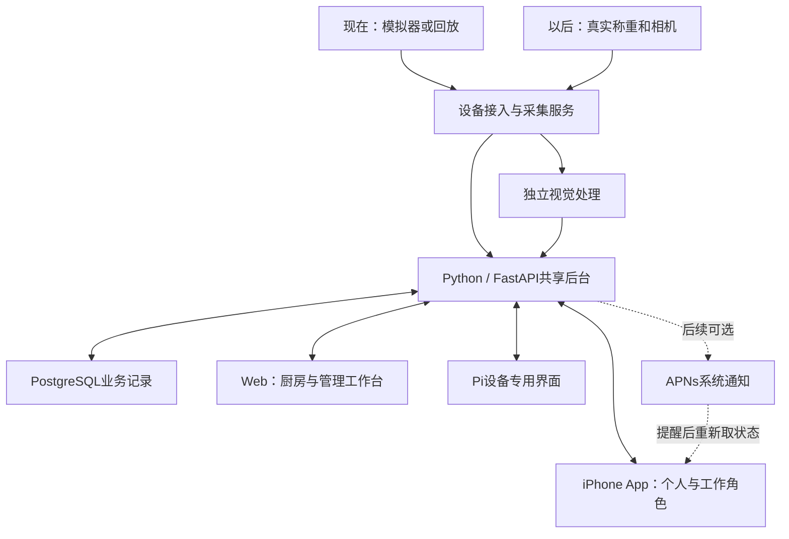

# Group 2 软件范围与系统架构讨论稿

**HISTORICAL — 2026-09-25：**以下内容仅描述已停止的 Senplate 食物监测原型。新桌面助理仍在方案评估，[当前研究](../../../../research/2026-09-25-desk-companion/feasibility-review.md)与[当前规范](../../../../product.md)取代本文的未来开发安排；已验证的软件历史结果仍按原证据保留。

更新：2026-09-19。状态：M1_2_LOCAL_PROTOTYPE_VERIFIED。P0补餐、M1.1菜单／订单与M1.2个人餐食／学校匿名样本已在本地实现并分阶段验证；默认英文，可切简体中文且保存选择。当前交付见[餐食样本契约](../2026-09-19/meals-samples-contract.md)与[本批QA](../../output/qa/development-m1-2-meals-2026-09-19/verification.md)，原[菜单订单契约](../2026-09-19/menu-orders-contract.md)继续适用。本文中的完整管理、配方、审核计划和实物模型规格仍有后续工作，不能据表格推断全部交付。

原“所有端共用一个网页工程”的建议已取代，原文保存在[Web优先V1历史快照](archive/software-scope-web-first-v1.md)。本次依据[Metafoodx App公开资料与截图研究](../../research/2026-09-16-metafoodx-app/app-review.md)修订载体与角色，原业务规则、模拟器、营养边界继续保留。

当前已进一步形成实现用V1规格：[页面与权限](app-pages-and-permissions.md)、[状态／数据／首批API](software-workflows-and-api.md)、[开发批次与验收](software-mvp-and-acceptance.md)。本文保持总体架构；具体页面编号、动作约束和P0接口以下述聚焦规格为准。P0历史以原记录为准，菜单与餐食新增范围分别以M1.1、M1.2聚焦契约及QA为准。

用户已选择无刻度纯碗V7，[VI V1与品牌规范](../../brand.md)已交付，包括图标基础稿、字体、色彩与设计令牌。应用模板属于品牌示例，不是完整App页面或软件实现；刻度探索结束，P0已复用这些品牌资产，后续页面继续沿用。

## 1 当前建议：三个界面载体，一个共享后台

**一个iPhone App＋一套厨房／管理Web＋设备专用触摸界面。**手机只做iPhone，不把Android或原生iPad版列入首版。App内有个人／顾客与工作两类界面，网页内有厨房和管理两类工作台；它们调用同一后台，使用同一组业务状态。

| 界面载体 | 使用者 | 首版主要功能 | 实现建议 |
|---|---|---|---|
| iPhone App：个人／顾客模式 | 普通顾客、成年个人用户 | App内扫码进入餐厅，菜单／下单／订单状态；绑定自己的餐食会话，份量、参考营养和历史 | Swift／SwiftUI原生界面，手机为主要入口 |
| 同一App：工作模式 | 受授权店员、管理者、学校供餐负责人 | 运营总览、现场供应、待处理任务、补餐接受／调整、事件记录和轻量报表 | 登录后按后台授权显示；不会给所有普通用户工作权限 |
| 工作台Web：厨房 | 厨师／配餐员；平板或电脑 | 持续显示制作及订单队列、配餐／取餐、实际补入及收尾 | React／TypeScript，针对固定工作台和触摸大按钮布局 |
| 同一Web：管理 | 管理员、授权学校负责人 | 菜品／配方／参考营养、菜单、餐期与规则、设备／容器、账号和完整报告 | 与厨房共用Web工程，按权限显示对应页面 |
| 设备专用界面 | 设备旁的操作员；7寸竖屏 | 当前会话、重量、识别确认、去皮／加料／换盘、逐项装盘 | 当前建议在Pi本地用全屏专用Web界面；不要求Pi运行iPhone App |
| 组内模拟工具 | 三位组员；开发电脑 | 模拟读数、回放、故障注入、事件日志和基线对比 | 内部工具，不计正式客户端，不对顾客开放 |

设备界面的本地Web实现属于工程建议，不是对外顾客网页。它可复用现有网页技术，Pi负责运行；若以后明确要求设备UI也使用原生Linux技术，再单独评估，不在当前默认增加另一套框架。

供餐、学校、个人是业务模式；个人／工作是账号使用身份，二者不能混为一个角色开关。同一设备一次只有一个活动餐期／餐食会话，切换模式先结束当前会话。默认英文，可切换简体中文；学校首版仍用匿名样本，不新建儿童／家长健康账户。

## 2 App角色与各界面的页面

### iPhone App的身份与导航

建议使用一套登录与账号，在进入受授权的工作空间时切换工作界面。普通用户默认只有个人功能；管理员通过邀请或后台分配员工／管理权限。即使同一个人兼有两个身份，餐厅仍不能读取其私人的餐食历史，切换身份不能依赖前端按钮代替后台授权。

个人／顾客模式可以采用四个入口：**首页、用餐、记录、我的**。首页显示自己的餐食摘要和进行中订单；用餐入口提供扫码进入餐厅、查看菜单和下单，也可扫码绑定当前设备餐食；记录保存自己的餐食和订单，营养值注明参考来源；我的负责账号、语言、偏好和身份切换。

工作模式可以采用：**总览、现场、任务、记录**。总览突出需要注意的状态；现场看设备对应菜品、余量、有效性和更新时间；任务处理补餐建议和相关工作；记录查看测量事件、必要照片及轻量报告。大量菜单编辑、人员管理和报表配置留在管理Web，固定排单留在厨房Web。工作四入口沿用P0；M1.1已实现个人四入口、工作订单分栏和最低菜单维护，M1.2新增个人餐食和Web匿名样本，完整管理表单仍待后续批次。

同一补餐任务可从App或厨房Web处理；后台校验当前版本和权限，避免两名员工同时接受产生重复任务。个人二维码只能关联经确认的当前餐食，不授予设备管理员权限。首个演示采用预先安装App、App内扫码的流程；不额外要求顾客网页、App Clip、Universal Links或App Store上架来才能演示。

### 设备端

首版按三个页面／面板组织：**开始会话与绑定、实时监测、校准与设备设置**。设置只给授权操作员。主屏显示菜名、净重、更新时间和有效状态；识别不确定时可人工确认，重量波动时显示等待稳定，不把上一条读数冒充当前实测。

供餐模式在放盘后绑定登记菜品和容器，持续记录；同盘补充和整盘换走分别处理。个人模式在同一个秤上逐项加料，每次稳定后确认食物和新增克数，再汇总一餐。学校模式记录匿名样本餐或配餐批次。去皮必须是明确操作；有食物、读数不稳定或会话状态不适用时不直接清零。

### 厨房Web工作台

主要页面为**供餐看板、补餐任务、订单队列**。一个补餐建议应说明“剩多少、预计能供应多久、制作需多久、已有多少在做、建议补多少”，并允许员工接受、调整或拒绝。已经在做的任务要被后续建议考虑。

制作完成只代表待出餐；食物实际补入监测餐盆后，才更新当前物理供应。厨房点击完成与传感器重量变化分别留证据，差异进入待确认；没有对应重量证据时可保留人工报告，不能标为自动验证。

餐期结束时记录剩余去向，例如保留、转移或废弃。剩余总重不能直接全部计为浪费。设备端可发起餐期结束，厨房端处理去向与未完成任务，管理端查看汇总。

### 管理Web工作台

主要页面为**概览、食物与配方、菜单与餐期、设备与账号、报表**。食物／配方资料至少包括名称、图片、生熟状态、食物组、标准份量、参考营养记录与版本；菜单再关联价格、说明和可见状态。已有记录保存当时的配方／营养版本，修改目录不重写过去的餐食。

初版报告关注空盘时间、有效监测比例、补餐建议与人工处理、上台提供量及期末剩余去向。单位、时间窗口和数据来源应清楚；模拟／回放／硬件数据分别筛选。没有完整生产记录时显示“上台提供量”，不冒称厨房全部生产量。

### 个人／顾客App的功能细节

顾客主要页面为**扫码菜单、菜品详情、购物车／下单、订单状态**。菜单提供菜名、图片、价格／套餐说明、供应状态、更新时间及有依据的预计等待。描述、食材和过敏原信息只使用人工维护的资料，不让模型凭外观推断。

“热销”按明确餐期内已完成订单统计，取消与重复订单不计入。自助菜的取用趋势单独命名，不把不同菜的克数直接排名为人气；只有一个被监测盘位时，不虚构全菜单的实时称重排行。其他菜可由员工手动维护供应状态，并标明更新时间和来源。

个人模式使用同一App中的**餐食详情、历史记录与参考营养摘要**。个人记录与设备会话通过短时配对码／二维码明确关联；只扫码查看菜单不能取得别人的餐食。学校首版使用匿名示范餐与汇总，不另建儿童／家长账户系统。

## 3 模式与端的对应

| 模式 | 设备界面 | 厨房Web／员工App | 管理Web／管理者App | 个人／顾客App |
|---|---|---|---|---|
| 自助餐 | 一盘登记菜持续监测 | 补餐建议和在制任务 | 菜单、餐期、补量规则、剩余报告 | 看菜单和供应；普通自取菜不用每次下单，现制／加点可下单 |
| 自选快餐 | 监测批量备好的菜 | 接单、配餐、取餐及补餐 | 菜单、标准份量、履约与剩余报告 | 扫码选菜下单，查看接受／备餐／取餐状态 |
| 学校配餐 | 匿名样本餐或分餐记录 | 有供餐流程时复用操作页 | 维护适用配餐计划，查看样本／汇总报告 | 展示菜单、样本份量和教育性营养信息 |
| 成年个人 | 逐项装盘或确认已知餐食 | 不启用 | 本人简化设置，基础食物资料复用 | 本人的餐食、份量、参考营养与历史 |

自助餐和自选快餐是供餐模式内的两种履约方式。后两种场景不要求增加一套后台或一台硬件，也不默认沿用厨房订单页面；学校负责人使用授权工作身份，普通个人不显示厨房功能。个人模式不会因为总重下降就自动输出精确的分项营养摄入；未知配方或分项剩余不清时保留不确定。

## 4 共享后台做什么

采用一个后端程序，内部按业务分模块。前端负责显示和发起操作，最终状态与计算由后端统一决定。

| 模块 | 输入 | 负责的结果 |
|---|---|---|
| 设备接入与有效状态 | 带时间、来源、序号的读数／图像结果及设备心跳 | 最新有效值、离位／不稳定／陈旧状态、已确认物理事件 |
| 菜品、容器与会话 | 登记资料、皮重、批次、模式及人工确认 | 当前读数属于哪只容器、哪道菜、哪个餐期／个人餐食 |
| 识别结果管理 | 模型候选、版本、分数和质量标记 | 候选或待确认；人工纠正留痕，不直接覆盖测量事实 |
| 预测与补餐 | 有效余量、消耗历史、制作提前量、在制任务、收餐时间 | 何时补、补多少、依据是什么；数据不足时采用明确基线 |
| 订单与厨房任务 | 顾客提交、员工接受、配餐、完成和取消 | 待履约预留、制作／配餐状态、去重和对账 |
| 参考营养与场景反馈 | 已确认食物、分别测得份量、版本化参考／配方 | 份量换算和教育性提示；不从图片直接测化学成分 |
| 身份、记录与报表 | 权限、操作、事件和状态变化 | 各角色可访问的数据、可追溯历史、统计和导出 |

视觉识别、需求预测和建议生成是不同任务。首版不需要一个通用聊天模型包办它们：识别保留MobileNetV3候选，预测先做固定阈值／消耗速度基线，建议用明确约束与规则，营养用可核对数据换算，文字解释先用模板。

## 5 必须统一的数据规则

### 物理余量、订单预留、未来供应分开

物理余量来自最新有效测量。已接受、尚未配出的订单占用可承诺供应；仍在制作的食物是未来供应，不能当作当前盘中已有食物。标准份量只是克数到份数的估算依据，首版界面不保证任意取餐方式都得到精确份数。

例子：实际在盘20份，已接受待配餐8份，可再承诺12份。配出其中3份并完成对账后，实际17份、待配餐5份，仍可再承诺12份。不能下单扣一次，再按重量下降扣一次。

配出操作和物理变化不是天然同时发生。首版通过员工操作关联对应测量窗口；释放预留与更新可承诺量在同一确认步骤完成。异步或矛盾时保留待对账状态，暂不恢复相应可售额度，不猜测重量变化对应哪位顾客。订单接受和预留在数据库事务内校验并更新，重复请求只生成同一订单；对并发竞争采用行锁或等效条件更新策略。[PostgreSQL行锁依据](https://www.postgresql.org/docs/17/explicit-locking.html)

### 一次建议只形成一次任务

建议采用“待处理→接受／拒绝／失效／被取代”；调整数量是接受时保留原值、调整值及原因的动作。接受后关联唯一任务。任务细化为“待开始→制作中→待补入→等待核对→已补入”，另有取消、需要人工核对及未核实结案。重新计算、刷新页面或网络重发不重复建任务，实际补入只按关联的有效事件记一次。

订单另有“已提交→已接受→配餐中→待取餐→已取餐”，拒绝／取消为独立分支；按阶段限制取消，并释放尚未履约的预留。首版不接在线支付，保留现场付款方式，不把订单完成等同于已经结算。

### 读数与事件分开，陈旧不等于零

重量下降只是观测变化，不能一律解释为顾客吃下了食物。移盘、触碰、加料、餐具变化、断线和未知菜分别处理。上一次有效值可显示，但必须标记时间和状态；不足以支持新建议时暂停相应建议。菜品绑定仍可靠且秤有效时，相机故障可以降级为重量提示；不继续宣称视觉确认正常。

记录至少区分观测时间、服务接收时间、单位、设备／会话、序号、数据来源、有效性、校准和模型版本。迟到事件可进入历史，但不能倒退覆盖最新状态；重发通过唯一标识去重。

### 一个盘位只测一个位置

食物目录可以有4–6类，设备按批次轮换识别；不表示同时实测4–6道菜。未被设备监测的菜单项使用人工状态或明确标注的模拟数据。公开菜单不暴露原始摄像头画面、后台设备密钥或个人餐食记录。

## 6 推荐技术结构

| 层 | 建议 | 选择原因与边界 |
|---|---|---|
| iPhone | Swift＋SwiftUI，原生扫码、导航与交互；HTTP操作和前台WebSocket更新 | 用户已明确只做iPhone，优先单平台原生方案；最低iOS版本待演示手机确认，不照搬竞品兼容范围 |
| 厨房／管理Web | React＋TypeScript＋Vite，共用组件和后台接口 | 适合队列、表格和批量配置；不再承担主要个人／顾客入口 |
| 设备界面 | Pi本地全屏专用页面，当前建议复用Web实现 | 小屏操作与手机App分别部署；SwiftUI面向Apple平台，不能直接在Pi Linux运行 |
| 业务后台 | Python＋FastAPI，模块化单体；首版一个业务服务进程 | 接入、目录、订单、厨房、建议、营养、权限和报表统一处理 |
| 数据 | PostgreSQL业务主库；照片／深度独立文件与索引；设备侧缓存未确认事件 | 单一业务事实来源；模拟、回放和实物分开，不持续保存所有原始视频 |
| 设备和AI | 独立采集适配器与视觉进程；HTTP提交并确认；模型用统一结果格式接入 | 视觉慢不能阻塞称重；先用明确标记的占位／人工结果完成界面 |
| 通知 | 前台实时状态为首版；后台推送另用APNs | 推送需要账号能力、服务端和设备权限，不能用常驻WebSocket冒充；首个模拟演示不依赖后台通知 |

SwiftUI是基于iPhone单平台偏好的工程主建议；没有证据证明Metafoodx本身采用它，也没有因为改原生App就要求重写Python模型或后台。[Apple SwiftUI](https://developer.apple.com/swiftui/)

App与Web共用API、身份／权限、数据模型和业务规则，不直接共用SwiftUI与React页面代码。可用同一接口说明生成或维护各自的类型和请求层；不能把“共用后台”理解成所有前端代码完全复用。React/Vite已用于本地工作台。[React文档](https://react.dev/learn/creating-a-react-app)

FastAPI支持WebSocket。连接只是即时更新通道，业务状态落库；断线和重新进入App时重新获取快照。首版单业务进程，未来扩容才增加跨进程广播机制。[FastAPI WebSocket](https://fastapi.tiangolo.com/advanced/websockets/)

App退到后台后可能被系统挂起，因此持续称重、推理和补餐计算必须留在Pi／后台，不能依赖员工手机一直开着。需要后台提醒时再接APNs；收到提醒也要打开后核对最新任务状态，不能以通知送达代替任务完成。[Apple后台生命周期](https://developer.apple.com/documentation/uikit/about-the-background-execution-sequence)、[APNs注册](https://developer.apple.com/documentation/usernotifications/registering-your-app-with-apns)

## 7 运行在哪里

**现在：**Mac运行后台、数据库、模拟器和Web开发环境，用Xcode及iPhone模拟器／真机开发App。手机与本地服务先在同一可互访网络演示，访问地址、网络权限和开发环境的连接策略在实施时配置；不能把手机自己的localhost当成Mac服务器。当前已有Xcode工程与本地模拟器签名，服务只监听Mac回环地址；实机局域网访问和签名尚未配置。

**硬件到位：**Pi接真实采集及视觉程序；优先验证Pi 5 8GB同时运行本地核心、数据库与设备界面。iPhone只负责交互和查看，后续模型不因App原生化就迁到手机。若Pi负载不足，可先Pi采集、Mac后台，接口不变；训练留在电脑。

**远程与发布：**iPhone App不会自动使局域网服务能在4G／外网访问。云同步、远程入口、APNs和App Store／TestFlight分发按后续演示需要独立安排；当前不购买账号、暴露服务或部署。后台不可达时显示缓存的时间与离线状态，不伪装接单成功；原先PWA作为个人入口的方案不再采用。

## 8 无硬件开发的具体方式

建议先开发统一输入约定和可重复模拟场景，再做真实适配器。接口可以接模拟读数、历史回放或实物；相同业务层处理三种来源。

模拟工具至少提供：正常取餐、同盘加料、整盘移走／换盘、按压抖动、视觉遮挡／未知类别、断线／重连／重发、临近收餐、订单取消与并发提交。每个场景保存脚本、随机种子或固定序列、时间和预期结果，可暂停、倍速和重放。

模拟分两层：最初注入明确标识的事件／识别占位结果，用于App／Web与业务流程；随后产生重量序列验证事件判断。后一层的答案标签单独保存作评价，不直接作为算法输入，否则不能检验判断逻辑。

数据源统一标为 `simulated`、`replay` 或 `hardware`；识别来源再区分 `stub`、`model` 和 `manual`。界面与导出都保留这些区别，不能把回放当现场实时、把预设菜名当训练结果。每次模拟用独立运行ID，和以后实测餐期隔离。

现在可以开发账号／权限、食物目录、App双角色与工作台／设备页面、任务与订单状态、参考营养换算、报告、规则基线、模拟器和异常恢复。真实称重精度、RGB-D质量、菜品识别率、热漂移和Pi负载必须等实物与数据验证；固定接口能减少重写，不代表接上硬件就自动完成全部集成。

## 9 数据对象与权限的最小设计

核心对象分为：用户／角色与场地、设备、容器与校准版本、食物／配方与营养参考版本、菜单／餐期、监测会话、观测／事件、补餐建议／任务、订单／预留／配出关联、餐食／份量记录、剩余去向和操作日志。此处涵盖完整产品概念模型；P0与M1.1的表／字段已在models.py与schemas.py实现，餐食／营养和学校对象已在M1.2追加，硬件维护与完整配置仍未交付。

权限建议：管理员维护资料与账户；厨房人员处理任务和订单；设备操作员管理现场会话，校准另给权限；顾客／个人App只查看自己的订单和餐食；无账号演示如另启用则使用独立订单访问凭据。设备使用独立接入凭据，不能拿它登录管理界面。权限在后台执行，不只隐藏前端按钮。个人与工作数据查询分别校验，切换角色或退出后清理无权继续展示的缓存。

所有关键操作保存操作人、时间、前后状态和关联记录。后续若改为多场地，再扩展租户隔离；首版不实现多门店SaaS开通、计费和总部管理，但记录保留明确场地归属。

## 10 开发顺序与可见成果

| 阶段 | 做什么 | 可以演示的结果 |
|---|---|---|
| 1 App骨架与共享API | iPhone登录、后台授权的个人／工作切换、双语；模拟输入和基本设备状态接口 | 同一App不同账号／身份看到适当内容；工作模式可查看模拟余量 |
| 2 补餐主线 | 工作App的现场／任务、厨房Web队列、建议接受、模拟补入与事件记录 | 取餐→建议→员工处理→补入确认；App与Web状态一致且不重复制作 |
| 3 个人／顾客流程 | App内扫码、菜单／下单、订单状态、设备餐食配对；最小管理资料页 | 顾客订单进入同一厨房队列，份量记录归属正确个人 |
| 4 三场景与复盘 | 参考营养、个人历史、学校匿名样本、管理Web配置／报告 | 一套核心切换用途，提供量、剩余与参考营养清楚分开 |
| 5 实物和完善 | 真实适配器、校准、受限模型、独立数据与基线对比；按需加入后台提醒 | 实物证据逐步替换模拟，保留异常和人工介入记录 |

阶段5可随硬件到位并行推进。先贯通一个iPhone工作流程和最小厨房Web，不把整个后台的所有表单先做完；个人／顾客App仍是首版需要交付的范围，不因参考B2B竞品而取消。

组内计划仍是Yuan Yuchen 40%、Xu Ziqian 30%、Li Wenhua 30%。Yuan主责后台、API权限／数据规则、AI与整体集成；Xu先做接入接口、模拟器、设备界面和事件／故障处理，到货后真实采集校准；Li主责iPhone App、厨房／管理Web交互、双语和扫码。原生与Web是两套界面实现，需要共用设计与API来控制工作量；最终贡献按实际记录，不据此认定已完成。

## 11 首版取舍与下一步

用户已确认iPhone及App双角色，厨房／管理Web继续作为适用工作台；SwiftUI与React已用于本地实现，Pi设备本地部署和维护仍为后续工程方案。首版保留供餐主线、App扫码点餐、学校／个人最小流程、来源与异常状态、权限和日志。

不额外承诺Android、顾客PWA、在线支付、配送、POS／ERP、多门店SaaS、儿童健康档案、通用混合菜精确营养或聊天机器人。后台推送和上架与首个前台演示分阶段；借鉴竞品信息组织不等于已验证商业领先。

两套页面流程、权限、核心状态和首批19项接口已在V1详细规格中整理，品牌Senplate与V7主标已确定，[VI V1](../../brand.md)已交付。后续关键界面设计使用现有字体、色彩与Logo；应用已按[开发批次](software-mvp-and-acceptance.md)完成P0、M1.1菜单／订单及M1.2个人餐食／学校匿名样本本地原型。下一批为M1.3配置与餐末复盘；其他P1接口随工作包细化，suggestion与RFQ仍保留。
