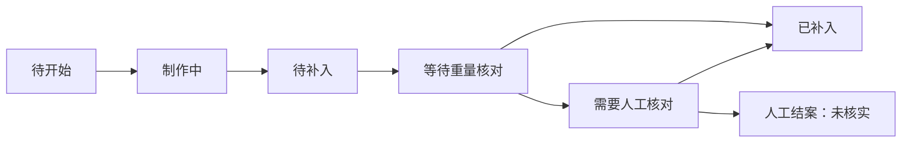

# Group 2 业务状态、数据与API规格 V1

更新：2026-09-19。状态：M1_2_LOCAL_PROTOTYPE_VERIFIED。P0补餐、M1.1菜单／订单与M1.2个人餐食／学校匿名样本已在本地实现并分阶段验证；默认英文，可切简体中文且保存选择。当前交付见[餐食样本契约](../2026-09-19/meals-samples-contract.md)与[本批QA](../../output/qa/development-m1-2-meals-2026-09-19/verification.md)，原[菜单订单契约](../2026-09-19/menu-orders-contract.md)继续适用。本文中的完整管理、配方、审核计划和实物模型规格仍有后续工作，不能据表格推断全部交付。

## 1 通用约定

- API前缀 `/v1`，JSON字段用snake_case；ID为服务端分配的不透明字符串，不能从显示编号推算访问权限。
- 质量统一整数克 `*_g`；单价／金额为最小货币单位整数 `*_minor`，附币种；时间为带时区的ISO8601；数据库保存UTC，API目前含香港偏移时间，界面按香港时区显示。克数显示步进不代表实物达到1g误差。
- 无法获得的值用 `null` 配合原因；零是有效数值，不能替代未知。原始读数及来源不被人工修改覆盖。
- 用户登录返回短期访问会话；App安全保存登录信息。`GET /me`返回本人、允许的个人／工作context和能力；前端选择context并不授予权限，后台仍检查每次请求和订阅。
- 工作请求校验场地、资源归属及能力；个人请求校验所有者。设备和开发模拟器使用不同的机器凭据，不是员工账号。
- 写请求提供 `Idempotency-Key`；同一用户、context及操作类型内，同键同内容只产生一次效果，同键不同内容返回冲突。角色授权检查先于返回旧结果。
- 可变业务对象有 `version`，动作带 `expected_version`。它与每次测量更新的 `snapshot_version` 分开，不能因每秒新读数就让每次按钮点击都冲突。
- 失败统一返回 `error.code`、可定位的字段、`request_id`和必要的当前版本；App把错误码转换为可理解的简中／英文文案，不直接显示内部异常。
- App只把后台确认的状态显示为完成。超时后查同一操作ID或用同一键重试；不能生成新订单或任务ID来“补一次”。离线时不新建已经承诺供应的订单。
- `client_operation_id`与该次用户写入使用的Idempotency-Key一致；未决操作归属原用户及context。Web可用同源会话Cookie、iPhone可用授权请求头建立实时连接，连接后的订阅仍需校验context；不把长期访问密钥放进URL。

## 2 数据对象最小集合

| 对象 | 核心字段 | 核心约束 |
|---|---|---|
| User／Membership | user_id、workspace_id、role、capabilities、status | 普通注册不产生工作权限；个人数据按owner隔离 |
| Device／Station | device_id、station_id、workspace_id、data_origin、heartbeat_at | 实物只一个独立位置；来源由注册配置／凭据确定 |
| Container／Calibration | container_id、tare_g、calibration_version、validity | 版本不可用于追溯改写旧测量；校准另行实测 |
| Food／Recipe／NutritionReference | food_id、recipe_version、cooked_state、portion_g、reference_id／version、nutrients_per_100g | 匹配生熟与配方；缺数据不生成数值 |
| MenuItem | menu_item_id、food_version、price_minor、currency、orderable、service_type、stock_source | 菜单发布与设备绑定不是同一件事 |
| MealPeriod／MonitoringSession | period_id、session_id、mode、open_reason、device_id、food_version、container_id、binding_revision、state、owner_user_id | 一个设备最多一个活动会话；个人owner由配对确认；学校样本无儿童owner |
| Observation／PhysicalEvent | observation_id、event_id、device_id、boot_id、sequence、session_id、observed_at、received_at、质量／有效性、origin | 观测是测量；事件是判断。重复不重复计量，迟到不覆盖新状态 |
| Recommendation | recommendation_id、session_id、binding_revision、basis_snapshot_id、method、amount_g、reasons、expires_at、version、state | 建议不是任务；接受须重新校验当前情况 |
| ReplenishmentTask | task_id、recommendation_id、food_version、planned_g、assignee、state、version、actual_added_g、verification | 计划量不等于实际加料；一次建议只建一次任务 |
| Order／OrderLine／Reservation | order_id、owner、workspace、state、version、菜单版本、份数、预留g／份数、status | 接受时原子地预留；价格由后台算，不使用客户端金额作为事实 |
| Fulfillment／Reconciliation | fulfillment_id、order_lines、allocated_event_ids、expected_g、actual_g、status | 物理事件只能在允许总量内关联，不重复分配给多个出餐动作 |
| Meal／PortionRecord | meal_id、owner、session_id、food_version、amount_g、measurement_ids、entry_source、nutrition_status | 提供量与摄入量分开；人工纠正保留原依据 |
| Disposition／Audit／Operation | 关联对象、数量／原因、actor、时间、操作键、结果 | 餐末去向单独记录；取消计划不自动等于废弃食物 |

`mode`为foodservice／school／personal；`data_origin`为simulated／replay／hardware；识别来源为stub／model／manual。硬件来源也不代表已经校准合格，仍需有效性字段。所有演示／回放带 `run_id`，与正式或其他实验运行隔离。

## 3 监测状态与质量

会话状态：`idle → preparing → active → closing → closed`，错误操作可结束为`aborted`。模式、容器、菜品或去皮依据变化会增加 `binding_revision`；不能把换菜前的建议应用到换菜后的会话。

开始会话只建立观测归属，不自动增加“上台提供量”。初始上台、补充、转移及仅切换模式分别记录来源；同一批食物因重新绑定或换模式不能被统计成又生产一次。结束会话前处理未决订单预留、补餐任务和配出核对；不能关闭后把待履约数量静默清零，未能处理的情况由经理明确例外结案并留原因。

当前快照分别记录：

| 维度 | 值 | 界面含义 |
|---|---|---|
| connectivity | online／offline | 设备服务心跳，不等于手机是否联网 |
| measurement_status | not_ready／valid／unstable／invalid／absent | 未准备、可用、抖动、异常、盘离位 |
| freshness | fresh／stale | 读数是否足够新；保留最后有效时间 |
| food_binding | none／pending／confirmed | 绑定身份是否已经确认 |
| vision_status | available／occluded／unknown／unavailable | 与秤的有效性独立 |
| availability | available／low／replenishing／paused／unknown | 面向业务的可供状态，不直接等同于某个传感器值 |

有效且稳定的净重为0可以表示空盘；`absent`表示餐盘离位，不得因此计入顾客取用。已确认菜品且秤有效时，相机不可用可降级为重量提示。App与后台断线时，只知道本地缓存已旧，不能据此断言设备已掉电。

起步默认：后台状态约1秒更新；超过5秒无有效新读数标陈旧，超过15秒无设备心跳标设备离线。均为可配置的软件演示参数，非硬件实测性能；真实采样节奏确定后调整。模拟／回放采用独立运行时钟并显示其来源，不用补传到达时间把旧实物数据伪装成当前数据。

原始高频采样在采集服务处理，业务层提交有效摘要和事件候选；校准实验可另存有界原始日志。不要把每帧图像或每次ADC采样都写进业务消息并推给手机。

## 4 补餐建议与任务

### 建议状态

`pending → accepted／rejected／expired／superseded`。调整数量仍记录为accepted，另存原建议与实际接受量及原因。pending建议可以按固定评估周期更新版本；不能每收到一帧就生成一个新的建议ID。

生成条件：会话活动、菜品确认、数量有效、新鲜度满足、没有未解决数量冲突。计算要扣除已经在制／待补入的未来量。只有在已有任务之外仍有新缺口，才形成新的建议周期；相同会话、菜品与周期只能有一个待处理建议。新的真实缺口允许后续批次，不用“永远只许一个任务”隐藏不足。

当前演示已实现固定阈值基线；近期消耗速度对照尚未实现。阈值输入已由物理净重细化为未预留量，配出核对未完成时暂停新建议。数据不足显示观察中；接近收餐或已有足够在制时给出说明性的暂不补做反馈，不创建数量为0的假任务。规则与模型方法分别标记。

接受时重新检查权限、建议版本／有效期、会话绑定及当前供应。同一操作键重试返回原结果；另一操作发现建议已被处理时返回409 `RECOMMENDATION_ALREADY_DECIDED`，附获授权可见的已有任务引用；条件发生实质变化返回 `RECOMMENDATION_OUTDATED`。计划任务和建议状态在同一事务保存。

### 任务状态和动作



| 当前状态 | 动作 | 下一状态 | 约束 |
|---|---|---|---|
| planned | start | in_progress | 原子认领未分配任务；非本人任务由经理转交 |
| in_progress | mark_ready | ready | 记录预计／实际制作完成，尚不增加盘中余量 |
| ready | begin_replenishment | awaiting_reconciliation | 员工准备补入，打开与当前会话关联的测量窗口 |
| awaiting_reconciliation | confirm_replenishment | completed | 关联新的有效加料事件，记录实际增加量，防止同一事件重复计量 |
| planned／in_progress／ready | cancel | cancelled | 按权限留原因；已生产食物的去向另记录 |
| awaiting_reconciliation | request_review | needs_review | 无合适事件、换盘、来源矛盾等，暂停相关自动建议 |
| needs_review | confirm_replenishment | completed | 经理／授权现场人员补充有效关联证据 |
| needs_review | close_unverified | closed_unverified | 经理留原因；标人工结案，不计传感器核实完成 |

重量增加本身已经进入最新测量，确认任务不能再把计划量加到秤重上。计划1000g、实际记录900g时，保存900g与100g差异，不改原读数。若没有可用证据，不能只点击“完成”就显示传感器已确认。

`incoming_g`汇总planned、in_progress和ready任务尚未补入的计划量，只用于未来供应判断，不加入当前可承诺量。awaiting_reconciliation／needs_review表示已可能发生物理变化，相关会话先暂停新自动建议，待核对后重算；completed、cancelled、closed_unverified不再占未来量。人工结案的验证状态和原因仍保留，不转换为传感器核实成功。

## 5 订单、预留与物理出餐

菜单项可使用 `stock_source=measured` 或 `manual`。前者按监测净重与标准份量估算；后者本批由经理维护总人工库存，再扣除已接受的预留份数。其他未监测菜仍可以上菜单或按人工份数接单，但必须标明来源，不冒充全部实时称重。

同一监测会话选择 `service_type=buffet_self_service` 或 `staff_portioned`。普通自助菜只浏览；按单配餐由员工发起出餐关联。现制／加点使用单独订单项和人工可供配额，不依靠同一自取盘的随机减重自动识别顾客订单。

| 当前状态 | 动作 | 下一状态 | 供应处理 |
|---|---|---|---|
| draft（客户端） | submit | submitted | 后台核价，尚未占用已承诺供应 |
| submitted | accept | accepted | 事务内校验所有订单行并原子预留，首版整单接受或拒绝 |
| submitted | reject／customer_cancel | rejected／cancelled | 无已接受预留可释放 |
| accepted | begin_preparation | preparing | 检查取消申请，记录配餐／制作已开始 |
| preparing | confirm_fulfillment | ready | 实物出餐关联完成或人工配额扣除完成，按规则释放预留 |
| ready | collect | collected | 核对取餐凭据并记录，不再次扣供应量 |

取消规则：submitted可由本人直接取消；accepted且未开始时可申请取消，厨房批准后变cancelled并释放预留。取消申请作为单独pending／approved／denied记录，不伪造订单已取消；有待处理取消申请时先处理申请，再开始配餐。preparing／ready之后不提供自动撤销，转工作人员处理并留原因。

对measured项目，设最新有效净重为S、仍占用的预留为R、安全余量为B，则可再承诺量为max(0, S−R−B)。S不足以可靠取得时暂停自动接受该行，未接受订单保留待处理；不把在制任务直接算作当前S。

示例（设计数据，份量100g，B=0）：S=2000g、R=800g，可再承诺1200g。配出300g后S=1700g，完成对应核对才把R降至500g，仍可承诺1200g。传感器先更新时可短暂保守少报，但不能在旧S还未更新时先释放R造成虚增。

M1.1开始配餐在Order上保存preparation_sequence、binding_revision和expected_g，预留仍计入R；核对时用FulfillmentAllocation把多个有效减重事件逐一唯一关联到订单，随后释放。原独立fulfillment_id对象保留为后续拆分建议，不是当前请求字段。未能唯一关联的自由取餐变化不能自动归给某张订单。对manual项目，完成配餐时原子扣减人工可供份数并释放对应份数预留，不等待不存在的秤信号。

库存校验、预留、订单状态和操作去重在事务内完成。取餐仅改变订单履约状态；同一减重事件或同一人工扣量不能重复使用。金额只记录应付参考，本期不接在线支付，不把collected当作已支付。

## 6 个人餐食配对与逐项记录

配对令牌类型与菜单码不同，建议120秒有效且单次使用；具体时间为软件起点。二维码只有引用／令牌，不包含可提升权限的角色或完整个人数据。

流程：设备本地进入个人会话并准备空盘→产生令牌→本人App申请→设备确认当前申请→服务端绑定owner→允许本人读写餐食。令牌被用过、过期、会话关闭或设备已有另一owner时拒绝；不能通过知道静态设备ID获取历史。

M1.2餐食状态为 `setup → pairing → recording → observing → completed`，未结束时也可cancelled；学校在确认空盘后直接进入recording。先选择食物参考并引用当前有效测量开始本项，再引用最新稳定测量确认新增量；服务端保存起点、计算差值，检查连续序列、同一校准／绑定／boot和未重复使用。操作员明确纠正产生新记录版本及manual标记，不篡改源读数。

同一步加了多种未知食物时只记混合项或请求分别确认，不能拆成精确各项克数。参考营养状态为complete／partial／unavailable，缺失数据不是0。后续总重下降只产生总余量，不据此把每个配料的营养等比例扣减为“已摄入”。学校流程用匿名sample_id与配餐模板，不建立儿童owner。

## 7 首批API清单（P0）

所有工作资源查询还需当前获授权context；路径ID不是授权依据。以下接口族已用于P0本地服务；以schemas.py及运行OpenAPI核对实际字段。部分完整筛选／偏好字段仍属设计，不能从表格推断所有扩展已开放。

| ID | 方法与路径 | 用途／主要输出 |
|---|---|---|
| A01 | POST /v1/auth/sessions | 账号登录，返回会话及过期信息 |
| A02 | GET /v1/me | 本人、contexts、capabilities与语言偏好 |
| A03 | DELETE /v1/auth/sessions/current | 退出并撤销当前会话 |
| A04 | GET /v1/workspaces/{id}/overview | 当前餐期、待处理计数与异常摘要 |
| A05 | GET /v1/workspaces/{id}/stations | 场地餐位列表及来源 |
| A06 | GET /v1/stations/{id}/snapshot | 最新有效状态、量、更新时间和关联任务 |
| A07 | GET /v1/stations/{id}/events | 按游标读可追溯事件 |
| A08 | GET /v1/workspaces/{id}/recommendations | 待处理建议列表 |
| A09 | GET /v1/recommendations/{id} | 建议依据、版本和有效期 |
| A10 | POST /v1/recommendations/{id}/decisions | accept／adjust／reject；成功接受返回唯一task_id |
| A11 | GET /v1/workspaces/{id}/tasks | 按状态／负责人筛选任务 |
| A12 | GET /v1/tasks/{id} | 任务详情及记录 |
| A13 | POST /v1/tasks/{id}/actions | start、mark_ready等有约束动作，禁止任意PATCH state |
| A14 | POST /v1/device/observations/batch | 机器身份提交测量，逐项回accepted／duplicate／rejected |
| A15 | POST /v1/device/heartbeats | 设备状态，不伪装成新的有效测量 |
| A16 | GET /v1/operations/{id} | 查询本人对应写操作是否提交成功及关联结果 |
| A17 | WS /v1/events | 获授权context的更新通知；连接恢复仍获取快照 |
| A18 | POST /v1/dev/runs | 开发环境建立隔离模拟运行和预置会话 |
| A19 | POST /v1/dev/runs/{id}/actions | 推进／暂停／故障场景；不对正式App或普通用户开放 |

P0会话、菜单和角色可由开发运行夹具初始化；正式设备D01和资料管理在P1补齐，不把模拟初始化声称为完成实物绑定。

M1.1已开放菜单浏览／当前餐期维护、QR、订单提交／接受／取消／配餐／取餐接口，见[完整菜单订单契约](../2026-09-19/menu-orders-contract.md)。M1.2已开放个人配对、餐食／份量动作、固定参考资料、设备控制台会话、匿名样本／CSV；实物维护、剩余去向与完整运营报告仍待后续。

## 8 关键字段与JSON示例

### 设备观测输入

必要字段：`observation_id`、`device_id`、`boot_id`、递增`sequence`、`session_id`、`observed_at`、`gross_g`、`tare_g`、`net_g`、`weight_quality`、`pan_presence`、`calibration_version`；视觉结果另带状态、候选／分数与模型版本，可为空。后台按注册身份加入来源与接收时间，不相信任意客户端声称hardware。

net_g需与有效的毛重／皮重及校准一致；负值或超有效范围进入异常，不静默裁成0。重发按ID和内容核对；乱序数据入历史，但新快照不能倒退。采集时间明显异常须标时间质量，不用接收时间抹去迟到事实。

### 最新状态示例

```json
{
  "station_id": "station_demo_1",
  "session_id": "session_demo_lunch",
  "binding_revision": 3,
  "snapshot_version": 142,
  "data_origin": "simulated",
  "run_id": "run_replenish_01",
  "observed_at": "2026-09-16T04:10:00Z",
  "received_at": "2026-09-16T04:10:00Z",
  "connectivity": "online",
  "measurement_status": "valid",
  "freshness": "fresh",
  "food_binding": "confirmed",
  "food_id": "food_demo_01",
  "net_g": 700,
  "reserved_g": 200,
  "safety_buffer_g": 100,
  "available_to_promise_g": 400,
  "incoming_g": 1000,
  "recommendation_id": null
}
```

这是同时展示物理余量、预留与未来在制的设计例子，1000g在制不计入400g当前可承诺量。`recommendation_id=null`表示此例无新待处理建议，不是建议补0g。

### 接受或调整建议

```json
{
  "client_operation_id": "op_demo_accept_01",
  "expected_version": 4,
  "decision": "adjust",
  "accepted_g": 1000,
  "reason_code": "BATCH_SIZE_ADJUSTED"
}
```

配合Idempotency-Key提交A10。接受时如使用原建议量，可不填accepted_g；adjust必须填有效批量与原因；reject必须填原因且不创建任务。成功结果至少包含operation_id、recommendation_id、decision、task_id（拒绝时为空）、resource_version和server_time。

### 完成加料核对

```json
{
  "client_operation_id": "op_demo_confirm_01",
  "expected_version": 4,
  "action": "confirm_replenishment",
  "physical_event_id": "event_demo_added_01",
  "note": ""
}
```

A13核对事件所属会话／菜品版本、有效性和未使用状态，实际克数取事件记录；客户端不能通过自由填写actual_added_g改变源测量。

### 实时通知

```json
{
  "event_id": "update_demo_201",
  "type": "task.updated",
  "resource_id": "task_demo_01",
  "resource_version": 5,
  "server_time": "2026-09-16T04:20:00Z",
  "data_origin": "simulated"
}
```

实时消息是刷新信号。相同事件去重，较旧版本不覆盖当前状态；发现版本缺口、重连或App重新进入前台时读权威快照。照片需要单独授权读取，不能把个人照片链接广播给整个工作场地。

## 9 错误和并发契约

| 情况 | 建议状态／错误码 | 客户端处理 |
|---|---|---|
| 未登录／会话过期 | 401 AUTH_REQUIRED | 回到登录，安全保留非敏感返回意图 |
| 无角色或资源归属权限 | 403 FORBIDDEN | 停止该操作和订阅，不靠切UI获得权限 |
| 对象不存在或不应披露 | 404 NOT_FOUND | 不泄露他人对象内容 |
| 版本或状态变化 | 409 VERSION_CONFLICT／INVALID_TRANSITION | 获取新对象，解释已变化；不自动覆盖 |
| 另一操作已经处理建议 | 409 RECOMMENDATION_ALREADY_DECIDED | 转到当前决定或已有任务；同键重试仍返回原成功结果 |
| 已处理建议／数量失效 | 409 RECOMMENDATION_OUTDATED | 展示最新建议或已有任务 |
| 同键不同请求内容 | 409 IDEMPOTENCY_CONFLICT | 查原操作，不用同键提交另一份业务 |
| 数量、字段或模式不合适 | 422 VALIDATION_FAILED | 定位到可纠正字段，保留草稿 |
| 接受订单时供应不足 | 409 INSUFFICIENT_SUPPLY | 不部分偷接整单；提示数量变化并重新选择 |
| 数据不够新或仍待核对 | 409 DATA_NOT_READY | 等待更新／人工核对，不显示已经成功 |
| 限流或服务暂不可用 | 429／503 | 提示稍后重试；写操作仍沿用同一操作键 |

双人同时接受建议：只有一个事务创建任务，另一个看到已有结果或版本冲突。网络超时后的404操作查询不证明原请求永远不会到达，因此重试仍使用原操作键和相同业务上下文。餐期关闭后不再接受延迟到达的新订单／旧建议。

设备本地去皮／校准是独立命令：由已授权的本地设备操作流程发起并回报完成，App不能伪造一个client_surface字段就调用。受理、设备确认收到、实际执行成功分别记录；当前未实现这条实物命令链。

## 10 P0运行契约补充（2026-09-19）

- P0运行定义在`services/api/senplate_api/schemas.py`及FastAPI `/openapi.json`。订单与当前菜单在M1.1已开放；M1.2餐食、营养快照和学校对象定义在meal_schemas.py及实际OpenAPI，实物维护仍属设计。
- 开发账号会话8小时；Web使用HttpOnly、SameSite=Strict Cookie，iPhone使用Keychain保存Bearer。服务仅回环开发，正式TLS和多环境认证未部署。
- 机器输入必须匹配设备、boot、session与数据来源；校准版本当前是demo-unverified，不能当成真实校准。
- 建议批次100–5000g，50g步进；调整与拒绝有原因。制作完成不更新重量；开始补入后才开放匹配的新增重事件，确认只关联记录，不能再累加计划量。
- 事件按服务端单调sequence排序，解决步进时钟下多个人工操作时间相同的顺序；历史调试表的单次追加迁移保留记录。业务version与snapshot_version仍分开。
- 硬件数据仅有接入边界，P0运行由simulated或replay创建；hardware会话开设、维护与真实采集尚未实现。没有把模拟识别标成AI结果。
- WebSocket使用state.changed刷新信号；客户端还使用前台轮询和进入前台重读。列表目前最多显示当前会话100事件，管理员CSV可导出该会话全部事件；全历史检索属后续。

## 11 M1.1运行契约补充

菜单管理version与顾客quote_version分开，库存正常消耗不迫使顾客复核未变化的价格；经理保存旧表单仍会被version挡住，避免恢复已配出的人工库存。Service配置使用service_version。订单行保存报价快照，厨房接受旧提交订单时沿用该快照价。

订单串行化锁定workspace和当前run后整单预留；一个盘位一次只有一个配出窗口，并与补入核对互斥。待核对订单保留R，核对只能使用开始之后、绑定相同、有效且未分配的减重事件；多次舀取可一起关联。偏差需经理明确复核原因。取餐码6位ASCII数字、仅ready时向本人显示，连续失败会限流；collected不代表已支付。

个人WebSocket按本人的activity_version刷新；操作恢复先检查actor与原context，再返回或重试原操作。新run、菜品重绑定和供餐方式改变被未完成订单／测量窗口阻挡，不自动丢弃义务。当前演示B=0，固定监测份量100g；后续真实容差和标准份量管理应在验证后扩展。

## 12 M1.2运行契约补充

设备控制台以绑定工作区的独立设置密钥换取HttpOnly会话，普通用户Cookie不能替代；只展示当前未完成餐食，完成后清除该设备页的私人详情。个人餐食仅owner的personal context可读写，工作快照隐藏重量、份量、事件和营养；学校工作身份仅查看本场地匿名样本。

实际接口族：POST／DELETE /v1/device-console/session；GET /v1/device-console/active、references、pairing-qr.svg；POST /v1/device-console/meals、meals/{id}/actions、simulate；GET /v1/device-console/operations/{key}；GET /v1/food-references；POST /v1/pairing/requests；GET /v1/me/pairing、/v1/me/meals、/v1/meals/{id}；POST /v1/meals/{id}/actions；GET /v1/workspaces/{id}/samples 与 samples.csv。simulate和会话初始化当前仅限开发模拟，不是实物校准命令。

配对码SPM-加12位十六进制、120秒、单次、设备核对姓名及四位号码；菜单码不能替代。写入以原actor/context/key恢复，PostgreSQL事务锁与业务version防竞争。读数变化另用snapshot_version，不因轮询生成重复份量。

份量保存完整参考快照；更正食物保留原因、旧版本和相同克数。加料中减重、漏包、离位、校准改变禁止确认；两项之间换盘也不靠相同总量恢复可信状态。取消未确认项须明确恢复起点重量并记录原因。整餐总余量需观测可比较，否则保存null与原因；无分项摄入字段结果。详见[聚焦契约](../2026-09-19/meals-samples-contract.md)。
