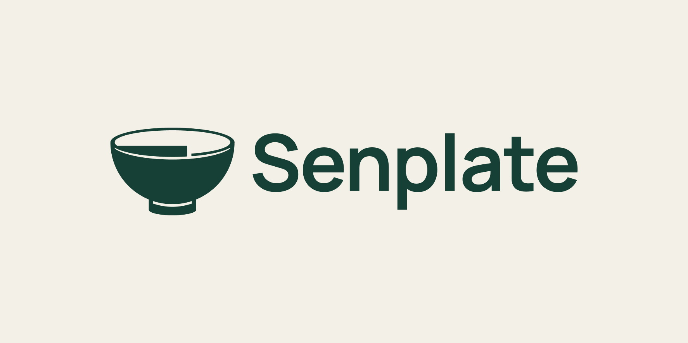

# Senplate V6 · 实体碗的黄金比例矢量构造

日期：2026-09-17。状态：VECTOR_RECONSTRUCTION_COMPLETE — MEASURED_GOLDEN_RATIOS — VISUAL_REVIEW。

用户在得知V5只有ImageGen比例参考、没有实际校验后明确“开始吧”，授权以新实体碗为基准进行可编辑矢量、黄金比例与小尺寸工作。本轮无需重复询问是否可以开始；这不自动等于用户已批准最终审美或商标注册。

## 实际图稿

保留V5的完整碗口、向下收拢的实体碗身、底脚及口沿阶梯形留白。消除生成纹理，使用确定的曲线与透明负形；没有把原像素边缘自动描成毛刺。旧A／开口环不再参与本次构造。

字标写Senplate。为使字标真正可编辑并有确定来源，本轮采用Manrope Bold、-2%字距，再按实际字形外接高度统一等比缩放；不是声称识别出了V5生成图的原字体。Figma保留文本原稿和转轮廓字标，交付SVG无需安装字体。Manrope的[SIL OFL 1.1授权文本](https://raw.githubusercontent.com/google/fonts/main/ofl/manrope/OFL.txt)已核对并随素材保存。

## 黄金比例构造

φ=(1+√5)/2≈1.6180339887。设A=320，依次用前一项除以φ得到B–F，先计算、再绘图。

| 编号 | 对应实际部位 | 目标值（设计单位） | 最终Figma路径测量值 |
|---|---|---:|---:|
| A | 碗口最外宽度 | 320.000000 | 320.000000 |
| B | 从后口沿最高点到碗身／底脚分界，**不含底脚** | 197.770876 | 197.771214 |
| C | 底脚外宽 | 122.229124 | 122.228516 |
| D | 碗口完整椭圆高度 | 75.541753 | 75.541992 |
| E | 符号与转轮廓字标之间的实际间距 | 46.687371 | 46.687378 |
| F | 底脚低于碗身分界的高度 | 28.854382 | 28.853786 |

目标关系：A/B=B/C=C/D=D/E=E/F=φ。实际五项比值约为1.618031、1.618045、1.618021、1.618039、1.618068；最大比值误差约0.000034，尺寸误差均小于0.001设计单位。差异来自Figma布尔运算／路径导出的数值取整，不把导出说成无限精度。

碗口上半部为椭圆，碗身下轮廓取自半径160的镜像半圆；底脚依实际相交位置连接。完整符号高度约226.625，**不是**把含底脚的总高称为197.771。口沿阶梯处在x=320/φ，负形用布尔减法连通。每一笔曲线并非都来自黄金螺线，黄金关系不等于审美优劣的实证。

[构造图](../../output/brand/2026-09-17-senplate-bowl-golden-v6/golden-construction.png)、[绘制前的计算参数](../../output/qa/senplate-bowl-golden-v6-2026-09-17/golden-construction.json)、[Figma实际路径](../../output/qa/senplate-bowl-golden-v6-2026-09-17/figma-geometry.json)、[独立测量结果](../../output/qa/senplate-bowl-golden-v6-2026-09-17/measured-golden-ratios.json)。测量脚本从最终路径与x=160的交点识别口沿、碗身底和脚底，未直接拿目标JSON当作测量值。另对[实际交付SVG](../../output/qa/senplate-bowl-golden-v6-2026-09-17/measured-svg-export.json)重新解析测量，最大尺寸误差约0.000824单位，仍小于0.001。

## 文件与复核

- [矢量素材包](../../output/brand/Senplate_Bowl_Golden_Vector_v6.zip)
- [主Logo SVG](../../output/brand/2026-09-17-senplate-bowl-golden-v6/senplate-logo-green.svg)／[独立符号SVG](../../output/brand/2026-09-17-senplate-bowl-golden-v6/senplate-symbol-green.svg)
- [单色与32／64／128px样本](../../output/brand/2026-09-17-senplate-bowl-golden-v6/monochrome-and-sizes.png)
- [Figma实体碗工作页](https://www.figma.com/design/UyYjnTFGWO0r1lj4uvghGp?node-id=79-2)：页面76:2；布尔构造77:8；生产符号78:9；主组合78:10；可编辑文字76:3／轮廓字标76:6；预览79:2；检查79:6；构造80:2。

放大查看主稿、口沿负形与脚底衔接；查看黑、反白及32／64／128px样本。32px保留碗的轮廓，口沿细节更清楚的场景建议48px以上；这不是目标用户识别率或实机测试。外轮廓574点镜像采样最大距离约0.000001设计单位，内部量位切口保持偏置。

本轮是基本Logo矢量及验证，不是完整VI、App实现、实物加工测试或商标清查。旧V5原生图和更早资产保留；收尾记录见[QA](../../output/qa/senplate-bowl-golden-v6-2026-09-17/closeout-validation.json)。
