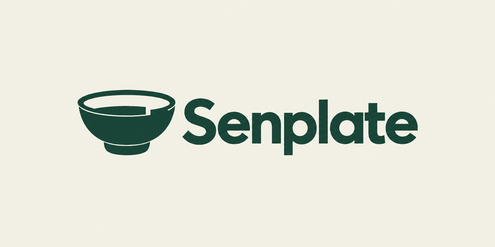

# Senplate V5 · 实体碗重新设计

日期：2026-09-17。状态：HISTORICAL_RASTER_REFERENCE — VECTOR_WORK_AUTHORIZED。用户随后在获知本图没有精确黄金比例验证后明确“开始吧”，授权进行[V6矢量与比例构造](senplate-bowl-golden-v6.md)。以下保留V5当时的生成过程与边界，不再作为阻止矢量工作的待确认项。

用户认为V4已经无法认出是碗，并明确要求重新设计。原开口椭圆环路线停止；Senplate名称和深绿／米白基调保留，新图形不再受A的盘沿、三角份量或悬空圆点限制。

本轮先做一个新的实体碗概念，优先看清碗口、完整碗身及底部，再将一处份量／水平参照细节融入。使用内置ImageGen，不沿用自动描摹或继续改旧椭圆，不扩展整套VI。候选字标建议用Senplate，与iOS显示名称一致；这不是用户已经选定新的字标。

黄金比例继续作为比例参考，但原生生成图片没有精确几何验证。先确认新造型是否能读成碗，再做矢量和尺寸规范；不得提前宣称新稿已获认可、已完成SVG或商标检索。

## 当前图稿与检查



实际使用内置ImageGen生成一个新概念，再作一次定向编辑以补齐不透明米白底及减少材质效果。首张为透明PNG，保留为[生成原稿](../../output/brand/2026-09-17-senplate-bowl-redesign-v5/bowl-01-generated.png)；展示版为[当前概念](../../output/brand/2026-09-17-senplate-bowl-redesign-v5/bowl-01-concept.png)。没有改动旧V4素材或代操作GPT网页，也没有使用CLI/API替代。

助手视觉检查：可见完整椭圆碗口、向下收拢的实体碗身、底脚，以及前口沿的阶梯形留白；文字拼写为Senplate。旧开口环和悬空圆点不再沿用。阶梯形细节用于表达份量／水平参照的设计意图，尚未经过目标用户理解测试。

当前图片仍有轻微生成纹理和较细的口沿／底脚缝隙，属于候选效果图，不是已完成的纯色矢量母版。用户认可造型后，再简化细线、整理曲率与光学字距、做32px等检查及精确比例核对。当前没有整套VI、PNG透明系列、SVG或App图标交付。

完整提示词与编辑词保留如下；文件和旧资产保护核对见[本轮QA](../../output/qa/senplate-bowl-redesign-v5-2026-09-17/closeout-validation.json)。

## 实际生成提示词

```text
Use case: logo-brand.
Create one completely NEW premium logo concept for the brand "Senplate", an AI and sensor system that continuously observes real food portions and remaining food, helping people decide how much to serve or replenish. It is used in dining services and personal meal recording.

The crucial design requirement: the symbol must clearly read as a REAL DINING BOWL before it reads as technology. Show the bowl in a restrained front-three-quarter view, slightly from above: a visibly open oval mouth, continuous substantial sidewalls curving down from a wider rim to a narrower stable base, and a clear bottom/foot. The filled body beneath the rim must be present. Do not depict merely a flat oval, an open elliptical ring, a collar, a power-button U, or an orbital swoosh.

Art direction: elegant, precise, mature contemporary identity for intelligent kitchen hardware, warm but not cute. Develop a unified compact bowl symbol, with one purposeful negative-space notch or small stepped level detail integrated into the rim or bowl wall, subtly expressing measured portions. Keep the main vessel silhouette clear, simple and substantial. The detail should feel intrinsic to the bowl, not a pasted-on sensor icon. At most a very restrained abstract food-level shape inside the opening; no food illustration, no conical mountain and no detached dot floating above it. No human figure, face, mascot, leaf, recycling arrows, fork/spoon, Wi-Fi arcs, AI sparkles, measurement numbers or medical imagery.

Use flat deep forest green #163F35 on a clean warm ivory #F3F1E7 background. Smooth polished curves, deliberate negative space, no textures, no gradient, no shadows, no bevels, no 3D rendering or mockup. Draw it with a clean vector-like finish, without claiming the image is an actual vector file. Let golden-ratio-inspired proportions guide the bowl width, depth and spacing only when they support recognition; do not show spirals, grids, ratio labels or technical construction lines.

Composition: one generously sized horizontal logo lockup centered in a quiet landscape image with plenty of breathing room. Put the distinctive bowl symbol to the left of the exact word "Senplate" (capital S, then lowercase e n p l a t e) in a beautifully spaced contemporary sans-serif wordmark of medium-bold weight. The bowl and wordmark should feel like a finished visual concept at the same optical weight. Only that single logo lockup on the background. No poster title, no explanatory copy, no slogan, no variant sheet, no app icon mockups, no contact sheet, no border, no watermark, no trademark symbols.
```

## 一次定向编辑提示词

编辑目标为上面的透明生成原稿，实际仍使用内置ImageGen。

```text
Edit this logo concept as a flat presentation image. Preserve the new bowl silhouette, complete bowl body and foot, the small integrated rim/level step, the exact word "Senplate", the letterforms, symbol-to-type proportions and placement. Do not change it back to a ring. Remove all shading, grain, gradients, 3D material cues and texture: bowl and wordmark must be one uniform solid deep green #163F35, with clean smooth edges. Fill the entire rectangular artboard with a uniform, fully opaque warm ivory #F3F1E7; the mouth and negative spaces should show the same ivory. The background is an integral visible part of this presentation image. Do NOT produce transparency, a transparent cutout, a black background, a checkerboard or a shadow. Preserve generous clear margins. Only this single bowl-and-Senplate lockup, with no extra text or elements.
```
