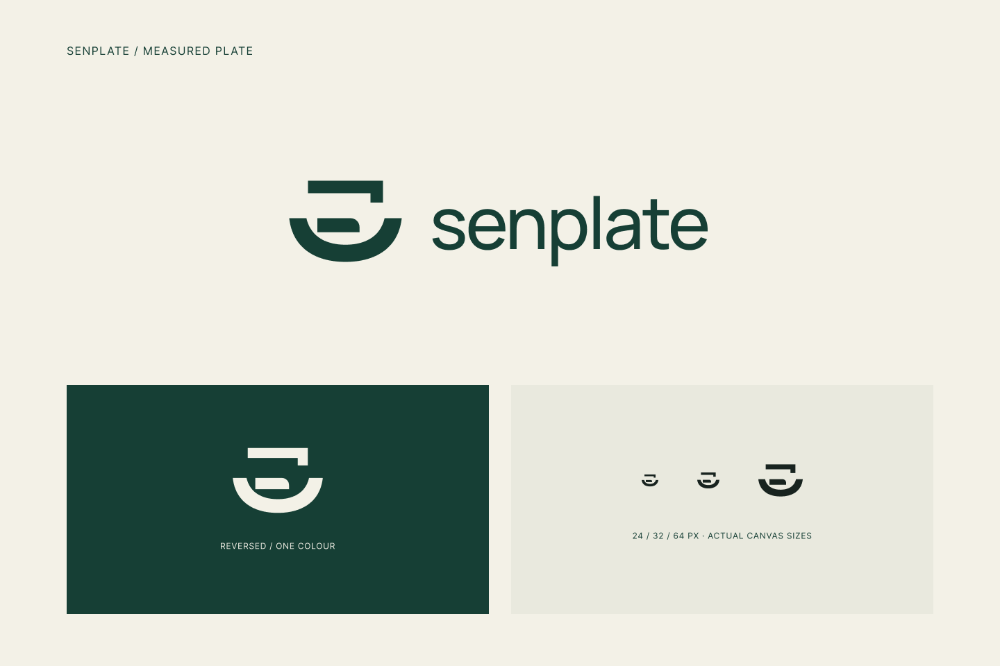

# Senplate Logo R5 · Measured Plate / 餐食计量

日期：2026-09-17。状态：**HISTORICAL — SUPERSEDED_BY_SELECTED_A**。用户随后上传“A方案·细化版”并明确选用，当前依据为[brand.md](../../brand.md)。以下保留R5的设计意图、资产及当时证据，不再等待评价；R5未被选作最终Logo。

## 当前设计意图

本稿保留深绿#163F35、米白#F3F1E7及小写senplate字标，改用“被测量的餐食”作为核心语义。下方浅盘弧线与上方计量参照共同构成标记，盘内有偏置的份量块。

| 图形特征 | 与项目的联系 |
|---|---|
| 下部浅盘／承载弧线 | 指向实际餐食与供餐容器，适用于供餐、学校样本和个人餐食配置 |
| 盘内份量块及周围空白 | 表示可被观察的食物份量／余量，不代表某种食物或固定营养占比 |
| 上部带短折角的基准带 | 表示计量和参照，呼应感知份量后判断何时补餐或怎样调整 |

这些是设计意图，不是用户识别测试的结论。Logo只承担“餐食＋感知份量”的主要关联，不要求把AI芯片、相机、秤、营养与循环箭头全部拼在一个图形里。没有声称新算法、营养诊断、准确率或实际减损效果。

## 图稿与源文件

- [Figma评审](https://www.figma.com/design/UyYjnTFGWO0r1lj4uvghGp?node-id=28-2)：新增R5，旧图不覆盖。
- [符号SVG](../../output/brand/2026-09-17-senplate-r5/measured-plate-mark.svg)、[横向组合SVG](../../output/brand/2026-09-17-senplate-r5/measured-plate-signature.svg)、[反白SVG](../../output/brand/2026-09-17-senplate-r5/measured-plate-reverse.svg)。
- [资产清单](../../output/brand/2026-09-17-senplate-r5/manifest.json)记录原生PNG、节点、字体、尺寸与哈希。

Figma母稿26:3，评审28:2，紧边界横向组合32:2。构图144×104单位，工作母稿216×156；小图放入24／32／64px正方形画布内，保持原比例居中。字标沿用Manrope Medium，104px字号、-3%字距及40px图文间距；仍未完成最终字体授权归档或正式VI手册。

## 给用户独立尝试的提示词

[Senplate_Logo_ImageGen_Brief.md](../../Senplate_Logo_ImageGen_Brief.md)已完成，包含完整背景、主提示词、A/B/C三个语义方向、避免的结构、输出格式与选中后的细化提示词。无需先读项目历史；不包含组员学号、邮箱、预算或其他不必要身份资料。

本文件供用户自行在网页版尝试。没有打开、操作或向用户的GPT网页会话提交内容，没有调用或宣称使用了某个特定网页版图像模型，也不保证提示词切换模型。网页端后续成图是新候选，不自动作为Senplate正式资产。

## 保留与检查

用户对R4的评价是视觉可接受但意义不足，不能改写成“全部丑”或完全否决其视觉气质。[R4](senplate-logo-profile-r4.md)保留为视觉参考，Figma框名改为REFERENCE；原图片与SVG不变。原Interval近似检索及更早否决稿继续保留。

R5横向组合、反白和小尺寸已实际查看；PNG由Figma原生导出、SVG文本转为轮廓，Figma内文本可编辑。没有用Python重绘或修改图像。语义是否让目标用户自然理解，仍需后续评价。

本轮**没有为R5做新的图库近似筛查或官方商标图像查询**。旧稿查询不能沿用为新稿权利结论，当前是设计草稿，不是已批准Logo或可注册性意见。

[阅读记录](../../output/qa/senplate-logo-r5-2026-09-17/reading-record.json)、[收尾检查](../../output/qa/senplate-logo-r5-2026-09-17/closeout-validation.json)。学校文件、硬件范围、身份、商业及赛事信息保留；无App编码、购买、注册或对外联系。

## 当前后续入口

选稿已经完成。转到[已选A版品牌规范](../../brand.md)继续后续界面设计；本稿及其字体、母版编号不能混用为新Logo。
