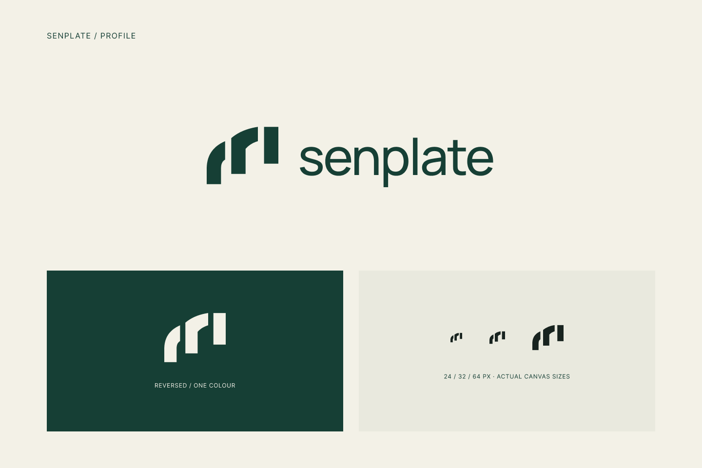

# Senplate Logo R4 · Profile / 层序

日期：2026-09-17。状态：VISUAL_REFERENCE — SEMANTIC_REVISION_REQUESTED。用户认为本稿视觉尚可，但项目关联及意义不足；当前修订为[R5餐食计量](senplate-logo-measured-plate-r5.md)。这是对视觉气质的有限认可，不是整个Logo获批，也不是完全否决视觉。Profile／层序仅为内部方向名。

## 本轮修改

保留深绿#163F35、米白#F3F1E7及小写senplate字标。替换旧稿“双折面围出方形中空、两处斜向开口”的核心结构，改为三个开放、互不连接的纵向轮廓。前两段使用弧形顶部，第三段保持直边；下端依次错位，避免统一基线造成普通柱状图的印象。

这不是把Interval换色或旋转。原稿在Figma标为ARCHIVE，几何与本地导出保留，详见[旧稿](senplate-vector-logo-studies.md)及[近似初筛](../../research/2026-09-17-logo-similarity/similarity-review.md)。本次没有新增产品功能或改变硬件。

## 当前图形

构图范围140×112单位，主竖段宽28单位，基本水平间隔12单位。三段下端分别位于112、92、72单位；工作母稿为210×168像素。三段的前后层次可呼应观察食物轮廓与连续变化，属于设计解释，不对应传感器精度、三个食物组或已验证算法。

字标沿用Manrope Medium，横向组合104px字号、-3%字距，图文间距40px。字体可用样式已在Figma确认并加载；尚未完成最终字体授权归档、逐字定制字距或完整VI手册。

## 文件与Figma

- [当前Figma评审画板](https://www.figma.com/design/UyYjnTFGWO0r1lj4uvghGp?node-id=15-2)：原生向量及可编辑文字。
- [符号SVG](../../output/brand/2026-09-17-senplate-r4/profile-mark.svg)、[横向组合SVG](../../output/brand/2026-09-17-senplate-r4/profile-signature.svg)、[反白SVG](../../output/brand/2026-09-17-senplate-r4/profile-mark-reverse.svg)。SVG字标转为轮廓，不依赖字体加载；Figma源文本保留。
- [资产清单](../../output/brand/2026-09-17-senplate-r4/manifest.json)记录导出来源、节点、尺寸、状态与哈希。
- 最终母稿节点22:3，主评审15:2，紧边界横向组合18:2；原始齐底试稿13:2已归档，旧Interval的2:2／5:2也归档，未改它们的图形内容。

## 对照与检查

最终几何重新与固定版本Simple Icons中的3454个图形进行候选检索，人工复核前16项及5个补充标记，共21项；另实际查看图片搜索中Pillar Konstruksi的三柱加双弧形标记。候选只是辅助发现，不提供法律相似度或清查结论。

已查到的Aqua、OPNsense及机械革命图形的双折面围框关系不再出现在本稿。三条形状和弧线本身属于常见视觉语言，仍需用户评价辨识度；没有宣称新的结构全球独有、必然可注册或已通过官方图形检索。旧Interval的香港／美国查询结论不能直接套到新稿。

本次只进行原生矢量制作、公开图形快速对照及小尺寸检查，**没有重新向香港、美国、内地、WIPO或欧盟提交新稿图像查询**。图标库与候选记录沿用已有公开数据，未把他人图形导入Senplate资产。

主图、反白与24／32／64px已实际查看；小图放在相应正方形画布内，按5:4原比例居中，不拉伸为正方形。三个轮廓及中间间隔保持可辨。原生PNG字节保存，未用Python修图；初次批量导出响应超长截断，后拆为SVG与PNG两次完整导出。

读档与范围见[记录](../../output/qa/senplate-logo-r4-2026-09-17/reading-record.json)，候选排序见[数据](../../output/qa/senplate-logo-r4-2026-09-17/ridge-library-ranking.json)，最终[核对](../../output/qa/senplate-logo-r4-2026-09-17/closeout-validation.json)。文档、身份、旧图和研究证据保留；没有App编码、购买、提交、对外联系或发布组件库。

## 唯一下一步

R4保留为色调、字标和视觉质感参考。用户比较[R5](senplate-logo-measured-plate-r5.md)及其网页端独立生成候选，再选定同时满足视觉与项目语义的方向；不自动批准或启动App还原。
