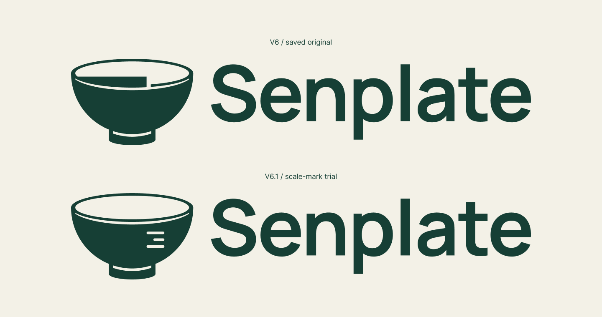

# Senplate V6.1 · 刻度小修试稿

日期：2026-09-17。状态：TRIAL_ONLY — V6_RETAINED_UNCHANGED。

用户明确要求先保留V6，再基于其小修，把感觉不自然的阶梯形口沿换成刻度试试看。本轮只制作独立试稿，不覆盖V6，不将试稿自动设为默认Logo。

## 局部改动

- 移除原来口沿内的阶梯填充和竖向缺口，内开口恢复为完整椭圆。
- 在碗身右侧设置三条右对齐的圆端刻线，顺序为长—短—长，不加数字。
- 碗身外轮廓、口沿分界线、底脚分界线、字标路径、组合宽高和图文间距沿用V6。

长线46.6874、短线28.8544、厚6.8116、中心间距17.8330，均使用原V6尺寸系列；长／短约为φ。刻线是品牌图形，不附实际测量单位。32px时刻度细节较弱，64px更清楚；未做实机或用户识别率测试。

## 保留与检查

V6原素材包、全部导出、原构造说明与QA文件原样保留。Figma只操作副本：原V6的8个源稿／预览节点状态前后相同；试稿中的外轮廓、口沿线及脚底线与基准源路径相同，字标路径也相同，排版主要参数相同。

另外比较两版960×680原生PNG的透明度，碗口及刻度区域之外没有检测到变化。文件保护、Figma不变量和像素局部检查见[本轮QA](../../output/qa/senplate-v6-tick-study-2026-09-17/closeout-validation.json)。这些检查证明修改范围，不代表用户已经选用。

## 文件

- [独立试稿预览](../../output/brand/2026-09-17-senplate-v6-tick-study/tick-preview.png)
- [横向Logo SVG](../../output/brand/2026-09-17-senplate-v6-tick-study/tick-logo.svg)／[独立符号SVG](../../output/brand/2026-09-17-senplate-v6-tick-study/tick-symbol.svg)
- [原V6素材包](../../output/brand/Senplate_Bowl_Golden_Vector_v6.zip)保持不变。
- [Figma对照](https://www.figma.com/design/UyYjnTFGWO0r1lj4uvghGp?node-id=85-13)：页面76:2；试稿布尔84:3、符号84:22、组合85:2、预览85:6、对照85:13，32／64px为85:24／85:26。

不新增字体、不改配色，不扩展VI或App代码，没有新商标检索。下一步根据用户比较结果决定是否采用刻度处理；V6始终保留为基准。
