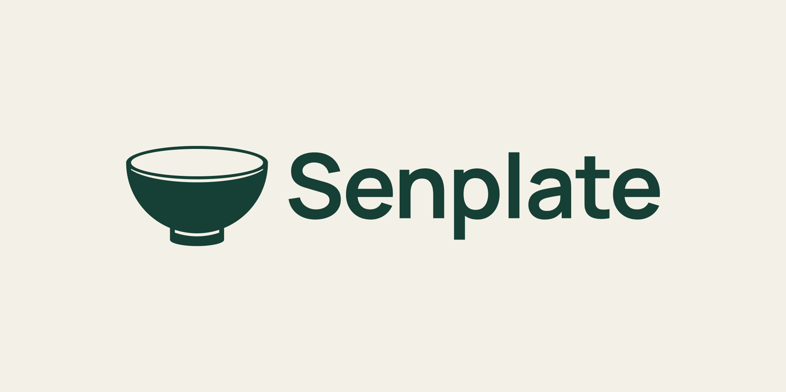

# Senplate V7 · 已选纯碗版

日期：2026-09-18。状态：USER_SELECTED — CURRENT_LOGO。

用户明确决定“算了不用刻度了，只保留那个碗就好”。当前采用完整、无刻度的碗形；停止刻度探索，V6及V6.1–V6.5转为历史版本，原文件与源稿全部保留。

## 当前形式

符号保留完整椭圆碗口、实体碗身、底脚及其分界留白。没有内外刻度、划痕或阶梯量位缺口。直接复用上一轮纯碗对照的精确路径，未重新生成或描摹。

横向组合沿用Senplate首字母大写、Manrope Bold字标与原间距。主色#163F35、底色#F3F1E7。符号320×226.625，字标实际高度197.770874，图文间距46.68737，组合宽1204.61255。

主要构造尺寸继承V6：口宽320、碗身高197.770876（不含底脚）、脚宽122.229124、口沿椭圆高75.541753、图文间距46.687371、脚伸出28.854382。历史[V6构造与测量](../2026-09-17/senplate-bowl-golden-v6.md)保留；本轮核对路径复用及组合一致性，没有把旧稿全部曲线测量重新表述为V7新测结果。

## 文件与核对

- [Logo SVG](../../output/brand/2026-09-18-senplate-plain-bowl-v7/senplate-logo.svg)／[透明PNG](../../output/brand/2026-09-18-senplate-plain-bowl-v7/senplate-logo.png)。
- [纯碗SVG](../../output/brand/2026-09-18-senplate-plain-bowl-v7/senplate-symbol.svg)／[透明PNG](../../output/brand/2026-09-18-senplate-plain-bowl-v7/senplate-symbol.png)。
- [素材包](../../output/brand/Senplate_Plain_Bowl_v7.zip)含上述核心文件、预览、64px小样、清单及既有Manrope许可副本；不是完整VI手册。
- [Figma当前预览](https://www.figma.com/design/UyYjnTFGWO0r1lj4uvghGp?node-id=106-13)，页面76:2；可编辑源106:2／布尔106:3，符号106:8，组合106:9，预览106:13，64px样本106:18。
- [QA](../../output/qa/senplate-plain-bowl-v7-2026-09-18/closeout-validation.json)核对48个旧节点、纯碗路径、字标与排版、文件保护、SVG和链接。已实际查看完整预览和64px，不称实机测试。

当前Logo选择已经完成，不再等待用户在刻度方案中挑选。后续视觉工作使用V7；本轮没有展开App界面或应用代码。
