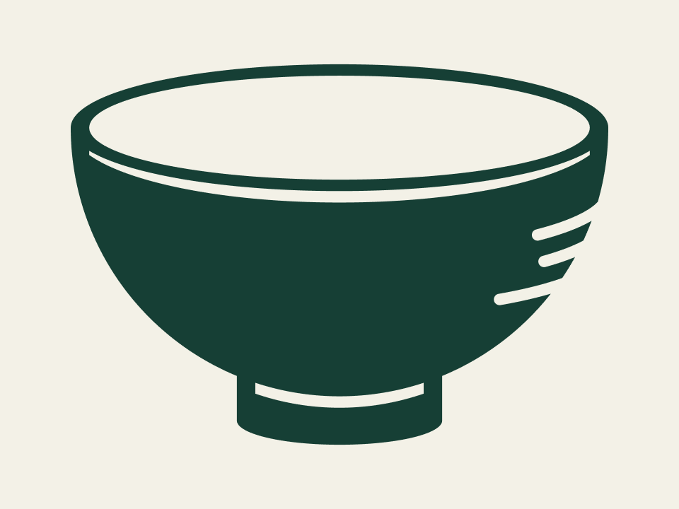

# Senplate V6.4 · 贴合碗口的弧形刻度

日期：2026-09-18。状态：TRIAL_ONLY — V6_RETAINED。

用户要求在V6.3基础上把刻度弧度加大、更贴近碗的弧度。本轮只调整三条刻线的曲线构造，V6及V6.1–V6.3源稿、导出和原QA保留。

## 几何与效果

三条线参照碗口半轴160／37.7708764的椭圆弧构造，分别平移到右侧原锚点。以三次贝塞尔近似椭圆弧，再将6.8115956等宽圆端描边转为负形。

边缘锚点高度88／110／132、向内水平跨度34／21／34沿用V6.3；内端相对边缘的下沉由原4单位增加至约13.674／7.450／8.094单位，曲线走势更明显。圆端方向随曲线切向转动。局部不是额外黄金螺线，宏观比例沿用原构造。

碗身基底、内口、口沿线、底脚、字标和主要排版不改。成品右边缘仍被三条负形切入；曲率变化会改变该局部切口，不称最终外轮廓逐点一致。

已查看整体对照、放大及米白底32／64px样本；64px刻线仍可辨，32px弧度细节较弱。此为视觉试稿，未获用户选用，不作实机识别率或商标判断。

## 交付

- [前后对照](../../output/brand/2026-09-18-senplate-v6-curved-ticks/curved-comparison.png)／[完整Logo](../../output/brand/2026-09-18-senplate-v6-curved-ticks/curved-preview.png)／[放大图](../../output/brand/2026-09-18-senplate-v6-curved-ticks/curved-detail.png)。
- [Logo SVG](../../output/brand/2026-09-18-senplate-v6-curved-ticks/curved-logo.svg)／[符号SVG](../../output/brand/2026-09-18-senplate-v6-curved-ticks/curved-symbol.svg)／[清单](../../output/brand/2026-09-18-senplate-v6-curved-ticks/manifest.json)。
- [Figma对照](https://www.figma.com/design/UyYjnTFGWO0r1lj4uvghGp?node-id=97-46)，页面76:2；布尔97:3、符号97:36、组合97:37、预览97:41、对照97:46、放大98:8、小样98:2／98:5。
- [检查记录](../../output/qa/senplate-v6-curved-ticks-2026-09-18/closeout-validation.json)：旧文件／31个旧Figma节点保护、共同构造和字标／排版、SVG与链接。首次描边轮廓化后定位异常已在视觉检查中发现并修正，错误临时生产节点97:26已删除，不在交付中。

下一步根据用户对加大弧度后的观感继续局部调整；未选定前保留V6基准，无完整VI扩展或应用代码。
