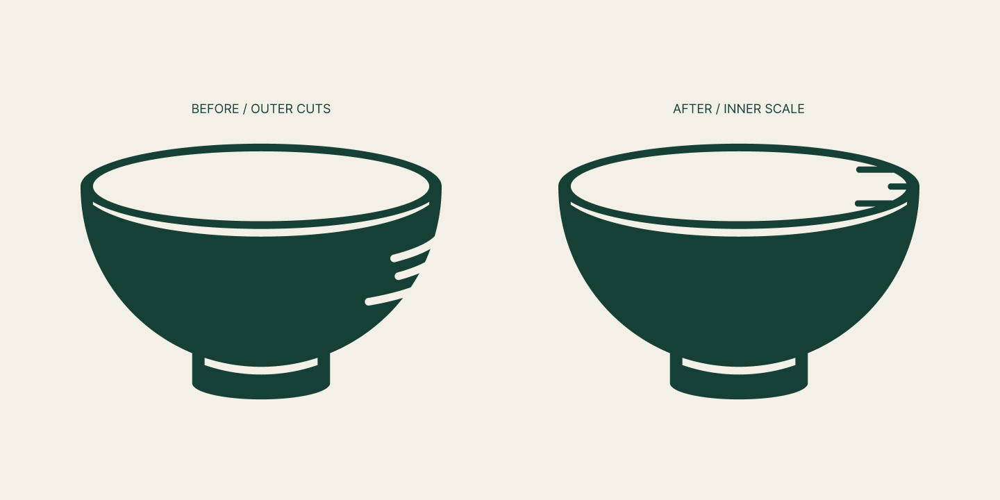

# Senplate V6.5 · 完整碗形与内壁刻度

日期：2026-09-18。状态：TRIAL_ONLY — V6_RETAINED。

用户先反馈V6.4仍怪，随后明确是“刻度像划痕，和碗不融合”。本轮集中解决该问题：恢复连续外轮廓，刻度移到碗口内侧。具体内壁处理是设计尝试，用户尚未选用。

## 处理

删除外侧三处弧形缺口。将三条深绿刻线接到椭圆内口的右侧边界，向内部伸出；高度23／38／53，长27／短17／长27，厚5.6，圆端。曲线切口改为水平量位标记，意图更接近量碗内壁；不把意图当用户识别测试结果。

通过“内开口减去三条刻线”作为碗身的负形，刻度局限在内口区域，外轮廓保持完整。碗身基底、椭圆内口原构造、口沿线和底脚沿用。宏观比例及原字标保留，局部参数按视觉调整，没有新的精确黄金比例主张。

已查看放大、等尺寸旧／新对照及米白底32／64px。64px可见内口标记，32px分隔细节较弱。仅导出符号和比较图，没有重复制作完整VI或新横向字标包。

## 源稿和交付

- [对照](../../output/brand/2026-09-18-senplate-v6-inner-scale/inner-comparison.png)／[放大](../../output/brand/2026-09-18-senplate-v6-inner-scale/inner-detail.png)／[符号SVG](../../output/brand/2026-09-18-senplate-v6-inner-scale/inner-symbol.svg)。
- [Figma对照](https://www.figma.com/design/UyYjnTFGWO0r1lj4uvghGp?node-id=102-2)，页面76:2；布尔100:3、内口100:14、符号100:25、对照102:2、放大102:11、小样103:2／103:5。
- 过程中另有纯碗结构对照101:17／101:18，作为定位问题的内部对照。用户澄清后以带内壁刻度试稿为本轮展示，不将纯碗视为已选方案。
- [QA](../../output/qa/senplate-v6-inner-scale-2026-09-18/closeout-validation.json)记录39个旧Figma节点及历史文件保留、共同构造、SVG与内链；全部V6至V6.4源稿和原QA不改。

下一步只评估内壁刻度能否消除划痕感。未经选定不替换V6基准，无App代码或新商标查询。
