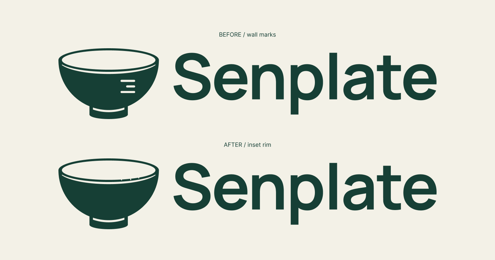

# Senplate V6.2 · 碗沿微刻度试稿

日期：2026-09-18。状态：TRIAL_ONLY — V6_AND_V6_1_RETAINED。

用户认为V6.1的刻度突兀。本轮只调整刻度的大小和位置，保留V6原版以及V6.1供回看，不代表用户已经选用新稿。

## 本轮改动

删除副本中碗壁上的长—短—长三条圆端横线，将计量暗示收进碗口前方偏右的内沿。三条短刻痕从内口边缘伸入绿色口沿，方向沿椭圆局部法线排列；中间略长，两侧略短，不加数字。它们是品牌细节，没有实际量具的计量意义。

内口椭圆中心(160,37.7708764)、半轴(148.9786068,30.9592808)。三处角度50°、62°、74°；宽2.8，中间深4.2，两侧深2.6，均向内口重叠0.9设计单位以保证连接。新刻痕按视觉调整，**没有把这些局部参数称为精确黄金比例**。

碗身、底脚、原口沿分界线、完整椭圆内口与V6.1相同。字标路径、组合尺寸1204.61255×226.625及图文间距46.68737相同；V6的主要黄金比例关系保留。32px／64px原生样本已查看：碗形保持，刻痕很弱，不能把它当小尺寸唯一识别点。未进行实机或用户识别测试。

## 源稿与交付

- [整体预览](../../output/brand/2026-09-18-senplate-v6-rim-tick-study/rim-preview.png)／[新旧对照](../../output/brand/2026-09-18-senplate-v6-rim-tick-study/rim-comparison.png)／[符号放大](../../output/brand/2026-09-18-senplate-v6-rim-tick-study/rim-detail.png)
- [Logo SVG](../../output/brand/2026-09-18-senplate-v6-rim-tick-study/rim-logo.svg)／[符号SVG](../../output/brand/2026-09-18-senplate-v6-rim-tick-study/rim-symbol.svg)／[素材说明](../../output/brand/2026-09-18-senplate-v6-rim-tick-study/README.md)
- [Figma对照](https://www.figma.com/design/UyYjnTFGWO0r1lj4uvghGp?node-id=89-33)，页面76:2。布尔89:3，符号89:23，组合89:24，预览89:28，对照89:33，放大90:8，32／64px样本90:2／90:5。
- [保留V6](../2026-09-17/senplate-bowl-golden-v6.md)及[V6.1历史试稿](../2026-09-17/senplate-v6-tick-study.md)的源稿、导出和原QA不修改。

## 检查与下一步

对修改前后15个V6／V6.1源稿和预览节点记录状态指纹；四个公共构造部件、字标路径及组合宽高／间距一致。受保护文件、局部PNG变化及内链检查见[本轮QA](../../output/qa/senplate-v6-rim-tick-study-2026-09-18/closeout-validation.json)。

原生PNG对比另有18个差异像素位于内口椭圆边缘一个像素范围内，最大透明度差16／255；源椭圆仍完全相同，未声称改动区外像素完全一致。

本轮为局部矢量试稿，没有新增完整VI、字体、App代码或图形商标查询。下一步根据用户对微刻度的视觉反馈决定保留、简化或取消该细节；未经明确选用，不替换V6基准。
