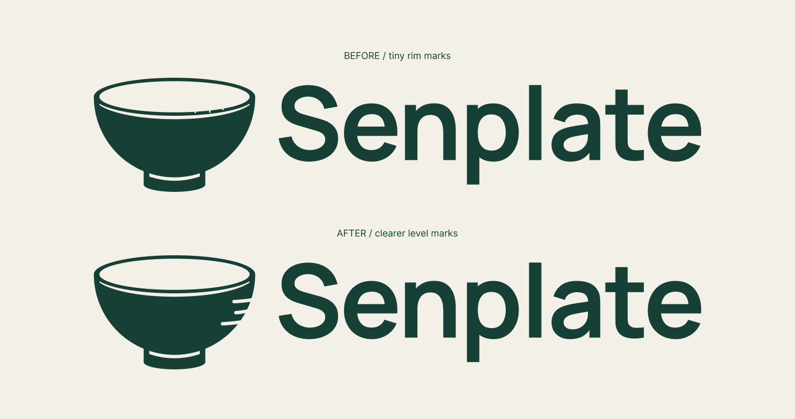

# Senplate V6.3 · 清晰量位线试稿

日期：2026-09-18。状态：TRIAL_ONLY — V6_RETAINED。

用户反馈V6.2的微刻度太不明显，要求在连续小修中提高可见性。V6、V6.1和V6.2原稿保留，新稿未被选用。

## 改动与取舍

恢复无微刻痕的完整椭圆内口，三条量位线移到碗口下方的右侧。线从右侧轮廓向内伸入，轻微弯曲、内端圆润，按长—短—长排列，避免独立悬浮在碗壁中央。此处理有意改变右侧局部轮廓；不能声称最终外轮廓完全未改。

碗身基底、碗口、底脚、字标路径及组合排版保持。三个高度88／110／132，线厚6.8115956，长线34、短线21，内端下沉4设计单位。34／21≈1.619，局部为视觉参数，不冒称精确黄金比例。V6宏观构造关系继续沿用。

已查看完整组合、放大图及米白底原生32／64px样本。64px的三处轮廓刻线比V6.2微刻痕更明显；32px仍受像素限制，圆端和曲率细节变弱。不是实机或用户识别率验证，也不代表用户已认可这次轮廓变化。

## 交付与源稿

- [完整预览](../../output/brand/2026-09-18-senplate-v6-visible-ticks/visible-preview.png)／[新旧对照](../../output/brand/2026-09-18-senplate-v6-visible-ticks/visible-comparison.png)／[放大图](../../output/brand/2026-09-18-senplate-v6-visible-ticks/visible-detail.png)。
- [Logo SVG](../../output/brand/2026-09-18-senplate-v6-visible-ticks/visible-logo.svg)／[符号SVG](../../output/brand/2026-09-18-senplate-v6-visible-ticks/visible-symbol.svg)／[素材说明](../../output/brand/2026-09-18-senplate-v6-visible-ticks/README.md)。
- [Figma对照](https://www.figma.com/design/UyYjnTFGWO0r1lj4uvghGp?node-id=94-11)，页面76:2；布尔93:3，生产符号93:23，组合94:2，预览94:6，对照94:11，放大94:30，32／64px为94:24／94:27。
- [QA](../../output/qa/senplate-v6-visible-ticks-2026-09-18/closeout-validation.json)记录旧版文件保护、23个旧Figma节点、公共源几何、字标／排版、PNG局部变化和链接检查。

PNG另有11个细微差异像素位于共同碗身弧线的1px范围内，最大透明度差32／255，记录为布尔细分后的边缘光栅差异；未声称局部修改区域以外像素完全相同。

下一步依据用户对清晰度和轮廓融合的反馈继续局部调整。原V6仍为保留基准；没有App代码、完整VI扩展或新商标查询。
