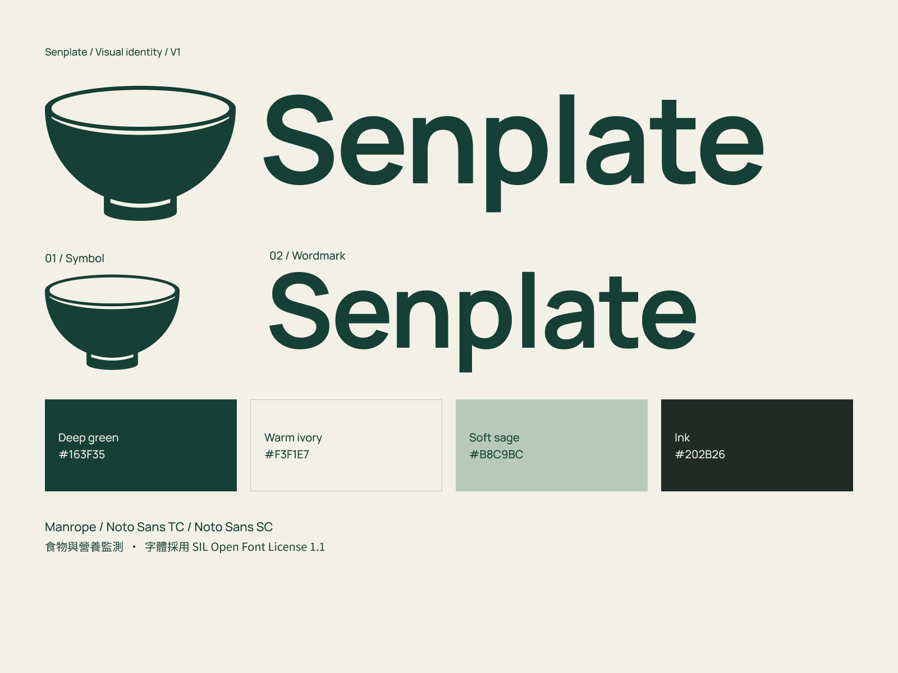

# Senplate VI V1 交付

日期：2026-09-18。状态：VI_V1_DELIVERED — V7_LOGO_PRESERVED — APP_NOT_IMPLEMENTED。

用户要求独立Logo图形、独立文字、整套视觉识别和字体商用核查，并已澄清“ai”指VI。主图形沿用已选V7纯碗，不重新设计，不加入刻度。

## 本次内容

1. 独立图形、独立字标、横向、上下组合，均提供绿／黑／反白SVG和透明PNG，共12个版本。
2. [11页规范手册](../../output/pdf/Senplate_VI_Guidelines_v1.pdf)：标志系统、配色版本、留白与最小尺寸、色彩、字体层级、App图标、应用模板、禁用方式、字体许可及文件使用。
3. [4页矢量总表](../../output/pdf/Senplate_Vector_Assets_Master_v1.pdf)。
4. 1024px App图标主版／浅色版、未裁切透明前景／纯色背景；演示封面、菜单立牌与设备标贴SVG／PNG。
5. 三种当前原字体、许可、[字体核查](../../research/2026-09-18-font-licences/font-licence-audit.md)、JSON／CSS令牌、可编辑字标SVG和Figma源稿指引。

[完整素材包](../../output/brand/Senplate_VI_Kit_v1.zip)／[目录说明](../../output/brand/2026-09-18-senplate-vi-v1/README.md)。

## 字体与规范决定

实际字标为Manrope Bold700；VI英文继续使用Manrope，繁体用Noto Sans TC，简体用Noto Sans SC。四者（包括历史Inter）官方许可均为OFL1.1，可免费用于商业设计；再分发字体附版权与OFL，禁止单独售字体。原件与官方来源哈希核对一致。字体许可不等于新商标清查。

主色#163F35和米白#F3F1E7保持。辅助浅绿#B8C9BC、墨色#202B26、最小尺寸和应用排版是本次VI建议；CMYK为无ICC换算参考，未经印刷或实机验证。上下组合复用相同图形／字标路径并等比缩放，图形宽320、字标宽640、间距40。

## 源稿与验证

Figma仍为同一个文件，新页110:2（03 — Senplate VI / V1）。[总览114:2](https://www.figma.com/design/UyYjnTFGWO0r1lj4uvghGp?node-id=114-2)。绿版图形110:3、字标110:4、横向110:5、上下110:8；可编辑文字111:18；图标112:2／4／6／8，封面112:9、菜单113:2、标贴115:20。

两份PDF全部15页已渲染查看，中文、对齐、颜色和图形正常。12份SVG均为轮廓，12份PNG有透明背景，图标尺寸1024。原V7／旧稿文件与53个旧Figma节点保持；绿版核心路径及横向布局与V7一致，同形态的三配色几何相同。[QA](../../output/qa/senplate-vi-v1-2026-09-18/closeout-validation.json)记录检查。

菜单QR为占位，设备标贴为视觉比例，图标为基础资产；没有创建App、Icon Composer工程、供应商订单或新商标申请。当前VI制作请求已完成，下一步可依据本套规范开展关键界面设计。

后续同日用户要求商标检索，已完成[纯碗近似初筛](../../research/2026-09-18-senplate-trademark/trademark-review.md)。BASAO与OpenRice分别构成视觉／相关业务重点参照；这不改动本套交付，也不把字体许可当商标许可。当前先评审检索对照，不自动开始新设计或应用代码。
