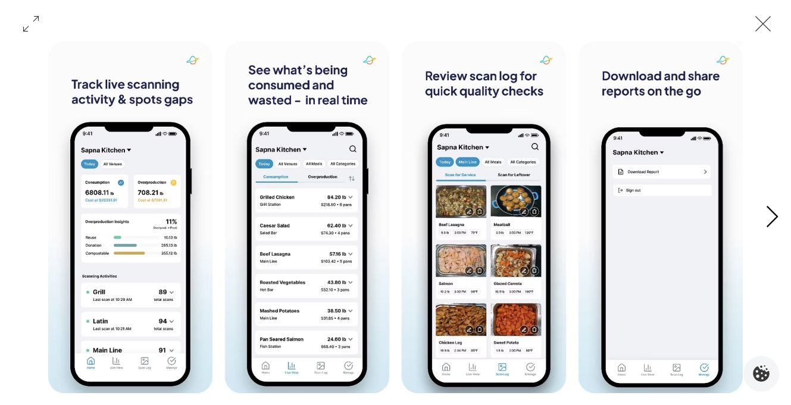

# Metafoodx iPhone App 研究与 Group 2 的端划分

核对日期：2026-09-16。用户已明确：我们的手机端只做iPhone，个人／顾客与员工／管理者都需要，在同一App中按角色区分。本文研究公开文章、商店说明／更新记录和界面图片，未安装、登录或操作Metafoodx客户账户；厂商展示不能作为实测性能。

## 1 已核实的产品定位

Metafoodx的手机产品面向餐饮运营人员，需要已有平台账号。美国App Store列为商务类，开发者为FoodFX Inc，支持iPhone及iPad，语言列英语，页面当前版本为2026.7.2。下载标免费不代表硬件或平台服务免费。[App Store](https://apps.apple.com/us/app/metafoodx/id6758000603)

官方文章说明iOS可用、支持已有账号及SSO，Android仍写为即将提供。此次Google Play定向检索未取得可核实的官方条目，不据此断言不存在。[官方移动功能介绍](https://www.metafoodx.com/post/introducing-the-metafoodx-mobile-app-real-time-kitchen-data-from-the-floor)

公司署名的新闻稿发布于2026-09-03；这是宣传发布日，不能当作商店首版日期。其主要用途是让现场人员无需返回办公桌即可了解当天运营情况。[Metafoodx署名新闻稿转载](https://markets.financialcontent.com/wedbush/article/accwirecq-2026-9-3-metafoodx-launches-ios-app-giving-chefs-and-dining-teams-real-time-kitchen-data-from-the-floor)

## 2 功能和页面实际怎样组织

| 公开入口 | 可确认的用途 | 对我们的启示（工程分析） |
|---|---|---|
| Home | 跨供餐点总览、消耗／过量供应与扫描活动 | 首屏聚焦异常及需要处理的事；我们的单机不虚构多餐位实测 |
| Live View | 按菜品查看当餐变化，可筛选或排序 | 现场页把数量、趋势、更新时间和有效性放一起 |
| Scan Log | 查看单次扫描及食物照片 | 我们改为连续监测中的事件时间线，必要时关联照片，便于核对 |
| Manage | 下载报告 | 大量配置仍适合网页；手机保留随手查看与轻量处理 |

功能依据为[官方介绍](https://www.metafoodx.com/post/introducing-the-metafoodx-mobile-app-real-time-kitchen-data-from-the-floor)与[公司发布说明](https://markets.financialcontent.com/wedbush/article/accwirecq-2026-9-3-metafoodx-launches-ios-app-giving-chefs-and-dining-teams-real-time-kitchen-data-from-the-floor)。官方还展示按活动编号组织数据的餐饮活动模式；对我们更有用的是“记录必须归属明确的餐期／会话”，不需要因此新增活动承办业务。

图：官方文章中的宣传示例，浏览器实际截图；不是我们登录客户后台后的运行结果。

## 3 逐图观察与更新记录

本次查看App Store全部5张iPhone预览，以及官方文章的功能示例、导航说明和活动模式共3幅图。下列为图片观察，不能扩张为全部交互已经测试。

- 总览图把数量、剩余去向和各供餐点的最后记录时间分开；这是排查“没数据”与“没有消耗”区别的设计线索。
- 商店的两个数据页展示空状态；官方文章补充了有内容的列表和照片。我们需要分别设计初次使用、空盘、断线、过期数据，不能都用一个空白页。
- 报表图可选择日期、供餐点、餐段、类别及菜品，并显示CSV格式。适合手机筛选导出，但不证明手机端具有完整餐厅配置功能。
- 官方照片卡片含重量、时间及温度文字，能看到类似编辑／删除的图标；仅凭图标无法确认写入权限、操作后果和全部功能。
- 商店更新说明记录了将非食物项从记录中排除，以及将厨房废料从部分运营统计中排除的修正。它说明数据分类会直接影响页面含义，不能把食物提供、剩余与其他流程混成一个总数。[商店截图及版本说明](https://apps.apple.com/us/app/metafoodx/id6758000603)

本地截图另有：[商店首组](screenshots/app-store-first-four.png)、[商店末组](screenshots/app-store-last-four.png)、[导航解释](screenshots/official-navigation.png)、[活动模式](screenshots/official-catering.png)。

## 4 公开资料没有证明什么

尚未核实顾客点餐、个人营养记录、手机自身称重／3D扫描、补餐任务完整流转、系统推送、完整离线操作、商业价格和后台实现技术。不能把未公开解释为“它没有”，也不能根据外观推定其使用SwiftUI、Flutter或React Native。

“实时”在这些资料中指设备记录进入手机视图；不能从App存在推出设备对每盘都连续称重。我们的原位持续测量仍须实际采集验证。餐中补餐、手机查看与场景扩展本身也不能宣称市场首创。

美国商店页面可读；香港具体条目直达被工具非重试访问策略阻止，本轮未绕过，香港下载可用性未确认。没有下载应用、留资、申请试用或联系厂商。没有找到并观看专门的手机App演示视频，不把历史硬件视频作为当前App实操证据。

## 5 对我们方案的修订建议

建议采用**一个原生iPhone App＋一套厨房／管理Web＋设备专用界面＋共享后台**。手机App按授权身份显示个人／顾客或工作界面。原“所有使用端都是网页”的方案被用户偏好取代；原业务数据和模拟器思路继续适用。

员工手机模式借鉴概览、现场状态和可追溯记录，但增加本项目需要的可执行补餐任务。顾客／个人模式围绕扫码进入餐厅、菜单／订单、绑定餐食和个人记录组织，不能直接套运营仪表板。工作界面只对受授权账号开放，同一个人的个人餐食不会因为其有员工身份而自动共享给餐厅。

厨房网页服务固定工作台的队列操作，管理网页负责菜品／配方、人员、规则及较完整报表；手机只做常用快速操作。设备屏幕负责当前称重、识别确认和去皮等现场动作，不能因手机变原生就假设Pi可以运行iPhone应用。

只做iPhone时，Swift／SwiftUI是合理主建议；网页沿用React／TypeScript，Python后台、视觉处理及数据库保持共用。SwiftUI官方面向Apple平台，不能直接部署到Pi的Linux系统。[Apple SwiftUI](https://developer.apple.com/swiftui/)

前台实时更新与后台提醒分开。iOS应用离开前台后可能被挂起，不能依赖永久WebSocket维持后台监测；需要离开App后的提醒时，另接APNs和通知权限。先实现前台状态与重新进入时刷新，后台推送不作为第一个模拟演示的前提。[Apple应用生命周期](https://developer.apple.com/documentation/uikit/about-the-background-execution-sequence)、[APNs注册说明](https://developer.apple.com/documentation/usernotifications/registering-your-app-with-apns)

详细页面、角色、部署和开发顺序已同步到[软件范围与架构](../../planning/2026-09-16/software-scope-and-architecture.md)。当前仍为规划与研究，未建立Xcode工程或实现应用。
