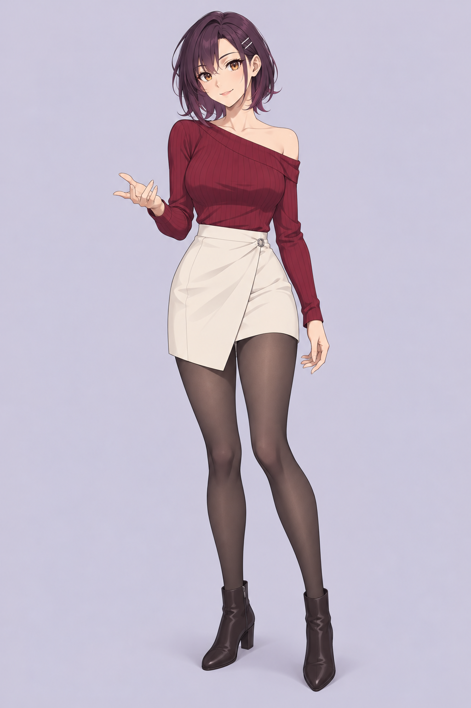

# C1 · Plum Dusk／紫暮 · V1

Group 2 · 2026-10-10。用户要求结合更主流、近期活跃的日本动画，**单独出一个C1供参考**。C1为新独立候选，不覆盖A1／B1／E1，也不是早期“暖金C”方向的自动恢复；正式角色仍未选定。

**灵动、敏锐、亲近，带一点俏皮的成年都市桌面伙伴。**原创设定约25岁；名字只作本阶段识别。

- **外形：**深梅紫的分组短发，左右长度有变化、一侧别耳；琥珀眼、清楚上眼睑、简洁鼻口与小幅不对称笑意，两枚银色条形发卡。
- **服装：**酒红不对称露肩长袖针织、米白高腰叠片短裙、半透深灰连裤袜、深色踝靴。剪裁与少量露肩提供轻微性感，姿态为正常交流。
- **画风目标：**现代日本TV动画的清楚线条／大色块，避免写实脸和游戏3D材质。实际脸部为二次元，衣物、丝袜、鞋及背景仍有柔和渐变／光泽，不称完全两级赛璐璐。
- **实际检查：**单角色，全身、双手、双靴可见，没有附加头像／文字／设备。人物占比更大、脚部留白与鞋跟高度偏离简报理想；保留有效首稿供审阅，不重生成。

[本轮动画研究](../../../../research/2026-10-10-avatar-art/mainstream-anime-c1-study.md)分开官方播出状态、传播里程碑与视觉观察。本次参考原则来自五个实际查看的官方角色图，生成器无输入IP图片，提示词只描述原创造型及通用画风。

[原PNG](c1-plum-dusk-v1.png)／[完整实际提示词](c1-prompt.txt)／[原生路径、尺寸与SHA](manifest.json)。内置ImageGen一次生成，1024×1536、1,587,650字节；工作区与原生文件逐字节一致，无裁切、像素后期或重生成。

A1 V1–V4、B1、E1及所有旧提示词保持；[A1简报](../a1-character-brief.md)继续有效。C1是外观概念，尚无三视图、表情表、骨骼、贴图工程或运行模型，应用仍使用原许可VRM。

下一步比较A1与C1，再按用户反馈细化选定方向；[QA](../../../../output/qa/2026-10-10-c1-mainstream-anime/verification.md)记录素材、来源、程序／学校保留与Git交付。
