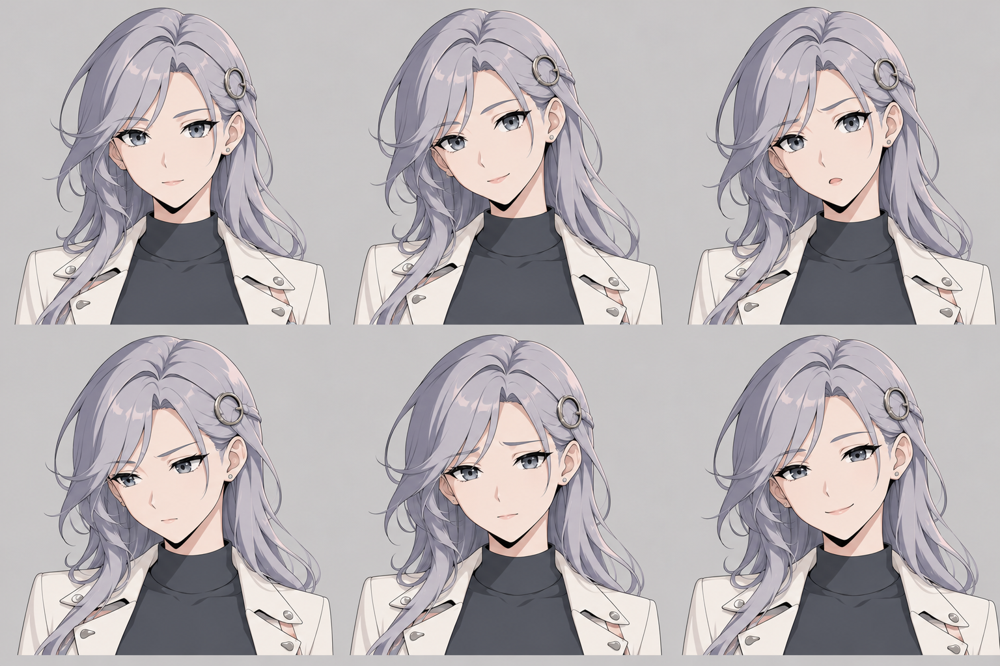

# A1 Six Expressions · E1

**2026-10-12最新决定：**A1为后续角色，C1历史保留。[九套服装](../a1-wardrobe-index.md)及实际prompt已另存[原图包](../../../../output/character-art/2026-10-12/A1_Wardrobe_9_Outfits_20261012.zip)；[六个全身视角与四张细节](../2026-10-12-a1-turnaround-details/README.md)已完成，采用V4原服装作工程参考，默认服装仍未选。以下是本目录原阶段记录；旧PNG／prompt／manifest保持。

Group 2 · 2026-10-10。用户同意按日本动画研究建议推进，本轮完成[简明角色简报](../a1-character-brief.md)、[详细表情与表演规则](../a1-expression-rules.md)及一张六表情对照。A1性格与外形方向成为工作基线，**E1仍待图像反馈，未最终定稿**。

图上刻意不生成文字；从左至右、先上后下对应：

| 位置 | 目标表情 | 本次实际观察 |
|---|---|---|
| 上左 | Neutral／中性 | 眉眼放松，嘴角仍有一点自然上扬 |
| 上中 | Listening／倾听 | 轻侧头、温和回应；笑意与开心仍较接近 |
| 上右 | Question／疑问 | 一侧眉毛抬起，嘴微启，差异比较清楚 |
| 下左 | Thinking／思考 | 视线偏移，眉部轻收，表情更专注 |
| 下中 | Care／关切 | 眉毛内侧抬起，实际稍偏担忧；后续可更平和 |
| 下右 | Joy／小幅开心 | 闭口小笑、眼神柔和；可与倾听进一步拉开差异 |

1536×1024原生PNG、2,101,520字节；一次内置ImageGen，唯一参考为已实际查看的A1 V4。银发、灰蓝眼、同侧发扣、耳钉、头肩服装与人物年龄感基本连续；没有复制商业角色。部分皮肤／背景仍有柔和色调过渡，不声称完全无渐变或各格几何完全相同。

[原PNG](a1-six-expressions-e1.png)／[实际完整提示词](expression-prompt.txt)／[来源、输入、尺寸及SHA](manifest.json)。工作区文件与ImageGen原生文件hash一致，无后期像素修改、裁切、文字叠加或重生成。五版原全身概念及五份提示词保持。

E1是独立头肩表情研究，不命名为全身V5，也不是六个已绑定的3D表情。应用继续使用pixiv许可样本；没有新VRM、动画、模型权重或真实语音测试。

当前已保留九套服装并完成A1视角／细节参考；E1脸型与表情反馈继续保留，后续定向微调倾听／开心／关切。新视角不表示E1已修订或替换到应用。验证见[原阶段QA](../../../../output/qa/2026-10-10-a1-character-brief/verification.md)。
