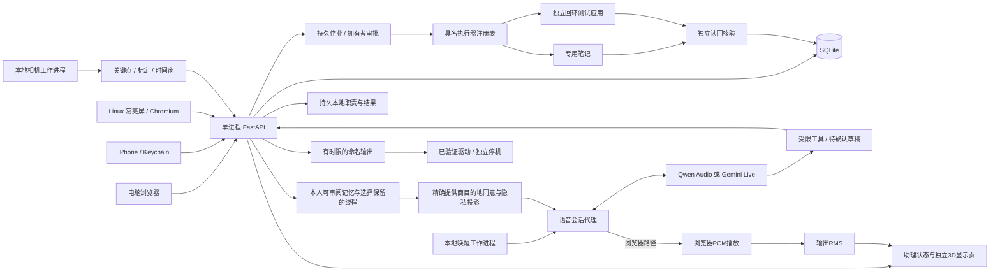

# 软件架构与边界

2026-10-12个人Agent增量保留模块化单体，在现有日历／事务／审批基础上加入[个人上下文](personal-context.md)、[持续职责](routines.md)、[执行器注册表](computer-jobs.md)及[提供商策略](provider-policy.md)。[当日早期17模块盘点](../../planning/2026-10-12/software-function-inventory.md)保留历史缺口，新状态以本节及[本轮实施契约](../../planning/2026-10-12/personal-agent-implementation.md)为准。真实PC／LCU、RIG／清洁模块与实际模型质量仍待验证。

## 运行单元

现场主机是数据与设备控制中心。浏览器、常亮屏和iPhone共用API，界面布局分开。SQLite负责事件、例外、操作去重、记录、配对、提案与连接配置，另保存事务、进展依据和持久检查。姿态时间窗、输出停机与语音活动同时存在内存中，故必须使用一个API worker。进程重启清理不可靠的时序和未执行动作，不恢复旧的运动队列。

日历版本与工作空间状态定期刷新；语音音频用WebSocket流动。角色采用按需加载的React Three Fiber／three-vrm，VRM骨骼与表情由助理状态驱动；浏览器实际输出RMS控制开口，尚无逐音素唇形。独立角色页与日历共用工作空间身份，本地预览不调用AI或工具。详见[角色契约](avatar.md)。主触摸屏与独立角色页可以先用同一主机；最终是否能驱动特定风扇或光学模块，取决于该设备接口。

## 身份与边界

- 拥有者会话8小时，口令使用Argon2，Cookie为HttpOnly／SameSite Strict，TLS时启用Secure。
- 配对码一次使用；终端需拥有者批准，长期身份可单独撤销。网页用HttpOnly Cookie，iPhone令牌留在Keychain。
- 本机工作进程用独立令牌，不借用拥有者口令。相机与输出API只接受该身份。
- 分享令牌与控制身份分开，只能访问服务端投影，不获得写入或设备权限。
- 外部提供商的密钥留在后端。Google令牌使用本机Fernet密钥加密；业务JSON备份不带这些秘密。
- 默认只监听回环，明确配置HTTPS来源后才接受相应Host／Origin；本轮没有对外开放服务。

这是一名拥有者的原型，不是跨家庭／学校／企业多租户权限系统。展示隐藏与授权控制分开：已授权控制屏可以编辑本人内容，常亮屏和公共分享投影隐藏相应字段。

## 坐姿处理

MediaPipe提供头、双肩与双耳的二维关键点。程序用亮度、关键点可见性、人数、距离、时间顺序和标定来源作质量门槛。特征按肩宽与画面宽高比归一化，个人参考／前倾／侧移形成基准；保留“无法判断”。侧向参考使用镜像对照。

持续偏离达到阈值后，形成具体提示；经过复测窗口后，用新的有效观察判定回到参考范围、仍偏离或无法判断。短动作、遮挡、断流、重复旧包和源切换不能累积成持续偏离。确认按钮不被当成恢复证据。活动提醒只使用可靠在桌时长，无人至少30秒才重置；无法判断不算已休息。

这个实现尚未获得真人分类准确率。正面二维关键点、衣着、遮挡、机位和个体差异都会影响可分性。不是脊柱角度、健康评分或情绪诊断。完整机位与标注试验见[evaluation.md](evaluation.md)。

## 助理与语音

工具只允许读取事务／日历／姿态／设备状态、准备事务进展／日历或命名输出草稿、准备／查询／取消受限电脑作业、请求软件停止。创建／修改／删除与设备预设的确认接口不提供给模型。草稿5分钟过期；日历动作检查版本，内部操作ID使保存回执丢失后仍可重复确认而不重复创建。停止输出绕过前端的一般待保存队列。

Qwen Audio与Gemini协议由不同适配器转换。输入16kHz PCM16，输出24kHz，队列受限；插话清空播放并取消未确认草稿。会话有单实例、短期票据、空闲和总时长限制；只记录时长和提供商用量字段，不落盘原始音频或转写。主动开始／唤醒后的语音及所请求的日历上下文会经过所配置提供商；默认本地文字规则无需提供商，可选Qwen／Gemini文字推理另行配置。

真实自然度、中文识别、回声、打断与费用仍需真实服务测试。学校DGX资源并未访问；这里没有把商业Qwen实时型号写成可在V100原样部署的开源权重。

## 输出与提醒

输出只允许灯光／机械臂等命名预设。命令5秒有效，领取后不重复执行；停止取消未完成队列，重启过期队列。驱动可报告失败或完成，回放只能报告模拟。没有编码器时，驱动完成不等于实际机械位置达标。

2026-10-05的[RIG-Arm评估](../../research/2026-10-05-rig-arm/secondary-development-review.md)提出“本组核心 → 受限RIG适配器 → 现成ESP32／总线舵机”的候选路线，尚未实现。当前PCA9685驱动不能直接控制SCS009总线；厂商工具的接受回执不能冒充动作完成。选定后需匹配固件、预设、取消／失联、命令去重和关节反馈，固定姿态相机与独立常亮屏仍由主机负责。更换原机文字LLM与接入Qwen／Gemini实时音频是不同工作，后者需网关或固件协议适配。

屏内提醒、桌面提示音、iPhone通知是三个不同通道。桌面提示音一次领取，遵守安静时段；失败不会重复响。手机只缓存未来七天最多64条，远端离线修改不会自动推送。Widget缓存过期后提示刷新。通知权限由使用者操作，OS交付与刷新时机仍须真机验证。

## 数据交换

ICS导入明确展开所选日期内的发生项为单次副本，检查大小、规则、日期、UID和匹配版本；不静默假装完整双向同步。Google使用只读OAuth与预览应用，不改远端数据。忙闲分享合并区间，不泄露标题或事件数量；可展示详情分享也不包含私人字段。

JSON恢复校验内容完整性，合并缺少事项，保留既有事件和偏好。原始SQLite备份与用户可导出的业务备份不同：前者可能含本机认证资料，应保存在受限运行目录中。

## 主动事务层

见[完整契约](task-tracking.md)。一秒规则检查与30秒可选文字建议工作进程分开，事务／待提示都落盘；单版本一条待处理提示，更新或关闭使旧建议失效。模型最多三轮只读工具后准备修改草稿，背景建议不获得修改接口；每天20次自动尝试（含失败）、默认关闭。完成仅表示用户确认，不由传感器或到期时间推断。

Tasks使用两秒轮询、页面可见时即时读取，选中事务的历史按任务版本和跟进ID刷新。UI区分读取断连与写入结果未知，表单及父面板共享未保存／忙碌退出保护，并发修改可保留草稿、加载当前版本后重新编辑。常亮投影与控制界面分开；私人缓存随断连隐藏。

业务备份增加每件事务最近20条进展；恢复只创建缺失事务且默认暂停，现有进展保留。源代码中的模型协议与测试模拟不等于真实API效果或目标Pi性能。

## 持久作业与非阻塞语音（2026-10-06）

层级保持模块化单体：路由负责身份／输入；`JobService`负责授权意图、版本、状态、调度与恢复；`ComputerExecutor`负责具体受限动作；`VerificationReceipt`负责可核对的独立结果。`task_id`仍指向原事务，作业完成不修改事务完成状态。相机、姿态复测和实体输出边界保持。

原笔记适配器仍仅在应用运行目录下的`computer-notes/`创建由随机作业ID命名的新文件，无任意路径、shell、URL、应用控制、覆盖或删除。新建文件使用独占／不跟随链接，写入后独立读回并核对字节数、SHA256、适配器身份、范围和文件名。未知写入不会重试，只有只读对账。未经批准不写文件；批准绑定完整意图哈希和版本，并在调度前再次检查关联事务版本。

作业状态为review、queued、running、verifying、succeeded、failed、cancel_requested、cancelled、expired、unknown。待批准5分钟、批准后执行期限60秒。已启动作业在重启后转unknown，旧运行令牌失效；未启动且未到期的已批准队列可继续。取消不能撤销已经写成的文件，迟到且完整的真实回执可如实显示成功。执行器抛出错误前是否已经发生写入由接口契约区分；任何写后核验异常保持unknown。

语音接收、工具执行和结果回传分开。普通工具最多2个并发、8个未完成；最多保留32个普通调用及一个Stop保留槽，结果队列64条。重复ID不同参数拒绝；打断立即设置取消标记，迟到未批准草稿被取消，客户端发送阻塞期间再次检查状态。提供商发送按批串行，已取消调用不会再次发起Qwen生成。已经由拥有者批准的作业不因语音断开而偷偷取消。原600秒／45秒会话限制保留，未新增自动收费重连。

四个后台循环（规则、天气、建议、作业；职责由规则tick调度）对普通异常保留安全错误状态并继续检查；`/api/workspace`返回workers状态。此方案仍要求单个API进程；不是分布式租约系统、任意GUI沙箱或硬实时线程终止保证。更换GUI适配器前必须另行建立OS隔离、权限、云传输范围和执行器强制停止能力。

2026-10-09整合审查修复：工具调用ID的拒绝回复不代表原调用结果已送达。送达标记必须对应同一个Invocation保存的实际结果对象；重复ID带不同参数或无效参数时，断连仍会取消原调用及其迟到草稿。[本地整合证据](../../output/qa/2026-10-09-dot-integration/verification.md)补充两种先失败后通过的回归及实际浏览器验证。

[运行与状态说明](computer-jobs.md)／[审查与剩余清单](../../planning/2026-10-06/software-architecture-audit.md)／[实际核验](../../output/qa/software-completion-2026-10-06/verification.md)。

## 个人上下文与持续职责（2026-10-12）

`PersonalContext` 负责拥有者权限、展示状态、精确目的地同意和上下文版本；记忆与会话服务负责各自保留规则，模型只消费有界投影。事实不得充当权限或已完成任务证据。会话请求先保留无正文操作回执，网络I/O不持有隐私锁，返回后重查会话／上下文版本；重复不确定请求不再次调用模型。临时聊天与已批准业务草稿的保留范围分开。删除不等于擦除旧备份或远端提供商数据；无正文去重元数据目前没有总量上限。

默认不共享历史、记忆或保存的日历／事务。配置模型不等于同意传输这些内容。语音与文字都使用同一目的地、身份和隐私规则；隐藏、修改、忘记或撤销使旧上下文版本失效，语音会话需重新打开，不自动收费重连。语音本身不自动变成持久转写或记忆。

`RoutineService` 只运行允许的本地只读技能，持久发生项与通知结果；一天／一周调度使用明确时区，处理夏令时缺失／重复时刻和停机补查。不是LLM轮询、任意cron命令或外部消息发送服务。前端打开页面不会自动领取／消耗结果。

新增应用适配器只接受配置好的精确IPv4回环origin，绑定服务身份与实例UUID；不支持任意URL、shell或用户应用。独立服务写入与GET核验分开，丢回执后只读对账，取消不能承诺撤回真实写入。这个无身份认证的虚构数据测试服务不防同机恶意进程，不能直接部署为真实私人数据应用。UI隐藏正文时仍保留必要作业状态及取消能力，禁止在看不到意图时批准。

自动化入口见[软件检查](software-checks.md)。资产保护、真实HTTP／SQLite、协议回归、实际浏览器、远端CI和真实语音／硬件是不同证据层级。
