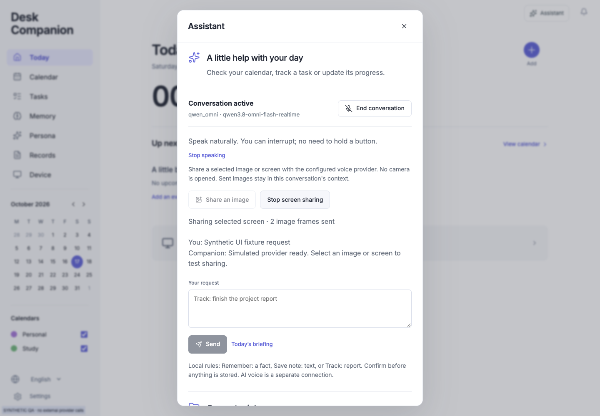
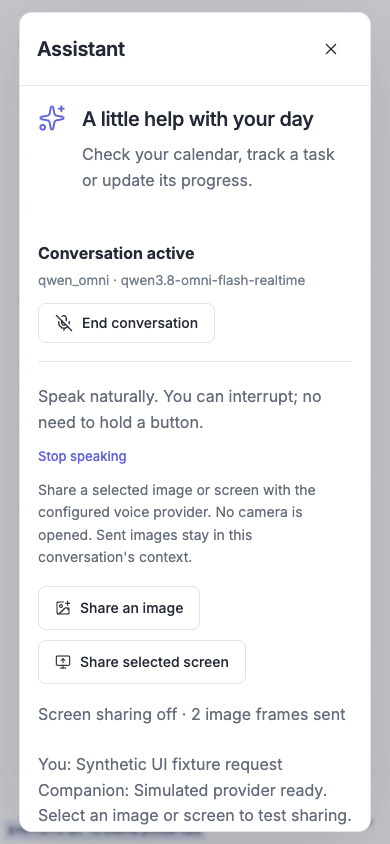

# Group 2 — Qwen Omni integration and bounded trials

Work began16 October2026 and continued past midnight into17 October. Immediate continuation of model selection and private Key staging on `codex/voice-model-comparison-20261015`, base `2249df246b8d9380dbf0823895c36fee5647f4d0`. Draft [PR #15](https://github.com/tantalum666/FYP/pull/15); no main merge. [Implementation contract](../../../desk-companion/docs/qwen-omni.md).

## Authorization, context and preservation

Owner requested “开始补齐吧” for the selected `qwen3.8-omni-flash-realtime`, then explicitly approved **at most CNY5**, using synthetic audio/fictional calendar without real microphone/screen capture. Generated blue JPEG is synthetic test material. No general desktop execution, real capture, new account, school action, hardware, VPN or standing operating budget is inferred.

[reading-inventory.json](reading-inventory.json) inherits137 exact observed project-owned Markdown versions from the same ongoing workflow’s [Key setup record](../2026-10-16-qwen-key-setup/reading-inventory.json), matching the base commit. Relevant entry points, focused specs and implementation were reread. After compaction, AGENTS/product/handoff and latest related decisions were restored; the task did not restart. Changed/new prose is explicitly authored/reviewed, with exact inherited ranges for unchanged text. File hashes detect changes, not reading. Exclusions: Git, dependencies/caches, third-party/build output and generated `output/qa` evidence. New Omni specification adds one owned Markdown version.

The referenced chat `01a07aeb-a256-7572-a42e-bd7e4668674f` was actually accessed with `read_thread`; latest three returned turns concern earlier character work and have failed status. They do not establish saved-delivery success or authorize new actions. Current requirements are from this conversation and repository authority. No message was sent to that chat.

All application tests use temporary runtime directories. Real API fixtures use an isolated fictional calendar and a restricted read-only `calendar_query`; UI fixture uses a fake Key and provider, never the staged Key. Original checkout, private runtime, school originals, A1 artwork/PR #4, separate kernel/PR #5 and fixed-camera posture loop remain outside this change. [document-checks.json](document-checks.json) checks links, Group 2 identity and allowed changed paths.

## Implementation and local validation

- Independent `qwen_omni` adapter: nested16kHz/24kHz PCM, semantic VAD, ASR, Tina engineering default, internal functions, search disabled; explicit opt-in private-file loader without shell evaluation or endpoint metadata injection.
- Response/item/call metadata correlation and fallback, duplicate suppression, grouped function returns after response completion, one resume. Native cancellation before/after admission; cancelled responses cannot supply late audio/tools and unsent cancelled function outputs are not sent with stale call_id. Existing approval, JobService, dispatcher bounds and reserved Stop remain.
- Owner-only deliberate image/screen sharing; JPEG normalization, bounded headers/size/rate and initial audio requirement. No camera capture or image persistence. End/stop/disconnect and late chooser/decode release tracks/resources. Already sent images remain in the provider conversation.
- Numeric usage whitelist, per-response deduplication and session accumulation. Missing/cancelled usage is not zero charges. Defaults stay none; the CNY trial ledger is a QA guard, not a production spending cap.

Commands actually completed on final application code:

```sh
# From desk-companion/
.venv/bin/ruff check backend scripts tests
.venv/bin/ruff format --check backend/desk/voice.py backend/desk/voice_credentials.py backend/desk/voice_media.py tests/test_voice_omni.py
.venv/bin/pytest -q
# From desk-companion/frontend/
npm test
npm run build
```

**215 backend tests passed in16.43s;21 frontend tests passed; Ruff, format, TypeScript and Vite production build passed.** New Omni file contains26 cases including endpoint/Key boundaries, consent, metadata fallback, cancellation, grouped results and late outputs. Four new frontend cases cover sizing/encoding and capture/decode finishing after disconnect. Existing TestClient emits one upstream Starlette/httpx deprecation warning; no dependency change was made for it. No CI, Pi/iPhone or hardware test is claimed. [validation.json](validation.json) records the final code fingerprints and actual results without secrets.

## Rendered browser verification

Browser plugin and its skill are unavailable; regular installed Playwright CLI was used with the frontend debugging/React skills. Loopback `http://127.0.0.1:8832/`, title Desk Companion, logged-in owner against [ui_fixture.py](ui_fixture.py). The fixture connector is fully fake. Browser `getUserMedia` returns a silent synthetic WebAudio stream; `getDisplayMedia` returns a generated canvas stream. No real media API is called. Final driver reloads the built frontend, installs these stubs before starting voice, and saves [browser-checks.json](browser-checks.json) and [browser-flow-final.log](browser-flow-final.log).

All assertions passed: zero capture before start; voice ready; one manual image acknowledged; selected synthetic screen acknowledged; stop prevents further frames and ends screen tracks; end voice ends microphone tracks;390×844 has no horizontal overflow; no window JS errors or framework error overlay. Desktop1440×1000 and mobile390×844 screenshots were visually inspected for readable controls, wrapping, frame count and stop state. Production frontend build was used, with a synthetic-QA banner.

Initial pre-login polling produced188 unauthorized401 console entries, before the owner fixture was logged in. They are not reported as post-login JS errors. An initial run-code call used the wrong CLI function wrapper; another attempted the visible “Assistant” text instead of its accessible “Open assistant” label. Fresh state inspection corrected the harness. The first successful upload used a file chooser which left a stale CLI modal record; clearing that record and using the hidden file input in the final driver avoids the harness issue. These attempts do not represent real capture or provider calls. Final reload/flow has no JS error; final browser assertions, rather than historical aggregate counts, determine this result.





## Actual selected-provider trials

Sources actually read: [WebSocket](https://platform.qianwenai.com/docs/api-reference/realtime-api/websocket-overview), [client events](https://platform.qianwenai.com/docs/api-reference/real-time-multimodal/client-events), [server events](https://platform.qianwenai.com/docs/api-reference/real-time-multimodal/server-events), [Realtime input guide](https://www.alibabacloud.com/help/en/model-studio/realtime), [platform model price](https://www.qianwenai.com/models/qwen3.8-omni-flash-realtime). Selected public gateway is distinct from Chat base URL and from workspace-key routes. No Key, fragment or hash is logged.

| Connection | Artifact | Actual result |
|---|---|---|
|1 setup only|[preflight](live-preflight.json)|WebSocket and session.update accepted; no audio/image. Authentication for this Key/model/public gateway succeeded.|
|2 first calendar|[failure](live-calendar-attempt1.json)|Two synthetic utterances around interruption; provider invalid_request_error on call_id, no completed answer/usage. Failure preserved. Initial helper’s zero estimate corrected to null with a note; missing usage proves no zero bill.|
|3 single utterance|[first success](live-calendar-attempt2-success.json)|Real calendar_query returned3 fictional meetings; all titles/times spoken. Audio receipt3.176s after synthetic final non-silent sample.3697 returned tokens.|
|4 original two utterances|[success](live-calendar-trial.json)|After lifecycle fixes, all3 meetings spoken; correct exclusive range19Oct00:00 to26Oct00:00 Asia/Hong_Kong. Audio receipt2.619s. One actual query, a prior cancelled response has no usage.3967 returned tokens.|
|5 generated image|[vision success](live-vision-trial.json)|One generated32×24 blue JPEG accepted; answer “The rectangle in the image you shared is blue.” No calendar query.1220 returned tokens.|

Synthetic input was generated locally with macOS `say -v Samantha`, then `afconvert` to PCM16 mono16kHz, not captured. [live_trial.py](live_trial.py) uses production VoiceService with one narrowed read-only fixture tool, max512 output tokens, four responses,45s wall time and2MB audio limit. [live_preflight.py](live_preflight.py) verifies setup. Both only read the explicitly staged private file in memory. Temp databases are removed. No further paid request is needed or scheduled.

The first failure occurred around interruption. Successful real function envelopes have name/call_id; the exact root cause is not proved as missing provider metadata. Metadata correlation and cancellation were both strengthened, then the original two-utterance trial passed. Mock regression specifically verifies no stale cancelled output and a succeeding next turn.

**Latency scope:** measurement starts at the fixture’s last sample above a fixed amplitude threshold and ends at first API audio received after sending the actual tool result. The complete transcript is correct; the first useful spoken word was not acoustically aligned. It excludes browser playback, Pi, human mic, cold connection time and real AEC. Two successful samples and one earlier failure do not establish p50/p95, a5-second SLA or proposal language accuracy. The vision2.398s field is also receipt-only, not a calendar latency result.

[First successful calendar audio](qwen-calendar-answer-first-success.wav) is retained unambiguously. [Vision audio](qwen-vision-answer.wav) belongs to the blue-image response. The helper originally reused the calendar audio filename for the vision trial; it was renamed and the helper now writes mode-specific filenames. The second calendar transcript/usage remain in JSON; its overwritten audio is not claimed retained.

## Budget and invoice limits

[trial-budget.json](trial-budget.json) reserves0.1+1+1+1+1 = **CNY4.1 of5**, guarded by a locked [reservation script](trial_budget.py). Another1-yuan trial would be refused. These are deliberately conservative allocations, not measured charges. All live calls are now stopped.

Platform price read during this task: input audio6, output audio12, text/image/video input1.5 and text output4.5 CNY per million tokens. Platform/Alibaba descriptions differ on whether audio-associated output text is billed. Trial estimates therefore use **all returned tokens × CNY12/million**, with no free-tier credit. Successful-response estimates are0.044364 +0.047604 +0.014640 = **CNY0.106608**. Failed/cancelled usage and the account invoice are unavailable; this sum is not a complete final bill or evidence of zero charge for setup/failure. No billing console was operated.

## Documentation, delivery and remaining

Updated product/handoff, both READMEs, decision/work logs, Qwen setup/operator/architecture, disabled service template, three tooling notes, two dated research reports and latency plan. New focused Omni contract separates implemented, mock-tested, live-tested and target-device gaps. Historical studies retain their original dates; current overlays supersede pending selection/adapter statements. Links/group terms/deliverables and staged secret/whitespace checks are recorded at closeout.

Remaining: actual Pi/Linux/Wayland/ARM64 browser playback and per-turn10-second timeout, consented multilingual voice/AEC/wake, final voice choice, and a separate target app/data scope with bounded GUI execution/read-back. Full business backup/archive, posture labels and RIG/cleaner/optics are not completed by this change. The five-yuan allowance is not renewed by a future wake-up or PR. Remote ref/PR read-back is added in [delivery.json](delivery.json) when actually observed.

Secret-scan triage: the initial generic rule matched a source-file SHA-256 next to the filename voice_credentials.py in validation metadata. It was a source digest, not a credential or its hash. Path/digest fields were separated and the staged scan rerun; no broad allowlist or credential suppression was added.

Final local closeout:138 project-owned Markdown versions /139 checked documents,1377 local references with0 broken links and one expected install-generated credentials link. Group 2 terms and identity source valid. Final application code is fingerprinted in validation.json;215/21 checks passed. Post-reload browser console has0 errors/0 warnings, both screenshots inspected. Synthetic browser and fixture service closed and task cache removed. Staged Gitleaks returned0 findings; whitespace rechecked after trimming generated log EOF.
