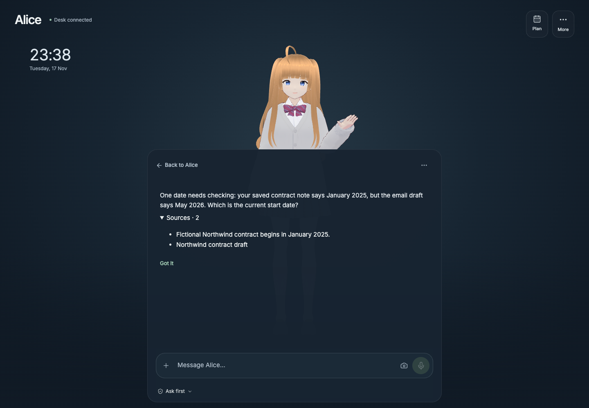
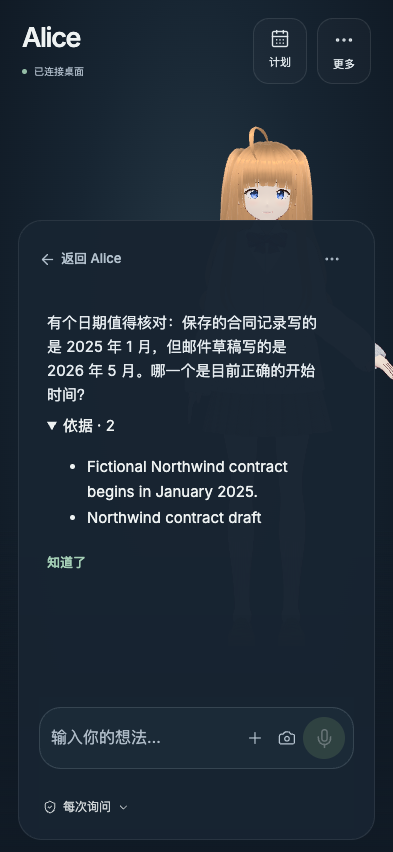

# Group 2 · Proactive assistance and PR integration verification

18 November 2026, Hong Kong; work began17November. Scope: contextual proactive assistance, standing read-only mail follow-up, official execution reuse, review/fix/integration of PR124–128 and a complete saved handoff. Pi power work stays paused. Normal application/native/Pi deployment is separate from this source integration.

## Changes and defects resolved

- Added current-evidence research through existing OpenAI Responses with strict JSON Schema. No action tools/AgentLoop in that background path. Existing Runtime/store/account readers/Notifier are reused; old task_advice inference worker retired.
- A fresh owner mail-follow request can start in Ask mode using the current proactive preference, without another per-thread card. Old pending drafts cannot gain a later grant. Stop/Off/private/account/task revisions fence reads and publication; cached receipts show actual pause/stop.
- Bounded relevance, current source citations, deduplication, quiet delivery, retry and daily limits. Stopped threads remain excluded across reconnect. Unchanged successful inputs do not trigger more inference. Local calendar sources now reuse recurrence/exception/deletion/completion expansion instead of raw rows.
- Real model requests exposed a five-second response-read timeout; use30seconds for research/15seconds for ordinary complete OpenAI responses, retaining bounded connection/write/body timeouts.
- Real hosted-browser attempts exposed provisioning counted as work, unsupported inferred readiness enums, control-plane timeouts and pending approvals surviving cancellation. Fix separate setup/active windows, exact reference states, lazy startup ordering, safe admitted-origin decision recovery and bounded cancellation/deletion readback. Original task input and credentials are not automatically replayed.
- RetainPR125 hardware assets and both history logs after local conflict resolution. No firmware, power setting, physical trial or procurement action performed.

## Local verification

Final combined backend result: **2,501 passed / 2 Linux-only skips in 542.48 seconds**. This includes the new calendar regression and final managed lifecycle code. The earlier full candidate ran2496passed/2Linux-only skips; it is retained but not substituted for the final result. Focused final initiative/mail/managed check: **66passed**. Earlier final managed-control checks:58passed. Ruff backend/tests:passed.

Frontend: **393passed**, TypeScript and production Vite build passed. No frontend source changed after that run; later work was backend fixes and documentation. Existing Vite large-chunk, HTTPX/TestClient deprecation and pytest warning remain visible in raw logs. Linux systemd graph checks cannot run on Mac; no Pi re-test was performed. No GitHub Actions workflow is tracked or used.

Installed Chromium desktop1440×1000 and Chinese phone393×852 exercised unsolicited findings, current citations, natural mail follow without an approval card, Off, interrupted dismissal with the same key and no repeated model call on unchanged sources. No page exceptions; console entries were software-WebGL ReadPixels warnings. These UI model/provider decisions were scripted. [UI receipt](browser-ui-verification.json).

The screenshots use fictional source data. They are browser rendering evidence, not native/Pi deployment or real-mail evidence. The earlier transient-offline home capture is intentionally not used as acceptance evidence.

## Real OpenAI calls

[Research cases](research-live-cases.json) preserve six successful real Responses cases: conflicting contract dates; aligned facts; untrusted email footer; incomplete booking; unassigned repository visibility contradiction; intentionally public repository control. The unassigned contradiction has no task and still produces a qualified, cited finding. The negative cases remain silent. No model action tools, outgoing attempts or action proposals resulted from research.

[Mail control](mail-live-control.json) uses a real model with a synthetic Gmail transport: find/follow the selected thread, then stop while retaining its task. Four model generations across two user turns, approximately10.876/9.531seconds, one subscription/task and zero sends. This verifies actual model tool selection and product permissions; it does not establish sustained real-account monitoring.

The first two real research attempts timed out under the old response-read limit. Both remain unknown in the closed cost ledger. A later successful request is not proof the earlier timeout was free.

## Official hosted-browser acceptance

Four trials were performed on public Books to Scrape pages. The first three failed and remain recorded in [live summary](live-summary.json): deadline including setup; readiness/control failure; pending origin approval preventing final cleanup. All three resources were subsequently confirmed absent with404 readback, with the third requiring cancellation of its pending approval before cancelling the turn.

The fourth, using repaired code, completed in68.153seconds including24.787seconds of setup and5browser activities. It chose the two cheapest available books in the Travel category, inspected their product stock counts and calculated a comparison. Independent HTTP parsing confirmed pricesGBP23.21/26.08, stock3/1, plus fictionalGBP4shipping → GBP53.29; fictional10HKD/GBP → HKD532.90. Both titles and URLs match. Report SHA256 is8b8945d357f6677bfdda2da0e611b6200c2ac53a18ecda808e4f2c4934edc8fc. DELETE200/GET404 passed in the integrated client. [Independent verification](browser-live-verification.json).

This is actual official service/model/browser acceptance on a public test catalogue. No account login, cart submission, payment, order, travel reservation or ticket was created. Each hosted trial omitted usage; its cost is not claimed to be zero.

## Cost and cleanup

The owner authorized broader tests using existing credits before24November. Engineering cap for this batch: **US$5**, not an indefinite budget. All Responses subledgers are closed. Twelve real generation requests:10received and2timeout/unknown; conservative accounting including holds **US$0.267201**. Four hosted sessions retain **US$1 each** because usage is unknown. Aggregate accounting plus reserves **US$4.267201**; this is not a verified invoice. [Closed summary](live-summary.json).

All four hosted resources have confirmed deletion readback. The isolated scripted API8832 and Vite5191 were terminated and the listeners were absent. No ongoing paid observer/remote schedule was created. Normal application services were not stopped or promoted. Raw receipts, session IDs, scripts and databases remain in the private archive; [evidence index](evidence-index.json) provides log hashes. No credentials, private balance screenshot or original account data are published.

## PR and hardware review

[Review record](pr-review.md) pins all five heads. Software124→126→127→128 and independent hardware125 are ancestors of the integration candidate; fixes are applied once on top. [Hardware checks](hardware-static-verification.json): ZIP CRC/path check; seven closed-edgeSTLs withZminimum0; 3MF15resources formfive printable assemblies;12physical parts total. Workbook cached values independently sum toHK$1,077.12first batch/HK$1,944.43goods/HK$55.57headroom. No slicing/fit/physical-function acceptance is implied.

Changed-file scope verification checked61Markdown files with no broken internal links, no credential-pattern hits, no workflow files and a clean `git diff --check`. [Scope receipt](scope-check.json).

[Publication](publication.json): PR129 merged atc51ece41; each original124–128 reads merged=true. Main tree75550fed equals tested candidate42bc01ec. The later closeout commit changes only documentation/receipts; application source remains identical. [Handoff](../../../handoff.md) records current publication and the single next step.

## Remaining acceptance

Promote the reviewed main tree to normal Mac/native/Pi and verify source/build/data/A3/grant parity. Primary text still needs its official-session migration. Sustained real-mail usefulness, full-inbox incremental events, Microsoft consent, closed-phone delivery, real merchant login/checkout/payment/ticketing, voice acoustics/latency and Pi supply reliability remain open. Source integration cannot close these gaps by test count.
