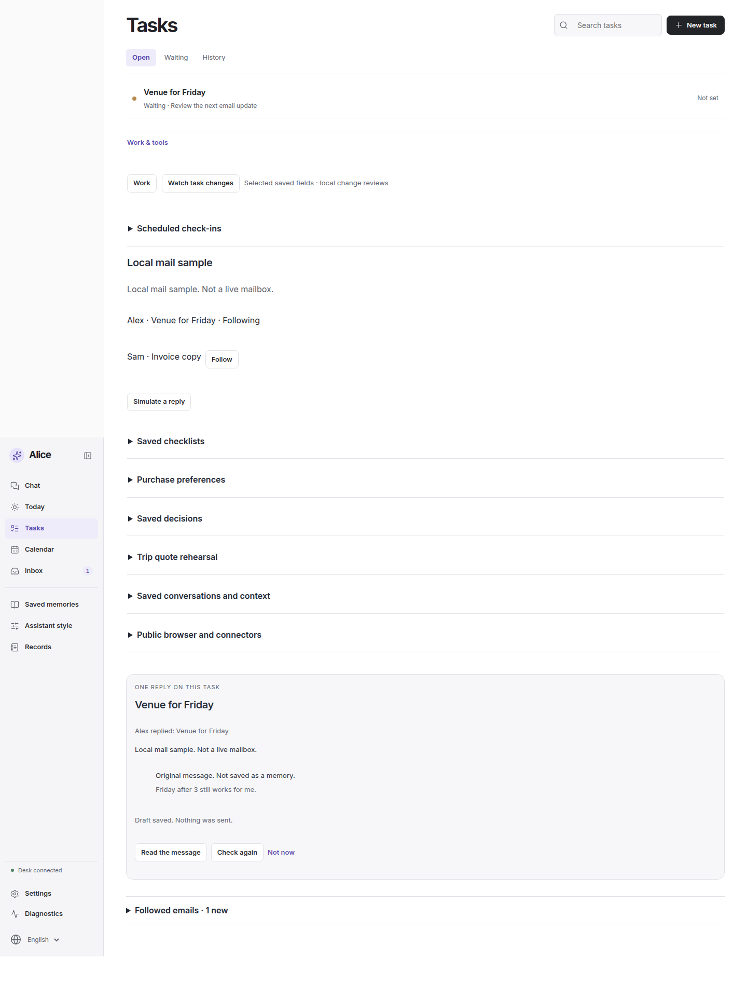
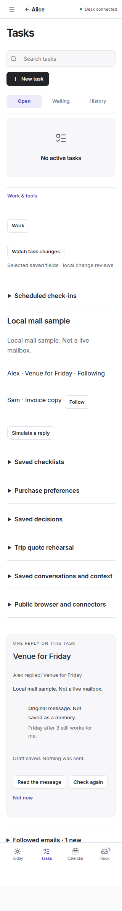

# One reminder after a followed thread receives a reply

25 November 2026. Grok Bot. Source baseline `main` `fc3b8d2af57b4b581a9caefc18ccc3d5fe3be87d` (PR #157). Pull request #160 stays on `cursor/followed-reply-reminder-e853`. Pull requests #158 and #159 were not checked out, stacked, merged, or edited.

## What was read (closeout)

- `AGENTS.md`, `product.md`, `handoff.md`, recent `decision-log.md` / `work-log.md`.
- Prior slice verification on this path and the failing suite list from the previous head.
- Product contracts for each failure: `TextAssistant._fingerprint`, flight reprice clarify, managed-browser create allowlist vs challenge origin, voice forget `home_archived`, `AssistantPanel` home transcript/caption imports, `api.requestDeadline` paths, Today/`MomentCard` mount.
- Narrow remote diffs from #158/#159 used only as hypotheses for baseline expectation/fixture shape. Their feature commits were not cherry-picked.

## Implemented (unchanged product journey)

On a thread the owner has chosen to follow, one new incoming reply raises one reminder on that same task. Chat and the task show it. Inbox can open the task. Quiet hours hold publication until they end. The owner can reread the original message. That text is not stored as a memory, in task evidence, or in the read receipt. Draft a reply appears only after the owner asks. Saving the draft does not send. Check again does not send, including when an earlier send is unknown. Dismissing one reminder leaves another. A failed read is not a confirmed new reply. A message from another thread is refused.

The owner can complete this on Work & tools with the local mail sample. The sample is labeled “Not a live mailbox.” A synthetic Gmail provider uses the same reminder and returns a snippet only for an explicit read. Neither is live-mailbox acceptance. Models stay GPT-6.2 Sol, GPT-Live 1.1, and A3 v9.

## Closeout: previous suite failures

Previous reported gate on notes head `c31149e98688e120aedde6e5a5bf4f6f4acf8737` (product parent `3b2881a38a1355e53e600e4ce98f65df61d2e890`): backend **3059 passed / 9 failed / 1 skipped**; frontend **438 passed / 2 failed**. “Baseline also fails” was not acceptance. Each failure was rechecked against product on this tip:

| Failure | Root cause | Fix on #160 |
|---|---|---|
| `test_office_container_check_and_legacy_fingerprint` ×3 | Product omits absent review-screen fields from the fingerprint; the test rebuilt a dump that still carried those empty keys | Behavioral fingerprint asserts (same/different payload and `allow_memory`) |
| `test_quote_approval_reprice_and_terminal_readback` ×2 | Stale agreement against the old quoted fare returns `acted:false` / `kind:clarify` with no `flight_booking`; booking stays `reprice` on status | Expect clarify + status `reprice` |
| `test_unadmitted_origin_and_auth_are_never_auto_approved` ×2 | Fixture asserted create `allowed_domains` from the mutated challenge `origin`, so create raised `AssertionError` → job `unknown` instead of product deny → `failed` | Split `session_origin` (create allowlist) from challenge `origin` |
| `test_forget_context_route_requires_owner_session` | Forget returns `{cleared, home_archived}`; exact equality to `{cleared:true}` failed | Assert both fields; `home_archived is False` |
| `test_ordinary_composer_over_local_http` | Composer fixture missing `useHomeTranscript` / `HomeCaption` mocks under Node 22 | Add those mocks; keep ownership/privacy asserts |
| `browser-workflow` timeout regex | Source-string regex did not match the real multi-condition deadline | Export `requestDeadline` (same path rules) and assert deadlines behaviorally |
| `moments.test` MomentCard in App | Workspace redesign mounts `<MomentCard>` under `TodayView`, not `App` | Assert Today mount once; keep card copy checks |

No ownership, privacy, revocation, current-permission, idempotence, unknown-effect, or draft/send approval expectations were weakened. No failures were skipped. No #158/#159 feature code was merged.

### Codex conflict note (duplicate baseline fixes)

#158 (`c2cac2d8…`) and #159 (`90275bf0…`) independently contain overlapping baseline test/fixture adjustments (fingerprint, reprice clarify, managed-browser `session_origin`, forget `home_archived`, Google composer mocks, requestDeadline/timeout behavior, Today/`MomentCard`). #160 applied the same *class* of baseline fixes from product contracts only. #158 also extracts `momentView` and adds `BROWSER_PAGE_LOST` copy; those were **not** taken here. When landing, Codex should treat the overlapping test edits as duplicate baseline repair, not as a reason to pull #158/#159 features into this journey.

## Locally verified (this closeout tip)

Interpreter: `/tmp/desk-venv/bin/python`. Frontend Node suite via `npm test`. Ports **8832** (API) and **5191** (Vite `--strictPort`) owned by the UI test process group.

Focused followed-reply backend: `PYTHONPATH=backend … pytest tests/test_mail_reply_reminder.py tests/test_mail_followups.py tests/test_mail_reply_ui.py` → **47 passed** (UI includes failed-read recovery then successful read/draft/save at 1440×1000 and 320×740).

Previously failing nine backend cases → **9 passed**.

Full backend: `PYTHONPATH=backend … pytest -q --tb=line -p no:cacheprovider` → **3068 passed, 1 skipped, 0 failed**, 1045.28s. The single skip is the suite’s existing skip, not this slice.

Frontend: `npm test` → **440 passed, 0 failed**. `npx tsc --noEmit` passed. `npm run build` passed (Vite; existing chunk-size warning). Ruff on the edited Python test files passed.

Tested product-and-test commit: `87a38f489606d6a672fa88faf6dd389bfd05c1f7`. Suites above were run on the closeout working tree that became that commit. A later notes-only tip must cite this SHA and must not claim the suites ran on untested later code.

## Local three-way integration (throwaway only)

25 November 2026 closeout follow-up. Owner Auto authorization; no extra credits. **No feature-branch rewrite, no GitHub merge, no new PR.** Throwaway worktree branch `local/integrate-158-159-160-e853` only.

### Per-PR heads used (unchanged on remotes)

| Ref | SHA |
|---|---|
| `main` | `fc3b8d2af57b4b581a9caefc18ccc3d5fe3be87d` |
| #158 `cursor/owner-page-handoff-f7ae` | `c2cac2d8f95da625a3b08ee6a8699bc27aa34692` (product `32066b8b`, hold-card test `59547453`) |
| #159 `cursor/task-recovery-readback-f7ae` | `90275bf08272bb49b9d50216b2e7e1f9d7246588` |
| #160 tip before this notes update | `28f39f826a191d10c1fff8444d7ce4d0fa33f407` (tested product `87a38f489606d6a672fa88faf6dd389bfd05c1f7`) |
| Prior 158+159 rehearsal (not this tree) | `cefe84e0` — independent of three-way evidence below |

### Merge order and local resolved tree

`main` → #158 → #159 → #160. Final local tree: **`65eb854ecd99dd5e9998161b57aab4a451340eac`**.

### Per-file conflict resolutions

**#158 ↔ #159**

| File | Resolution |
|---|---|
| `frontend/tests/browser-workflow.test.ts` | Kept #158 `requestDeadline` path asserts **and** shared setTimeout behavioral check |
| `frontend/tests/moments.test.ts` | Kept #158 `momentView` behavioral suite + Today mount + card endpoint/copy asserts |
| `tests/test_chat_attachments.py` | Kept named-repeat fingerprint behavioral asserts (equivalent to #159) |
| `handoff.md`, `decision-log.md`, `work-log.md` | Kept **both** Local page handoff and Interrupted task readback; next step = parent review of open PRs, Pi separate |

**(#158+#159) ↔ #160**

| File | Resolution |
|---|---|
| `frontend/tests/moments.test.ts` | Kept #158 `momentView` feature tests (160 only had mount/copy); retained `Not now` / reset copy |
| `tests/test_chat_attachments.py` | Kept behavioral asserts; retained 160 comment |
| `tests/test_conversation_flight_booking.py` | Kept clarify/`reprice` asserts; retained 160 comment |
| `tests/test_managed_browser.py` | Kept `session_origin` fixture; retained 160 comment |
| `handoff.md` | Kept all three personal-agent sections (page handoff, task readback, followed reply); next step = parent budget after integration evidence, Pi separate |
| `frontend/src/api.ts` | Auto-merge kept #158 `requestDeadline` + `BROWSER_PAGE_LOST` and #160 mail-reply error copy |

Feature product from all three PRs retained. No tests dropped.

### Combined suite on `65eb854e`

Worktree `/tmp/fyp-integrate-158-159-160`. Interpreter `/tmp/desk-venv/bin/python`.

- Backend: `PYTHONPATH=backend … pytest -q --tb=line -p no:cacheprovider` → **3074 passed, 1 skipped, 0 failed**, 1110.57s  
  - Single skip: `tests/test_shop_basket.py:407` — `local PHP CLI unavailable`
- Frontend: `npm test` → **442 passed, 0 failed**
- `npx tsc --noEmit` passed; `npm run build` passed (existing chunk-size warning)
- Ruff on merged product Python paths: passed
- `git diff --check origin/main...HEAD` (at integration tree `65eb854e`): flagged a trailing blank line at EOF in `mail_reply_reminder.py` (whitespace only from #160)
- Focused interaction set (`test_mail_reply_reminder`, `test_task_job_journey`, `test_task_recovery_ui`, `test_owner_takeover`, `test_live_owner_page`): **36 passed**

### Ancillary #160 hygiene (whitespace only)

Removed the single trailing blank line at EOF in `desk-companion/backend/desk/mail_reply_reminder.py` (`1` deletion). No semantic change. `git diff --check` on that file is clean after the fix. Full suite results above still belong to tested product tree `87a38f489606d6a672fa88faf6dd389bfd05c1f7` and combined throwaway `65eb854e`; this whitespace tip does **not** claim a new full-suite run.

### Browser journeys (owned ports, sequential teardown)

Ports cleared between runs. Leftover Vite on 5190 from a prior attempt was killed before retries. Each UI test owns its process group / listening pids.

| Journey | Ports | Result |
|---|---|---|
| Owner same-page hold / type / handback (`test_owner_page_ui.py`) | API 8831, Vite 5190 `--strictPort` | **1 passed** (1440 + 320) |
| Interrupted task readback (`test_task_recovery_ui.py`) | API 8831, Vite 5190 `--strictPort` | **1 passed** (1440 + 320) |
| Followed mail failed-read → original → draft save never send (`test_mail_reply_ui.py`) | API 8832, Vite 5191 `--strictPort` | **1 passed** (1440 + 320) |

### Interaction guarantees checked on the combined tree

- Same-title task/file association stays on the selected task (task journey / recovery).
- Paired / revoked / `hide_private` continue to fence private task and mail reminder surfaces.
- Check / reread report `sent: false` and do not dispatch again; unknown send stays distinct.
- Draft appears only after explicit owner choice; save does not send (`MAIL_REPLY_SEND_FORBIDDEN` path retained).

### Defects

None requiring a product push to #158/#159/#160. No localized integration bug found.

### Not claimed by this integration

The throwaway tree is **not** a GitHub merge. Independent #160 closeout green and prior 158+159 rehearsal `cefe84e0` do **not** substitute this three-way evidence; this section is the three-way evidence. Still not deployed, not live Gmail accepted.

## Not claimed

Not merged. Not deployed. Not a live Gmail or Outlook acceptance. Not a sent message. Not shopping, booking, or automatic execution. Paid reasoning was not used. Extra paid credits were not used. The Pi update is a separate device step. #158 and #159 remain independent open work.
