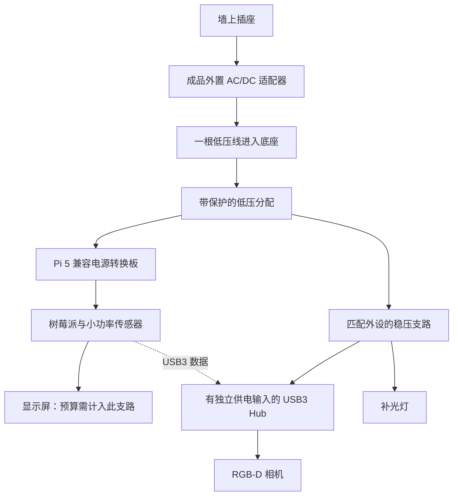

# Group 2 相机、统一供电与多盘位成本设计

**2026-09-21更新：**Gemini2原“首购候选”不再作为本轮工程建议。先做普通RGB与称重基线，深度相机根据可验证增益决定；本页既有相机比较、价格、统一供电和扩展算例按2026-09-15历史条件保留。[最新复核](../2026-09-21/marco-camera-and-nutrition-review.md)，尚未采购或确定新BOM。

更新：2026-09-15。针对 Gemini／RealSense、Metafoodx 照片中的外接线缆，以及假设十个自助餐盘位的扩展问题。以下为工程建议和算术情景，未采购、组装或测试。十盘位是部署分析，不新增 FYP 必做设备数量；当前交付基线仍是一套原型、一个独立称重位置、三个软件配置。

**用户随后明确确认：FYP只做一台设备用于demo。**多餐位是项目成功后进入真实自助餐的疑问，不是要求本期实施共享相机、多节点或多机通信。下文多盘位及其成本仅保留作未来商业部署研究。电源优先国内成品，MeanWell／WittyPi5只是资料示例，不锁定品牌或海外采购。

**供电后续已具体化：**当前单机按[12V两支路供电专项](power-supply-detail.md)选型：亚博Pi5 PD板给Pi／屏幕，ORICO Hub给相机和两灯。下文24V／WittyPi及单独灯降压是较早通用备选，保留作HISTORICAL研究，不作为当前并行采购方案；该ORICO型号需12V，不能套用24V直供。

## 结论与原采购表的关系

1. 当前单盘位首购候选维持 **Orbbec Gemini 2**；共享相邻餐盘时，其较宽的彩色视野也是优势。Gemini 335 可在实际供货及价格合适时作为替代候选；不能把型号较新或厂家不同测试条件下的百分比当作本地食物识别更准。RealSense D435 是可借用或开发适配更合适时的替代。
2. **扫描和连续监测是系统工作流程，二者相机都可以输出连续 RGB-D 数据。**选择 RealSense 不强制变成扫描站；选择 Gemini 也不会自动得到整机连续监测。
3. 一根外部电源线可以实现，建议用外置成品 AC/DC 适配器、内部低压分配及合适的转换模块。树莓派、相机、屏幕和灯不应都无条件从 Pi USB 取电。
4. 十个独立餐盘需要十条独立称重测量路径；不等于十台电脑、十块屏幕、十个 3D 相机。扩展候选为独立称重节点、按区域共用相机、共用计算和界面。
5. 原 [采购工作簿](<../../outputs/01a07aeb-a256-7572-a42e-bd7e4668674f/Group 2_Hardware Procurement_20260915.xlsx>)、[数据](procurement-data.json)和 V1/V2 建议书原样保留。原清单是单机台架／展示参考，包含工具和配套项，且 Pi 与灯分开使用适配器。它不是新统一供电版本或十盘位部署 BOM，不能直接乘十当成商业报价。

## 相机的具体比较

2026-09-15 重新读取厂商页面。美元为国际官网参考，不含国内渠道、运费及税费；人民币采购区间仍是工程预留。

| 维度 | Gemini 2 | Gemini 335 | RealSense D435 |
|---|---|---|---|
| 官网参考价 | US$234，页面有库存 | US$264，页面缺货 | 官方比较页 US$314，未核对当地现货 |
| 彩色视野 | 16:9 模式约 86°×55° | 16:9 模式约 86°×55° | 约 69°×42° |
| 彩色输出 | 可到 1920×1080、30fps | 可到 1920×1080、30fps | 1920×1080、30fps |
| 深度输出 | 1280×800、30fps 配置 | 最高 1280×800、30fps | 最高 1280×720；最高帧率与分辨率不能随意组合 |
| 近距依据 | 深度范围从 0.15m，理想 0.2–5m | 深度范围从 0.1m，理想 0.26–3m | 最高深度分辨率 Min-Z 约 0.28m，理想 0.3–3m |
| 设备端处理 | MX6600 深度处理及支持配置下的硬件 D2C | MX6800 深度处理 | D4 深度处理器 |
| 开发路线 | Orbbec SDK v2 | Orbbec SDK v2 | librealsense；有官方多机配置文档 |
| 当前定位 | 优先测试，价格／视野均衡 | 有合适现货后的替代候选 | 有借用设备、既有代码或更好适配时可优先 |

来源：[Gemini 2](https://store.orbbec.com/products/gemini-2)、[Gemini 335](https://store.orbbec.com/products/gemini-335)、[D435 规格](https://www.realsenseai.com/products/stereo-depth-camera-d435/)、[RealSense 比较价](https://www.realsenseai.com/compare-all-cameras/)。

两者均有机内深度计算，不要将其误当作已经运行本项目的食物分类模型。较宽视野方便低位安装和共享，但同样的图像分辨率覆盖更大面积，每个食物细节分到的像素会减少；较窄视野在相同高度反而可能保留更多局部像素。

Gemini 2 的厂家 2%@2m 与 Gemini 335 的 1.5%@2m 使用的 ROI 条件不完全相同，D435 的 2m 指标也不是同一台架比较。不能线性换算为 0.5m 处的菜盘误差，也不能推导食物识别率。实际应比较同一位置的有效深度、边缘／反光盘／湿食物表现、RGB-D 对齐、独立批次识别和完整服务运行稳定性。

[Orbbec SDK v2](https://github.com/orbbec/OrbbecSDK_v2)列出 Linux ARM64 和 M2 macOS 测试，但 ARM64 明列的平台主要是 Jetson；这不能充当 Pi 5 实测。D435 也不能凭历史树莓派示例就保证在当前 Pi 5 系统即插即用。当前没有执行任一相机 SDK 或模型测试。

Metafoodx [官方技术比较文章](https://www.metafoodx.com/post/metafoodx-vs-others-why-our-ai-platform-redefines-food-operations)明确使用 Intel RealSense 和 GPU 平板，没有公开这里所比较的具体相机型号及内部供电结构。复用同品牌不会获得其私有软件、数据和校准。

## 一台相机可以覆盖几盘

针孔几何示例：镜头正对平面，忽略畸变；宽度＝2×距离×tan(水平视角÷2)，高度同理。距离从相机量到被测食物平面，不是只量到桌面。

| 相机到被测平面的距离 | Gemini 2 彩色名义覆盖 | D435 彩色名义覆盖 |
|---|---|---|
| 0.50m | 约 93.3×52.1cm | 约 68.7×38.4cm |
| 0.70m | 约 130.6×72.9cm | 约 96.2×53.7cm |

以 GN1/3 的 32.5cm 长边沿餐线排放、盘间留 2cm 为例：两盘总宽约 67cm，三盘约 101.5cm。在上述名义几何下，Gemini 2 距食物平面 0.5m 看两盘、0.7m 看三盘具有研究价值；D435 需要不同高度或排列。**这只是安装候选，不是已验证可测盘数。**还需为镜头偏置、共同有效视野、边缘畸变、盘高、顾客手臂、台架和防护玻璃留空间。

十盘沿上述长边排成一线约 3.43m。只以 Gemini 2 的水平视野计算，需要距平面约 1.84m 才能刚好放入画面，尚未留边缘余量；每个 32.5cm 盘宽在 1920 像素画面里只占约 182 像素。这说明“把一个相机装很高看十盘”会改变细节、遮挡及结构条件，不能直接用单盘位精度承诺。

可从“每区域 2–3 个相邻盘位”的候选做布局实验；十盘可能约需 4–5 台相机，也可能因实际布局更多或更少。没有餐线尺寸和实测前，不固定数量。无需强行合成完整三维餐台：每台相机可对预先登记的盘位区域分别裁剪，绑定相应称重通道和菜品。

## 一根外部供电线怎样做（HISTORICAL通用候选）

用户照片可见一根细线从底座左后方伸出；线缆性质、其余不可见接线和底座内部结构均不能由照片证实。本设计借鉴整洁的底座、立柱内部线束及固定接口，不声称还原 Metafoodx 电路。

推荐集成候选如下。实线为供电关系，虚线为 USB 数据；所有餐盘继续原位放置。

外部可以像笔记本一样只有一块电源砖、一根低压入机线；机内仍然有多根分支线。相机 USB3、屏幕 DSI、按钮与灯的线束沿固定立柱或罩壳布置，设置应力释放，不能拉住浮动秤板。底座、竖屏和上方相机可分离成模块，餐线只保留必要的传感头及低矮称重底座。

### 可核对的成品模块示例

以下型号用于说明方案可由成品模块组成；最终可以换成国内可购且满足规格的适配器及供电板，不要求购买这两款。适配器和降压／配电板是不同器件，购买一块12V或24V适配器不能省略设备所需的转换。

- [Mean Well GST60A24-P1J 数据表](https://www.meanwell.com/Upload/PDF/GST60A/GST60A-SPEC.PDF)：24V、2.5A、60W 外置成品适配器，C14 市电入口；如采用该款，配合正规英规 BS1363 至 IEC C13 成品电源线。P1J 为 5.5×2.1mm、中心正极输出，设备入口需匹配尺寸、极性、电流及机械固定。24V 是内部转换前的输入，不能直接接 Pi 或相机。
- [UUGear Witty Pi 5 HAT+](https://www.uugear.com/product/witty-pi-5/)是已存在的 Pi 5 供电板示例：螺丝端子接 6–30V DC，厂家声明可向 Pi 及外设提供最高 5A。它证明不必自行设计整个降压和电源管理电路；该款并未加入原采购表，也不是本项目实测通过的最终器件。
- [Witty Pi 5 手册](https://www.uugear.com/doc/WittyPi5_UserManual.pdf)§13.3 的官方索引说明只使用 I2C 总线及相应电源连接，没有沿用旧代额外 GPIO 的做法。厂家公告列其地址 0x51；与当前 NAU7802 0x2A 不同。仍须试装散热器、排针引出、屏幕电源及全部信号，不能直接声称已验证与所有配件兼容。
- 外设支路需选择实际符合输入电压和连续负载的 DC/DC 模块及 USB3 Hub。相机口必须同时提供高速数据与所需电流；只有大电流“充电口”不够。Hub 供电输入可能是 5V、12V 或其他值，必须先选型号再定支路，不把 24V 直接插进任意 Hub。

以上是明确部件类别的参考拓扑，**不是可照图上电的最终接线单**。电源板手册和主机供电路径须匹配，不能并接两个未经隔离设计的 5V 电源；不剪开官方 Pi 电源线或以普通杜邦跳线承担高电流主电源。市电部分用完整成品适配器和线材，样机只做低压侧安装与配线。

### 国内成品电源的选型条件

以当前单台demo为对象，先选外部适配器与内部供电模块的匹配组合。可用搜索词如“12V 5A 60W 桌面式电源适配器”“24V 2.5A 60W 电源适配器”“树莓派5 5.1V 5A 电源模块”；这些是筛选词，不是已核实的淘宝商品。

| 检查项 | 当前单机的筛选要求 |
|---|---|
| 完整产品身份 | 有明确厂家、型号、参数表、持续输出及保护说明；不只看商品标题瓦数 |
| 外部输入 | 适用香港市电；可选100–240V AC输入、英规插头或配套英规成品电源线 |
| 低压输出 | 12V／5A或24V／2.5A均为60W等级候选；电压必须匹配内部供电板和Hub，实际电流及功率按负载／效率／温度定稿 |
| 连接器 | 核对DC插头内外径、极性、电流与固定方式；5.5×2.1和5.5×2.5不能仅看外观混配 |
| Pi支路 | 若从USB-C供电，核对实际5V档位和Pi5兼容性；普通高瓦数PD电源不自动提供5V／5A。使用专用供电板则按其规定路径接入 |
| 相机／灯支路 | Gemini2官方建议DC5V且至少1.5A供电能力；高速数据口与大电流充电口不能混同。灯按实物功率另计 |
| 连续运行 | 相机、屏幕、灯及模型一起运行，检查稳压、温升、掉线和冷启动；供应商额定值不代替本机测试 |

供电条件再次核对[Pi官方USB-PD说明](https://pip-assets.raspberrypi.com/categories/685-app-notes-guides-whitepapers/documents/RP-009856-WP-1-USB%20Power%20delivery%20on%20Raspberry%20Pi%205.pdf)和[奥比中光Gemini2中文参数](https://www.orbbec.com.cn/index/Product/info.html?cate=38&id=51)。尚无国内实际SKU、报价或整机电源验证结果。

### 功率如何预留

单相机集成原型可以先用以下支路上限做设计计算：Pi／屏幕／低功率采集支路预留约 25W、相机端按 5V×1.5A 预留 7.5W、两条灯合计 5W、Hub 控制及其他 2W，负载侧合计约 39.5W。假设整体转换效率为 80% 作保守算术情景，适配器约需 49.4W，因此 **60W 档是首轮核算候选**。这些是设计预算，不是实际耗电，也不保证任何 60W 适配器或降压板都适用；各支路峰值、温升、压降和整机负载必须分别测试。

[Pi 官方硬件文档](https://www.raspberrypi.com/documentation/computers/raspberry-pi.html)规定，在检测到合适的 5V／5A 供电时 USB 外设总预算为 1.6A，且与风扇相关；普通兼容 3A 供电条件下为 600mA。供电板提供最高 5A 不会自动取消板上 USB 配电限制，100W 手机充电器也不自动具备 5V／5A 档位。

原型先保留原有官方电源的单机台架方案，便于排查；整机定型再装集成电源。台架临时共用一个成品插排可减少墙面插头数量，但不等于已经完成低压单线入机及紧凑外壳。整条餐线若有多个物理分区，可以每区一条进线；不强求不同餐岛跨过走道共用一条供电线。60W 单机候选不能直接套到十盘位系统。

## 十个盘位的模块化部署（未来商业研究，FYP之外）

这里的“餐位”按一个放菜的餐盘位置解释，不是十个顾客座位。若需分别持续获得十盘余量，每盘应有独立受力路径及测量通道；几盘共用一个大秤所得合计重量不能唯一拆开。

| 硬件 | 十盘位候选配置 | 必须随盘数增加吗 |
|---|---|---|
| 称重底座／传感器和测量通道 | 10 份独立测量路径 | 是；一个底座可由多个元件组成一台秤 |
| 小型采集控制器 | 每盘或每组一块 MCU，按线距和通道安排 | 不需要每盘一台 Pi；可研究 ESP32、RP2040 或已有 UNO |
| RGB-D 相机 | 按实际区域覆盖设计，2–3 盘共享一台作为候选 | 不必一盘一台；也不保证一台覆盖十盘 |
| 计算主机 | 一台共享主机起步评估，必要时分区 | 数量由完整视觉负载及线路决定 |
| 员工显示屏／网页 | 通常共用一个入口，手机可访问 | 不必每盘配 7 英寸屏 |
| 指示灯 | 每盘小灯可选 | 低成本提示，与大屏分开 |
| 供电和网络 | 共用低压分配或按餐岛分区 | 按总功率、线损、距离和维护设计 |

单盘位仍可以 Pi 直连 NAU7802，不需要 Arduino。多盘位时 MCU 的作用是读取附近的秤并传输小数据包，不承担通用 RGB-D 视觉；这不是把 UNO 改为首版必需。

称重 ADC 尽量靠近传感器，避免沿整条餐线拉长原始毫伏信号。NAU7802 固定地址相同，不能把十块直接接在同一条短 I2C 总线上假设可用。小范围可测试复用器；米级餐线更适合本地采集后通过设计好的 RS485／CAN／以太网或 Wi-Fi 传送状态，具体方案还要核对协议、电源、终端和抗干扰。低压配电、电源地和通信参考按最终接口设计，不用一个长杜邦线束代替总线设计。

### 软件如何避免十倍计算

开餐／换菜时确认“盘位 A 是某菜、批次及皮重”；连续称重负责余量，视觉根据变化或适当间隔检查身份、遮挡和异常。每盘无需每秒从零识别所有配料。相机共用时先按盘位区域裁剪，保持相机区域、节点 ID、菜单和批次的明确对应。

十路重量数据通常比多路图像轻得多；瓶颈更可能在 RGB-D 采集、解码、对齐和视觉处理。**一台 Pi 5 能否处理 4–5 路相机加所有服务，当前不能保证。**可比较分区 Pi 或 USB 接口适当的 x86 小主机；不同 CPU/GPU 支持、功耗和成本仍需实测。

仅把模型推理从 30fps 降到 1fps，并不会自动降低仍在 30fps 采集的 USB 流带宽。还需选择 SDK 支持的真实采集模式、处理队列和数据格式。USB3 Hub 增加接口数量不等于增加上游带宽。[RealSense 官方多机指南](https://dev.realsenseai.com/docs/multiple-depth-cameras-configuration/)分别讨论带宽、电源、CPU、线材和同步，不能直接移植其 PC 示例中的相机数到 Pi。

相邻深度相机的光学共存要在实际布局中测试，不泛称一定互相干扰；RealSense 对 D4xx 的资料明确称重叠视野下无显著串扰。同步的需要取决于是否做多视角融合或严谨时间对应，不能把同步配件默认加入仅分区观察的方案。

中央主机故障会影响多个盘位。节点缓存、心跳、陈旧值提示和本地基础阈值灯可作为可靠性设计，但本地基础提示不能冒充中央 AI 建议仍正常运行。相机失效时，已绑定身份且有效的重量可以继续支持余量提示；视觉身份和相关估算要标为不可用。

### 3D 是否每区都需要

可比较“称重＋登记菜单＋中央补餐预测”的基础组合和“分区加入 RGB-D”的视觉增强组合。没有相机的区域仍可持续测余量，但不具备该区的持续视觉检查或深度测量，不能宣传为十盘全部 RGB-D 监测。

若收益主要来自重量、提前量和在制状态，减少相机可能更有价值；若深度明显减少换盘错误或操作负担，再按有价值的区域配置。该取舍需通过识别、人工确认、空盘和剩余共同评价。学校或个人的独立示范机可以保留漂亮的一体式外形；餐线部署可以把同一核心拆成低矮秤台、公共上方支架和一个控制盒。

## 成本情景：明确假设再算

原单机参考为 RMB 4,314–6,651。直接乘十是 RMB 43,140–66,510，但其中连工具、校准用品、屏幕和主机都重复算了；这是说明复制整机的错误成本直觉，**不是合理十盘位报价**。

成本公式为：**共享主机／界面＋独立称重盘位数×每盘成本＋相机区域数×每区成本＋公共配电／网络／结构＋安装验证与维护**。

下表另设一个十盘位、四个相机区域、单台共享 Pi 级主机的样机物料情景。四相机是否能覆盖以及主机是否足够均待测；只用于比较结构，不是采购清单或商业报价。

| 构成 | 数量 | 单价工程预留 RMB | 情景小计 RMB |
|---|---:|---:|---:|
| 共享计算、存储、散热、一个屏幕及主机盒；电源另计 | 1 | 1,700–2,500 | 1,700–2,500 |
| 每盘称重元件、ADC、基础平台、小采集／通信板和连接件 | 10 | 300–650 | 3,000–6,500 |
| Gemini 2 相机区域，含基本数据线和安装件 | 4 | 1,700–2,300 | 6,800–9,200 |
| 公共配电、Hub／通信、上方支撑和公共线材 | 1 | 1,500–3,500 | 1,500–3,500 |
| **物料情景合计** | | | **13,000–21,700** |

均摊约 RMB 1,300–2,170／盘位，但不是新增第十一个盘位的固定价格。若需要第五个相机区域，情景合计升为 RMB 14,700–24,000；若改用更强主机、工业称重结构或分区供电，还要相应调整。

共享主机预留参考原表 Pi、散热、存储、屏幕和盒体的金额量级；相机预留参考原 Gemini 2 相机及基本附件。节点和公共设施为本轮设计预留，**没有取得供应商报价**。该范围不含开发工时、运输、真实厨房改装、成品认证、现场安装、维护服务及备用机，不能直接用于商业售价或与竞品全包价比较。真实保温台的承重、清洁、热漂移和安装结构可能成为重要成本。

基础称重组合减少相机费用，也减少视觉能力；不可把删去功能后的价钱当作同等能力的降本成果。商业可行性仍需用实际空盘、餐末剩余、员工操作负担和维护成本验证。Controliza [Buffet](https://controliza.com/en/buffet)已公开视觉和称重及实时补餐，当前方案不能宣称其没有共享硬件或我们已经更便宜。

## FYP 本轮保持的范围与下一步

用户明确FYP只做一台demo，当前保持一个独立称重位置。移除此前把第二容器或额外称重节点作为本期可追加验证步骤的建议；多盘共享与商业餐线验证留待未来工作，不影响单台原型验收。三种应用配置仍由同一台设备轮流演示；保留持续测量、视觉辅助、反馈及辅助QR功能。

适配器与内部模块的书面细化已完成，见[供电专项](power-supply-detail.md)。下一步先确认所选Hub低压接口与上游供电行为，再进行单机台架验证，不能把未测候选直接认定为接线定稿；扩展相机数仍不是本期下一步。

## 研究访问与验证记录

本轮已查看用户图片；重新读取 Gemini 2／335 商店、D435 规格／比较价、Orbbec SDK、Pi USB 供电、RealSense 多机指南、Metafoodx 技术文章、Controliza Buffet 和 Mean Well 数据表相关字段。UUGear 产品页及手册直接提取返回 Internal Error，使用官方搜索索引取得产品规格、手册 §13.3 与厂家公告；未把搜索中旧代手册或论坛讨论作为 Witty Pi 5 接线依据，未声称全文读完电源板手册。

本轮没有重新观看竞品视频、获取厂商内部线路图、访问淘宝／京东商品、询价或购买。几何与费用计算有可复算记录，不能充当实测。所有原交付物保留，当前状态见 [handoff](../../handoff.md)，完整记录见 [work-log](../../work-log.md)。
