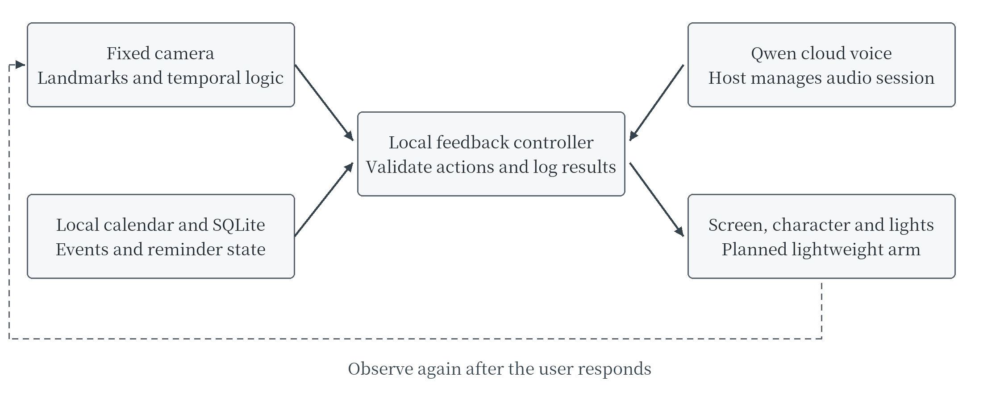

# AI Desktop Calendar with Continuous Posture Monitoring and Feedback

Group 2 Project Proposal

Module: ITE4116M Final Year Project
Programme: Higher Diploma in AI and Smart Technology (IT114124)
Class: AIST-2B
Supervisor: Marco
Date: 28 September 2026

Table 1 Group members and planned allocation

| Member | Student ID | Student email | Share |
|---|---|---|---|
| Yuan Yuchen (Leader) | 250342840 | 250342840@stu.vtc.edu.hk | 40% |
| Xu Ziqian | 250137555 | 250137555@stu.vtc.edu.hk | 30% |
| Li Wenhua | 250329909 | 250329909@stu.vtc.edu.hk | 30% |

The proposed device will support adults working at a home or office desk. A fixed camera will observe visible upper-body posture, compare sustained forward or sideways leaning with a personal reference, present an actionable prompt and check whether the user adjusts. The same device will provide a local calendar, daily timetable, voice commands and an animated character. A small robotic arm is planned for physical cues. Reflected imagery and an enclosed rotating LED module will be compared for the character display. Evaluation will address functional accuracy, false alerts, responsiveness and reliability, without claiming medical diagnosis or health outcomes.

<!-- body -->

## 1 Statement of the problem to be solved

People working at a computer may gradually lean forward or sideways, or remain seated without noticing the duration. A timed break alarm can indicate elapsed time but cannot explain the posture observed at that moment or check whether a prompt led to an adjustment. Users also need to see their next meeting or task. These are the proposed use cases to investigate in controlled desk conditions; no workplace pilot or quantified market demand has yet been established.

The core task is to detect defined, sustained visible posture deviations, suppress brief movements, provide a specific prompt and record whether the user returns to the personal reference. The calendar and voice interface give the same terminal a practical daily role. A posture event will not automatically change the user's schedule.

For example, after sustained forward leaning, the device displays a prompt to adjust the distance from the screen, speaks once and raises a lightweight indicator using the planned arm. It then reassesses posture and records adjusted, still deviated or unable to judge. Briefly reaching for an object or an obstructed view must not trigger the same conclusion. A separate duration-based reminder can suggest movement even when the user's visible posture remains within the reference range.

### Project objectives

1. Implement personal calibration, continuous detection of forward and sideways leaning within a tested camera view, uncertainty handling and reassessment after feedback.
2. Integrate a local calendar and timetable, hands-free voice queries, confirmed calendar changes and observable device feedback in one prototype.
3. Compare single-frame thresholds, temporal detection and fixed-interval reminders, measuring false alerts, response time, adjustment records and integrated reliability.

## 2 Background and intended environment

The initial scope is one adult, one seat and a calibrated fixed camera position. Home and office desks use the same core functions; multi-person identification, employee performance monitoring and enterprise integration are outside the initial scope. OSHA recommends changing position during prolonged computer work [6]. This provides general context, rather than evidence that this device prevents spinal or neck disorders.

Table 2 Existing alternatives and evaluation focus

| Reference | Public capability | Focus of this project |
|---|---|---|
| Phone calendars and Skylight Calendar [9] | Calendar, task and reminder displays. | Add visible-posture detection and reassessment while keeping the timetable readable. |
| UPRIGHT GO 2 [10] | Wearable posture sensing and vibration feedback. | Evaluate a camera-based approach that requires no wearable, including its viewing and occlusion limits. |
| Razer AVA [8] | A desktop voice character with camera and display. | Use its interaction and form as references while independently implementing posture feedback. Its optical construction is not assumed. |

The proposed contribution is the integration and evaluation of personal calibration, persistent posture detection, actionable feedback and reassessment in a calendar terminal. More features alone do not establish an advantage. Results will also identify conditions in which a simple timer or an existing calendar is sufficient.

Users can hide private event titles, pause monitoring and directly disable camera or microphone input. Demonstrations will use fictional schedules. Camera processing will be local by default, with no continuous raw-video storage or automatic cloud upload.

## 3 Outline of the proposed solution

### 3.1 Architecture and hardware

The local system will separate capture, posture processing, calendar management, feedback and logging. Raspberry Pi 5 with 8GB RAM is the preferred deployment target [7]; the existing M2-series MacBook with 16GB memory will support development. Full-load tests will determine the final arrangement. Resolution, sampling and character complexity will be reduced before using a clearly documented Mac-assisted demonstration fallback.

Figure 1 Local posture and calendar services connected to voice and physical feedback

Table 3 Proposed hardware and its role

| Component | Purpose | Selection condition |
|---|---|---|
| Fixed RGB camera | Observe the head, shoulders and necessary upper-body region. | Compare a monitor-adjacent and an oblique elevated position. The arm must not move the camera. |
| Pi 5, storage and cooling | Local processing, calendar, interface, audio and control. | Measure the combined workload; memory capacity does not guarantee inference speed. |
| Readable display and character module | Timetable, instructions and interaction states. | A conventional screen provides the baseline; select reflected imagery or enclosed rotating LEDs after testing. |
| Microphone, speaker, lights and physical controls | Wake-word interaction, spoken prompts, status and input disabling. | Test echo, noise and false activation. Basic prompts remain available offline. |
| Planned lightweight arm with two or three degrees of freedom | Raise a small indicator or perform a brief attention cue. | Separate motor supply, motion limits and manual stop. No body contact or object grasping. |

The existing Arduino UNO R4 WiFi is optional for diagnostics or separate control. Power branches will be sized for the selected modules; motors will not draw power directly from Pi GPIO. Enclosure dimensions will follow camera, audio and display tests.

### 3.2 Functions and scope

**Posture and presence.** A guided personal calibration establishes the reference. The device detects sustained forward and sideways leaning within the tested view and distinguishes absence, occlusion, multiple people and insufficient confidence. Forward leaning means a calibrated visible head-and-shoulder displacement pattern, not a precise cervical angle. Unreliable hip landmarks hidden by the desk will not be used to calculate a torso angle. If forward leaning cannot be distinguished reliably, the camera position must be revised and retested; an unresolved failure will be reported rather than filled with a language-model guess.

**Feedback and reassessment.** A confirmed event triggers a specific on-screen instruction, with voice and light feedback. The arm is added after its checks pass. A persistence threshold and cooldown prevent repeated alerts. After a defined interval, the system records adjusted, still deviated or unable to judge. Users may snooze or disable prompts. Daily records contain valid observation time, events, alerts and reassessment, rather than a health, attention or productivity score.

**Calendar.** Local functions cover anniversaries, weekly or monthly recurring events, one-off events, private/public display flags, time-conflict warnings, a daily timetable, completion confirmation and snoozing. Presence can bring up today's timetable; absence hides private titles. A public flag controls this device's display and does not imply a shared multi-user service. External calendar synchronisation, weather and lunar-calendar support are later extensions.

**Voice and permitted actions.** A local wake word opens a short voice session. Qwen realtime voice is the first candidate [1], followed by Gemini, OpenAI Realtime and GPT-Live as alternatives; the project does not require all four. The model requests an action, local code checks its parameters and current state, and a real execution result is returned. Creating, rescheduling or deleting an event requires read-back and confirmation. The arm accepts named preset poses rather than arbitrary angles or continuous motion. Account access, model version and actual cost will be checked during integration.

**Character display.** The character expresses idle, listening, thinking, speaking, alert and confirmation states. Reflected imagery [11] and an enclosed rotating LED module [3,5] are candidates. Programmatically switching stored animations can respond to live events; per-frame lip movements or changing text require a continuous video or rendering interface, which need not be HDMI. By the end of October, the team will select one route using control access, desk-distance visibility, timetable legibility, noise and transition latency. A conventional screen remains the fallback. The project does not promise volumetric or 360-degree holography or replication of AVA's optics.

### 3.3 Algorithms and development method

MediaPipe Pose Landmarker [2] is the initial pretrained landmark model candidate. The team will implement visibility checks, personal calibration, normalised head-to-shoulder displacement and shoulder-line features, temporal decision logic and reassessment. Only features supported by the calibrated view will be used. Low-confidence inputs produce an unknown state. A candidate deviation must persist across a time window; recovery also requires sustained evidence. Timestamped bounded processing prevents queued old frames from being presented as live observations.

Calendar data includes event identifiers, start/end times, timezone, recurrence, privacy and reminder states. Posture records include timestamps, calibration version, input validity, state and feedback outcome. Device actions include a request identifier and execution result. Retrying an operation must not duplicate a calendar change or arm movement. Cloud failure leaves the local calendar, visual processing, screen and basic prompts operational.

The proposed stack is Python, OpenCV, MediaPipe, SQLite and a full-screen device interface, with HTTP or WebSocket connections where needed. Development starts with reproducible inputs on the Mac, followed by real capture and Pi validation. Two-week iterations will establish vision and the calendar before voice, character and arm integration. Training a large speech model from scratch is unnecessary.

### 3.4 Evaluation and acceptance

The following are proposed engineering targets, not achieved results. Controlled recording is planned with at least six consenting adults in two sessions each, covering reference posture, forward/sideways leaning, brief movements, absence and occlusion. Three participants are assigned to development and three to final testing. Test users may complete the standard personal calibration, but their outcome labels cannot be used to tune thresholds. Adjacent video frames remain in the same partition. Human labels describe visible actions, not medical diagnoses.

Table 4 Proposed evaluation requirements

| Area | Target and method | Reporting condition |
|---|---|---|
| Posture detection | Target macro F1 of at least 0.80 in controlled testing. Report class recall, event detection, false alerts/hour and unknown proportion; target no more than two false alerts/hour in ordinary-work segments. | Include occlusion, view and person effects. Rejected observations must remain visible in the results. |
| Feedback and reassessment | Target 95% of confirmed events reaching the local screen/light within two seconds, measured after the persistence condition is met. Compare reassessment with human-labelled video. | Time audio, character and arm actions separately. Animation playback does not prove the user adjusted. |
| Calendar and voice | At least 30 calendar cases, 40 Mandarin/English commands and ten ambiguous or prohibited requests. Target at least 90% correctly executed commands; every calendar-write confirmation case must pass. | Record wrong parameters, refusal, cancellation, retries and actual execution separately. |
| Concurrency and recovery | Two desk arrangements, each with a run of at least two hours. Record sampling, display behaviour, CPU/temperature, network loss, camera failure and restart. | Show unknown states clearly. Cloud failure must not stop local functions. |
| Display and arm | Measure 100 automatic character-state changes. Repeat 100 preset arm actions and check limits, stop control, obstruction and power. | Record the exact hardware and conditions. Disable movement when mechanical checks fail. |

Single-frame thresholds and temporal detection will use the same recorded inputs. Fixed-interval reminders provide a comparison of alert frequency and timing. Post-alert adjustment is a short-term behavioural observation, not evidence of lasting health benefit. Evaluation clips require separate consent and controlled access; records use participant codes. No market questionnaire or interview programme is included.

## 4 Why the proposed solution is appropriate

Each hardware element has a defined role: a fixed camera observes the user, the screen and audio explain an action, the planned arm provides a visible physical cue, and the camera checks the subsequent state. The user does not need to wear a sensor, but the camera introduces viewing and occlusion limits. The calendar remains useful independently, while the character makes listening, processing and feedback states visible.

Current preparation consists of requirements, competitor and component research, Chinese proposal drafts and interface planning. The new desk device has not been assembled or measured. Tests of the retired Senplate food-software prototype are not evidence for this device. A three-person development period of approximately six months is supported by one prototype, limited posture categories and a replaceable voice service.

October trials will check camera placement/calibration, display control, audio echo and concurrent Pi load before the enclosure is fixed. Unsuitable modules will be replaced according to observed interface or performance failures. The arm remains a lightweight cue with separately tested power and motion. Grasping, clinical posture diagnosis, treatment of emotional disorders, all-day cloud listening and enterprise calendar integration are outside the committed scope.

## 5 Main stages and project plan

Core development is planned from late September 2026 to March 2027, with April reserved for final reporting and presentation. Table 5 follows the course Moodle schedule accessed on 28 September 2026 [4]. Any later course changes will be incorporated. The proposal upload deadline is 29 September 2026 at 23:59.

Table 5 Development stages and course milestones

| Work period | Main outcome | Course milestone |
|---|---|---|
| 28 Sep–23 Oct 2026 | Requirements, data/interfaces, camera/calibration, display control and audio trials; first component selection. | 26 Oct Progress Report I |
| 26 Oct–27 Nov | Local calendar, initial landmark/temporal processing, detailed design and first evaluation records. | 30 Nov Initial Report |
| 30 Nov–11 Dec | Complete prompting and reassessment; separate arm supply, limits and stop tests. | 14 Dec Progress Report II |
| 14 Dec–29 Jan 2027 | Wake word, Qwen tools, character and arm integration; demonstration and fault handling. | 18 Jan interim rehearsal; 1 Feb Interim Report and demonstration |
| 1 Feb–19 Mar | Held-out participant evaluation, baselines, false-alert analysis and integrated runs; major fixes. | 22 Mar Progress Report III and demonstration |
| 22 Mar–16 Apr | Review results, package source/data, finish manuals and final report. | 19 Apr Final Report |
| 19–26 Apr | Rehearsal, fallback demonstration and individual question preparation. | 26 Apr Final Presentation |

Weekly reviews will track integration issues. Group 2 will submit one bi-weekly team log of completed work, pending tasks and reasons for change, while retaining distinguishable individual contribution records internally. The next recording period is 28 September to 11 October; its submission time remains subject to Moodle.

## 6 Main deliverables

1. One desk prototype with fixed camera, processing, readable display, audio and status output, documenting the selected character display and actual verification of the planned arm.
2. Source code for the calendar, calibration, temporal posture detection, feedback/reassessment, permitted voice actions and character states.
3. Consented anonymous evaluation material, labelling rules, development/test partitions, baseline scripts, results and failure examples.
4. Wiring and power records, installation/user guidance, recovery procedures, team logs, individual contribution records and an AI-assistance record.
5. Course progress reports, the final report, presentation and demonstration materials, with incomplete or unmet requirements accurately identified.

## 7 Responsibilities of each member

Table 6 allocates the planned student workload, totalling 100%. It does not represent completed contribution or final assessment marks. All three members will participate in integration and presentation, supported by their code, design, experiment and log records.

Table 6 Roles and identifiable outputs

| Member and share | Role | Main responsibility |
|---|---|---|
| Yuan Yuchen 40% | Project Leader and AI Systems Lead | Requirements/architecture; posture features, calibration, temporal decisions and reassessment; voice tools; evaluation design, analysis and report integration. |
| Xu Ziqian 30% | Hardware and Edge Systems Developer | Camera placement, Pi capture, power and audio; display control, arm drivers/limits/stop; continuous-run testing and maintenance guidance. |
| Li Wenhua 30% | Calendar and Interface Developer | Calendar data/recurrence, timetable, privacy and conflict displays; character animation, daily records, interface tests and user instructions. |

The course has announced that HDAIST will adopt AI as a group member in AY26/27, with peer-review details to follow [4]. The team will record AI-assisted research, drafting, code and checks alongside students' review, modification and validation. No unannounced assessment percentage is assigned to AI. External components and assets retain their sources and licences; supplier fabrication will not be presented as student-made hardware.

## 8 Projected resources

Available resources are an M2-series MacBook with 16GB memory and an Arduino UNO R4 WiFi. The Pi, camera, display, audio, light arm and enclosure are subject to model selection and procurement; no supplier quotation or purchase is asserted. Existing or borrowed equipment will support initial trials before one prototype's bill of materials is finalised against its interfaces and full power demand.

Cloud voice will be used during wake-initiated sessions, with actual usage and cost per successful task recorded. A published unit rate is not treated as a total monthly cost. Software versions and character, voice and model licences will be fixed during implementation. Core evaluation can use fictional schedules and consenting adults in controlled tests, without real company calendars or continuous audio recording.

## 9 References

Web sources accessed on 28 September 2026. Manufacturer material establishes public capabilities rather than measured project performance.

[1] Alibaba Cloud. *Qwen Omni Realtime*. https://www.alibabacloud.com/help/en/model-studio/realtime

[2] Google AI Edge. *Pose landmark detection guide for Python*. https://developers.google.com/edge/mediapipe/solutions/vision/pose_landmarker/python

[3] HDFocus. *Small Table 18CM 3D Hologram Fan*. https://www.hd-focus.com/hologram-fan/table-type-fan/small-table-3d-hologram-holographic-fan.html

[4] HKIIT. *AIST Final Year Project ITE4116M AY2627 course schedule and logbook notices*. VTC Moodle. https://moodle2627.vtc.edu.hk/course/view.php?id=7481

[5] HYPERVSN. *SmartV operating modes*. https://hypervsn.com/knowledge/what-are-the-available-smartv-operating-modes-player-hdmi-stream-and-cloud

[6] OSHA. *Computer Workstations Positions*. https://www.osha.gov/etools/computer-workstations/positions

[7] Raspberry Pi. *Raspberry Pi 5*. https://www.raspberrypi.com/products/raspberry-pi-5/

[8] Razer. *Razer AVA*. https://www.razer.com/ap-en/razer-ava

[9] Skylight. *Skylight Calendar*. https://myskylight.com/calendar/

[10] UPRIGHT. *UPRIGHT GO 2*. https://store.uprightpose.com/products/upright-go2

[11] Adafruit. *MONSTER M4SK Toon Hat*. https://learn.adafruit.com/monster-mask-augmented-eyes-toon-hat

## Supervisor and second reader review

Supervisor comments:

Second reader comments:

Supervisor signature and date:

Second reader signature and date:
