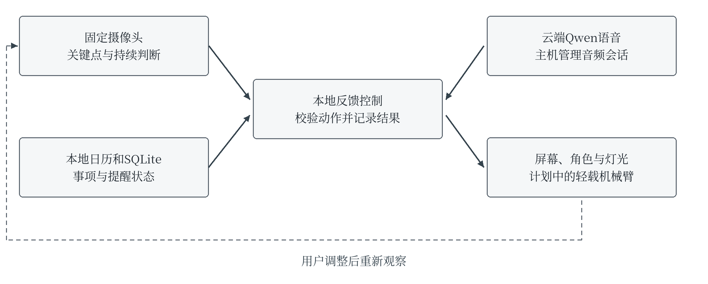

# 具有持续坐姿监测与反馈的 AI 智能桌面日历系统

Group 2 Project Proposal 中文审阅稿 第三版

课程：ITE4116M Final Year Project
专业：Higher Diploma in AI and Smart Technology（IT114124）
班级：AIST-2B
导师：Marco
日期：2026年9月28日

表1 组员及计划工作分配

| 组员 | 学号 | 学校邮箱 | 占比 |
|---|---|---|---|
| Yuan Yuchen（组长） | 250342840 | 250342840@stu.vtc.edu.hk | 40% |
| Xu Ziqian | 250137555 | 250137555@stu.vtc.edu.hk | 30% |
| Li Wenhua | 250329909 | 250329909@stu.vtc.edu.hk | 30% |

本项目拟制作一台供成年人在家庭或办公室书桌使用的实体助理。固定摄像头持续观察可见的上半身姿态，依据个人标定判断持续前倾或侧歪，给出具体提示，并再次检测用户是否调整。同一设备提供本地日历、当日时间轴、语音查询和角色反馈。小型机械臂列入计划硬件；悬浮角色显示将比较反射成像与带罩旋转LED模块。项目以可重复的功能和性能测试评价成果，不以医学诊断、心理治疗或商业健康效果作为交付目标。

<!-- body -->

## 1 待解决的问题

长时间在电脑前工作的人，可能没有留意逐渐前倾、侧歪或一直坐着。定时休息提醒只知道时间已经过去，无法说明当时出现了什么姿态，也无法确认提醒后是否作出调整。用户同时需要查看下一项会议或任务；反复切换手机、电脑日历和独立提醒设备会增加操作步骤。上述是本项目要在受控桌面环境中检验的使用问题，当前没有真实办公室试点或市场需求量化结果。

项目的核心任务是：固定摄像头持续检测限定的可见姿态偏离，过滤短暂动作，在偏离持续达到设定条件时给出具体反馈，再记录“已回到个人基准”“仍偏离”或“无法判断”。日历与语音为同一桌面终端提供日常用途；姿态判断不会自动更改日程。

例如，用户在工作时持续向屏幕前倾，设备显示“请调整与屏幕的距离”，播报一次提示，并驱动计划中的轻载机械臂举起提醒标志。经过预设等待时间后，系统再次检测并记录结果。短暂拿物品、低头或遮挡不应立即触发同样警告。久坐提醒另按用户设定的时长运行，不因姿态看似平直而取消。

### 项目目标

1. 完成固定机位、个人标定、持续前倾与侧歪判断、遮挡拒判及反馈后的再检测。
2. 在同一实体设备实现日历、时间轴、免按键语音查询、经确认的日程修改和明确的设备反馈。
3. 比较单帧阈值、持续时间判定和固定间隔提醒，测量误报、响应时间、调整记录及整机稳定性。

## 2 背景与使用环境

首版适用于一个成年人、一个固定座位和经过校准的摄像头位置。家庭与办公室共用同一功能核心；首版不承担多人识别、雇员绩效监控或企业系统接入。OSHA建议长时间电脑工作期间改变姿势和活动[6]，这提供一般使用背景，并不能证明本设备可以预防颈椎或脊椎疾病。

表2 现有替代与本项目的验证重点

| 参照 | 公开能力 | 本项目的验证重点 |
|---|---|---|
| 手机日历与Skylight Calendar[9] | 日程、任务与提醒展示 | 增加固定桌面的可见姿态检测和提醒后复测，同时保持日历可读。 |
| UPRIGHT GO 2[10] | 佩戴式姿态检测与震动提示 | 验证无需佩戴的摄像头方案在限定机位下的准确性、误报及遮挡限制。 |
| Razer AVA[8] | 桌面语音角色、摄像头和显示单元 | 借鉴角色交互和外形，独立实现坐姿反馈；不声称已知或复制其内部光学结构。 |

本组不以功能数量宣称领先。可评价的贡献是把个人标定、连续姿态判断、具体反馈和复测连接到同一日历终端，并报告相对简单基线的结果。若现有手机或定时提醒已经足够有效，实验也应说明专用硬件的额外价值有限。

用户可隐藏私人日程、暂停监测，并直接关闭摄像头或麦克风。公开演示使用虚构事项；原始视觉数据默认在本地处理，不持续保存或自动上传云端。

## 3 拟议方案与系统范围

### 3.1 架构与硬件职责

系统采用本地模块化服务：摄像头处理、姿态判断、日历、反馈控制及日志相互分离。首选部署目标为树莓派5 8GB[7]；现有M2系列16GB MacBook用于开发。若并行负载未达目标，将先优化采样和角色复杂度，并保留Mac辅助处理的演示方式，明确实际部署结构。

图1 本地姿态与日历服务连接语音和实体反馈

表3 拟议部件与用途

| 部件 | 作用 | 选型条件 |
|---|---|---|
| 固定RGB摄像头 | 观察头、肩及必要的上半身区域 | 比较显示器附近与斜侧上方机位；摄像头不随机械臂运动。 |
| 树莓派5与存储散热 | 本地处理、日历、界面、音频及设备控制 | 测完整负载；8GB容量不自动保证实时速度。 |
| 可读显示与角色模块 | 展示TimeTable、提示和倾听／说话状态 | 普通屏作为基础；反射像或带罩旋转LED按可读性和控制能力择一。 |
| 麦克风、扬声器、状态灯与实体控制 | 唤醒、语音反馈、状态显示和关闭输入 | 测回声、噪声与误唤醒；基本提醒可离线运行。 |
| 计划中的2至3自由度轻载机械臂 | 举起轻量提示标志或执行短提醒动作 | 独立电机电源、限位、手动停机；不接触人体或抓取物品。 |

已有Arduino UNO R4 WiFi可用于调试或独立控制，但不是必需组件。电机和显示供电按所选型号单独核算，不由树莓派GPIO直接给舵机供电。外壳尺寸在摄像头视野、音频和显示台架通过后确定。

### 3.2 功能与边界

**坐姿与在桌状态。**用户先进行个人标定；系统识别受测机位下的持续前倾和明显侧歪，并区分离桌、遮挡、多人入镜与低置信度。前倾指经标定的可见头肩位移模式，不等于精确颈椎角度。髋部被桌面遮住时，不使用不可靠髋点计算躯干角度。若机位不能稳定区分前倾，须调整机位并重测；仍失败则报告未达到该要求，不用大模型猜测补足。

**反馈与复测。**按个人阈值、持续时间和冷却时间触发一次提示。屏幕给出具体调整动作，语音与灯光同步，机械臂在验证通过后加入。随后判断是否回到个人基准；用户可延后或关闭提醒。每日记录仅包含有效观察时间、姿态事件、提醒及复测结果，不生成健康、专注或工作质量评分。

**电子日历。**本地支持长期纪念事项、按周或按月重复事项及单日行程；提供私人／公开标记、时间冲突提示、TimeTable、确认完成和延后。坐到桌前时显示当天页面，离桌时隐藏私人标题。公开标记只影响本设备显示，不代表已经建立多人共享服务。外部日历同步、天气和农历属于核心稳定后的扩展。

**语音和受限动作。**本地唤醒词开启短语音会话，Qwen实时语音为第一候选[1]；Gemini、OpenAI Realtime、GPT-Live按既定顺序备用，不同时承诺集成四家。模型请求查询、延后或修改事项，本地程序校验参数与状态。新增、改期和删除须复述关键信息并取得确认；只有执行成功后才报告完成。机械动作只允许预设姿态，不接收任意角度或连续运动命令。供应商账户、版本和实际费用在接入前核对。

**角色与悬浮效果。**角色至少表达待机、倾听、思考、说话、提醒和确认状态。反射成像[11]与带罩旋转LED[3,5]是待比较的显示方案。预置动画若可由程序自动切换，也能响应实时事件；逐帧口型或动态文字则需实时视频、SDK或开放渲染通道，HDMI并非唯一方式。10月底前根据接口、近距离观感、日历可读性、噪声和延迟确定一种方案；普通屏保留为后备，不承诺360度体积全息或复制AVA成像。

### 3.3 算法与开发方法

MediaPipe Pose Landmarker[2]作为预训练关键点候选。本组开发可见性检查、个人标定、归一化头肩偏移和肩线倾斜特征、时间窗口与复测状态机。只使用标定机位能够支持的特征；关键点置信度低时输出无法判断。连续窗口达到偏离比例才形成事件，恢复也须持续确认，避免单帧抖动反复报警。图像处理使用有界队列与时间戳，旧画面不排队冒充实时结果。

日历保存事项ID、起止时间、时区、重复规则、隐私标记和提醒状态；姿态记录保存时间、标定版本、有效性、状态和反馈结果；设备动作保存请求ID与实际执行结果。重试不能重复修改日历或重复驱动机械臂。云语音不可用时，本地日历、视觉判断、屏幕和基础提示继续工作。

拟采用Python、OpenCV、MediaPipe、本地SQLite及设备全屏界面，使用HTTP／WebSocket连接必要模块。Mac先完成可重放流程，随后接真实硬件并验证Pi部署。开发按两周迭代进行，先完成视觉与日历，再集成语音、角色和机械动作；无须从零训练大型语音模型。

### 3.4 评估与验收

以下为拟议工程目标，当前均未实测。计划在至少6名自愿成年参与者的两次独立录制中，采集中立、前倾、侧歪、短暂动作、离桌及遮挡片段；3人用于开发，3人用于最终测试。个人标定可在测试前执行，但不能用测试标签调阈值。同一视频的相邻帧不跨组；人工标签仅表示可见动作，不是医学评价。

表4 拟议评价指标

| 范围 | 目标与方法 | 失败如何呈现 |
|---|---|---|
| 姿态判断 | 受控测试宏平均F1目标至少0.80；另报各类召回、事件检出、误报／小时和无法判断比例。正常工作片段目标误报不超过2次／小时。 | 报告遮挡、机位与个体差异；拒判不能隐藏在准确率之外。 |
| 反馈与复测 | 95%的已确认事件在2秒内产生本地屏幕／灯光提示；计时从持续条件满足开始。复测结果与人工视频标签核对。 | 声音、角色和机械动作分别计时；不把动画播放当作用户已调整。 |
| 日历与语音 | 至少30个日历用例、40条普通话／英语命令和10条含糊或禁止动作；正确执行目标至少90%，修改确认规则全部通过。 | 分别记录错误参数、拒绝、取消、重试和实际执行结果。 |
| 并行与恢复 | 两种桌面布置各运行至少2小时；记录姿态采样、显示、CPU／温度，测试断网、摄像头失效和重启。 | 不可判断状态可见；云故障不停止本地功能。 |
| 显示及机械臂 | 自动切换100次角色状态并测延迟；机械臂重复100次预设动作，检查限位、停机、遮挡与供电。 | 型号与条件逐项记录；未通过机械检查时不启用电机。 |

在相同片段上比较单帧阈值与持续时间判定；固定间隔提醒用于比较提醒数量和时机。反馈后调整率属于短期行为观察，不作为长期健康成效。测试资料以匿名编号保存，原始短片仅在单独同意和受控访问下用于评价。本提案不安排市场问卷或访谈任务。

## 4 方案适切性与可行性

硬件的作用明确：固定摄像头观察使用者，显示和音频输出可理解的动作提示，机械臂提供可检验的实体提示，随后摄像头复测。用户无需一直佩戴姿态设备；代价是受视角、遮挡和个人桌面条件限制。日历提供独立可用的日常服务，角色则让设备状态容易理解。

目前已完成需求梳理、竞品与硬件资料比较、中文提案和接口草案；新设备尚未组装，也没有姿态或语音性能结果。旧Senplate软件的模拟测试属于已停止方向，不计为本设备验证。三人约六个月的开发计划以一台原型、有限姿态类别和可替换语音服务为基础。

10月首先完成摄像头机位与个人标定、显示控制、音频回声及Pi并行负载的小规模试验。若某项成本或兼容性不合适，按实际失败原因替换模块，避免先制作外壳再被机位或接口限制。机械臂只做轻载提示，供电与噪声独立验证；复杂抓取、临床姿态诊断、情绪障碍治疗、全天云端监听和企业级日历集成不列为交付条件。

## 5 阶段与项目计划

计划以2026年9月底至2027年3月完成核心开发，4月用于最终报告与展示。表5与2026年9月28日读取的课程Moodle日程对齐[4]；学校后续改期将按新通知同步。Proposal平台截止为2026年9月29日23:59。

表5 开发阶段与学校里程碑

| 工作期 | 主要成果 | 对应课程节点 |
|---|---|---|
| 28 Sep–23 Oct 2026 | 需求、数据与接口；相机视野、标定、角色控制和音频台架；冻结首批部件 | 26 Oct Progress Report I |
| 26 Oct–27 Nov | 本地日历、关键点与连续判断初版；设计、数据划分和首轮结果 | 30 Nov Initial Report |
| 30 Nov–11 Dec | 完整提示与复测；机械臂独立供电、限位和停机测试 | 14 Dec Progress Report II |
| 14 Dec–29 Jan 2027 | 唤醒词、Qwen工具、角色和机械联动；整机演示与故障处理 | 18 Jan中期预演；1 Feb Interim Report与展示 |
| 1 Feb–19 Mar | 留出参与者测试、基线比较、误报分析与两小时运行；修复主要问题 | 22 Mar Progress Report III及阶段展示 |
| 22 Mar–16 Apr | 结果复核、安装手册、源码与资料整理、最终报告 | 19 Apr Final Report |
| 19–26 Apr | 复演、备份方案、各成员答辩准备 | 26 Apr Final Presentation |

每周检查模块整合问题，每两周由Group 2提交一份团队日志，并在组内保留可区分的个人贡献记录。进度报告记录实际完成、未完成及修改原因；下一份日志周期按28 Sep–11 Oct安排，具体提交时间以Moodle为准。

## 6 主要交付物

1. 一台含固定摄像头、计算主机、显示、音频与状态提示的桌面原型，附选定角色显示方案和计划机械臂的实际验证记录。
2. 本地日历、个人标定、持续姿态判断、反馈复测、语音受限工具和角色状态的软件源码。
3. 获许可的匿名测试资料、标签规范、开发／测试划分、基线脚本、结果与失败案例。
4. 设备接线和功耗资料、安装及使用手册、恢复步骤、团队日志、成员贡献与AI辅助工作记录。
5. 学校各阶段报告、最终报告、演示和答辩材料。未实现或未达标部分按实际结果说明。

## 7 各组员职责

表6为三位学生的计划工作分配，总计100%，不表示已完成贡献或最终评分。各成员均参与集成与答辩，并用代码、设计、实验和贡献记录说明实际产出。

表6 角色与可识别成果

| 组员与占比 | 角色 | 主要责任 |
|---|---|---|
| Yuan Yuchen 40% | 组长与AI系统负责人 | 需求、架构、姿态特征与标定、连续判断和复测、语音工具；测试设计、分析与报告整合。 |
| Xu Ziqian 30% | 硬件与边缘系统负责人 | 相机机位、Pi采集、供电和音频；显示控制、机械臂驱动、限位与停机、连续运行和维护资料。 |
| Li Wenhua 30% | 日历与交互界面负责人 | 日历数据与重复规则、TimeTable、隐私和冲突提示；角色动画、每日记录、界面测试与用户说明。 |

课程已公告HDAIST在AY26/27 FYP中采用AI作为组员，相关同伴评核细节将另行公布[4]。本组记录AI参与的研究、文稿、代码和检查，并保留学生的审查、修改与验证记录；不自行给AI分配学校尚未规定的评分比例。外部模块和素材保留来源及许可，供应商制作不计作学生自行制造。

## 8 资源需求

现有资源为M2系列16GB MacBook和Arduino UNO R4 WiFi。Pi5、摄像头、显示、音频、轻载机械臂与外壳仍是待核型号和采购项；本提案没有供应商报价或已购清单。先以现有电脑与可借部件验证，再按具体接口和完整功耗确定一台原型的BOM。

云语音只在唤醒后的会话使用，并记录实际用量和每个成功任务的费用；不把公开最低单价当作整机月费。软件版本和角色、声音、模型许可在实现时锁定。用户不必提供真实公司日历或长期录音，核心评价可用虚构日程与自愿成年人受控测试完成。

## 9 参考资料

以下网页于2026年9月28日核对。厂商资料用于说明公开能力，不代表本组实测结果。

[1] Alibaba Cloud. *Qwen Omni Realtime*. https://www.alibabacloud.com/help/en/model-studio/realtime

[2] Google AI Edge. *Pose landmark detection guide for Python*. https://developers.google.com/edge/mediapipe/solutions/vision/pose_landmarker/python

[3] HDFocus. *Small Table 18CM 3D Hologram Fan*. https://www.hd-focus.com/hologram-fan/table-type-fan/small-table-3d-hologram-holographic-fan.html

[4] HKIIT. *AIST Final Year Project ITE4116M AY2627 course schedule and logbook notices*. VTC Moodle. https://moodle2627.vtc.edu.hk/course/view.php?id=7481

[5] HYPERVSN. *SmartV operating modes*. https://hypervsn.com/knowledge/what-are-the-available-smartv-operating-modes-player-hdmi-stream-and-cloud

[6] OSHA. *Computer Workstations Positions*. https://www.osha.gov/etools/computer-workstations/positions

[7] Raspberry Pi. *Raspberry Pi 5*. https://www.raspberrypi.com/products/raspberry-pi-5/

[8] Razer. *Razer AVA*. https://www.razer.com/ap-en/razer-ava

[9] Skylight. *Skylight Calendar*. https://myskylight.com/calendar/

[10] UPRIGHT. *UPRIGHT GO 2*. https://store.uprightpose.com/products/upright-go2

[11] Adafruit. *MONSTER M4SK Toon Hat*. https://learn.adafruit.com/monster-mask-augmented-eyes-toon-hat

## 导师与第二阅卷人意见

导师意见：

第二阅卷人意见：

导师签名及日期：

第二阅卷人签名及日期：
