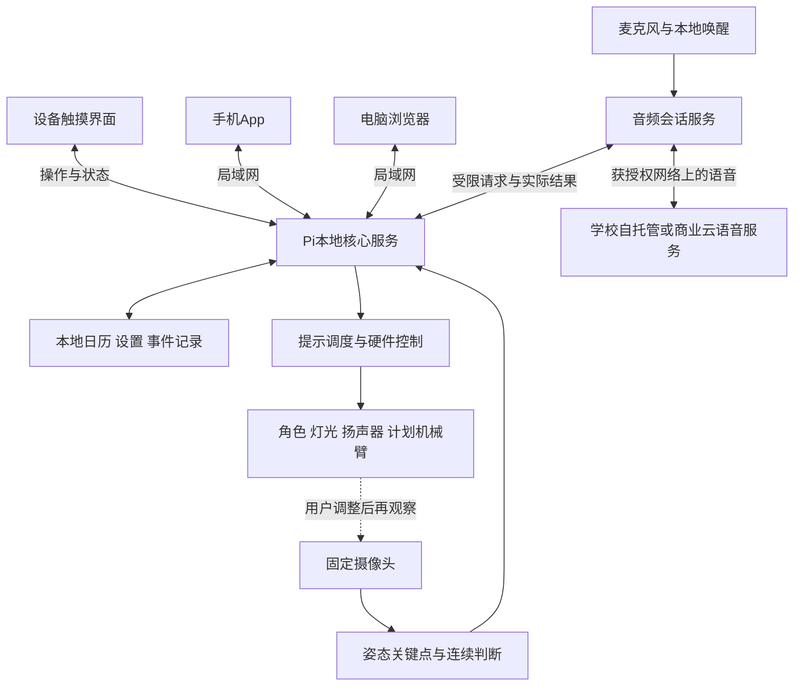

# Group 2 桌面助理软件范围与跨端方案 V1

日期：2026-09-28；路由更新2026-10-03。状态：**HISTORICAL_DESIGN_BASELINE**。下文保留9月28日至30日的完整讨论，旧“尚未／下一步／待接入”不作为当前实现事实。实际S1–S10已完成独立软件验证，见[当前完成计划](../2026-10-02/software-completion-plan.md)及[产品规范](../../product.md)；真实硬件／服务仍待接入。10月3日[主动事务首版](../../desk-companion/docs/task-tracking.md)也已实现并完成本地UI／UX审查；本稿仍保留历史身份。

当前执行以[软件开发计划](../2026-09-29/software-development-plan.md)为准。用户9月29日授权先规划后开发，选定简洁高级的界面风格；本组工程实现已采用React／TypeScript／Vite＋FastAPI／SQLite，并完成[独立桌面工程B1](../../desk-companion/README.md)。本稿仍描述最终整机目标，不能把下表全部能力当成本批完成。手机安装、Pi触摸和配对尚未验证。

用户已明确：手机和电脑都能控制，设备希望使用触摸屏并直接操作。角色与日历是否共用一个显示区尚未决定；是否要求离开家庭／办公室后远程访问也未明确。本稿将已确认要求、工程建议和后续扩展分开。旧Senplate食品软件、角色权限与品牌不作为本项目当前需求。

**9月29日日历补充：**组员清单已整理为[电子日历Part 1](../2026-09-29/calendar-part1-functional-scope.md)，[原文单独保存](../2026-09-29/calendar-part1-teammate-source.md)。天气、双历、批量录入、对外共享及第三方同步等进入当前需求池，主清单与增强建议分别记录，首版逐项取舍尚未确认。本稿不再以先前“全部后续”的建议排除这些功能；日历细节以Part 1整理稿为当前讨论入口，整机坐姿主线不变。

**9月29日AI选型补充：**用户要求不按本地／API筛选，以自然交谈和工具调用为条件，纳入第三方测评。[当前全面比较](../../research/2026-09-29-voice-ai/naturalness-and-tools-review.md)建议首轮对照Gemini 3.8 Live、GPT-Realtime-2.1与Qwen-Audio-3.1-Realtime-Plus，并补入其他实时／组合／开放候选。此为工程建议，型号未由用户锁定。疑似DGX-1／V100仍未核实配额；[本地基线研究](../../research/2026-09-28-local-voice/server-deployment-comparison.md)留作之后的实施比较。三候选共用本地工具契约，避免为每家另建一套业务。尚未试听、开通API、批准收费或改变学校Proposal。

同日[价格补充](../../research/2026-09-29-voice-ai/price-and-value-ranking.md)把低价Qwen Flash与限时免费的StepAudio3提升为费用对照；此前三款属于能力比较，不是唯一成本测试顺序。日历清单整理未选定或调用任何模型。

## 1 要做的是怎样的软件

产品是一个有实体桌面终端的个人日程与坐姿反馈助理。设备自己承担持续摄像、姿态判断、语音收发和实体反馈；手机与电脑是同一设备的控制入口。关闭手机App或电脑浏览器，不应停止桌面监测。首版一个拥有者、一台原型、一个固定使用位置，英文默认，可切换简体中文。

从使用者看有三个操作入口：设备触摸屏、手机App、电脑管理界面；另有一个可选的角色专用显示输出。从实现看是一个共享核心服务、一套可复用的界面代码和必要的硬件／模型工作进程，不是三套独立业务系统。

建议日常体验：坐到桌前看到当天安排；持续前倾达到判定条件后得到具体提示；系统复测并记录结果；用户说“把明天的讨论改到下午三点”，查看并确认修改；手机、电脑与触摸屏得到相同日程。

## 2 Linux与触摸屏的关系

采用现成的Raspberry Pi OS 64-bit作为操作系统，在上面部署本组应用。无需自行开发Linux发行版。推荐设备界面使用React／TypeScript，打包后的HTML、CSS、JavaScript、字体和角色素材存于Pi本地，由本地服务提供给Chromium全屏运行。浏览器隐藏地址栏与普通桌面，开机自动进入应用。树莓派官方有这一kiosk模式的实现路线[1]。

底层触控由所选屏幕的Linux驱动识别，界面接收点击、滑动和输入事件。官方Touch Display 2提供触摸与屏幕键盘支持[2]，但本组仍需验证具体屏幕型号、显示旋转、触摸坐标、全屏状态下键盘唤起和中文输入。HDMI图像本身不包含触摸输入；HDMI类触摸屏通常另有USB触摸链路，应以具体型号为准。

触摸“延后10分钟”的完整过程：Linux接收触控 → 界面发送操作 → 本地后台校验并保存 → 调整提醒计划 → 返回真实结果并通知其他已连接界面。用户触摸的是应用界面，不直接操作GPIO或数据库。

本地页面不依赖外部网站或CDN。没有互联网时，设备仍可显示已保存日程、接受触摸修改、执行本地姿态判断和基础提醒；完整语音取决于所选服务可达性，学校内网服务器可达时可不依赖第三方云。Pi本身掉电或核心服务停止时，不声称监测仍在工作。

## 3 建议采用的平台与技术

| 层或入口 | 推荐方案 | 实际得到什么 | 尚需验证的部分 |
|---|---|---|---|
| 设备操作系统 | Raspberry Pi OS 64-bit | 驱动、网络、音频、开机服务和显示环境 | 当前Pi型号、OS镜像、相机／音频驱动组合 |
| 设备触摸界面 | React＋TypeScript＋Vite，Chromium kiosk | 全屏日历、坐姿反馈、语音确认与设置 | 触控、键盘、分辨率、重启恢复和负载 |
| 手机 | 同一React界面基础＋Capacitor安装包 | 有App图标的iPhone／Android混合应用，界面资源随包分发 | 各自签名、网络权限、插件与真机测试；框架支持不等于本组已交付 |
| 电脑 | 同一系统的响应式浏览器界面 | Mac／Windows用浏览器查看、编辑和控制 | 首测Chrome／Edge，另核Safari；不默认承诺exe／dmg安装包 |
| 本地核心 | Python＋FastAPI＋SQLite | 日历、设置、权限、事件、提醒、语音工具和历史的统一事实来源 | 单业务服务、数据库迁移／备份与操作去重 |
| 姿态处理 | OpenCV＋MediaPipe Pose Landmarker候选 | 可见关键点，再由本组标定、时间窗与复测逻辑形成状态 | 机位、遮挡、多人、独立测试与Pi并行性能 |
| 语音 | 独立本地音频进程＋学校自托管／商业云适配器 | 本地唤醒，短会话听说，经校验的工具操作；当前先对照Gemini／Realtime／Qwen实时服务，开放模型保留 | 自然度、中文、工具结果、回声、打断、误唤醒、真实费用；本地路线另核GPU／运行时 |
| 角色输出 | 可独立渲染的角色场景；先预制2D／轻量动画，按需Three.js | 同一角色状态可送往普通屏、隐藏反射屏或具有控制接口的风扇 | 素材许可、实际输入方式、噪声、时延与Pi帧率 |

Capacitor官方支持用Web技术制作iOS／Android原生容器应用，并通过插件接入原生功能[3]。这里是“Web界面＋原生容器”的混合应用，不应称为SwiftUI原生界面，也不是让用户每次打开一个外部网页。Capacitor不负责在Pi上直接运行iOS安装包；Pi复用的是构建后的Web界面和共享数据契约。移动应用仍要单独完成打包、签名及实机测试[4]。

手机首测iPhone是延续用户此前的设备偏好，Android是可扩展目标；本轮用户尚未明确要求两种手机均为首版验收。电脑浏览器和设备触摸屏属于明确需求。界面共用组件、文字资源、类型和请求逻辑，但针对三种屏幕分别排版；不能把手机页面直接放大当桌面／设备设计。

### 为什么推荐这一组合

本项目同时需要Pi全屏、手机控制、电脑日历和可能的WebGL角色。使用相同前端技术有利于统一状态和减少界面重复开发。Python继续负责摄像头、模型与硬件，避免把持续监测依赖在手机前台或页面生命周期上。这是本组工程取舍，不是官方平台的性能排名。

| 候选路线 | 能力与优点 | 对本项目的取舍 |
|---|---|---|
| React＋Capacitor＋Pi kiosk | 浏览器／设备直接复用Web界面，手机能打包成App；适合日历、设置与角色场景 | 当前首选建议。原生质感、键盘和系统能力需做专门适配，不能只套壳不设计 |
| Flutter＋Python | 官方覆盖iOS、Android、Web、Windows、macOS及Linux Arm64[5]；适合统一应用UI | 合理备选。Pi当前系统、触控／图形环境与角色渲染仍要实测；需要新增Dart技术体系，不能把平台列表等同Pi实机通过 |
| SwiftUI手机＋React设备／电脑 | iPhone原生控件与系统交互较直接 | 如果明确只重视iPhone原生体验可选；需要维护两套界面，Android不能直接复用SwiftUI |

不优先为设备再增加Electron；现成Chromium全屏已能承担本地界面。首版不用为了一个本地原型引入微服务集群、Redis或MQTT。需要多设备或云端规模后再按真实需求扩展。

## 4 三个入口分别能做什么

| 任务 | 设备触摸屏 | 手机 | 电脑 |
|---|---|---|---|
| 今日安排与下一事项 | 大字概览与当前时间段 | 随手查看与快速更改 | 日／周／月视图及完整编辑 |
| 新增、修改、删除日程 | 支持，常用短表单／语音辅助 | 支持，主要快速录入入口 | 支持，主要集中规划入口 |
| 持续坐姿监测 | 显示实时状态，本地后台持续运行 | 看设备状态与记录 | 看设备状态、记录及实验导出 |
| 个人标定 | 引导就位、预览与确认，首选入口 | 可打开标定向导，要求人坐在设备前 | 可查看向导和诊断；不能远程冒充完成标定 |
| 语音交互 | 设备麦克风与扬声器为主要入口 | 首版有文字命令与操作回执；手机语音入口可后加 | 首版文字命令／设置；电脑持续监听不列必做 |
| 延后／暂停提醒 | 一键操作，反馈最清楚 | 可操作并看到实际状态 | 同样可操作 |
| 角色、音量、亮度 | 可直接调整，常用按钮优先 | 可设置并同步 | 可设置并同步 |
| 每日／每周记录 | 简洁摘要，点入详情 | 个人历史与趋势 | 完整筛选、导出及组内实验模式 |
| 配对与权限 | 显示短期配对码，并现场确认 | 扫码或输入代码，成为已配对控制端 | 输入代码配对；可撤销旧设备 |
| 机械臂 | 开关与已验证预设动作；物理停机独立有效 | 设置是否启用提醒动作；不做任意角度遥控 | 组内维护模式可测试预设动作，须人在现场 |

本地原型仍按一个拥有者配对多个控制端作为工程起点；这不自动包含家庭多用户、公司管理员或团队租户系统。三位学生开发设备与一个最终用户拥有设备是不同概念。9月29日Part 1提出的对外共享已超出旧稿“公开标记只控制本机展示”的定义：需分别设计分享对象、详情／仅忙闲、查看／编辑和撤销，具体首版机制待定。不能用本机隐藏标题冒充已经实现外部协同，也不把“公开”默认成向整个互联网开放。

## 5 页面与显示内容

手机建议四个主入口：**Today／Calendar／Records／Device**，AI助理作为可从各页打开的交互面板。电脑使用相同栏目与侧栏、宽时间轴。触摸屏按用户9月30日纠正采用独立常亮场景，不保留常驻四栏导航；触摸再打开控制面板。原底部快捷栏建议被取代，详见[设备界面规范](../2026-09-30/device-display-spec.md)。

以下页面吸收新的Part 1需求池，用于后续布局讨论，不表示每个新增项都已纳入首版或完成实现。日历新增项与原始来源对应的编号见Part 1整理稿。

| 页面或面板 | 主要显示内容 | 用户能做的动作 |
|---|---|---|
| 首次设置 | 语言、时区、联网状态、麦克风／摄像头说明、设备名称 | 建立本地拥有者、配对手机／电脑、调整音量和显示、进入标定 |
| Today | 时间与日期、天气／温度、今日简表、当前及下一事件、姿态状态与当前提醒 | 打开今日时间轴、添加事项、延后提醒、查看／播报AI摘要、打开AI助理 |
| Calendar | 日时间轴、周／月摘要、农历／公历及节假日、忙闲标识、周期事项和纪念日、分享状态、冲突提示 | 新增／编辑／删除、批量选日期、周期设置、提前提醒、完成标记；分享与外部同步另显示授权及更新状态 |
| Posture | 是否标定、当前有效／前倾／侧歪／离桌／无法判断状态、持续时间、提示及复测结果 | 标定、暂停、重新标定、反馈误提醒；默认不长期开真人摄像预览 |
| Assistant | 倾听／思考／说话／等待确认状态、必要的本次转写、拟议动作卡及结果 | 查询日程、解释提示、文字输入、确认或取消动作、结束会话、打断播报 |
| Records | 有效观察时长、事件与提醒次数、已调整／仍偏离／无法判断分布、手动完成事项、数据时间范围 | 看日／周趋势、检查事件、导出或删除自己的记录；不显示无依据的健康／效率分数 |
| Device／Settings | 连接、内部／外部同步状态、显示、声音、提醒、隐私、已配对终端、存储与软件版本 | 调整偏好、撤销配对／分享、隐藏私人标题、关闭输入；备份／恢复的内容和方式待定义，维护项放单独入口 |

### 触摸首页的优先顺序

9月30日已将常态改为大时间／日期、整月日历与近期安排，当前摄像头真实状态放底部；操作按钮在触摸后展开。待处理提醒有独立提示条，窄矮屏减少次要日程，保持当前事项与提醒可读。没有虚构天气、姿态或AI角色状态；这些实际接入后再加入适合的状态位置。日历为主目前是工程起点，并非用户已确认角色比例；日历与角色最终显示单元仍待决定。

示例仅用于说明信息结构：14:20，下一项15:00 Project discussion；设备状态Monitoring；出现持续偏离后提示“Please adjust your distance from the screen”，随后显示Rechecking，再显示Adjusted、Still outside reference或Unable to assess。英文／简体中文内容从统一资源映射，数据里的事件标题保持用户原文。

触屏按大按钮、少层级设计，建议触控目标至少约48个逻辑像素作为设计起点，最终按实际DPI和桌面距离验证。长文本允许滚动，不能只靠颜色表达状态。数字时间用明确选择器，长日程可在手机／电脑编辑；设备仍须能独立完成基础录入。

## 6 角色与日历如何放置

先把角色与日历分成两个软件场景，不把最终光学结构写死。

| 显示方式 | 体验 | 硬件及开发影响 | 本稿建议 |
|---|---|---|---|
| 一块普通触摸屏同时显示角色和日历，或在两个模式间切换 | 最容易直接触控，文字清楚；可验证AI交互 | 一个可触摸显示单元；角色占用面积与时间轴可读性需要取舍 | 第一阶段软件与接口验证用；不称为已实现悬浮效果 |
| 触摸屏显示日历和设置，独立透明舱／带罩风扇显示角色 | 日历始终可操作，角色不遮挡文字，更贴近用户想要的实体形态 | 同一台设备增加一个显示输出及对应供电／结构；反射式另需隐藏屏，风扇式需其控制器接口 | 若要保留悬浮角色，这是更合适的最终候选；用户尚未批准增加第二显示单元 |
| 所有日历与角色只显示在悬浮区 | 外观更紧凑 | 小字可读性、光学镜像、观看角度与输入面更难；普通反射片／保护罩并不自动成为触摸屏 | 当前不推荐作为唯一可用控制面 |

“悬浮图像”本身不是一个可按压的触摸面。可以增加触控玻璃或手势传感，但这是额外硬件与标定工作，不作为现有屏幕天然能力。暂未决定双屏时，先在同一触摸屏上完成两种场景，保持角色输出适配器独立；之后决定分屏不会改变日历／姿态／语音业务规则。

角色至少具备idle、listening、thinking、speaking、alert、confirm六个状态。状态由真实语音与设备事件驱动；预置动画可表达实时反馈，不需要每次用视频生成模型重新生成。普通／反射屏可使用2D动画或经Pi实测的轻量3D；反射像按实际光路调整镜像、裁切与黑背景。风扇若仅能由程序切换文件，则先切预制片段，动态字幕留触摸屏；若只有人工App上传，不足以承担自动角色反馈。详细硬件证据沿用[显示研究](../../research/2026-09-26-desk-companion/hologram-fan-maturity.md)。

口部按声音音量开合只是说话动效，不称音素级唇形同步。首版使用一套原创或获许可角色，不预设直接使用AVA角色、名人声音或实时视频生成服务。

## 7 核心软件怎样连接

首版业务服务保持模块化单体；摄像头／推理、音频与硬件驱动独立进程或有界工作队列，不能让推理或云端等待堵塞触控和日历。仅主核心负责业务写入，SQLite保存配置和事件；其他进程不直接抢写同一业务表。高频帧不进日历数据库，关键事件保留时间、来源、标定／算法版本及有效性。

设置分为三类：日程和提醒偏好属于拥有者并共享；亮度、音量、麦克风和机械臂启用状态属于实体设备并同步显示实际结果；手机／电脑的界面语言和显示密度可各自保存。自托管访问凭据或商业模型长期密钥只保存在可信服务，不放进网页或手机安装包。硬件未支持的背光／动作能力显示为不可用，不用界面变化冒充物理执行。

界面用HTTP取得或修改状态；B1已采用1.5秒版本轮询及回到前台刷新，断线后重新读取完整快照。WebSocket保留为后续实时更新候选，不将通知作为唯一记录。FastAPI官方说明其简单内存连接示例仅适用于单进程[6]，后续接入时仍须有界并持久化状态。

视觉使用现成预训练关键点作为起点，本组开发特征、个人基准、持续判断和复测。官方提供Python实时模式与Pi示例[7]，但不保证本组Pi5与全部显示／音频同时运行时的帧率。先在Mac核对功能，再在Pi实测负载；若需Mac辅助，界面明确实际部署，不能假装设备已独立运行。

## 8 AI做什么 由程序决定什么

| 部分 | 使用的依据 | 输出 |
|---|---|---|
| 视觉AI | 摄像头可见人体关键点与置信度 | 观测结果，不直接等于坐姿好坏 |
| 本组姿态算法 | 个人标定、可见性、时间窗、冷却和复测 | 是否形成持续事件，提示原因及实际复测状态 |
| 日历与设备程序 | 已保存日程、时间、用户设置、权限、执行结果 | 冲突、提醒、写入、灯光和预设机械动作 |
| 所选语音／文字AI | 用户指令与必要的结构化上下文 | 自然对话、请求具体工具、解释已有记录 |
| 报告 | 程序统计的有效观察和事件 | 先生成可复算数值，AI可把这些数值解释成自然语言 |

Qwen商业实时接口支持流式音频和工具调用[8]；这不等于每个公开语音权重原样支持同一协议，自托管须按选定模型与运行时另接工具适配。模型提出get_schedule、propose_event_change、snooze_reminder等限定请求，本地程序校验，日历变更展示日期／时间／事项并等待确认；执行成功才可播报“已完成”。触控与手机直接表单的Save是明确提交，删除有确认；不把语音二次确认机械套到每次低风险按钮操作。

机械臂只使用验证过的named preset，启动维护动作要求现场准备状态。若舵机没有位置反馈，软件只能证明发出命令，不能单凭驱动返回就证明真实臂位达标。机械动作与用户姿态改善是两种不同结果。物理停机／静音／摄像关闭优先于远端命令，重启或重连不自动重放过期机械动作。

首版语音会话在设备端开启，手机／电脑默认不一起收音或播报，避免回声和重复响应。主动短时聊天可以存在，但持续记忆仅保存用户明确允许的偏好，支持查看、修改和删除；不依赖从零训练大语音模型，也不判断抑郁或情感障碍。

## 9 跨端同步与联网边界

“支持iPhone和电脑”是平台问题，“离开家之后还能访问”是网络与同步问题。用户本轮尚未明确远程互联网访问是否首版必做；本稿建议先完成同一可互访Wi-Fi下的演示，并为云端扩展保留接口。

| 情况 | 应有的行为 |
|---|---|
| Pi和三端正常连接 | 三端读取同一日程／偏好；修改保存后推送新版本，不分别创建三份事件 |
| 手机锁屏或电脑关闭 | Pi继续监测和提醒；客户端回来后重新取最新状态 |
| 无互联网但局域网仍通 | 本地日历、三端控制和基础反馈继续；仅当所选自托管服务器仍可达时完整语音继续，商业云语音不可用 |
| 学校语音服务器断开／排队 | 保留本地姿态、触控和缓存基础播报；不假装仍可自然聊天，旧工具请求不得稍后自动重放 |
| 手机离开该网络 | 首版无法读取设备新状态；缓存有最后更新时间，不能声称命令已执行 |
| 路由器掉线但Pi正常 | 设备触屏与本地监测继续，其他终端显示离线 |
| Pi掉电 | 三端均不得显示正在实时监测；恢复后读取持久数据，旧动作不重放 |
| 两端同时改同一事件 | 校验版本；保留后者草稿并提示已有修改，避免最后写入悄悄覆盖 |
| 已保存但响应丢失 | 同操作ID查询／重试，不新建第二个事项或重复驱动硬件 |

后续若要外网远程控制，可新增身份认证、云API／中继和设备主动外连。日历编辑可经版本化操作同步，离线时显示“待设备同步”；机械动作应短有效期且仅在现场允许时执行，不排队到数小时后突然动作。不能把Pi端口直接暴露到公网当作完整远程方案。调用Qwen并不自动给手机提供远程访问。

PWA可以成为安装体验补充，但普通http局域网页面可打开，不等于满足PWA安装条件；一般需HTTPS或本机localhost环境[9]。手机里的localhost指向手机自己，不是Pi。Capacitor真机访问同样需配置平台的本地网络权限、认证和合适TLS方案；不能通过全局关闭浏览器安全功能解决。应用上架、系统后台推送与本地控制分别验收，不自动算作首版已完成。

## 10 三条完整操作旅程

**新用户启用。**触摸屏选择语言与时区 → 设置本地拥有者 → 显示短期配对码 → 手机／电脑申请，触屏核对确认 → 指引坐到标定位置 → 验证画面有效并保存基准 → 首页显示真实监测状态。未标定时日历可用，姿态结论保持待标定。

**持续偏离到复测。**有效画面逐帧取得关键点 → 同一偏离持续达到条件 → 提示卡与一次语音／灯光，机械臂仅在已验证启用时动作 → 用户调整或延后 → 等待规定时段后复测 → 保存已调整、仍偏离或无法判断。若只是遮挡，显示观测失效，不累计为已确认的不良姿态；未知片段不能当作休息已完成。

**跨端修改日程。**手机编辑15:00讨论为16:00 → 后台检查版本与冲突 → 保存同一事件的新版本 → 触屏和电脑刷新 → 旧提醒失效并按新时间重排。通过语音改期时先生成拟议修改卡，确认后进入同一写入流程；含糊指令需要补清事项／日期，不能猜错仍说成功。

## 11 已明确要求、待排期清单与开发顺序

必做：三处控制入口、首次配对、本地日历／重复事项／冲突、TimeTable、个人姿态标定与持续判断、反馈复测、每日记录、免按键设备语音、动作确认、基础角色状态、设置与故障提示。计划机械臂按已验证预设接入。默认英文与简体中文切换。

9月29日组员[Part 1清单](../2026-09-29/calendar-part1-functional-scope.md)把天气、双历、节假日、批量录入、外部同步及共享等列为功能设想，另建议Widget和强弱提醒。最新[开发计划](../2026-09-29/software-development-plan.md)已逐项映射B1–B5，保留全部输入。B1核心已完成，天气／双历／外部连接／实际分享为B4工程排期，具体来源、提供商及授权方式待选；不宣称老师逐项批准或全部需求已实现。

互联网远程访问、Android首版验收、复杂3D人物和细腻唇形仍未锁定。手机系统后台通知／闹钟与Widget需按平台细化；第三方日历须选择平台和同步方向，不能只凭框架跨端就承诺同等系统能力。备份与同步分别设计。

| 顺序 | 做到的具体结果 | 评价边界 |
|---|---|---|
| 1 接口与界面小样 | 同一日程可在Mac浏览器的设备布局、电脑布局及手机尺寸中增改并同步，数据可重启恢复 | 这是软件流程，不是已接触摸屏或真手机 |
| 2 真实摄像头基线 | Mac摄像头／可用UVC输入，个人标定、持续判断、提示、复测和未知处理 | 单帧／时间窗基线、数据划分与标签先确定 |
| 3 手机安装与Pi触控 | iPhone安装包、实际局域网配对；Pi开机全屏，触控和屏幕键盘可用 | 分别测真机、显示旋转、网络与开机恢复 |
| 4 语音与角色 | 依据服务器配置选自托管或商业模型；本地唤醒、查询与确认改期、打断、角色状态和回声处理 | 实测正确执行、首音、打断与资源／费用；模型服务失联仍保留本地基础能力 |
| 5 光学及机械整合 | 通过接口测试的显示模块、限位及停机合格的机械臂加入 | 角色观感、控制时延、噪声、供电与Pi满负载独立验证 |
| 6 一体化演示 | 三端一致、网络／相机失效和重启测试、受控姿态与反馈评价 | 日志／报告区分模拟、回放和真实硬件数据 |

B1已按第1项完成本地日历与浏览器布局验证，下一步为真实相机基线。界面明确示例日程，姿态当前仅显示未连接，不把预设姿态当AI识别。软件开发保留可解释的源码、修改与实验记录；[本批QA](../../output/qa/desk-development-batch1-2026-09-29/verification.md)不代表后续实物流程已通过。

## 12 来源与当前未定项

本轮核对日期为2026-09-28。来源证明平台公开能力，不证明本组实际兼容、触控体验、姿态准确性或完整负载性能。

1. [Raspberry Pi官方kiosk教程](https://www.raspberrypi.com/tutorials/how-to-use-a-raspberry-pi-in-kiosk-mode/)：现成OS与Chromium开机全屏的路线。
2. [Touch Display 2官方文档](https://www.raspberrypi.com/documentation/accessories/touch-display-2.html)：触摸、屏幕键盘、方向与实际型号连接。
3. [Capacitor官方介绍](https://capacitorjs.com/docs)：Web技术与iOS／Android原生容器。
4. [Capacitor iOS](https://capacitorjs.com/docs/ios)及[开发工作流](https://capacitorjs.com/docs/basics/workflow)：手机平台打包和原生工程仍须构建。
5. [Flutter平台支持](https://docs.flutter.dev/reference/supported-platforms)及[Linux构建](https://docs.flutter.dev/platform-integration/linux/building)：跨平台备选，不能以Linux Arm64支持代替Pi验收。
6. [FastAPI WebSocket](https://fastapi.tiangolo.com/advanced/websockets/)：多客户端更新及内存连接示例的单进程边界。
7. [MediaPipe Python姿态任务](https://developers.google.com/edge/mediapipe/solutions/vision/pose_landmarker/python)：关键点／实时模式与Pi示例；本地算法和性能另测。
8. [Qwen Realtime官方指南](https://www.alibabacloud.com/help/en/model-studio/realtime)：流式音频、VAD和自定义工具能力；无本组实际调用。
9. [MDN PWA安装条件](https://developer.mozilla.org/en-US/docs/Web/Progressive_web_apps/Guides/Making_PWAs_installable)：HTTPS／localhost条件，浏览器支持不等于自动安装成功。

9月28日依据组员原始DOCX与Proposal形成架构；9月29日保存Part 1后，用户授权开发，B1于9月30日完成。React／FastAPI路线已作为工程选择实施，其余能力按最新开发计划推进。日历、TimeTable、持续判定、久坐与汇总继续保留；实际显示数量、具体屏幕、外网访问和Android首版范围仍可调整。学校Proposal、日志及旧项目源代码保持原样，当前运行的是Mac本地新软件。
