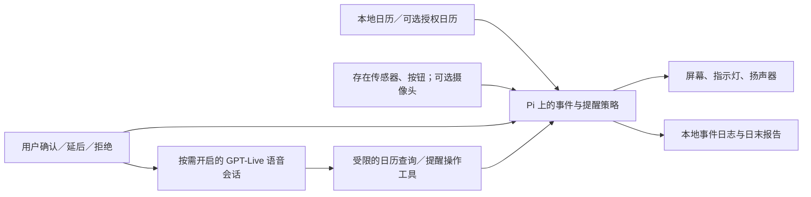

# Group 2 新方向研究：情境感知桌面助理

研究日期：2026-09-25。状态：**方案评估与建议，尚未由团队选定题目或改写学校 Proposal**。本轮只读组员文档、公开资料及指定视频；没有采购、训练、实物测试、真实用户访谈、API 调用或对外提交。此前 Senplate 食物监测方案已被用户明确推翻，其软件、品牌、采购资料和 2026-09-21 Proposal 仅作为历史成果保存。

**后续状态：**用户已指定语音候选顺序 Qwen → Gemini → OpenAI Realtime → GPT-Live，并要求先看[新题目中文 Proposal 审阅稿](../../planning/2026-09-25/desk-companion-proposal-zh-review.md)。下文早期“按键说话／GPT-Live”语音路线不再是当前首选；按[最新实时语音比选](realtime-voice-model-comparison.md)和[当前规范](../../product.md)解释。中文稿已生成，但正式英文 DOCX／PDF 仍未制作或提交。

**再后续范围修正：**用户读第一版中文稿后明确：视觉坐姿监测必须持续运行、作判断并给反馈；小型机械臂大概率加入；“提醒时机”为主的抽象痛点和访谈承诺撤回。当前以[第二版中文Proposal](../../planning/2026-09-25/desk-companion-proposal-zh-review-v2.md)为准。本研究原表格、阶段和旧英文问题陈述留作当时比较，不能移植为当前学校稿。

**同日语音成本与地区复核：**[语音方案专项](voice-model-cost-review.md)比较三段式、实时小模型和本地模型，并查到 OpenAI／Google 的 Developer API 官方地区列表均未列香港。下文的 GPT-Live 架构与标价仍是技术／算术参照，**不能据此把其香港直连接入写成已可用的首版依赖**。目前建议先按本地语音组件与明确香港区域的文字模型设计可替换接口。

## 1. 两份组员材料究竟提出了什么

- [《智能工作台与 AI 电子日历系统方案总结》](</Users/tantalum/Downloads/文档.docx>)：日历有生日／节日／重复日程、私人／共享计划、冲突检查和语音摘要；摄像头识别用户坐姿及久坐，并提出休息、喝水建议；汇总日程完成与坐姿记录；用户来到桌前时自动显示当天日程。这是**团队设想**，不是已有用户研究或可实现的准确率证明。
- [《形态 A：智能音箱智能屏幕终端》](</Users/tantalum/Downloads/形态 A：智能音箱智能屏幕终端（如 小爱触屏音箱、小度在家、FotoCube 等）/形态 A：智能音箱智能屏幕终端（如 小爱触屏音箱、小度在家、FotoCube 等）.md>)：把智能屏和电子墨水日历作为参照，认为它们缺工作状态、姿态和反馈闭环。该文件的市场缺口需要核实，不能直接写入 Proposal 为确定事实。
- 用户补充：使用环境可为**家庭桌面或办公室桌面**；希望有语音 AI、可见角色、小型“全息”效果，并考虑机械臂。灵感来自《银翼杀手 2049》、Razer Project AVA，以及[OpenAI Developers 指定视频](https://x.com/OpenAIDevs/status/2102819834790908072)。这些是构想与参照，不是要求复制角色或宣称治疗情感障碍。

## 2. 市场与技术事实校准

| 对照 | 官方公开能力 | 对新项目定位的影响 |
|---|---|
| [Amazon Echo Show](https://digprjsurvey.amazon.com/csad/help/node/GCDDK2AGHRZS6N5X) | 存在感知可触发例程；[部分设备](https://digprjsurvey.amazon.com/csad/help/node/TNbkumeinxKMvIRvJ0)可按靠近程度调整内容并递送个性化提醒 | “现有智能屏不会感知人／只被动显示”不成立。需比较**提醒何时、用什么强度出现，以及用户是否完成确认**。 |
| [Skylight Calendar](https://myskylight.com/calendar/) | 多来源日历、任务／家庭例行事项、Sidekick 导入事件 | 普通电子日历和 AI 录入已有成熟产品；只做日历大屏没有充分差异。 |
| [Microsoft Viva Insights](https://learn.microsoft.com/en-us/viva/insights/personal/use/focus-plan) | 自动安排专注时段，能调整 Teams 提醒与通知偏好 | 办公室工作规划已有软件替代品；实体桌面装置必须证明比现有电脑／手机流程多解决了什么。 |
| [UPRIGHT GO 2](https://store.uprightpose.com/products/upright-go2) | 佩戴式姿态传感、震动反馈、记录 | 姿态检测和反馈并非空白市场。顶置摄像头对人、桌和遮挡条件的适用性需要独立验证。 |
| [Razer AVA](https://www.razer.com/razer-ava) | 厂商展示 5.5 英寸“3D hologram”角色、摄像头／麦克风／扬声器、日程与陪伴，页面仍邀请加入 beta | 语音角色加日历也不独特；厂商的“emotional intelligence／mood”宣传不等于情绪障碍疗效证据。光学内部方案未公开，不能宣称我们复现其全息技术。 |
| [OpenAI Developers 视频与技术文章](https://developers.openai.com/blog/bringing-my-led-display-to-life) | 树莓派、128×64 LED、ESP32 控制器、GPT-Live-1 语音、后端工具和本地画面渲染 | 证明“语音控制实体显示屏、日历／天气画面”已有可复现工程思路；视频展示的是 LED 屏，不是全息投影、坐姿检测或心理干预。 |

视频实际核对：用户 Chrome 中的约 55 秒原帖可播放。本轮实际查看了约 0:06 标题、0:16 语音待处理与桌上 LED、0:21 当日天气画面、0:30 温度画面、0:39 图表及 0:51 天际线动画等画面／字幕；没有据这些画面声称听完完整音轨。相应[官方技术文章](https://developers.openai.com/blog/bringing-my-led-display-to-life)说明：Pi 上语音服务处理麦克风、回声消除、中断和云端 GPT-Live 连接，另一服务渲染动画及读取经处理的日历数据，较复杂查询委派给后端模型。Pi 承担本地设备与渲染，**大语音模型不是在 Pi 上训练或本地运行**。

研究依据也支持关注提醒时机，而不是堆功能。微软研究的[注意力敏感提醒](https://www.microsoft.com/en-us/research/publication/attention-sensitive-alerting/)提出在信息价值与打断成本之间取舍；[IM 提醒时机实验](https://www.microsoft.com/en-us/research/publication/instant-messaging-effects-of-relevance-and-timing/)报告在相关或任务节点之后显示时，干扰较低。两项都是研究背景，**不能当作本组设备效果**。OSHA 指南说明，即使姿势合适也应改变静态姿势；NIOSH 给出工作中休息和变化姿势的建议。这支持“久坐提示”的一般性合理性，不支持声称设备可诊断颈椎病。[OSHA](https://www.osha.gov/etools/computer-workstations/positions)、[NIOSH](https://www.cdc.gov/niosh/bulletin/2020/working-from-home.html)。

## 3. 四种定位的痛点、可行性和取舍

| 定位 | 是否有可观察痛点 | 主要障碍 | 本轮判断 |
|---|---|---|---|
| A. AI 电子日历／智能屏 | 日程复杂、会忘事是真实可能性；但手机、智能屏已有大量替代 | 功能重合，额外硬件占桌面；“显示了”不等于“按时做了” | 可作产品界面，**不足以单独成为 FYP 的主研究问题**。 |
| B. 精确坐姿与健康监测 | 长时间不动、缺休息可观察 | 人体有多种合理姿势；单摄像头遮挡、角度与个体差异大；临床效果无证据 | 限定为“连续静坐／姿态变化线索与休息提醒”的辅助实验，不承诺医学评分。 |
| C. AI 情感陪伴／解决情感障碍 | 有些人需要倾诉；实体角色可改善交互接受度，尚待测试 | 情绪无法由脸部动作可靠读出；临床症状和疗效需专门验证；亲密型长时使用可能带来依赖风险 | 可做**自愿开启的短时交流与自我记录**，不作为治疗或自动识别情绪的主承诺。 |
| D. 桌面情境感知的任务转换与休息支持 | 固定提醒可能在不合适时刻打断，离席后提醒会错过；用户需在会议／休息前执行下一动作 | 必须证明比手机闹钟、日历与已有智能屏更有用；不能凭在桌前推断专注或完成任务 | **首选研究命题。**同一设备可在家和办公室使用，研究对象是桌面工作流程而不是某栋建筑。 |

心理边界有直接证据：跨文化／情境下的面部动作不能被简单映射成确定情绪，[APS 综述](https://www.psychologicalscience.org/journals/pspi/1529100619832930/)如此指出。[OpenAI 与 MIT 的四周研究](https://openai.com/index/affective-use-study/)发现语音对福祉的结果混合，长期高强度使用与较差结果有关；其研究并未证明本设备会改善或恶化任何人的心理疾病。Proposal 应避免“检测抑郁／治疗情感障碍／消除孤独”的效果语句。若用户主动说今天状态不好，系统可以让其自行标记、进行有限对话，并提醒联系真实朋友、家人或合适支持；不根据面相推断心理诊断。

## 4. 推荐的 FYP 核心：Context-Aware Desk Companion

**建议的主问题：**对在家或办公室独立使用书桌的成年人，能否让桌面装置结合**明确的日程紧迫度、在桌／离桌信号和用户设置的专注模式**，比固定时间闹钟更少产生不合时宜的打断，同时不增加重要日程遗漏？

这是待用户与 Marco 讨论的研究题目，不是已完成的需求验证。它比“AI 陪伴＋全息＋机械臂＋姿势＋日历”更容易说明输入、决策、动作和再测量。一个完整例子：14:00 有会议；13:52 人已在桌前但处于专注模式，先以屏上安静提示显示准备事项；接近必须行动的时间仍未确认，提升为声音；用户说“我知道了”或按键确认。非紧急喝水提醒可延至任务节点或用户返回座位。系统记录何时提醒、是否确认、是否被延后；不能仅凭摄像头／雷达声称会议真的参加了、工作已经完成。

**可执行闭环：**日历与桌面传感器发现事件 → 规则／可解释的情境策略选择提醒时机和强度 → 灯光／屏幕／语音给出一件具体动作 → 用户按钮或语音确认、延后或拒绝 → 系统记录并按计划再次核对。规则策略先行；若收集到足够的用户反馈，再比较轻量偏好模型。不要先假设训练大模型才能完成此类控制。

FYP 的技术工作量应体现在**传感状态有效性、提醒决策、受控语音工具与同条件实验**。按需语音要能正确理解“今天下一项是什么／稍后提醒我／我已处理”，但具体日历动作由程序校验并留记录；模型生成一句自然语言本身不算决策效果。若想做机器学习的时机推荐，必须先取得足量、按参与者分开的“此刻是否适合打断”反馈，并与不学习的规则比较，不能只在几条演示数据上训练后宣布提升。

建议首版功能只包含：本地日历／可选一个外部日历**只读**同步、当日 3–5 类日程提示、桌面存在状态、明确专注模式、分级提醒、按钮／语音确认、可解释的日末小结。日程“完成”只能来自用户确认或实际授权系统事件。Google Calendar 接入需要 API、OAuth 同意与用户授权，[官方 Python Quickstart](https://developers.google.com/workspace/calendar/api/quickstart/python)可作为后续路线；首个受控 demo 不以外部账号集成为前置。

**辅助而非主承诺：**长时间在桌前的休息提示、经用户主动发起的简短聊天、简单 2D 角色动画。摄像头坐姿、多人共享日历、企业 IT 集成、机械臂和视觉“全息”分别作为实验或展示增强，不让它们阻塞核心闭环。

## 5. 系统架构和硬件可行性

| 层 | 一台 FYP 设备的建议 | 应验证的限制 |
|---|---|---|
| 运算 | 树莓派 5（已有 Mac 做开发、Pi 做现场运行）；Arduino UNO R4 WiFi **非必要** | Pi5是否已经购买未确认；语音模型云端运行，Pi负责传感、界面、音频链及策略；整机负载需实测。 |
| 显示 | 约5–7英寸普通 LCD／IPS，先做清晰日历与 2D 角色；LED／小灯表达提醒级别 | 电子墨水适合静态日历，不适合作为说话角色主屏；小屏可读性、白天可见性要测试。 |
| 感知 | 单个桌面存在传感器、物理按钮；姿态实验才加 Pi Camera Module 3 或普通 UVC 摄像头 | 存在仅说明感测区有人，**不等于正在工作、没有分心、情绪低落或姿势不当**。Pi Camera Module 3 官方起价 US$25，非本地成交价。[官方规格](https://www.raspberrypi.com/products/camera-module-3/) |
| 音频 | USB 麦克风／扬声器或组合设备，物理静音与明显工作指示 | 回声、远场噪声、办公室隐私及网络断线要实测。首版按键说话比全天候监听更可控。 |
| 供电／外壳 | 正规 Pi5 5V／5A电源、显示和伺服的匹配电源支路、稳固桌面支架 | 不沿用旧食物秤的12V供电方案。Pi5 的USB外设预算随供电条件变化，[官方说明](https://www.raspberrypi.com/documentation/computers/raspberry-pi.html)须在确定外设后核对。 |

摄像头若用于姿态，初步可采用[MediaPipe Pose Landmarker](https://ai.google.dev/edge/mediapipe/solutions/vision/pose_landmarker/python)提取可见关节点，再针对一个固定安装位做“明显前倾／离开画面”的有限分类，保留用户自行调整与关闭选项。不能把单帧骨架等同脊椎诊断，也不能假设在 Pi 上已达到所需帧率。

### 语音 AI 如何放进去

按[OpenAI Docs：GPT-Live](https://developers.openai.com/api/docs/guides/live)，语音会话可以在语音交互时把日程查找和工具操作交给受控后端；浏览器入口可用 WebRTC，Pi 这样的服务端音频整合可用 WebSocket。这是架构参照，不是当前香港可用性的结论。API 密钥留在可信服务，不能放在界面或仓库中。对“帮我把明天提醒改到 9 点”一类写入，应先读出现有事项并让用户确认；模型只能调用明确授权的工具，不能直接改日历数据库或读取任意私人内容。离线时基本日历与规则提醒仍应运行，云语音显示不可用。

截至 2026-09-25，[GPT-Live 1 官方价格](https://developers.openai.com/api/docs/pricing)是**每分钟 US$0.05，按秒计**，后端模型与工具另计。[OpenAI Docs：语音成本](https://developers.openai.com/api/docs/guides/voice-latency-cost)说明会话从开始到关闭，连双方静默与等待后端的时间也计入；静音不等于关闭。仅语音会话：每天10分钟×30天约US$15；每天开8小时×30天约US$720，未含后端、网络、电力。故默认按键／主动开启、短会话并及时关闭；“全天陪伴”不能在当前价格下未经预算论证就承诺。

### Razer 风格视觉与机械臂

普通 LCD 上的角色动画可先验证交互。小型反射板形成的“漂浮影像”是光学展示效果，不是体积全息；亮度、观看角度和办公室照明会影响效果。Razer 页面没有披露可照抄的内部光路，因此不能据其宣传图指定本设备光学结构。把它留作**外观增强的独立测试**，不让投影失败导致日历和提醒失败。

完整六轴机械臂没有直接解决“提醒时机”痛点，另增加控制、供电、噪声和安全测试。若团队确实需要动作，可用轻量双伺服云台让小头像或指示灯转向用户，并比较有／无动作时是否更容易注意提示、会不会更烦扰；它不是六轴机械臂，且[Adafruit小云台的顶部空间仅38×36mm](https://www.adafruit.com/product/1967)，不能直接承托大屏。伺服[应单独核对供电](https://learn.adafruit.com/adafruit-16-channel-pwm-servo-hat-for-raspberry-pi/powering-servos)，不从 Pi GPIO 直接给电机供电。若动作并未改善实际提醒效果，就不把它保留为必做件。

## 6. 用户、商业与验证计划

| 维度 | 现在可提出的假设 | 需取得的证据／退出条件 |
|---|---|---|
| 首批使用者 | 在家或办公室独立使用书桌、有会议／个人任务与休息节奏的成年人 | 先访谈6–8人，记录**最近一次**错过提醒或不合时宜打断、现有替代和容忍的设备／隐私负担；尚无受访者或试点。 |
| 实际购买者 | 家庭自费者、或获公司允许的员工／机构 | 家庭端需问付费意愿；办公室先问是否允许摄像头／麦克风、日历授权和放置桌面。没有公司采购或部署意向证据。 |
| 替代品 | 手机日历／闹钟、智能屏、工作计划软件、姿态提醒器 | 对比**完成一个任务的总操作量和误提醒**，不能只数本机功能更多。 |
| 价值成立 | 少漏掉重要事项、少无谓打断，用户愿意继续把装置放桌上 | 与手机／固定提醒基线比较；若改善小于额外设备、API费用、隐私顾虑和维护负担，独立产品价值不成立。 |

商业核算至少采用：**每月用户可感知净价值＝避免的漏事／打断成本或愿意支付额 − 设备价格按寿命摊销 − 语音及其他服务费 − 安装维护与隐私负担**。目前前一项没有访谈或试点数据，硬件也未询价，因此不能提出可信的售价、回本月数或市场规模。办公室采购还需要区分使用者、IT／隐私审批者与预算负责人；家庭端则需要个人真的愿意多放一台设备，而不只是说概念有趣。

实验以**相同事件脚本和同一参与者交叉比较**固定提醒、仅有桌面显示／存在感知、完整情境策略三种条件；次序轮换，避免总是最后一种因为熟悉任务而更好。必须预设重要提醒的硬期限，不能为了减少打断把会议提醒延到会后。记录：重要事项按时确认率、漏提醒率、不希望被打断次数／小时、提醒到确认的时间、实际延后／拒绝次数、错误存在判定、语音任务成功率和时延、真实使用成本。自报是否完成任务与日志分开，姿态仅报告有限分类性能及误报；不把短期问卷写成健康或情感障碍治疗效果。

可在第一月先用组员和志愿成年人做探索性访谈；评估问卷由实际任务与不便事件组成，少做泛泛“你喜不喜欢AI”。学校若要求正式伦理或场地审批，应在真实采集前处理；本轮尚无用户授权数据。产品应有清楚的传感状态、物理静音／摄像关闭、本地最小日志、删除与导出，办公室默认不显示私人事件标题给旁人。

## 7. 三人半年可交付的范围与时间

| 阶段 | 核心交付／证据 |
|---|---|
| 第1月 | 访谈、3种基线定义、实体屏与存在传感器台架、日历本地数据、固定提醒完整流程。 |
| 第2月 | Pi 上可靠感知、时间事件、分级显示／按钮反馈、离席／回来及断网处理。 |
| 第3月 | 按需语音会话、只读日历查询与确认后修改、会话成本和工具调用日志。 |
| 第4月 | 情境提醒策略、可解释依据、隐私开关、限定坐姿／久坐实验（若进度允许）。 |
| 第5月 | 同一测试集上的基线对照与成年人可用性测试；选做头像／反射影像／小云台之一。 |
| 第6月 | 修复、长时稳定性、分析、报告、可复现演示；不把外观增强替代主指标。 |

建议分工（沿用用户此前的**40%／30%／30%计划占比**，待组内讨论，不冒充已完成贡献）：Yuan Yuchen 40%——需求、系统架构、提醒策略、后端／语音工具及综合评价；Xu Ziqian 30%——Pi、传感器、音频、供电结构与可靠性实测；Li Wenhua 30%——日历／角色界面、语音交互与动画、双语、可用性实验和用户文档。三人都要能展示自己实现的模块和测试，不以 AI 助手代替个人贡献。

## 8. Proposal 可采用的工作标题和研究表述

**Working title:** *An AI and IoT Context-Aware Desk Companion for Timely Task and Break Reminders*。

**Problem statement（英文草稿，待 Marco 审阅）：** *Desk workers often receive calendar and break reminders at fixed times, regardless of whether they are present, have chosen a focus period, or are ready to act. We propose a small desk device that combines calendar urgency, local presence sensing and explicit user preferences to choose when and how to present an actionable reminder. The user can acknowledge, postpone or reject it through a button or an on-demand voice session. We will compare the prototype against fixed reminders on missed critical events, unwanted interruptions, response time and user acceptance. The system will not infer task completion, diagnose mental health conditions or claim clinical posture benefits from sensor data.*

这是一份**可讨论的技术命题**。老师最可能追问：为什么不能直接用手机、怎样定义“不合时宜”、传感器如何验证、离席后重要事件怎么办、云语音费用和隐私如何控制。这些问题在正式新版 Proposal 里应成为实验与范围，而非用“AI＋机械臂＋全息”一笔带过。先前食物项目[10页 Proposal](<../../archive/senplate/output/docx/AY26_ProjectProposal_Group 2.docx>)及对应 PDF 继续保留，但内容已经不对应本方向，**不能按旧稿提交**。团队原目标为2026-09-28先交、Moodle截图的平台截止2026-09-29 23:59，且需 DOCX 和 PDF；本轮尚未生成新稿，也未取得 Marco 对新题目的正式批准。
