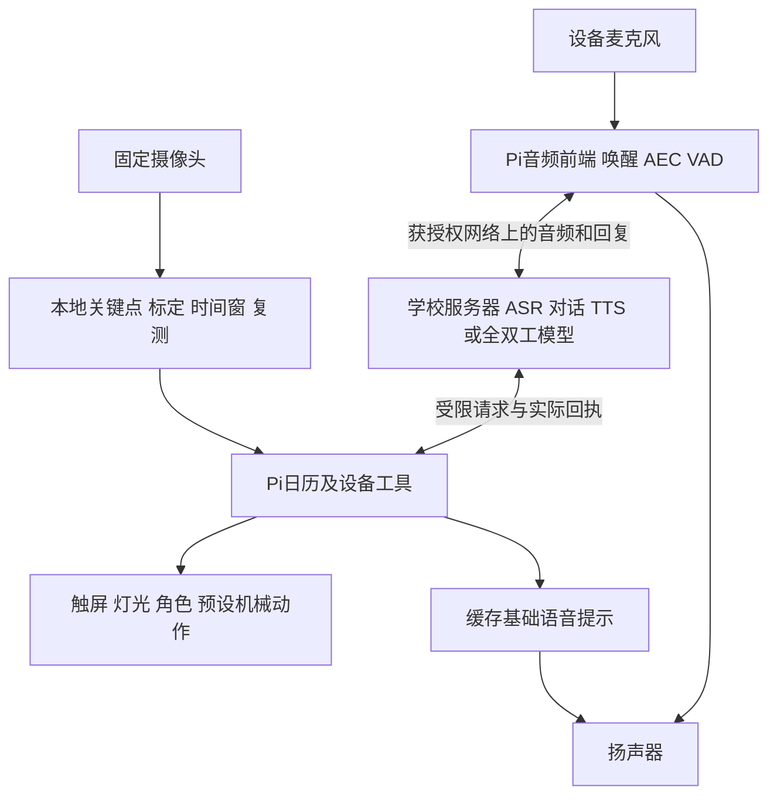

# Group 2：学校服务器与本地语音 AI 选型

核对日期：2026-09-28；范围路由更新2026-09-29。状态：**服务器／V100基线保留，当前自然体验排序见新的跨提供商复核；未实测**。

用户转述老师可提供服务器部署，先要求按未知配置分析，随后补充“好像是NVIDIA DGX-1（搭载Tesla V100）”。型号、每卡16／32GB、实际配额与权限仍待核。**9月29日用户进一步要求不按本地／API筛选、广泛比较自然交谈和工具并加入第三方证据，当前推荐以[新复核](../2026-09-29-voice-ai/naturalness-and-tools-review.md)为准。**第1至8节保留部署研究，第9节标为当时的Qwen聚焦建议；本页旧下一步及提供商顺序不再作为当前安排。免按键、日历工具、持续坐姿反馈／复测与三端要求不变，没有最终型号决定。

## 1 判断与首测建议

不必购买第三方语音API才能实现目标。可以在学校服务器部署公开权重，Pi只承担现场音频、界面、姿态和设备控制。本地部署仍通常通过**本组自己的API**连接设备；接口不是收费服务的同义词，兼容OpenAI格式也不意味着请求发给OpenAI。

以下是获得服务器型号时的本地基线，现保留作对照／备用；当前体验验证顺序见[9月29日跨提供商复核](../2026-09-29-voice-ai/naturalness-and-tools-review.md)，不要求同时长期运行多套：

- **功能主线：Qwen3-ASR＋Qwen文字模型＋Qwen3-TTS。**分别完成转写、对话／工具请求和播报，便于检查日期、对象、确认与执行结果。未知／较新GPU时原建议Qwen3.5-9B；疑似V100后先以Qwen3-8B量化建立兼容性基线，再比较3.5-9B。显存较少时用4B文字模型和0.6B语音组件。
- **自然对话对照：MiniCPM-o 4.5。**更直接对应中英双向语音与边听边说；需另验证设备工具适配，不能从能聊天推导可靠改日历。

上述排序是工程建议，不是本组已测的音质或速度排名。学校服务器不是已批准最终部署目标；取得配置后再决定型号、量化与运行时。原Proposal Word／PDF原样保留，本轮不声称改稿或部署完成。

## 2 对照的模型与真正作用

| 模型／组件 | 官方可核实的能力 | 对本项目的判断 |
|---|---|---|
| [Qwen3-ASR 0.6B／1.7B](https://github.com/QwenLM/Qwen3-ASR) | 提供本地权重、离线及流式识别；普通话、英语、粤语等 | 用作耳朵；输出文字，不承担回答和说话。先测0.6B，错误分析后比较1.7B。 |
| [Qwen3.5-4B](https://huggingface.co/Qwen/Qwen3.5-4B)／[9B](https://huggingface.co/Qwen/Qwen3.5-9B) | 视觉语言权重、文字对话、工具调用与关闭思考的配置 | 用作分段链的对话和工具决策，不替代姿态测量；V100路线按第8节，当前体验优先级见新复核。 |
| [Qwen3-TTS 0.6B／1.7B](https://github.com/QwenLM/Qwen3-TTS) | 中英文等语音生成；CustomVoice有预置声音，1.7B支持风格指令 | 用作嘴巴；先选有明确来源的预置声，不必训练／克隆声音。TTS不是完整助理。 |
| [MiniCPM-o 4.5](https://huggingface.co/openbmb/MiniCPM-o-4_5) | 9B端到端多模态模型，中英实时语音、全双工模式与本地演示 | AVA式交谈的重点候选；工具可靠性仍需接本组程序验证，现有模型卡未提供可直接采用的日历工具契约。 |
| [Step-Audio 2 mini](https://github.com/stepfun-ai/Step-Audio2) | [开放8B权重](https://huggingface.co/stepfun-ai/Step-Audio-2-mini)，语音输入输出；官方vLLM示例带工具解析器 | 语音加工具的备选；8B不代表整套只用8GB，codec和运行时也占资源。未复现其打断或本组参数正确率。 |
| [Qwen3-Omni-30B-A3B-Instruct](https://github.com/QwenLM/Qwen3-Omni) | 可下载的音视频输入／语音输出模型 | 资源充足时比较；A3B是激活参数量，不是只需装载3B权重。不能与商业Qwen3.8 Omni Realtime视作同一可下载模型。 |
| [Fun-CosyVoice3-0.5B](https://github.com/QwenAudio/CosyVoice) | 中英等TTS、文本输入与音频输出流式处理 | 如果Qwen TTS在目标机器的延迟／声音不合适，作为可替换播报组件；不是额外必做模型。 |

更新检查也发现[Qwen3.8-27B](https://huggingface.co/Qwen/Qwen3.8-27B)已经提供开放权重。它是更大的视觉语言／工具模型，不会单独解决完整听说。日历与提示场景先用较小模型完成同任务测试，只有错误率确有收益且时延可接受时才升级；不能把更晚发布当作本项目最合适的证明。

Qwen3-ASR、Qwen3-TTS、上述Qwen模型和MiniCPM-o官方模型页／仓库列Apache-2.0；部署时固定确切权重与依赖版本并保存许可证。预置或自备声音、角色素材也分别保留来源。这里核对的是发布条目，不是整个训练数据已经完整开放的断言。

## 3 免按键、流式与全双工需要分开

免按键可由本地唤醒词开启会话；用户说完后自动回答，无须按录音键。[sherpa-onnx中文／英文关键词模型](https://k2-fsa.github.io/sherpa/onnx/kws/pretrained_models/index.html)可作为候选，[Silero VAD](https://github.com/snakers4/silero-vad)用于语音活动检测；VAD不判断用户是否在叫设备，也不直接识别语义上的一句话是否结束。

三段式也能做流式输出和打断：音频前端持续区分人声和扬声器回声，检测到用户发言后停止当前播放、取消旧推理和待播队列，再处理新指令。不能只停止扬声器却让旧任务继续执行。麦克风位置、AEC回声消除、端点判断、网络抖动与机械噪声都影响体验。

全双工模型允许说话期间继续处理输入，更适合自然插话；它仍需正确音频链和会话管理。MiniCPM官方同时列了读音错误与中英混用等[已知限制](https://github.com/OpenBMB/MiniCPM-V#limitations)，不能承诺复制商业语音体验。

**运行时版本差异：**Qwen TTS仓库一处旧vLLM说明仍写仅离线；当前[vLLM-Omni TTS指南](https://docs.vllm.ai/projects/vllm-omni/en/stable/user_guide/examples/online_serving/text_to_speech/)已列Qwen3-TTS在线PCM／WebSocket流式输出。需按确切运行时、checkpoint验证，不把普通generate返回完整WAV冒充实时输出。句段级文本推送与逐token输入又是不同能力，首版先用短句合成并记录首音时间。

当前vLLM-Omni的[Realtime接口](https://docs.vllm.ai/projects/vllm-omni/en/latest/serving/realtime_api/)明确区分分轮流式和[Full-Duplex接口](https://docs.vllm.ai/projects/vllm-omni/en/latest/serving/full_duplex_api/)。页面虽列特定Qwen3-Omni duplex配置，但[详细协议](https://docs.vllm.ai/projects/vllm-omni/en/latest/serving/realtime_duplex_api/)与[官方工程跟踪](https://github.com/vllm-project/vllm-omni/issues/7055)区分原生双工和turn-based模型的服务端适配；后者可以实现取消／打断，不能升级为Qwen3-Omni权重本身原生全双工的证明。也不能把该接口当作V100兼容保证。未运行任何示例。

## 4 按可分配GPU显存选择

以下是**尚未知道GPU代际时，一台演示设备、一个活跃语音会话、短上下文**的容量比较，不是厂家统一最低配置或已测吞吐。已知可能是V100后，应优先按第8节的运行时兼容性与分卡建议执行，不能直接沿用此表作为V100部署保证。4-bit量化主要压缩模型权重，运行缓存、音频编码器、声码器与多个服务的预分配仍需另算。服务器RAM不等于GPU显存；同为24GB的旧卡和新卡也不等速。

| 可分配资源 | 先试的路线 | 结论与条件 |
|---|---|---|
| 无GPU，只有CPU及32GB以上RAM | 轻量ASR、2B／4B量化文字模型、轻量播报或缓存提示 | 能做功能试验，不先承诺流畅自然交谈；可用商业API承担较重环节。 |
| 单卡8–12GB | 4B量化＋0.6B识别＋小TTS，缩短历史并限制并发 | 容量较紧；运行时可能需顺序调度或部分放CPU。MiniCPM量化是另一个需单独实测的候选，不承诺全套共驻。 |
| 单卡16GB | 9B量化＋0.6B ASR＋0.6B TTS，必要时用4B | 对模块化首版有研究价值；要测三个组件同时驻留、显存峰值和首音延迟。 |
| 单卡24GB | 9B量化＋ASR 0.6B／1.7B＋TTS 0.6B／1.7B逐项比较 | **本项目优先争取的配置等级**；保留显存余量，按实际速度选语音组件。不是24GB保证所有默认服务配置能共存。 |
| 单卡32–48GB | 上述组合，另试MiniCPM-o 4.5官方PyTorch路线 | 自然语音的较宽裕试验条件；不要把两套模型都常驻当首版必需。 |
| 单卡80GB或合适多卡 | 再评估Qwen3-Omni完整方案或更大文字模型 | 有条件可测，不因资源大自动优先；视频长度、精度与并发显著影响显存。 |

MiniCPM的[官方PyTorch演示](https://github.com/OpenBMB/MiniCPM-o-Demo)建议超过28GB显存，同时报告初始化后worker约21.5GB；这是不同口径，不能由21.5GB推导24GB全流程保证。其[模型卡](https://huggingface.co/openbmb/MiniCPM-o-4_5)另给llama.cpp-omni量化路线12GB Nvidia GPU起点。量化与原精度路线要分别测，官方适用Mac条件也不能自动覆盖现有M2／16GB。

Qwen3-Omni官方表的约78.85GB对应**Transformers、BF16、FlashAttention2、15秒视频及Instruct含Talker**。不是纯语音通用门槛，更不是所有量化／部署方式都必须80GB；降低精度和改变运行时可另测试。两张24GB不自动变成一张48GB，需支持的模型拆分，或把ASR／TTS和文字模型分配到不同GPU。

建议为模块化原型申请：可持续使用的一张24GB级Nvidia GPU、约64GB系统RAM、100GB可用存储及可运行后台服务的Linux环境。RAM／存储为本组预留，非官方最低配置；同一设备不需多人高并发。Docker方便但不是唯一方式，受管理的Python环境也可。不得直接照抄各模型独占大部分显存的默认示例同时启动。

## 5 在本组设备里的位置



姿态检测仍用预训练关键点及本组时序逻辑，不持续把视频送大模型判断坐姿。语音可获得“当前持续偏离、持续时长、提醒原因、复测状态”这类最小结构化资料，用来解释已有判断。角色使用本地动画状态，播放音频驱动嘴部开合；细腻唇形另做，不需要每句话生成一段视频。

例如“把明天下午的讨论改到三点”：ASR给转写 → 模型查询匹配事项 → 日期／时区／对象含糊时澄清 → 显示并播报拟议更改 → 用户确认 → Pi校验版本后写入 → 三端同步 → 按真实回执播报。模型下载后并不会天然认识我们的日历或机械臂；工具接口和一致性由团队实现。

工具保留get_schedule、propose_event_change、snooze_reminder、set_display_scene与验证过的arm_pose等；不能开放任意shell或舵机角度。重连、取消和超时不能重放过期机械动作；“模型说完成”不是动作成功证据。

## 6 网络、费用与自训

学校服务器自托管不等于Pi单机离线：设备在校内或获授权VPN／网关能连到服务器时，可以不调用第三方AI；家中无法访问学校内网时，重模型语音不可用。服务器／网络中断时，Pi继续触控日历、姿态判断、灯光及缓存基础播报，不承诺自由聊天仍正常。用户尚未确认外网远程控制为首版必做，不因服务器出现而自动扩张此范围。

学校资源若免费且可常驻，可降低直接调用费，但电力、维护、网络、管理员支持和毕业后的使用期限仍是实际条件。部署在学校的录音／文本也由该服务器处理，不能说数据全部留在Pi。

自托管成本口径＝资源／电力＋存储网络＋维护时间；商业语音＝实际输入输出和上下文用量×费率＋服务／工具费用。应比较每个正确完成任务的成本，不能凭不收token费断言总体最便宜。本轮不重新计算历史API价表或预设已获免费全天算力。

**先部署预训练模型做推理，不从零训练。**日历能力来自工具和上下文，不需把个人日程训练进权重；用户偏好放可编辑资料。只有固定测试揭示特定口音／日期／工具错误，并积累足够许可数据后才考虑小范围微调。现有M2／16GB适合开发与较小模型功能试验，不预先保证大型全双工实时时延。

## 7 取得配置后怎样决定

向老师取得：GPU型号／数量／可分配显存及是否共享；CPU／RAM／存储；系统与CUDA／驱动；可用Python／容器权限；是否只能排队训练还是可常驻实时服务；校内与校外访问方式、可用期限。Nvidia服务器可请管理员提供不含账户密码的nvidia-smi摘要，无需在聊天发送密钥。

先做一个麦克风会话，沿用Proposal的40条普通话／英语命令与10条含糊／禁止请求，并增加改口和播报中打断场景。固定相同工具、日期数据和设备音频：分别测转写日期／对象正确率、工具参数、用户确认、真实执行、首个有效音频p50／p95、打断后的停止时间、音频连续性及GPU峰值。用本组录音／现场输入，不借厂商benchmark声称达标。

功能主线可先提出首音p50≤2秒、p95≤4秒、打断后停止p95≤0.5秒作为讨论目标，**计时从用户说完开始，包含端点等待／网络／推理／播放**；这不覆盖或更改Proposal中姿态条件满足后的本地2秒目标。若必须等显卡排队或持续运行受限，商业API可作为可配置替代。没有资源与实测前，不保证时延或宣布某模型已经满足整机要求。

本节原下一步是取得V100配额后做本地预检；随后改为第9节Qwen短时对照，再于9月29日被跨提供商复核取代。当前下一步以新复核及handoff为准。服务器信息仍是自托管路线的前置，不是云端试听的前置。没有下载安装权重、开通服务、联系学校、采购或改写学校交付状态。

## 8 DGX-1／Tesla V100补充：兼容性优先的具体路线

### 8.1 设备型号能说明什么

NVIDIA的[DGX-1官方规格](https://docs.nvidia.com/dgx/archives/dgx1-user-guide/introduction-to-dgx1.html)列8张SXM2 GPU，V100分别有每卡16GB与32GB版本，系统RAM列512GB。8×16＝128GB或8×32＝256GB是整机显存总和；不能当作一张同容量卡，也不能假设学校全部分配给Group 2。该规格本次经官方搜索索引读取，正文直达返回Internal Error，未假称实机配置已经核实。

V100属于Volta、计算能力7.0，[NVIDIA型号表](https://developer.nvidia.com/cuda/gpus/legacy)明确对应。它适合继续做限定模型推理和适当训练，但不能仅凭DGX名称或TFLOPS判断现代语音软件兼容。当前一台设备、单会话的功能链值得自托管验证，不必因为架构较旧就直接采购API或新显卡。

### 8.2 上一轮建议必须补上的限制

| 项目 | 当前官方证据 | V100的处理建议 |
|---|---|---|
| 数值精度 | [NVIDIA架构表](https://docs.nvidia.com/cuda/archive/11.0/ampere-tuning-guide/)显示Volta Tensor Core为FP16，Ampere才新增BF16 | 优先检查FP16或受支持的量化，不照抄BF16默认值；软件可存BF16不等于硬件原生加速，转换后仍须测数值／语音正确性。 |
| CUDA工具链 | [CUDA13说明](https://docs.nvidia.com/cuda/archive/13.0.0/cuda-toolkit-release-notes/index.html)移除Volta离线编译和相关库支持，12.x仍可构建 | 用兼容驱动的CUDA12.x环境。已有按旧工具链构建的程序不因此自动失效，不擅自升级学校宿主驱动。 |
| PyTorch发行包 | [PyTorch2.12官方说明](https://pytorch.org/blog/pytorch-2-12-release-blog/)保留CUDA12.6 wheel供Volta使用 | 这是可复核的环境起点，不是已验证完整依赖锁；包需包含sm_70，不能只看系统nvidia-smi上的CUDA字样。 |
| FlashAttention-2 | [官方README](https://github.com/Dao-AILab/flash-attention)的标准CUDA支持面向Ampere／Ada／Hopper等，未包含V100 | Transformers优先测试受支持的SDPA后端或普通eager实现；这些不是承诺同样速度。llama.cpp自有attention实现是另一回事，不能混为一个库。 |
| vLLM最新版 | [当前官方安装页](https://docs.vllm.ai/en/latest/getting_started/installation/gpu/)要求计算能力≥7.5 | V100为7.0，不能直接采用最新版默认镜像。历史支持版本不等于支持新ASR／TTS模型；不把降级vLLM当作万能修复。 |

建议文字模型从支持Volta的llama.cpp构建或兼容的Transformers环境起步。[llama.cpp CUDA源码](https://github.com/ggml-org/llama.cpp/blob/master/ggml/src/ggml-cuda/fattn.cu)仍有Volta路径，[构建文档](https://github.com/ggml-org/llama.cpp/blob/master/docs/build.md)说明CUDA构建；具体发布二进制、模型与内核仍须验证。不得把某个社区镜像能启动解释为学校环境已通过。

### 8.3 V100本地基线组件（原首测建议；现作为对照或备用）

- **文字／工具：先Qwen3-8B量化。**[官方模型卡](https://huggingface.co/Qwen/Qwen3-8B)支持工具、关闭思考及llama.cpp等本地路线。先测短上下文、单并发、约4K至8K上下文配置，排除不必要长思考；3.5-9B在相同命令集作为后续比较，不把3-8B说成绝对能力更强。
- **ASR：先Qwen3-ASR-0.6B。**优先兼容PyTorch／Transformers后端，按FP16或必要的FP32检查；上一轮基于新vLLM的流式部署不能原样承诺。先验证单句正确性，再测真正增量识别／端点延迟。
- **TTS：先Qwen3-TTS-12Hz-0.6B-CustomVoice。**[官方Demo代码](https://github.com/QwenLM/Qwen3-TTS/blob/main/qwen_tts/cli/demo.py)提供FP16／FP32等选择，但选项存在不是V100性能证明。禁用不兼容FA2，测读音／NaN／首音与生成速度。先用短句分段返回的基础链；同样不能把生成完WAV再分包叫低延迟模型流式。若运行时适配或速度未过关，再比较已列CosyVoice备选。
- **MiniCPM-o 4.5为第二阶段候选。**单卡32GB只缓解容量，不消除BF16、attention、codec及双工服务依赖。必须验证FP16／量化路线完整可用、持续交互不卡顿；不能直接用其一般Nvidia显存门槛宣布V100合格。

Qwen3.5含Gated DeltaNet等路径，[Transformers官方实现](https://github.com/huggingface/transformers/blob/main/src/transformers/models/qwen3_5/modeling_qwen3_5.py)存在PyTorch回退。这说明不能断言它绝对不能用V100；回退性能和不同版本的依赖要实测。选择3-8B作首个基线的理由是先减少运行时变量，用户没有要求放弃3.5或只采用旧模型。

### 8.4 按实际配额部署

| 学校实际分配 | 优先试验布局 | 不能直接保证的事 |
|---|---|---|
| 1×V100 16GB | 一个量化4B／8B文字模型＋0.6B ASR／TTS，短上下文和单会话；必要时调整调度 | 全部常驻及端到端速度需测；8B FP16权重已接近16GB，不能挤入所有组件。 |
| 2×V100 16GB | GPU A放量化Qwen3-8B；GPU B放ASR与TTS，进程内分别限制资源 | **较合适的首个资源申请**；是按组件分卡，不是把两张卡伪装成32GB单卡。 |
| 1×V100 32GB | 可试8B FP16或量化＋小ASR／TTS，优先保证并发余量 | 单卡容量更宽裕，但所有旧架构兼容问题仍在。 |
| 2张以上32GB或整台DGX-1 | 按模型组件／对照实验分卡，必要时再验证大模型跨卡 | 无需默认占用全部8卡；更多卡不能线性消除端点、网络和音频延迟。 |

以上布局均未实测。NVLink支持卡间通信，不自动替软件合并权重和缓存。服务器与Pi的位置关系仍与第5／6节一致；学校服务不可达时保留本地姿态、触屏日历、缓存提示及物理停止控制。

### 8.5 最小只读信息与首测顺序

老师或管理员可提供以下只读结果，不需发送密码：

```sh
nvidia-smi --query-gpu=index,name,memory.total,memory.free,driver_version --format=csv
```

该结果说明当前可见GPU和瞬时空闲量，**不证明本组拥有相同配额或可长期独占**；配额、常驻服务／排队规则及校内外访问另由老师确认。进一步在已授权环境检查torch版本、CUDA构建、sm_70是否编入和一个基础运算，再分别做文本、识别、合成、完整语音链。nvidia-smi的CUDA版本是驱动支持能力，不一定是当前Python包使用的工具链。

不先改学校宿主系统或下载所有候选。先用受管理环境／容器完成兼容性小样，再测同一40条中英命令、10条歧义／禁止请求、打断和连续运行。单卡可加载、离线音频文件正确、流式、全双工、真实设备控制分别验收。本轮没有运行该命令、登录服务器或完成部署；用户提供型号仍保留“好像”的不确定性。

## 9 HISTORICAL：9月28日Qwen自然语音聚焦比较

### 9.1 本次需求与推荐的改变

用户希望更自然的语音体验，未说必须完全离线，也未批准调用收费服务。此前分段链偏重V100兼容、可审查和功能验证；它能优化得流畅，但不能仅凭声音好听就证明接话、插话和改口自然。当前建议以实际交谈作为首个选择依据：**重点试听Qwen-Audio-3.1-Realtime-Plus，与Qwen3.8-Omni-Flash-Realtime对照**；本地分段链作为基线，开放语音模型作为自托管比较。推荐不是已定供应商、已购买或已试听结果。

### 9.2 三类Qwen不能混用

| 路线 | 已核公开方式 | 对自然体验的定位 |
|---|---|---|
| Qwen-Audio-3.1-Realtime-Plus | [官方型号](https://help.aliyun.com/en/model-studio/qwen-audio-3-1-realtime-plus)为阿里云实时双向语音服务；支持声音、文字及工具 | 纯语音重点候选；本项目姿态由本地模块判断，不要求语音模型直接看视频。 |
| Qwen3.8-Omni-Flash-Realtime | [官方型号](https://www.alibabacloud.com/help/en/model-studio/qwen3-8-omni-flash-realtime)提供云端音视频实时输入、语音输出、函数与MCP | 保留作功能、体验与实际费用对照；不宣称音质低于或高于3.1，需同条件听。 |
| Qwen3-Omni开放权重，或Qwen ASR＋文字＋TTS | [公开仓库](https://github.com/QwenLM/Qwen3-Omni)与前述分段组件可自行部署 | 能研究本地听说，但权重、调度、算子和轮次处理不同；不能保证V100复现上述商业实时款。 |

本次读取Qwen官方Hugging Face组织的omni／audio检索元数据，分别返回7项／4项；未找到与上述3.1 Realtime Plus或3.8 Omni Realtime同名的可下载权重。网页列表直达失败后用公开元数据API核对，记录见[qwen-public-model-list.json](../../output/qa/qwen-natural-voice-2026-09-28/qwen-public-model-list.json)。这只是已核公开分发范围，不排除未来发布或私人服务安排，不因API示例开源就宣称模型权重开源。

### 9.3 能配置什么，仍需测试什么

[Qwen-Audio官方指南](https://help.aliyun.com/en/model-studio/qwen-audio-realtime-user-guides)提供流式输入输出、双向连接、smart_turn和工具调用；[客户端参数](https://help.aliyun.com/en/model-studio/fun-audiochat-client-events)列可设声音、instructions和enable_speech_emotion。smart_turn结合声学与语义判断轮次，设计目标包括避免把“嗯／呃”误当新一轮打断。它不等于现实噪声下每次都成功；不能只把固定静默门槛设短来声称更自然。

语气设置属于声音表达，不是情绪诊断。配置短回答、适度停顿和明确称呼可以改善角色一致性，但人格提示词不能解决全部延迟或错误。真人式语音还依赖麦克风、AEC、播放缓存清理和网络；打断时除停止声音，还要取消未执行请求，已经提交的日历操作则查询实际状态，不假装自动撤销。

Qwen3.8的官方语音表也提供[多个中英声音](https://www.alibabacloud.com/help/en/model-studio/omni-voice-list)与预览入口。此次没有播放／试听这些音频，因此不按厂商形容词宣布哪个声音最好。两款Realtime的字段与默认值分别适配，不能把Audio的smart_turn和Omni的semantic_vad混成同一个参数。

[3.1技术报告摘要](https://arxiv.org/abs/2609.25176)覆盖工具、对话规则、全双工与背景说话评价；本文只读摘要／元数据，没有声称全文复现。其半双工任务成功率与全双工背景响应指标是不同实验，均不移植为本组准确率或对用户满意度的保证。

### 9.4 为我们的设备设计的短时对照

以下是待测目标行为，不是已发生的对话：

| 用例 | 用户行为 | 合格观察 |
|---|---|---|
| N01 自然问答 | 问今天剩下什么安排 | 回答简短、日期正确，语句和停顿可听懂。 |
| N02 句中犹豫 | “明天下午……嗯，四点提醒我” | 等待完整意图，避免把中途停顿当最终日期。 |
| N03 随口应答 | 助理说话时用户说“嗯” | 不因正常附和无谓中止整句。 |
| N04 明确插话 | 助理说话时用户说“等一下，只说上午” | 停止旧播放，按新范围回答，不继续旧队列。 |
| N05 改口并写入 | “三点……改四点”，然后确认 | 复述最终日期时间，只执行确认后的变更一次。 |
| N06 中英混合 | 中文句子包含Project meeting等标题 | 正确识别对象，不因切语言遗失原任务。 |
| N07 旁人／设备噪声 | 键盘声、旁人讲话、设备扬声器回声 | 记录误触发与错打断；不把其当用户确认。 |
| N08 失败与取消 | 中途断网、说取消、工具执行失败 | 明确反馈真实状态，不重复操作，不声称成功。 |

建议先用同一麦克风、两至三种预置音色、相同问题和人物设定做约10至20分钟体验对照，记录首个有用音频、抢话／停顿、打断停止、音色偏好、中英读音、工具正确性和实际用量。此为用例测试，不新增学校问卷／市场访谈要求，也不把用户喜欢声音当作日历正确率。

如允许使用商业服务，可由Qwen实时端负责对话，Pi继续本地姿态、日历和受限动作；学校服务器可用于本地模型对照或按需后台任务，**无需强行把每次语音转发经过DGX才能体现其价值**。如之后要求全部本地，则以实际V100兼容及对话测试选择Qwen3-Omni／MiniCPM-o等，不能先保证与商业服务相同。

3.1 Plus与3.8 Omni的价目／计量需分别核算，不能将旧3.8新增音频最低算例套给3.1；当前没有实际账单或预算批准。保持本地唤醒后会话方式，无须为免按键而全天向云端传音。接入前核对账户、可用区域与费用条件；本次未创建账户或调用API。

9月28日当时的下一步（已被9月29日新复核取代）：在具备授权的语音测试条件后，按上述脚本比较Qwen实时两款的自然度和工具正确性。保留这一安排用于理解历史；没有把自然度、延迟、开源模型部署或收费接入写成已验证成果。
