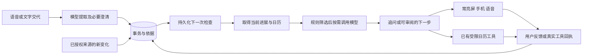

# Group 2｜参考 Your dot 的主动事务跟进

日期：2026-10-03。状态：**HISTORICAL_FEASIBILITY_BASELINE — 首版已在后续同日实施**。

30 日恢复入口：[三家个人 Agent 研究与当前实现对照](../personal-agent-research-index.md)。原研究日期和原始证据保留。

**当前路由：**用户随后明确要求先增强软件再审查UI／UX，现已完成[主动事务首版](../../desk-companion/docs/task-tracking.md)及[交互审查](../../output/qa/task-enhancement-ux-2026-10-03/verification.md)。以下“尚未开发／建议”描述本次研究开始时的状态；结构化事务、持久调度、三端入口和可选文字适配现已落地，外部来源监控和付费模型实测仍未完成。

用户询问新推出的 Dot 能否自动跟踪事务，并明确所指是 Codex／ChatGPT 中的 Your dot。本轮核对官方资料和当前 Desk Companion 代码，提出扩展方案；没有开启任何实际跟踪、读取个人邮件、修改应用行为或更换学校 Proposal。持续坐姿检测、反馈与复测仍为必做。

## 官方 Dot 的相关能力

[OpenAI 官方概览](https://learn.chatgpt.com/docs/dots)描述了聊天之间继续推进工作、根据变化安排下一步、主动带回结果或需要用户决定的问题；云端执行可以在个人电脑关闭后继续，本地文件／应用工作则要求连接的电脑在线。

[Tasks and memory](https://learn.chatgpt.com/docs/dots/tasks-and-memory)进一步区分：指定责任、固定周期计划、受支持服务的事件监控、对话上下文、持久笔记和主动研究。Dot可以决定暂停和再次检查的时间，不必为每次跟进指定固定周期；连接一个应用本身不会自动建立监控。记忆不是所有对话的完整永久转录；主动研究只读，后续动作仍有各自权限。

[2026年9月28日至10月2日更新](https://learn.chatgpt.com/docs/whats-new/september-28-october-2-2026#delegate-ongoing-work-to-your-dot)说明近期推出的持续责任功能。以上是官方产品说明，本组没有独立测试 Dot 的跟进成功率或内部实现。下文是本组设计，不是对其私有架构的逆向结论。

本次资料没有建立可把用户现有 Dot 直接嵌入 Pi／本组 App 的公开接口契约。因此建议实现同类的事务跟进机制，不把现成 Dot 接口作为交付依赖，也不宣称任何同类产品能力都可直接复制。

## 对本项目的价值与范围

希望解决的具体问题：一件事跨越几天、涉及多个准备步骤或等待他人时，用户需要反复记住做到哪里、还有什么缺失、何时追问和何时安排工作。一般到点提醒并不自动维护这些进展。该问题目前是产品假设，没有新增用户调查或真实改善数据。

可把助理扩展成“交代一次，后续可以补充或纠正；设备保留同一件事的进展，在合适时间提出下一步”。这比只播报今天日程更贴近用户所说的跟踪。是否优于手机待办或现成智能助理，仍应通过相同任务比较；不能以实体角色、机械臂或功能数量宣称领先。

### 一个完整例子（设计示例，不是当前功能演示）

用户说：“周五要交报告，现在还在等组员的数据，你帮我盯一下。”

1. 助理确定具体日期／截止时间，建立一条事务，记录“等待数据”和已确认的剩余步骤。模型建议的步骤与用户明确要求分开，不编造组员已承诺的时间。
2. 用户补充“组员说明天中午前给”。保存来源为用户转述，安排中午之后的一次检查；不必整晚调用模型。
3. 检查时若没有新依据，询问“数据收到了吗”；不能因没有看到邮件就说对方没有发送。
4. 用户说“收到了，图还没做”。更新原事务而非创建第二条；结合已保存的日历，提出一个可审阅的工作时段。没有记录的时段只是日历上未占用，不保证现实中有空。
5. 用户确认后进入既有日历写入流程。任务状态、准备时间和最终截止时间分别保留；安排了一个时段不等于完成了报告。
6. 用户说“已经提交”，可以标记“用户确认完成”。如果以后接入提交系统，只有其实际回执才能标记“系统核实提交”。保存文件、生成PDF或到达截止时间均不能自动证明提交。

## 自动化程度与难度

| 能力 | 数据来源与条件 | 本期建议 |
|---|---|---|
| 从语音／文字捕捉明确交代的事务 | 本次输入，缺项澄清，可查看的记录 | 第一阶段；明确指令可按既定权限保存，闲聊推断仅列候选 |
| 跨会话记住进度、阻塞原因和下一次跟进 | 本组结构化数据库，用户可纠正／删除 | 第一阶段；不需训练私人数据进模型 |
| 根据进展和截止时间主动追问／建议安排 | 后台调度、日历、提醒偏好 | 第一阶段；有终止、暂停、冷却和频次上限 |
| 发现指定日历／文件来源的变化 | 明确选定的数据源、可读权限、变化游标及时间戳 | 第二阶段；先一个来源，不泛化成读取整台电脑 |
| 从邮件识别回复、等待事项和截止日期变化 | 额外邮件授权、范围、增量获取与语义核对 | 后续；现有 Google Calendar 权限不包含 Gmail |
| 自动跨任意网站／软件完成复杂事务 | 每个平台的执行接口、授权与实际结果核查 | 不作为首版承诺；范围和维护明显大于当前功能 |

## 研究时的实现基线（HISTORICAL）

代码核对日期为2026-10-03，当前为单拥有者工作空间。

- [Store](../../desk-companion/backend/desk/store.py)已经保存日程、例外、操作去重、提醒及记录；还没有通用事务、依赖和后续检查的数据表。
- [助理工具](../../desk-companion/backend/desk/assistant.py)已经有日历／姿态／设备查询、创建及修改草稿和确认边界；没有跨会话通用任务记忆工具。
- [服务入口](../../desk-companion/backend/desk/app.py)和[Runtime](../../desk-companion/backend/desk/runtime.py)已有日历／姿态的周期检查；现有周期检查不是通用长时事务代理。
- [语音适配](../../desk-companion/backend/desk/voice.py)有 Qwen Audio／Gemini Live 工具通道，但默认不持久保存录音或转写。新记忆需单独保存获准的事务事实，不静默改成保存全部聊天。
- [Google连接](../../desk-companion/backend/desk/google_calendar.py)当前为只读日历与预览应用，不能把它称为邮件监控、实时推送或双向日历同步。
- 独立常亮屏、手机／电脑控制、隐私投影、配对和记录可延伸使用。iPhone当前是缓存本地通知，新增后台事务进展若要在离家锁屏时主动送达，还需远程连接和推送交付。

## 建议的新增软件结构

**事务数据。**建议增加 Task、TaskEvidence、FollowUpJob、Proposal／Decision 关系。至少记录标题、状态、截止日期／时区、明确或建议的步骤、等待对象／原因、关联日程、依据来源与观察时间、下一次检查时间、版本、暂停／关闭状态。状态可为待处理、进行中、等待、完成、取消；不是每次聊天仅把整份历史重新发给模型。个人偏好单列，可查看、修改和删除。

**持续运行。**事务／检查时点落盘；服务关闭后恢复时合并已过期检查，避免一次播放多条。输入变更会废止旧版本的检查。执行和通知分别去重；失联、来源陈旧、超时与重试均保留状态。第一版在现有 FastAPI／SQLite 单机结构上增加有界工作队列即可，无需立即引入多代理集群。模型提出的下一次检查时间要经最短间隔、最晚时间及频次限制校验。

**模型分工。**语音负责自然听说；事务模块负责可靠保存和调度，按需调用具有工具或结构化输出能力的文字模型理解进展与提出建议。可以复用同一供应商，也可以独立更换后台模型。现成模型先测试，无需从零训练。语音音色自然与后台任务规划可靠是两项不同指标。

**设备和服务器。**Pi可作为事务数据库、规则、调度和显示主机的候选，大模型推理用获准的云服务或学校服务器；仍需整机负载验证。学校DGX-1／V100的实际配额与长期在线权限未确认。若需要桌面设备关机后仍继续跟进，调度和必要持久状态应放在可常驻的服务器；不能把仅在Pi运行写成关机仍可工作。

**成本控制。**新输入、来源变化或保存的检查时点才触发处理；无变化时规则筛选，使用有限的相关资料。后台跟进不要求一直保持收费语音会话，也不需要逐帧把摄像头发给模型。实际费用另计文字推理、来源获取、推送、语音和维护，当前不报价或保证账单。

## 首版交互与可验证边界

手机／电脑用“待跟进事务”列表管理状态、依据和暂停；触摸屏保持当前大时钟／日历构图，只显示少量当前需要行动的内容。角色在有提示时表达状态，不不断播报无变化信息。传感器的可靠在桌状态可帮助选择普通提示时机，不证明用户正在忙、已经完成任务或处于何种情绪。重要截止提醒不得无限等人回来。

第一阶段建议只做三条完整流程：**交代并保留一件事；用后续话语更新同一件事；在有意义的变化或检查时点主动跟进并提出日历草稿。**增加来源自动观察时先做一个获授权日历或指定资料入口。不会因“自动跟踪”默认读取全部邮件、聊天记录或屏幕。

保存事务事实的许可与对外行动的许可分开。当前日历修改仍经过既有确认流程；向别人发消息、提交文件或采购不从“跟踪一下”自动获得授权。来源正文作为资料处理，不能把文档中的指令升级为用户授权。模型没有完成依据时保留待确认；完成和自动推断分别记录。

拟议测试使用相同脚本比较固定提醒、纯规则事务跟进、模型辅助跟进。检查日期提取、指代／更新去重、等待与完成的依据、临时改期、取消后停止、冷却／安静时段、重启恢复、来源断连和旧提醒失效。记录错误完成次数、遗漏／重复提示、所需人工操作及调用成本。合成脚本结果只能证明软件行为，不能证明现实工作效率或健康改善；不新增市场问卷要求。

## 研究阶段交付状态（HISTORICAL，已由上方实施路由接续）

结论是限定范围内可实现，现有软件可复用较多基础。主动事务层尚未开发，接口与上述字段属于工程建议，用户没有批准最终提供商、全平台自动执行或新的硬件。正式学校提案和既有源代码保留。本轮只完成研究、当前能力核对和方案记录；不把上一轮软件完成状态扩大到这项新需求。
