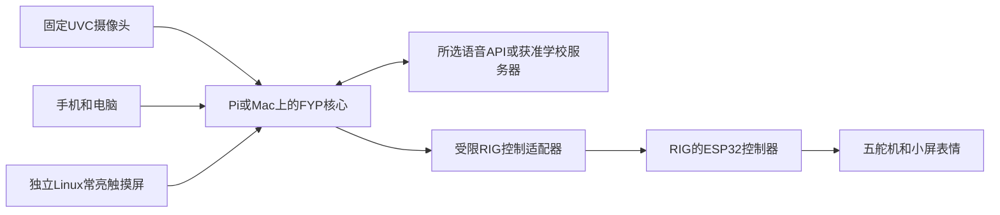

# Group 2｜RIG-Arm 二次开发与 Desk Companion 对接评估

日期：2026-10-05。状态：**RESEARCH_COMPLETE / HARDWARE_CANDIDATE_NOT_SELECTED**。

用户转述 Marco 推荐 RIG-Arm，询问能否买现成设备、更换小智所用 AI，以及二次开发能做到什么程度。本轮核对 MakerWorld、官方商城／Wiki、两个公开固件仓库的固定提交和现有 FYP 输出代码。结论是可以复用整机并做较深入的软件修改，建议让本组主机负责 AI／日历／姿态，RIG 控制器负责机械动作。型号尚未由用户锁定，没有购买、供应商联系、编译／刷机、收费调用或实物测试；正式 Proposal／日志及应用源码保持。

## 1. 买到的是什么

[MakerWorld 作者页](https://makerworld.com/zh/models/2913469-rig-arm-desktop-embodied-ai-arm-llm-multimodal?appSharePlatform=copy#profileId-3258768)将它描述为五自由度桌面 AI 伙伴，提供机械打印文件和电子套件入口。官网有两种 SKU，本次在 Chrome 切换并核对了整机价格：

| 官方选项 | 2026-10-05 页面标价 | 含义／本组取舍 |
|---|---:|---|
| Electronics Kit | US$109 | 页面明确不含 3D 打印外壳，需要打印和装配；不能理解为整机到手 |
| Hand-built Full Unit | US$124 | 页面描述为预装配整机；若希望节省机械制造时间，这是更合适的候选 |

[官方商品页](https://shop.xgorobot.com/products/rig-arm-programmable-robotic-arm-steam-education-rig-series-universal-research-secondary-development-platform?variant=49162969514235)仍显示预售，另有国庆约十天发货延迟提示。标价不包含本次未核实的香港运费、税或实际优惠；不保证某日到货。商品通用正文同时描述套件与整机，要让实际订单明确包含已装外壳、控制板、五个舵机、屏幕、相机、音频部件、供电及连接所需部件。

“开箱可玩”指厂商原有演示和联网流程，不等于已经兼容本组软件。它更适合点头、转向、招呼等桌面表达。当前图片显示末端为交互头，未核实标配夹爪及额定负载。作者在 9 月 20 日评论中回复手机对它太重，因此不把手机支架、搬运或工业抓取写进 FYP 能力。

## 2. 小智不是不可更换的 AI 模型

这里的小智是设备端语音交互框架：处理收音、唤醒、网络、播放、屏幕和工具连接。实际对话模型可以在厂商云、第三方 API 或自己的服务器上。MakerWorld 对小智和 ESP-IDF 的鸣谢，不构成必须使用某一种模型的技术限制。商城本身也写了 Qwen 集成；没有证据证明“原机只能接小智专属大模型”。

[官方 MCP 指南](https://wiki.xgorobot.com/kb/the-rig-series-robot/rig_en_mcp)公开两条不同方向：

1. **外部 AI 控制 RIG：**从自己账号的设备控制区取得生成的客户端配置，由兼容客户端发现并调用机械臂工具。现有工具接入可不修改固件，但要核实购买批次／地区账号是否实际提供这个入口。
2. **RIG 助理调用外部工具：**从智能体区取得另一份 WebSocket access point，连接本组日历／查询桥接程序。此方式可以保留原机语音，但对话体验、厂商服务和权限流程仍受该平台影响。

这两条配置不能混用；USB 串口主要用于刷写／日志，插上 USB 并不会自动获得 Python 动作 SDK 或 USB 麦克风。官方教程也明确区分这几种连接。

本组可以先接只读日历工具、再接既有待确认草稿；不能让厂商助理通过新增接口绕过 FYP 的确认、版本和输出限制。

## 3. 源码支持多深的修改

本轮固定的公开源码快照：

- [rig_omni — c2b42cd](https://github.com/LuwuDynamics/rig_omni/tree/c2b42cd73ef65f5cd2a158d6949f0273869454dc)：包含 Arm 板型、驱动、运动与 IK、语音通信和表情资源。仓库简介仍提 Puppy／Hover，正文及代码实际包含 Arm／TARS，不应只看简介排除。
- [rig_local — 486500a](https://github.com/LuwuDynamics/rig_local/tree/486500a9ad9c93719680cd3d8273d2689d001cbf)：保留 Arm，增加设备直连模型／ASR／TTS和局域网 HTTP MCP。名字中的 local 不意味着大模型在 ESP32 上运行。

| 想修改的内容 | 实际依据 | 工作量与边界 |
|---|---|---|
| 角色语气、语言、文字模型 | 智能体设置；rig_local 的 base URL／model／key／system prompt | 较小；需匹配服务商参数，不需要训练新模型 |
| 日历、事务进展、姿态结果等工具 | MCP 工具注册和官方外部工具流程 | 中等；本组已有业务可复用，新增受限桥接和真实结果读回 |
| 点头、摇头、转向等预设 | Arm 的工具、动作与 IK 源码 | 现成预设可先复用；新预设需确认包络、速度、结束和停止 |
| 表情、短文本、开机提示 | EAF／LVGL资源、display API、板型音频资源 | 可替换，需打包／刷写；不是直接装 Linux／React 应用 |
| 示教／路径／姿态算法 | 教学模式、motor／robot／ik／action 或 local 的 xgo 文件 | 可修改 C++；复杂度上升，受五个关节、负载和结构限制 |
| 整条 Qwen／Gemini 实时语音 | 协议层、音频服务、既有 FYP 适配器 | 中到较大；音频格式、会话、回声、打断和工具回传都要适配，不能只填 API key |
| 自托管对话 | 可配置的文字接口或自建语音服务／网关 | 可行路径；模型跑 Pi 之外的服务器，DGX-1/V100 兼容与配额仍按既有研究验证 |
| 电路／外壳 | Wiki 原理图、MakerWorld 机械文件 | 可研究；公开参考图不等于可任意重新制造／分发完整硬件，且需匹配板型 |

### 可调用工具是真实注册代码

[rig_omni Arm 的 InitializeTools](https://github.com/LuwuDynamics/rig_omni/blob/c2b42cd73ef65f5cd2a158d6949f0273869454dc/main/boards/arm/arm_board.cc#L435)注册了示教开始／停止／回放／取消／状态、空闲微动开关、若干表情动作，以及点头、摇头、XYZ相对移动和 yaw／pitch／roll 相对调整。点头实际工具名拼作 `self.arm.node`，不是自行猜测的 nod。部分工具每次增量有范围，内部还有累计限幅；这些是软件限值，不是实测定位精度或能同时独立控制六个自由度的证明。

[rig_local HTTP MCP](https://github.com/LuwuDynamics/rig_local/blob/486500a9ad9c93719680cd3d8273d2689d001cbf/main/mcp_http_server.cc#L94)实现端口 80 的 POST `/mcp`，处理 JSON-RPC initialize、tools/list、tools/call；构建清单纳入此文件，application 实际调用 Start。因而局域网控制有具体源码基础，不只是宣传中的 MCP 字样。此接口仍须目标 Arm 构建／刷写／连接验证；不能认定出厂整机已经安装这个固件。所读入口未见认证／TLS处理，若采用，应加入本组控制边界并留在受控局域网。

local 另有 LAN 专用的朗读和短文本显示工具。朗读仍走其已配置 TTS，不自动使用本组实时语音；这些接口也不提供任意 PCM 音频播放或 Linux 大屏界面。

### 两个分支不能混用操作说明

| 本轮读到的行为 | rig_omni 固定提交 | rig_local 固定提交 |
|---|---|---|
| 默认空闲微动 | 关闭 | 开启 |
| 结束示教 | 保存并回到站立，不自动播放；另有显式播放工具 | 回到站立后自动回放 |
| 示教采样实现 | 100ms／上限15秒 | xgo实现20ms采样，不能套用另一分支参数 |
| 教学记录持久性 | 当前运行会话数据 | 本轮未核实重启后保留，不能当永久动作库 |
| 对外控制 | 网络协议与官方生成的 MCP 连接 | 另有本机 HTTP MCP |

这些行为可能随后续提交变化，开发需固定 commit、构建配置和实际固件，不拿 main 网页与到货版本混作同一事实。

## 4. 换文字模型与换自然语音的区别

rig_local 已实现：麦克风 → DashScope ASR → OpenAI 兼容文字 LLM → DashScope TTS → 扬声器；文字响应可以按句送流式 TTS，并有取消与工具循环。这里的 TTS duplex 指文字／音频流式合成模式，不证明其具备用户要求的原生自然双向语音体验。

[LLM 客户端](https://github.com/LuwuDynamics/rig_local/blob/486500a9ad9c93719680cd3d8273d2689d001cbf/main/cloud_api/llm_client.cc#L52)发送 Chat Completions、tools、流式响应并携带 tool_call_id；[协议实现](https://github.com/LuwuDynamics/rig_local/blob/486500a9ad9c93719680cd3d8273d2689d001cbf/main/cloud_api/cloud_api_protocol.cc#L762)将实际工具结果放回对话，最多五轮。不是只读说明就认定有工具调用。

可以以 Qwen、DeepSeek 或自己服务器的兼容文字端点为候选，但“兼容”仍需测试。源码对 DeepSeek 加 thinking 参数，对其余接口统一加 enable_thinking=false；严格校验参数的其他服务未必接受。ASR／TTS目前的直连实现也不是通用的任意提供商开关。

若选本组既有 Qwen Audio／Gemini Live：

1. 最简单的对接阶段，主机使用独立麦克风／扬声器运行本组语音，RIG 只执行动作与小屏反馈，避免两个助理同时抢麦或执行。
2. 要把 RIG 头部音频也用起来，可修改其网络语音端点和固件，或在主机做网关。rig_omni 的 WebSocket握手声明 16kHz 单声道 Opus；本组接口使用 16kHz PCM输入／24kHz输出，网关需转换编码、采样率、会话及取消状态，MCP动作通道不能代替它。
3. 原机保留的唤醒／VAD／音频能力可以作为基础，但远场、机械噪声、回声与打断必须在真实硬件上听测。没有据此比较出自然度、时延或成本赢家。

无需为“换 AI”从零训练大模型。训练与微调若有必要应来自具体失败数据；角色提示、工具连接和业务记忆先由软件实现。

## 5. 与目前 FYP 的硬件分工

公开硬件为 ESP32-S3 控制器、五个 SCS009 总线舵机、1.09英寸圆屏；README给 Arm 为 240×240 SPI显示。MakerWorld相机为 GC0308、0.3MP，官方代码将相机作为快照工具。参考：[rig_omni硬件与板型](https://github.com/LuwuDynamics/rig_omni/blob/c2b42cd73ef65f5cd2a158d6949f0273869454dc/README.md)。

这是工程建议，不是新增已实现驱动。RIG能替代原来“自行搭建小臂”的机械／控制候选：其控制器已有舵机总线，不需要为它再加 UNO或PCA9685。Pi／Mac仍处理本组数据库、UI、姿态和AI接入；大模型不在ESP32上运行。

- **固定相机必须保留：**随臂移动的相机会改变机位及个人标定，且低分辨率快照通路未证明可满足持续姿态判断。机器人IK描述的是它自己关节，不是人的坐姿。固定UVC输入 → 时间条件 → 反馈 → 固定相机复测仍为主线。
- **常亮日历大屏必须分开：**240×240小屏适合表情、图标和短通知，未核实触控，不适合当前独立月历／编辑UI。不能将React kiosk直接装到ESP32小屏。
- **AVA形象仍是另一显示选择：**RIG的移动表情头不等于全息角色。用户尚未决定用它替代角色显示，现有反射／带罩风扇研究和独立角色页不自动删除或升级为新增必买屏。

## 6. 动作层还缺什么才能接本组软件

当前 FYP 的 [输出工作进程](../../desk-companion/backend/desk/agents/outputs.py)只支持 simulator 和 PCA9685，未实现 RIG。PCA9685为PWM方案，不能直接接管SCS009总线舵机；不能用“已有机械驱动”表示已经兼容该整机。

建议新增 RIG 适配器，把本组的少量命名预设映射成工具调用。保持输出默认停机、命令有效期、一次领取、软件停止、重启不重放和真实回执，且保留回放不能驱动实物。直接暴露厂商全部动作、相对XYZ累计调整或自动示教回放，会超出本组已定义的行为。

需要补做的实质工作：

1. 固定固件和允许的预设；禁止重复网络请求重复触发或累加位置，过期命令丢弃。
2. 定义动作ID／运行状态、完成或失败回执。现有一些工具只是写动作标志后立即返回 true；这表示接受，不保证电机到位。
3. 统一动作取消／停机和控制器失联行为。teach_stop仅结束示教，关闭idle_motion仅关闭微动，均不能当通用急停。
4. 核对内部舵机反馈的导出。本轮 rig_omni motor代码解析位置／速度／负载反馈，local xgo也有反馈；但其 get_device_status公开Arm扩展主要是IMU，未提供本组可直接使用的关节到位回执。源码读到反馈不等于已实测定位精度。
5. 实测启动、断电／断网、动作中停止、复位、限位和桌面碰撞包络；断扭矩也不保证手臂安全保持，物理断电与软件取消分别检查。

没有在本轮检查的Arm工具注册中找到满足本组要求的统一停止＋失联看门狗契约；这是集成缺口，不是声称全库任何位置都没有相关代码。所有动作先在清空工作区的台架校准，未测试前输出保持未commissioned。

## 7. 代码、原理图与机械模型许可分开

rig_omni 的[README许可声明](https://github.com/LuwuDynamics/rig_omni/blob/c2b42cd73ef65f5cd2a158d6949f0273869454dc/README_CN.md#L304)明确写 Apache License 2.0；本轮未找到项目根LICENSE文件，不能因此说它完全未许可。rig_local公开README没有同样整体声明，仅找到第三方组件许可证，不能把另一仓库的声明自动套用。若正式复制local代码，应取得明确的整体许可依据；本组也可基于已声明的omni实现原创所需控制接口。

官方Wiki已发布[RIG驱动板原理图入口](https://wiki.xgorobot.com/kb/common-resources-en/e83d2b6f9491257670d2b05d2)，区分Puppy与Hover／Arm，后者提供2026-09-22 PDF。开发指南也展示控制板、相机、显示和音频参考图。因此8月评论中“原理图待发布”不是当前结论。本轮核对的是入口及发布元数据，未验证该PDF各引脚与到货板一致，亦未建立完整可复制造板BOM／PCB工程许可。

MakerWorld机械模型使用 **SDFL-C**，限制模型和衍生数字／实体版本的再分发，不能因宣传说开源而当成Apache机械文件。此阶段在FYP仓库保存本组研究、来源链接和原创对接规范，不纳入STL／3MF或上游仓库。未来改壳、分享文件或商业制造按对应许可／作者授权处理。

## 8. 建议的实施顺序与采购前核对

**阶段1：保留原机做连通基线。**选明确的已装配SKU，记录板型、固件、原装供电与恢复路径；如账号提供官方MCP，先读真实工具清单／状态，再测试一个小动作。原机演示单独记录，不算本组功能交付。

**阶段2：接本组输出层。**用外部AI／固定相机／大屏，新增受限RIG适配器；可先以官方MCP作连通对照，再评估主机到控制器的本地接口。local提供技术参考；若其许可未明，以omni为基线实现本组接口。补齐取消、命令期限、回执和失联停机后，再开启经过台架确认的预设。暂不重写IK或增加夹爪。

**阶段3：复用整机收音／播放。**决定自然语音服务后，再做Opus／PCM网关或固件适配，同条件验证唤醒、犹豫、附和、插话、工具中打断、网络失败和电机噪声。这与学校服务器部署另分验证，不凭接通说自然度已达标。

可向厂家核对的内容（本轮仅列清单，未发送）：

- 整机实际包含哪些部件、主控／屏／相机版本、五舵机型号；有无附夹爪，额定负载是多少。
- 当前出厂固件版本，对应公开commit／板型；是否允许USB自编译刷写、是否有加密／Secure Boot限制及校准保留方式。
- 海外／香港账号是否提供设备控制MCP、确切传输和认证方式；能否无需其云端使用本地控制接口。
- 原装供电参数、接口、是否含电池／充电器；常驻外接电源时动作供电和长期运行条件。没有据旧Senplate电源方案直接给RIG接线。
- 动作完成、取消、关节反馈、断网停止能通过什么接口获得；停止时保持还是卸力。
- 精确SKU的恢复包、对应接线图／BOM、许可及本批发货时间。

本组演示应连接到具体业务：持续偏离产生一次姿态提示和小幅机械示意，随后依据固定摄像头复测；日历／事务确认真实保存后才表达完成。模型的话语、动一下手臂和设备的成功回执各有不同含义，不能用原机聊天或动作数量代替日历／姿态验证。

## 9. 本轮验证与来源

[来源登记](source-register.json)记录主网页、仓库commit、具体文件及证据层次；[研究QA](../../output/qa/2026-10-05-rig-arm-feasibility/verification.md)保存全文读取、网页可见转录、商品截图和保留检查。

实际完成的是原始源码阅读／静态追踪和公开网页核对。未执行第三方源码，未安装ESP-IDF／固件依赖、未启动模型或付费会话、未连接实体臂。官方装配视频链接已定位，本轮没有观看完整视频或用其替代实物验证。所有工作量分档和对接架构属于工程判断。
