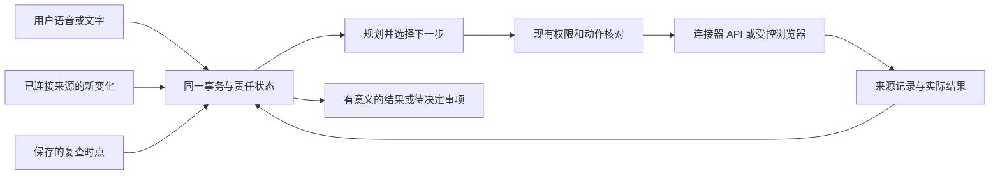

# Group 2｜个人 Agent 研究总入口与实现对照

7 November live update: Pi/VPS/OpenAI now has31actual generation receipts. Controlled shopping/flight decisions, explicit browser continuation, calendar-tool followup and cancellation passed; real JD stopped at verification and Cathay failed to load. FYP drafted a harmless email, then Codex Gmail sent it and read it back; FYP has no native sender. Account takeover/payment/ticket work remains open. [Actual evidence](../output/qa/2026-11-07-live-agent-eval/verification.md).

**工程更新2026-11-06：**用户选择先做通用浏览器，不固定商家。新增OpenAI原生computer调用、实际浏览器操作／截图、同一任务的显式状态接续和停止恢复；购物／订票复杂条件通过脚本规划＋真实浏览器验收，真实账户／支付／出票尚未接入。[本轮研究](2026-11-06-general-browser-and-openai.md)、[实现契约](../desk-companion/docs/computer-use.md)、[实际QA](../output/qa/2026-11-06-openai-agent-merge/verification.md)。普通文字／复核语音的Work改口保留；其报告文件核验不等于目标语义完成，PR93已修正误导文案和来源指令混淆。

总入口更新：2026-11-06。对象固定为 **Grok Bot、Meta Muse、OpenAI ChatGPT 的 Your dot**。下方历史研究保留各自日期，最新官方资料与实现差距见上方本轮研究。New Computer 的旧 Dot 只保留为历史背景。

用户要求的体验是：交代一次，助理能跟踪邮件和事务、提出建议，并通过真实应用推进购物／旅行等工作。研究和文档不能代替这些实际结果。本轮恢复资料并纠正路由，没有开启个人邮箱监控、购买或付费模型调用。

## 1. 之前的资料在哪里，为什么当前回答没有接上

资料存在；问题出在分支隔离、索引遗漏和交接只突出最近技术切片。上一轮回答没有恢复已有研究，不能归因于用户没讲清目标。

| 日期／研究 | 恢复位置 | 此次核对结果 |
|---|---|---|
| 11月6日：通用浏览器与OpenAI默认 | [研究更新](2026-11-06-general-browser-and-openai.md) | 原生computer协议、浏览器接续、实际页面证据与未完成交易／账号边界 |
| 10 月 3 日：Your dot 持续跟进 | [主动事务研究](2026-10-03-dot/proactive-task-tracking.md) | 已明确是 OpenAI Your dot，研究了责任、事件／时间触发、笔记与后台建议；原件一直在当前仓库 |
| 10 月 6 日：个人 Agent 与电脑操作 | [整体方案](../planning/2026-10-06/personal-agent-discussion-and-next-steps.md) | 已要求真实应用操作，不能用陪聊／提醒替代；已有声音、持久核心、执行器和结果核验的职责划分 |
| 10 月 12 日：三家机制及差距 | 下方六份恢复报告 | 留在未合并 [PR #5](https://github.com/tantalum666/FYP/pull/5)，当前分支原来没有这六个文件 |
| 10 月 14–15 日：产品拆解与托管模型架构 | [产品拆解](../docs/tooling-and-review/companion-product-teardown.md)、[架构讨论](../docs/tooling-and-review/companion-architecture.md) | 已有云电脑、连接器、记忆、调度与审批结论；把另一款 Dot 放进主体比较，且旧分支链接没有完整列出 Grok |
| 10 月 29 日：权限与交互 | [权限体验方案](../planning/2026-10-29/assistant-permission-ux.md) | 参考了 Muse／Dot，但当轮明确没有核验 Grok 的具体控制；这不能被当作完整三家复核 |
| 10 月 30 日：真实应用执行 | [执行 QA](../output/qa/2026-10-30-application-execution/verification.md) | Chromium／Calc／Writer 的受控脚本、版本与恢复已实跑；没有完成自主邮件／购物 Agent |

从 PR #5 的固定提交 `11dc2b84cebe6e8250b28ca4442fc91f0dfec676` 恢复了 **6 份、原始 1,304 行／205,227 字节**的项目研究。每份都有历史标记；指向旧代码的链接固定到原提交。10月30日该轮只恢复文档；10月31日已按当前核心完成[兼容代码整合](../desk-companion/docs/pr5-integration.md)并合并PR5，见[实际回执](../output/qa/2026-10-31-pr5-repair/publication.json)。原始 Git blob、SHA-256 和恢复变换见[清单](../output/qa/2026-10-30-agent-research-recovery/historical-inventory.json)。

- Muse：[机制与公开接口](2026-10-12-personal-agents/muse.md)／[能力差距](2026-10-12-personal-agents/muse-capability-gap.md)
- Dot：[机制与可复用原语](2026-10-12-personal-agents/dot.md)／[能力差距](2026-10-12-personal-agents/dot-capability-gap.md)
- Grok Bot：[机制与公开接口](2026-10-12-personal-agents/grok.md)／[能力差距](2026-10-12-personal-agents/grok-capability-gap.md)

这些旧差距报告已经警告过“测试很多、能写笔记、具备记忆”不能替代完整跨应用工作。后续实现获得了真实进展，但主交付门槛没有持续指向用户的完整生活事务，这是需要修正的衔接问题。

## 2. 三家究竟怎样实现用户看到的体验

下面区分 **官方公开机制／产品行为** 与 **FYP 工程建议**。本轮没有登录竞品做行为实验，没有测量其成功率，也没有取得其私有源代码或内部提示词。

### Grok Bot：持久电脑、工具连接与可复用流程

官方说明：同一账号的 Bots 共用一台持久云电脑及文件／浏览器会话，各有操作画面；现成连接器处理结构化业务，缺少接口时使用浏览器。工作可在客户端关闭后继续。它保留上下文，把经过验证的流程保存为 skill，再由 routine 在时间或事件到来时启动。[概览](https://docs.x.ai/grok-bot/overview)、[电脑与应用](https://docs.x.ai/grok-bot/computer-and-apps)、[Skills 与 routines](https://docs.x.ai/grok-bot/skills-routines-and-automations)

**邮件并非只有一种接法。** Gmail／Outlook 是用户自己的邮箱连接；Bot 自有地址是另一项功能。自有邮箱收到邮件后，要有对应 routine 才启动工作；后台来信产生的外发邮件默认停在草稿，需要 Send。不能把“已连接邮箱”说成“已经自动监控并发送”。[邮箱与触发行为](https://docs.x.ai/grok-bot/computer-and-apps#give-your-bots-an-email-address)

**付款路径也不同。** 官方 Vault 文档区分已保存银行卡的自动填入与 Link 单次支付：后者展示商家／商品／总价并要求批准。购买动作的 Auto Review、银行卡填入及银行验证是不同环节，不能从“可自动填卡”推出任意购买都无须判断。[Vault 付款](https://docs.x.ai/grok-bot/vault#pay-for-things)、[审批规则](https://docs.x.ai/grok-bot/approvals-security-and-privacy)

其云运行与模型选择是成品服务的一部分；当前文档不保证固定模型供应商组合。接入 xAI 推理 API，不会自动获得 Grok Bot 的账户、电脑、routine 和 Vault。[公开架构](https://docs.x.ai/grok-bot/security)

### Meta Muse：常驻 Agent、浏览器与独立动作授权

Meta 公开了每用户 Linux VM、受限 Agent 运行区、区外凭据／连接器服务和独立 Sentinel。浏览器由单独的 broker 管理，Agent 获取受控页面观察并操作；用户接管时暂停 Agent。关键是模型、真实软件、账户使用和授权系统共同工作。[公开实现说明](https://research.meta.ai/blog/security-and-safety-for-ai-agents-our-approach-with-muse)

其目标／事件／时间触发用于持续推进任务，完成后台检查后再判断是否值得通知。设计文章直接举了学校邮件、家庭日历、购物车和预约的例子，并提供 Goals、活动记录和可编辑记忆。[设计说明](https://introducing.muse.ai/)

**购物可以走到成交，不能等同于只提供链接。** Meta 的发布说明包括旅行预订及浏览器交易；其安全文章写明已存卡网站也逐笔核对购买，Link 采用绑定商家、金额和有效期的一次性卡号。[发布说明](https://about.fb.com/news/2026/09/introducing-muse-personal-ai-agent/)、[购买机制](https://research.meta.ai/blog/security-and-safety-for-ai-agents-our-approach-with-muse#purchases)

这些是厂商公开描述，尚不是我们复现的能力；FYP 不能因为能调用一个 Meta 模型，就宣称继承 Muse 的钱包和云基础设施。

### OpenAI Your dot：长期责任、选时唤醒与后台委派

Dot 把持续责任、固定日程及受支持事件分开管理，能暂停后再唤醒，也能把工作交给后台任务。语音通话结束不必结束已交代的工作；云任务可在用户设备离线时继续，本地电脑任务则仍需要该电脑在线。[产品说明](https://learn.chatgpt.com/docs/dots)

它结合当前上下文、相关 ChatGPT memory 和自己的持久笔记。主动研究读取可访问资料并形成发现；后续对外行动另受权限约束。连接工具和建立监控任务是两个动作。[任务与记忆](https://learn.chatgpt.com/docs/dots/tasks-and-memory)

操作审查使用用户指令、既有授权和规则，分别决定继续、询问或交给本人。产品体验是“持续负责并在必要时回来”，不能简化成每隔几分钟调用一次聊天模型。[控制说明](https://learn.chatgpt.com/docs/dots/controls)

## 3. 此次发现的旧结论与回答偏差

| 旧说法／遗漏 | 30 日核对后的处理 |
|---|---|
| 旧拆解把 New Computer Dot 作为可能主对象 | 当前对象固定为用户在 10 月 3 日已明确的 OpenAI Your dot；旧产品只作历史附录 |
| Grok 审批大约 10 分钟到期 | 当前官方说明：由聊天请求发起的卡片不按计时器到期；后台／routine 卡片为 30 分钟，另有关闭条件。旧数字保留历史，不用于当前设计 |
| Muse 发布页曾获取失败，只能依赖部分二手材料 | 本轮已成功打开 Meta 发布原文；不能继续把此前 HTTP 403 当作当前不可读 |
| 三家付款能力被笼统描述 | 分清 Muse 逐笔批准、Grok Vault 卡片使用与 Link 单次批准；Dot 依据具体工具／授权，未核实的商家路径不填入结论 |
| 只建议 Linux 装 Codex，就像已经解决个人 Agent 主体 | Codex 是可选执行框架。此前 Dot 研究还包含 managed Agents API／Agents SDK／Responses 等路径；连接器、责任状态、触发、通知和交易结果仍要由产品接好 |
| 旧研究未合并，因此当前像“从未研究” | 已恢复六份文本、固定来源提交并加入根入口／产品／交接；代码分支是否合并与研究是否可用分别管理 |

Grok 审批变更见[当前原文](https://docs.x.ai/grok-bot/approvals-security-and-privacy#if-you-dont-answer)。API 候选本轮只重新确认了 [Agents API 总览](https://developers.openai.com/api/docs/guides/agents-api/overview)：它提供托管 Codex harness 和会话／编排／恢复，但不是可直接嵌入的 Dot 成品。账号可用性、具体 SDK 版本、费用和与 FYP 的协议兼容尚未测试；Linux CLI／SDK 的前轮建议仍是候选，不能替代工程对照。

## 4. 对 FYP 源码的当前对照

以下是当前分支代码事实，不是把旧 PR #5 的能力移算到现有实现。

| 用户可感受到的能力 | 已有基础／证据 | 当前缺口 |
|---|---|---|
| 交代一个目标后独立做多步工作 | `TaskService`、既有作业队列、应用阶段与依赖／结果；复杂文档任务由脚本实跑；2026-11-06 起普通文字、未见来源版式、已复核语音快照和语音复核页都可以把改口送进已有 Work，并在同一条对话显示一份已核验报告文件 | 真实模型受控浏览器多步任务已实测；跨子任务全自主编排与复杂办公Work仍未验收。短 HTTP 循环仍在一项效果后停止。后一轮提问还不能再次读出这一条已核验结果 |
| 自动跟踪真实邮件并提出建议 | 事务、进展、规则检查、有限后台建议、记忆、通知入口；2026-11-03 离线样本已有游标、同一线程到同一事务、带来源的草稿和有意义通知 | 没有 Gmail／Outlook 真实账号、实邮箱增量同步或发信验收。离线样本不能代替真实验收 |
| 已有关联邮件变化后继续原任务 | 任务版本、去重、权限和旧结果恢复；离线后续回复／改期更新同一事务 | 已有明确选定事务字段的变化跟踪、合并提醒与来源产物；仍缺真实邮件持久收件 |
| 一句话买常用纸巾 | 语音工具通道、任务状态、单次／持续软件权限、应用结果核验；离线购物夹具可把同一商品或订单记到同一事务和暂停的 Work，建议只作为待批准草稿 | 新通用浏览器可操作公开网站和保存状态；购物条件已由真实OpenAI在明确标注的演练页实跑；真实京东遇验证即停，没有真实商家账号、库存承诺、地址授权、支付或订单查询。见[离线购物契约](../desk-companion/docs/shopping-fixtures.md) |
| 订机票 | 本地日历／任务与通用浏览器；演练页已实测日期、人数、行李、费用和跨日到达 | 没有航班搜索／票价规则／旅客资料授权、报价再核、预订／支付／出票状态和变更跟踪 |
| 用户离开后持续工作并收到通知 | 服务运行时可持续检查；通知 UI／配置存在 | 可靠的常驻运行、邮箱事件入口及真实离线手机推送尚未交付；关闭页面、电脑休眠和云主机在线须分别说明 |

源码依据：[Google 当前只读日历范围](../desk-companion/backend/desk/google_calendar.py)、[任务检查](../desk-companion/backend/desk/tasks.py)、[后台文字建议](../desk-companion/backend/desk/text_ai.py)、[Agent loop](../desk-companion/backend/desk/agent_loop.py)、[权限种类](../desk-companion/backend/desk/permissions.py)、[应用操作模型](../desk-companion/backend/desk/application_models.py)、[当前执行契约](../desk-companion/docs/application-execution.md)。`NoticeInbox` 是应用通知，不是邮箱接入。

**2026-11-03 工程补充：**离线日程夹具把本地事件映射进现有事务、日历记录、建议草稿和通知。安静时段的通知先保留，再由现有规则 tick 经 Notifier 发出。可移植 JSON 备份包含日程游标，恢复后再次同步仍是同一事务。这不是第三条旅行验收，也没有连接 Google／Outlook 或任何真实日历账号。邮箱、购物和日程现共同纳入11月4日审查整合；它们仍然只是离线样本。[离线日程契约](../desk-companion/docs/offline-calendar-journey.md)。

## 5. 从目标体验推导下一批实现，而不是再做一次功能清单

本节是 **FYP 工程建议**。用户已明确想要邮件跟踪、生活事务代办和语音入口；下面的先后顺序、字段与验收方法由工程方案提出，不构成采购／发信／扣款授权。

### 第一条真实验收：邮件到事务再到建议

选择一个用户授权的真实邮箱及明确范围。首次同步、增量游标和每次处理结果持久保存；重复事件不重复建事务。把同一线程的截止日期、待回复对象、等待事项与已有事务关联。只有重要变化、临近期限或需要选择时通知；用户说“处理好了”后读取新依据并关闭对应跟进。

通过标准：新邮件／后续回复／改期正确更新同一事务；无变化不反复提醒；断线补偿不遗漏、重启不重复；撤销邮箱连接立即停止读取；建议可追溯到邮件及观察时间。**最终必须有真实邮箱与实际通知证据，离线样本只用于开发，不能替代验收。** 发信从单独可审阅草稿和具体授权开始，不把收到邮件当成发件人对 Agent 的指令。

复用 `TaskService`、`PermissionService`、现有通知和状态版本；为来源接入增加明确职责，不另开完整平行任务系统。把“模型做完一个动作之后如何继续”放进这条旅程一并验证，Codex／Agents API／自有 loop 是可替换的实现候选。

### 第二条真实验收：语音购买常用纸巾

先保存经过用户确认的商品偏好、数量、可用商家、含运费预算、允许替代条件及地址使用范围。语音请求建立一件采购事务，读取当次商品与库存、核算总额、准备订单，在该渠道要求的授权点取得决定，再查询订单结果。需要本人验证时保留已完成步骤，结束验证后继续。

通过标准：没有换错规格／数量，没有漏算运费；价格或商家变化重新核对；不因一次语音重复识别创建两单；失去下单回执时先查询订单；只有实际订单回执才报告下单成功，支付失败不写成购买完成。支付凭据交给符合要求的支付服务／安全表单，不把完整卡号或密码放进模型上下文。支持的最终自动化范围由具体商家、支付接口和用户授权决定。

2026-11-03 的离线夹具只覆盖重复、乱序、断线、撤销、重启、同一事务续接、无意义变化不通知，以及草稿必须由拥有者批准。可移植备份可以恢复购物游标，恢复后再次同步不会另开事务。它不读取真实商店，也不结账。

### 第三条真实验收：旅行准备到明确的预订状态

接入可用航班／预订渠道，结合用户确认的日期、机场、行李、乘机人资料及预算进行比较。所选航班在提交前重新核验价格和退改限制；待支付、已付款、已预订、已出票分别记录。确认邮件和后续航变进入同一个旅行事务，连接回邮件跟踪能力。

通过标准：日期／机场／时区正确，行李和总价完整，真实预订编号与出票依据可读回；失败、超时或改价不重复付款，不把一次搜索结果当已保留票价。这一阶段当前没有真实外部接口或付款实测。

## 6. 以后从这里恢复，不再丢失研究线

- 根 `START_HERE_NEXT_CHAT.md`、`product.md` 和 `handoff.md` 必须指向本页。下一步同时写出用户旅程与对应代码缺口，不能只剩一个底层模块名。
- 当前事实优先于历史供应商建议、接口价格和旧测试数字；本页再链接带日期的原始研究。旧 PR 只取有用的文档／设计证据，不以恢复研究为名混入另一套运行核心。
- 验收按“真实来源 → 计划 → 实际操作 → 独立结果 → 后续跟进”记录；本地测试数量、生成一份文件或模型一句“完成”都不能代替整条旅程。
- 资料恢复、公开原文核验、实际竞品操作和 FYP 实现测试分别记录。10月30日轮只完成前两类及源码差距审查；11月6日新增实现与浏览器验收在本页顶部单独链接。

本轮[阅读／来源／验证记录](../output/qa/2026-10-30-agent-research-recovery/verification.md)。软件执行里程碑及研究现已通过 [PR #70](https://github.com/tantalum666/FYP/pull/70) 合入 main。旧 PR5 的[原始阻塞](../output/qa/2026-10-30-all-pr-review/verification.md)已在31日通过兼容整合修复，现以[当前契约与证据](../desk-companion/docs/pr5-integration.md)恢复；本页没有把邮件、购物、订票或最终 AI 选型写成完成。
